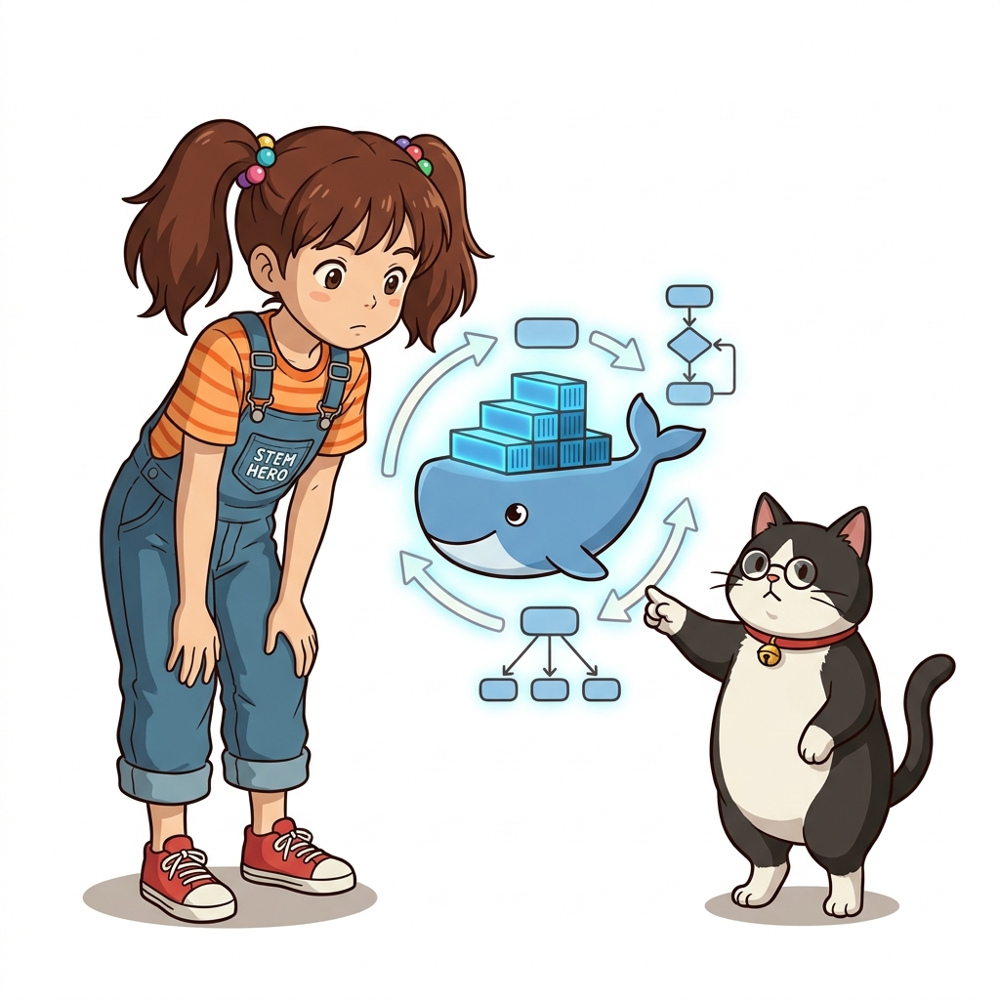
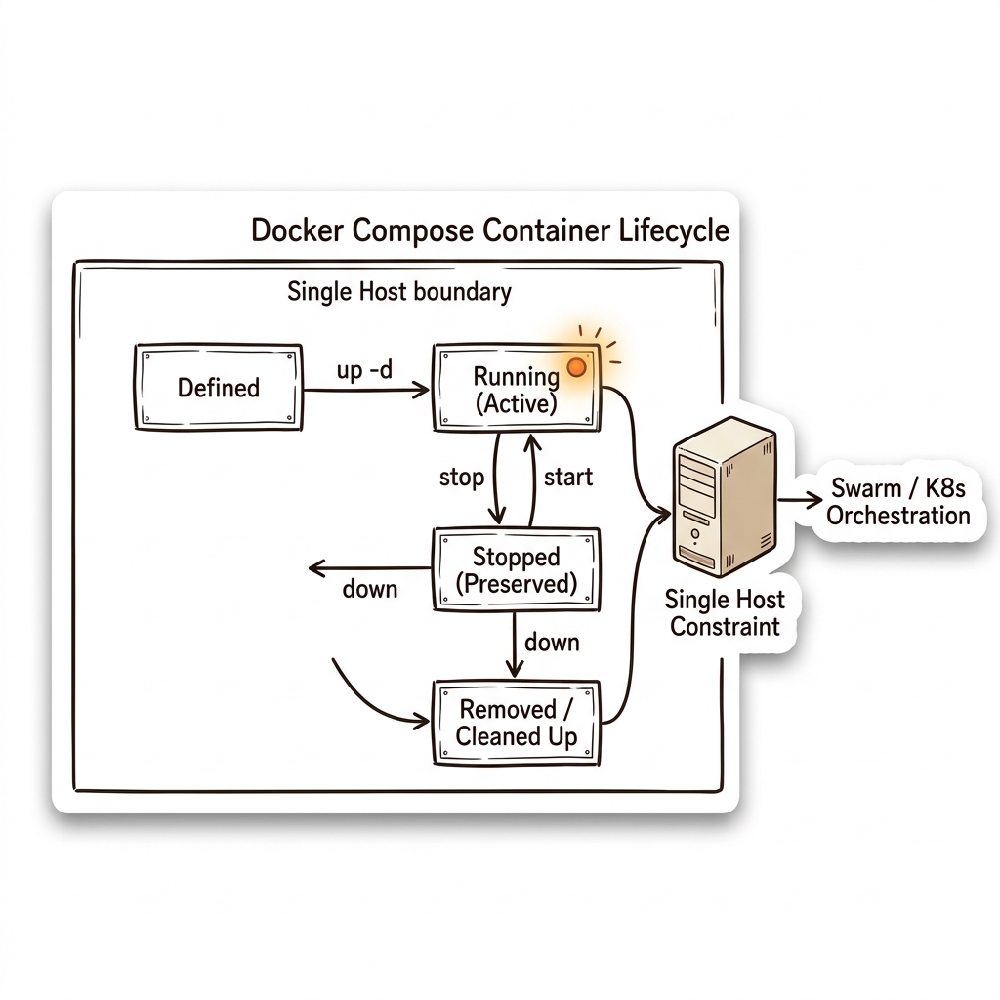
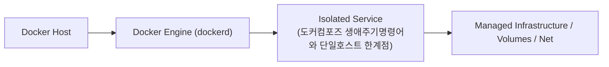
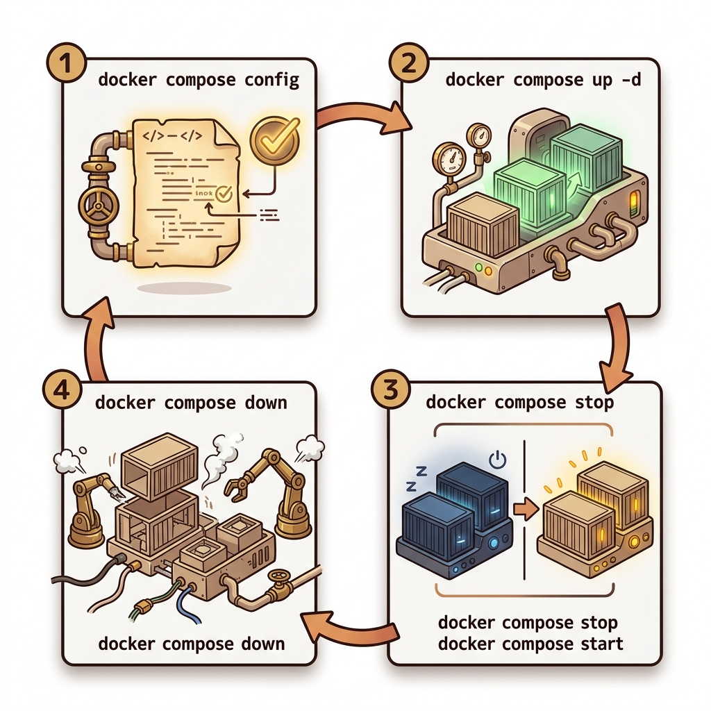
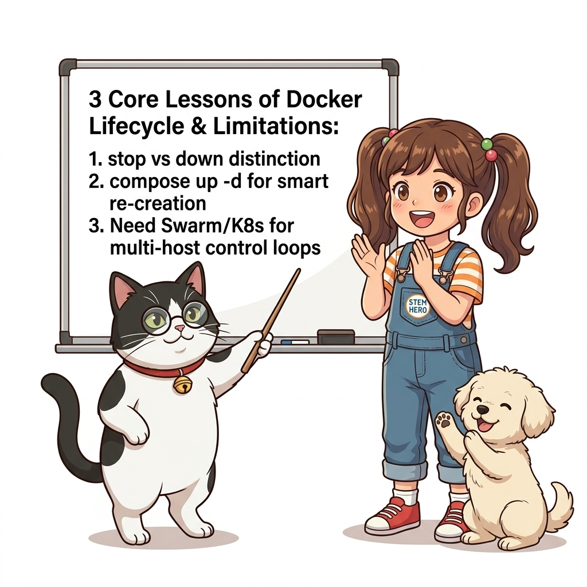

# 046. 도커컴포즈 생애주기명령어와 단일호스트 한계점

도커 컴포즈로 관리되는 애플리케이션의 상태를 제어하는 핵심 명령어(`up -d`, `stop`, `start`, `restart`, `down`, `ps`, `logs`, `top`)의 동작 차이를 명쾌하게 구분합니다.


**그림 04-5-1** 도커컴포즈 생애주기명령어와 단일호스트 한계점의 필요성과 현대 클라우드 아키텍처 관점의 개요

---

### 046.1 왜 도커컴포즈 생애주기명령어와 단일호스트 한계점이(가) 필요한가? (문제 정의와 현실적 배경)

소프트웨어 시스템이 복잡해질수록 설정을 다루는 방식은 전체 인프라의 신뢰성을 결정짓는 핵심 척도가 됩니다. **도커컴포즈 생애주기명령어와 단일호스트 한계점**이(가) 부재하거나 잘못 다루어질 때 현장에서는 다음과 같은 대표적인 병목과 장애가 발생합니다:

1. **하드코딩된 설정과 환경 불일치로 인한 유연성 상실**: 환경이 바뀔 때마다 코드를 다시 빌드해야 하므로 배포 주기가 지연되고 이미지 수가 기하급수적으로 폭증합니다.
2. **보안 민감 데이터의 무분별한 노출**: 비밀번호, 데이터베이스 토큰, 암호화 키가 이미지 레이어에 영구 박제되어 형상관리 시스템이나 외부에 유출될 위험이 커집니다.
3. **재현 불가능한 구성 드리프트**: 스테이징 환경과 프로덕션 환경의 미세한 설정 차이가 예기치 못한 서비스 중단 사고로 직결됩니다.


**그림 04-5-2** 도커컴포즈 생애주기명령어와 단일호스트 한계점에 대한 대표적인 오해와 실제 프로덕션 현장의 엔지니어링 진실

---

### 046.2 핵심 아키텍처와 엔지니어링 메커니즘

나아가 도커 컴포즈는 **처음 `up`을 실행할 때만 원하는 상태를 맞춰줄 뿐, 실행 도중 컨테이너가 비정상 종료되거나 서버 자체가 죽었을 때 이를 지속적으로 감시해 다른 서버에 재배치하는 클러스터 컨트롤 루프(Control Loop)가 없다**는 한계를 이해합니다.


**그림 04-5-3** 도커컴포즈 생애주기명령어와 단일호스트 한계점의 내부 아키텍처 및 데이터 흐름

#### 📊 핵심 비교 및 엔지니어링 표준 분석

| 구분 / 핵심 원리 | 상세 설명 및 동작 메커니즘 | 실무 적용 시 주의점 및 베스트 프랙티스 |
| :--- | :--- | :--- |
| **`stop` vs `down`** | `stop`은 컨테이너를 중지(`Exited`) 상태로만 두어 내부 임시 파일과 구성을 보존 / `down`은 컨테이너와 가상 네트워크를 완전히 삭제 | 설정 파일(`compose.yaml`)을 수정했을 때는 `restart`가 아니라 다시 `docker compose up -d`를 실행해야 변경된 서비스만 스마트하게 재생성됨! |
| **도커 컴포즈의 한계점** | 클라이언트 사이드 도구이므로 `docker compose up` 명령이 끝나면 백그라운드에서 상태를 감시하는 컴포즈 프로세스가 없음 | 진정한 고가용성(HA) 운영을 위해서는 헬스 체크(8장)와 컨테이너 오케스트레이터(Swarm/K8s, 12장)가 필요! |
| **최적의 활용처** | 로컬 개발 환경, 자동화 통합 테스트(CI), 단일 서버 소규모 서비스 배포에서는 지구상에서 가장 생산성이 높은 도구 | 컴포즈 문법을 완벽히 익히면 그대로 Part 06의 도커 스웜 스택(`docker stack`)으로 직결됨 |

---

### 046.3 선언적 실습 및 아키텍처 다이어그램

본 실습은 외부 비공개 패키지에 의존하지 않고, 공식 표준 이미지를 기반으로 즉시 재현 가능한 살아있는 코드로 구성되어 있습니다.

```bash
# 도커 컴포즈 파일 문법 검증(config) 및 주요 생애주기 명령어 요약
echo "1. 문법 및 병합 결과 검증 : docker compose config"
echo "2. 백그라운드 생성 및 시작 : docker compose up -d"
echo "3. 컨테이너 유지한 채 일시정지/재개 : docker compose stop && docker compose start"
echo "4. 컨테이너 및 네트워크 완전 제거 : docker compose down" 
```

#### 🔍 아키텍처 흐름도 (Mermaid Diagram)




**그림 04-5-4** 선언적 인프라 명세를 통한 도커컴포즈 생애주기명령어와 단일호스트 한계점 검증 파이프라인

---

### 046.4 핵심 정리: 캐릭터 대화와 3대 교훈

> 👧 **도로시**: "교수님! **도커컴포즈 생애주기명령어와 단일호스트 한계점**의 원리를 배우니까, 복잡하게 얽혀 있던 인프라 설정이 레고 블록처럼 질서정연하게 제자리를 찾는 게 보여요!"
> 
> 🐱 **조교 지니**: "야옹~ 맞습니다! 특히 런타임 환경과 불변 인프라의 경계를 명확히 지키는 것이 대규모 클라우드 운영의 제1원칙이랍니다!"
> 
> 🐶 **토토**: "멍멍! 선언적 코드로 한 번 적어두면 언제든 똑같이 복원되니까 정말 든든해요!"
> 
> 👨‍🏫 **이호진 교수님**: "훌륭하구나. 원리를 깊이 이해하고 실습을 통해 손에 익히는 것이 훌륭한 클라우드 엔지니어로 성장하는 가장 빠른 지름길이란다."


**그림 04-5-5** 도커컴포즈 생애주기명령어와 단일호스트 한계점 마스터를 위한 3대 핵심 교훈

1. **설정과 실행의 명확한 분리**:
   * 애플리케이션 코드는 불변으로 유지하고, 가변적인 설정값은 외부에서 주입하여 이식성을 극대화합니다.
2. **선언적 재현성 확보**:
   * 사람이 수작업으로 변경하지 않고 코드 명세를 통해 언제 어디서나 100% 동일한 실행 결과를 보장합니다.
3. **최소 권한 및 보안 모범 사례 준수**:
   * 불필요한 권한과 포트 노출을 최소화하고 민감 데이터를 암호화하여 프로덕션 안정성을 담보합니다.

---

### 046.5 랩노트 피날레와 다음 강의 예고


**그림 04-5-6** 연구실에서 다음 마일스톤인 [헬스체크1 프로세스는 살아있는데 서비스는 죽었다] 실습을 예고하는 교수님과 토토

> 💡 **다음 강의 안내**:
> [헬스체크1 프로세스는 살아있는데 서비스는 죽었다](../047_헬스체크1_프로세스는_살아있는데_서비스는_죽었다/)에서는 더욱 심화된 실전 엔지니어링 실습과 아키텍처를 다룹니다!

---

## 🧭 강의 네비게이션
* [◀️ 이전 강의: 045_도커컴포즈_환경변수_environment_env_file과_볼륨연결](../045_도커컴포즈_환경변수_environment_env_file과_볼륨연결/)
* [📋 Part 04. 도커 컴포즈(Compose) 분산 앱 실행, 헬스/디펜던시 체크 & 모니터링 (042 ~ 061) 목차로 돌아가기](../)
* [▶️ 다음 강의: 047_헬스체크1_프로세스는_살아있는데_서비스는_죽었다](../047_헬스체크1_프로세스는_살아있는데_서비스는_죽었다/)
