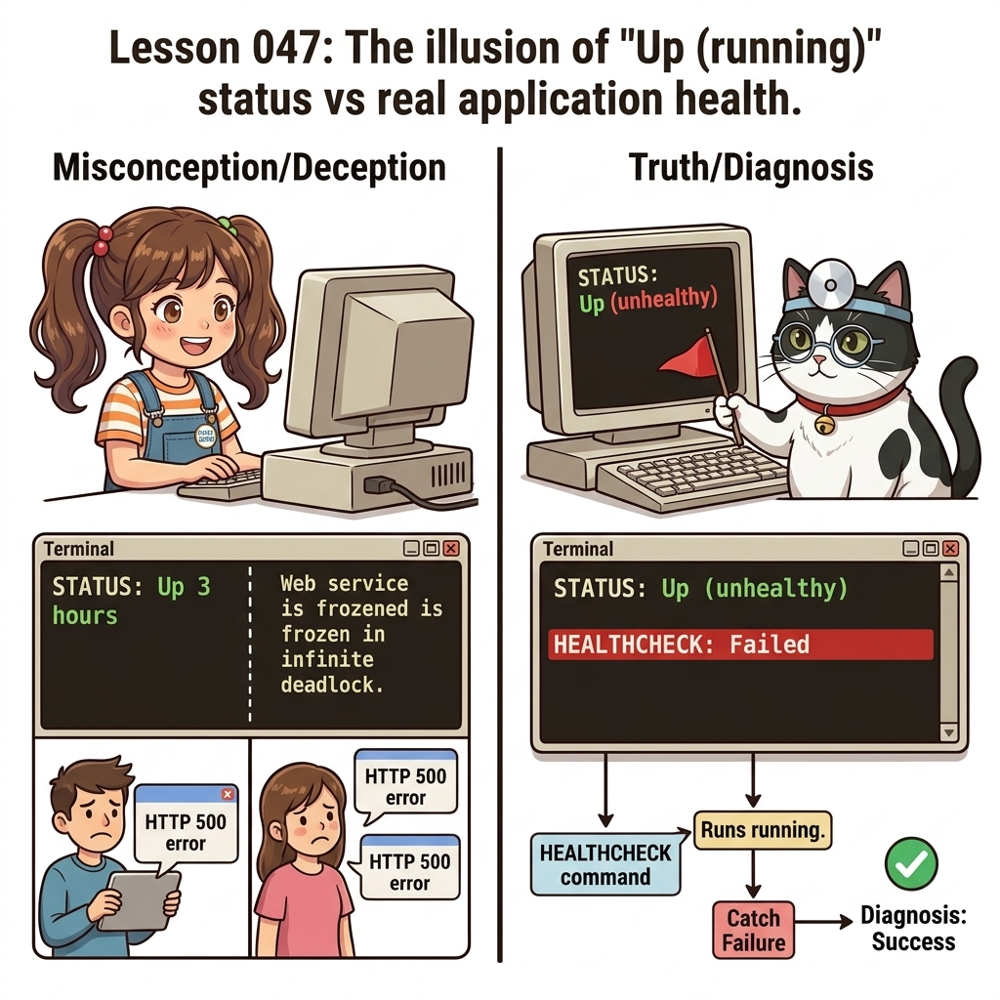
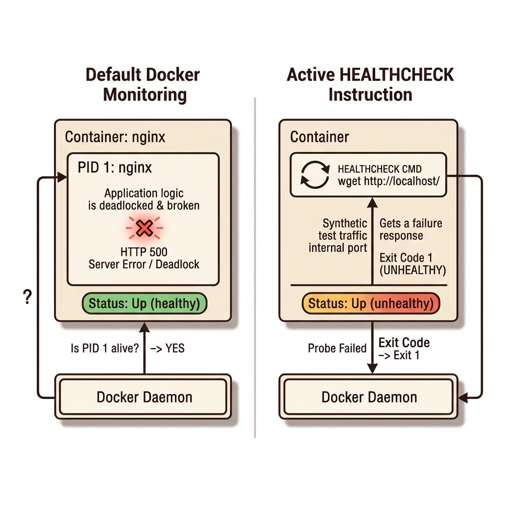
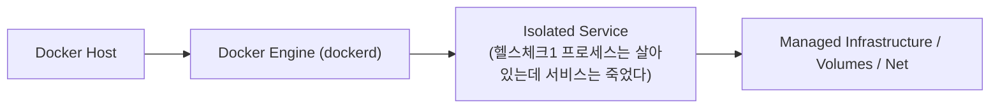
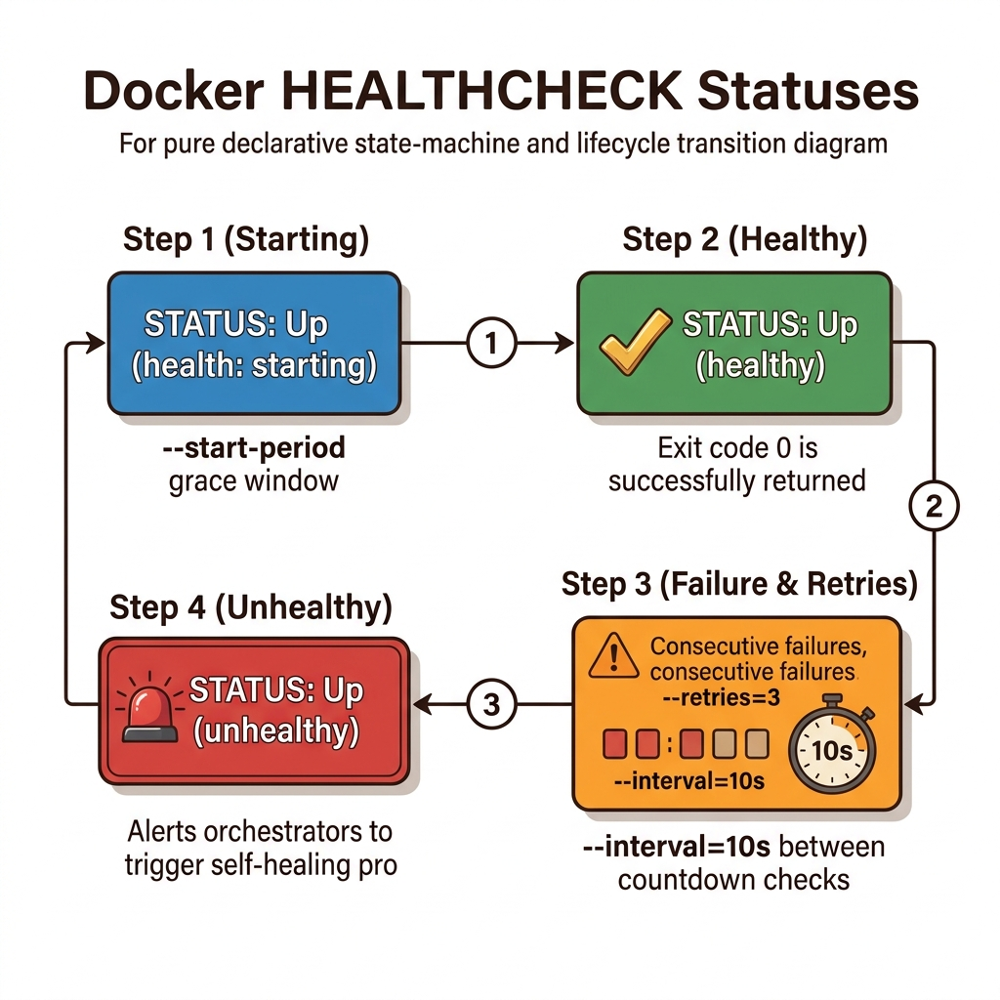
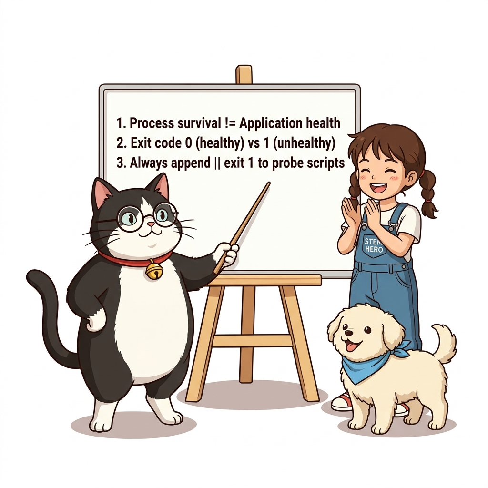

# 047. 헬스체크1 프로세스는 살아있는데 서비스는 죽었다

도커 엔진은 기본적으로 컨테이너 내부의 **PID 1 프로세스가 종료되었는지 여부**만 확인합니다. 따라서 웹 서버 프로세스가 데드락(Deadlock)이나 메모리 고갈로 멈춰서 모든 HTTP 요청에 `500 Internal Server Error`를 뱉어내도 도커는 컨테이너가 정상(`Up`)이라고 착각합니다.


**그림 04-6-1** 헬스체크1 프로세스는 살아있는데 서비스는 죽었다의 필요성과 현대 클라우드 아키텍처 관점의 개요

---

### 047.1 왜 헬스체크1 프로세스는 살아있는데 서비스는 죽었다이(가) 필요한가? (문제 정의와 현실적 배경)

소프트웨어 시스템이 복잡해질수록 설정을 다루는 방식은 전체 인프라의 신뢰성을 결정짓는 핵심 척도가 됩니다. **헬스체크1 프로세스는 살아있는데 서비스는 죽었다**이(가) 부재하거나 잘못 다루어질 때 현장에서는 다음과 같은 대표적인 병목과 장애가 발생합니다:

1. **하드코딩된 설정과 환경 불일치로 인한 유연성 상실**: 환경이 바뀔 때마다 코드를 다시 빌드해야 하므로 배포 주기가 지연되고 이미지 수가 기하급수적으로 폭증합니다.
2. **보안 민감 데이터의 무분별한 노출**: 비밀번호, 데이터베이스 토큰, 암호화 키가 이미지 레이어에 영구 박제되어 형상관리 시스템이나 외부에 유출될 위험이 커집니다.
3. **재현 불가능한 구성 드리프트**: 스테이징 환경과 프로덕션 환경의 미세한 설정 차이가 예기치 못한 서비스 중단 사고로 직결됩니다.


**그림 04-6-2** 헬스체크1 프로세스는 살아있는데 서비스는 죽었다에 대한 대표적인 오해와 실제 프로덕션 현장의 엔지니어링 진실

---

### 047.2 핵심 아키텍처와 엔지니어링 메커니즘

`Dockerfile`에 **`HEALTHCHECK CMD ...`** 인스트럭션을 추가하여, 도커가 주기적으로 컨테이너 내부에서 실제 HTTP 엔드포인트나 서비스 응답을 찔러보고 건강 상태(`healthy` vs `unhealthy`)를 판별하도록 만드는 원리를 실습합니다!


**그림 04-6-3** 헬스체크1 프로세스는 살아있는데 서비스는 죽었다의 내부 아키텍처 및 데이터 흐름

#### 📊 핵심 비교 및 엔지니어링 표준 분석

| 구분 / 핵심 원리 | 상세 설명 및 동작 메커니즘 | 실무 적용 시 주의점 및 베스트 프랙티스 |
| :--- | :--- | :--- |
| **프로세스 생존 ≠ 애플리케이션 정상** | 스레드 풀 고갈, DB 연결 끊김, 무한 루프 상태에서는 프로세스(PID 1)가 살아있어 도커가 이상을 감지하지 못함 | `HEALTHCHECK`를 통해 애플리케이션의 '실제 업무 처리 능력'을 도커 엔진에게 직접 보고 |
| **종료 코드(Exit Code) 규약** | 헬스 체크 명령이 **`0`을 반환하면 정상(`healthy`)**, **`1`을 반환하면 이상(`unhealthy`)**으로 판정 | 쉘 논리합 연산자 `|| exit 1`을 붙여 앞선 검진 명령이 실패할 때 명확히 종료 코드 1을 반환하도록 작성 |
| **컨테이너 상태 표시의 변화** | `HEALTHCHECK`가 있는 컨테이너는 `docker container ls`의 `STATUS` 컬럼에 `(health: starting)` ➔ `(healthy)` 또는 `(unhealthy)`가 함께 표시됨! | 운영자가 한눈에 유령 상태의 고장 난 컨테이너를 식별 가능 |

---

### 047.3 선언적 실습 및 아키텍처 다이어그램

본 실습은 외부 비공개 패키지에 의존하지 않고, 공식 표준 이미지를 기반으로 즉시 재현 가능한 살아있는 코드로 구성되어 있습니다.

```dockerfile
# 컨테이너 내부 웹 서버가 실제로 HTTP 200 OK를 반환하는지 스스로 검진하는 HEALTHCHECK Dockerfile
FROM nginx:1.27-alpine

# 10초마다 로컬 80 포트를 호출하여 실패(exit 1)가 3번 연속 발생하면 unhealthy로 판정!
HEALTHCHECK --interval=10s --timeout=3s --start-period=5s --retries=3   CMD wget --no-verbose --tries=1 --spider http://localhost/ || exit 1
```

#### 🔍 아키텍처 흐름도 (Mermaid Diagram)




**그림 04-6-4** 선언적 인프라 명세를 통한 헬스체크1 프로세스는 살아있는데 서비스는 죽었다 검증 파이프라인

---

### 047.4 핵심 정리: 캐릭터 대화와 3대 교훈

> 👧 **도로시**: "교수님! **헬스체크1 프로세스는 살아있는데 서비스는 죽었다**의 원리를 배우니까, 복잡하게 얽혀 있던 인프라 설정이 레고 블록처럼 질서정연하게 제자리를 찾는 게 보여요!"
> 
> 🐱 **조교 지니**: "야옹~ 맞습니다! 특히 런타임 환경과 불변 인프라의 경계를 명확히 지키는 것이 대규모 클라우드 운영의 제1원칙이랍니다!"
> 
> 🐶 **토토**: "멍멍! 선언적 코드로 한 번 적어두면 언제든 똑같이 복원되니까 정말 든든해요!"
> 
> 👨‍🏫 **이호진 교수님**: "훌륭하구나. 원리를 깊이 이해하고 실습을 통해 손에 익히는 것이 훌륭한 클라우드 엔지니어로 성장하는 가장 빠른 지름길이란다."


**그림 04-6-5** 헬스체크1 프로세스는 살아있는데 서비스는 죽었다 마스터를 위한 3대 핵심 교훈

1. **설정과 실행의 명확한 분리**:
   * 애플리케이션 코드는 불변으로 유지하고, 가변적인 설정값은 외부에서 주입하여 이식성을 극대화합니다.
2. **선언적 재현성 확보**:
   * 사람이 수작업으로 변경하지 않고 코드 명세를 통해 언제 어디서나 100% 동일한 실행 결과를 보장합니다.
3. **최소 권한 및 보안 모범 사례 준수**:
   * 불필요한 권한과 포트 노출을 최소화하고 민감 데이터를 암호화하여 프로덕션 안정성을 담보합니다.

---

### 047.5 랩노트 피날레와 다음 강의 예고


**그림 04-6-6** 연구실에서 다음 마일스톤인 [헬스체크2 interval timeout retries와 unhealthy 상태전환] 실습을 예고하는 교수님과 토토

> 💡 **다음 강의 안내**:
> [헬스체크2 interval timeout retries와 unhealthy 상태전환](../048_헬스체크2_interval_timeout_retries와_unhealthy_상태전환/)에서는 더욱 심화된 실전 엔지니어링 실습과 아키텍처를 다룹니다!

---

## 🧭 강의 네비게이션
* [◀️ 이전 강의: 046_도커컴포즈_생애주기명령어와_단일호스트_한계점](../046_도커컴포즈_생애주기명령어와_단일호스트_한계점/)
* [📋 Part 04. 도커 컴포즈(Compose) 분산 앱 실행, 헬스/디펜던시 체크 & 모니터링 (042 ~ 061) 목차로 돌아가기](../)
* [▶️ 다음 강의: 048_헬스체크2_interval_timeout_retries와_unhealthy_상태전환](../048_헬스체크2_interval_timeout_retries와_unhealthy_상태전환/)
