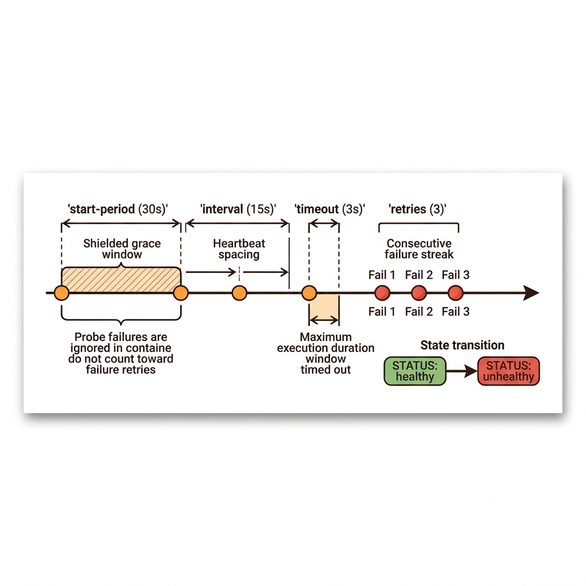
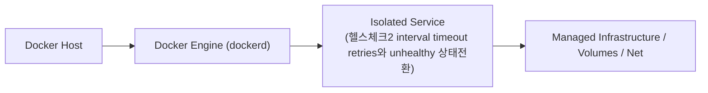
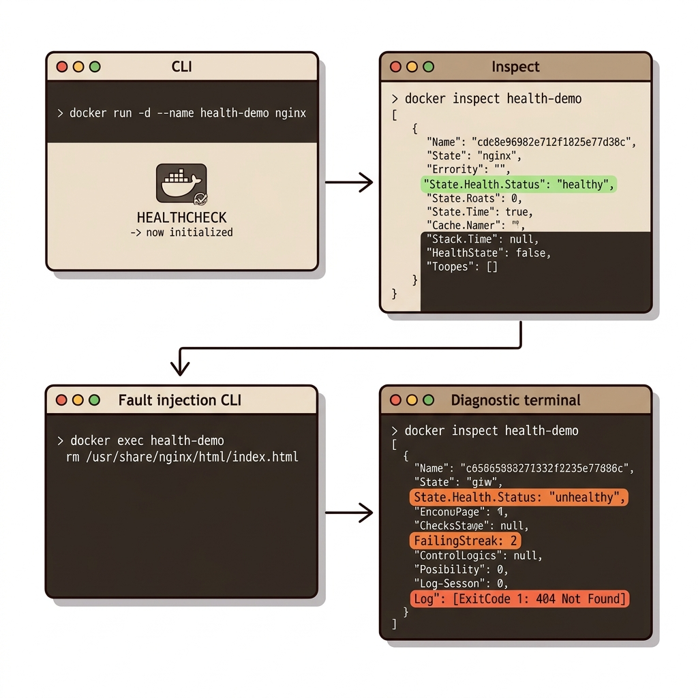
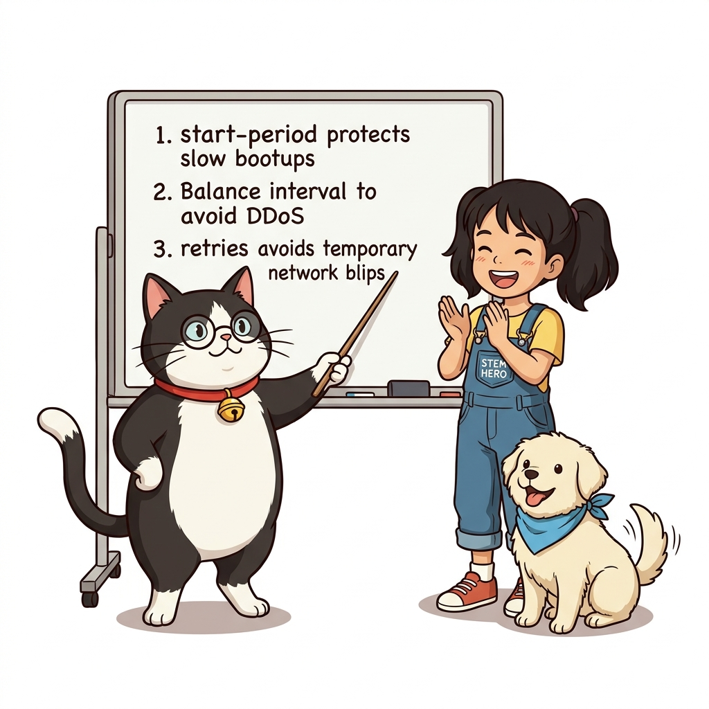

# 048. 헬스체크2 interval timeout retries와 unhealthy 상태전환

일시적인 네트워크 지연 때문에 멀쩡한 컨테이너를 죽이지 않도록 **`--interval`(검진 주기), `--timeout`(제한 시간), `--start-period`(초기 부팅 유예 시간), `--retries`(연속 실패 허용 횟수)** 4대 파라미터를 정밀 튜닝하는 법을 배웁니다.


**그림 04-7-1** 헬스체크2 interval timeout retries와 unhealthy 상태전환의 필요성과 현대 클라우드 아키텍처 관점의 개요

---

### 048.1 왜 헬스체크2 interval timeout retries와 unhealthy 상태전환이(가) 필요한가? (문제 정의와 현실적 배경)

소프트웨어 시스템이 복잡해질수록 설정을 다루는 방식은 전체 인프라의 신뢰성을 결정짓는 핵심 척도가 됩니다. **헬스체크2 interval timeout retries와 unhealthy 상태전환**이(가) 부재하거나 잘못 다루어질 때 현장에서는 다음과 같은 대표적인 병목과 장애가 발생합니다:

1. **하드코딩된 설정과 환경 불일치로 인한 유연성 상실**: 환경이 바뀔 때마다 코드를 다시 빌드해야 하므로 배포 주기가 지연되고 이미지 수가 기하급수적으로 폭증합니다.
2. **보안 민감 데이터의 무분별한 노출**: 비밀번호, 데이터베이스 토큰, 암호화 키가 이미지 레이어에 영구 박제되어 형상관리 시스템이나 외부에 유출될 위험이 커집니다.
3. **재현 불가능한 구성 드리프트**: 스테이징 환경과 프로덕션 환경의 미세한 설정 차이가 예기치 못한 서비스 중단 사고로 직결됩니다.


**그림 04-7-2** 헬스체크2 interval timeout retries와 unhealthy 상태전환에 대한 대표적인 오해와 실제 프로덕션 현장의 엔지니어링 진실

---

### 048.2 핵심 아키텍처와 엔지니어링 메커니즘

고의로 장애를 일으킨 컨테이너에서 연속 3회 헬스 체크 실패 후 상태가 `unhealthy`로 바뀌는 것을 확인하고, `docker container inspect`로 최근 5번의 헬스 체크 실행 결과와 출력 메시지를 확인합니다.


**그림 04-7-3** 헬스체크2 interval timeout retries와 unhealthy 상태전환의 내부 아키텍처 및 데이터 흐름

#### 📊 핵심 비교 및 엔지니어링 표준 분석

| 구분 / 핵심 원리 | 상세 설명 및 동작 메커니즘 | 실무 적용 시 주의점 및 베스트 프랙티스 |
| :--- | :--- | :--- |
| **`--interval` & `--retries`** | 기본값은 30초(`interval`)마다 검사하여 3번(`retries`) 연속 실패 시(약 90초 후) `unhealthy`로 전환 | 너무 짧게 잡으면 헬스 체크 자체가 CPU/트래픽 부하를 주므로 실무에서는 `interval=15s~30s`, `retries=3` 권장 |
| **`--start-period` (초기 유예)** | Java Spring Boot나 DB처럼 초기화에 시간이 걸리는 앱이 부팅 도중 실패한 것을 카운트하지 않도록 보호하는 유예 기간 | 초기 기동 시간 동안 발생한 실패는 `FailingStreak` 횟수에 합산되지 않으며, 한 번이라도 성공하면 즉시 `healthy`로 전환! |
| **왜 `unhealthy`인데 컨테이너가 안 꺼질까?** | 단일 도커 엔진에서 `unhealthy` 판정 후 컨테이너를 강제 종료하면 대체할 컨테이너가 없어 서비스가 완전히 끊기기 때문! | 자동 교체와 재시작은 컴포즈 조건부 의존성이나 스웜/쿠버네티스 오케스트레이터가 담당함 |

---

### 048.3 선언적 실습 및 아키텍처 다이어그램

본 실습은 외부 비공개 패키지에 의존하지 않고, 공식 표준 이미지를 기반으로 즉시 재현 가능한 살아있는 코드로 구성되어 있습니다.

```bash
# 헬스 체크가 적용된 웹 컨테이너를 띄우고, 고의로 웹 파일을 지워 404 에러(unhealthy) 유발 실험!
docker container run -d --name health-demo   --health-cmd="wget -q --spider http://localhost/index.html || exit 1"   --health-interval=2s --health-retries=2   nginx:1.27-alpine

sleep 3
docker container inspect --format 'Before Bug -> Status: {{.State.Health.Status}}' health-demo

# 고의로 index.html을 삭제하여 HTTP 404 유발 ➔ 4초 후 unhealthy 상태로 전환 확인!
docker container exec health-demo rm /usr/share/nginx/html/index.html
sleep 5
docker container inspect --format 'After Bug  -> Status: {{.State.Health.Status}} (FailingStreak: {{.State.Health.FailingStreak}})' health-demo
docker container rm -f health-demo
```

#### 🔍 아키텍처 흐름도 (Mermaid Diagram)




**그림 04-7-4** 선언적 인프라 명세를 통한 헬스체크2 interval timeout retries와 unhealthy 상태전환 검증 파이프라인

---

<!-- BIBLE_INTEGRATION_book6_trouble_db_migration_healthy -->
---

### 048.B 📚 도커 바이블 심화: 트러블슈팅: 분산 DB 마이그레이션 실패 방지와 depends_on condition: service_healthy 완벽 구현
*출처 도서: 『트러블 슈팅 도커』 핵심 분석*

Docker Compose로 웹과 데이터베이스를 함께 띄울 때 가장 자주 겪는 크래시 루프(CrashLoop)는 다음과 같습니다:
`Error: connect ECONNREFUSED 172.20.0.2:5432 - DB Connection Failed.`

#### 장애 원인과 잘못된 처방:
* 많은 개발자들이 `depends_on: [db]`를 적어두면 웹 앱이 DB가 완전히 준비될 때까지 기다려줄 것이라 믿습니다.
* 하지만 도커 컴포즈의 기본 `depends_on`은 **'DB 컨테이너 프로세스가 스폰되었는가'만 검사**할 뿐, DB 내부 스토리지 엔진이 데이터 복구를 마치고 포트를 열었는지는 전혀 알지 못합니다.
* DB는 기동 직후 수 초 동안 내부 초기화 과정을 거치므로, 그 사이에 웹 앱이 접속을 시도하면 연결 거부로 죽어버립니다.
* **완벽한 해결책**: DB 서비스에 명시적인 `healthcheck`를 선언하고, 웹 서비스에 `condition: service_healthy`를 지정해야 합니다.


**그림 048-B-1** DB 헬스체크 신호등이 초록불(healthy)로 바뀔 때까지 안전하게 대기한 뒤 출발하는 웹 컨테이너

```bash
# [실습] 헬스체크 대기 조건이 적용된 완벽한 compose.yaml 패턴
cat << 'EOF' > compose-healthy-db.yaml
services:
  database:
    image: postgres:alpine
    environment:
      POSTGRES_PASSWORD: secret
    healthcheck:
      test: ["CMD-SHELL", "pg_isready -U postgres"]
      interval: 3s
      timeout: 3s
      retries: 5
      start_period: 5s

  web-backend:
    image: alpine
    depends_on:
      database:
        condition: service_healthy
    command: ["sh", "-c", "echo 'DB 완벽 가동 확인 완료! 마이그레이션 시작!' && sleep 3600"]
EOF

# 컴포즈 실행 및 헬스체크 상태 전이 관찰
docker compose -f compose-healthy-db.yaml up -d
docker compose -f compose-healthy-db.yaml ps
docker compose -f compose-healthy-db.yaml down
rm -f compose-healthy-db.yaml
```

> 👨‍🏫 **이호진 교수님의 바이블 멘토링 노트**:
> "compose.yaml에서 depends_on만 적어놓고 왜 DB 연결이 안 되냐고 밤을 새우는 주니어들이 정말 많습니다. 서비스 간 순서는 반드시 'healthcheck + condition: service_healthy' 쌍으로 통제해야 합니다."
>
> 👧 **도로시의 깨달음**:
> "식당 문만 열렸다고(컨테이너 실행) 무작정 쳐들어가는 게 아니라, 주방장님이 요리 준비가 끝났다는 사인(service_healthy)을 줄 때까지 얌전히 기다리는 예절이었네요!"
>
> 🐱 **조교 지니의 아키텍처 체크포인트**:
> "MySQL은 `mysqladmin ping -h localhost`, Redis는 `redis-cli ping` 명령어로 헬스체크 테스트를 작성하면 아주 가볍고 정확합니다."


### 048.4 핵심 정리: 캐릭터 대화와 3대 교훈

> 👧 **도로시**: "교수님! **헬스체크2 interval timeout retries와 unhealthy 상태전환**의 원리를 배우니까, 복잡하게 얽혀 있던 인프라 설정이 레고 블록처럼 질서정연하게 제자리를 찾는 게 보여요!"
> 
> 🐱 **조교 지니**: "야옹~ 맞습니다! 특히 런타임 환경과 불변 인프라의 경계를 명확히 지키는 것이 대규모 클라우드 운영의 제1원칙이랍니다!"
> 
> 🐶 **토토**: "멍멍! 선언적 코드로 한 번 적어두면 언제든 똑같이 복원되니까 정말 든든해요!"
> 
> 👨‍🏫 **이호진 교수님**: "훌륭하구나. 원리를 깊이 이해하고 실습을 통해 손에 익히는 것이 훌륭한 클라우드 엔지니어로 성장하는 가장 빠른 지름길이란다."


**그림 04-7-5** 헬스체크2 interval timeout retries와 unhealthy 상태전환 마스터를 위한 3대 핵심 교훈

1. **설정과 실행의 명확한 분리**:
   * 애플리케이션 코드는 불변으로 유지하고, 가변적인 설정값은 외부에서 주입하여 이식성을 극대화합니다.
2. **선언적 재현성 확보**:
   * 사람이 수작업으로 변경하지 않고 코드 명세를 통해 언제 어디서나 100% 동일한 실행 결과를 보장합니다.
3. **최소 권한 및 보안 모범 사례 준수**:
   * 불필요한 권한과 포트 노출을 최소화하고 민감 데이터를 암호화하여 프로덕션 안정성을 담보합니다.

---

### 048.5 랩노트 피날레와 다음 강의 예고


**그림 04-7-6** 연구실에서 다음 마일스톤인 [디펜던시체크 실행순서만으로는 부족한이유와 Fail Fast전략] 실습을 예고하는 교수님과 토토

> 💡 **다음 강의 안내**:
> [디펜던시체크 실행순서만으로는 부족한이유와 Fail Fast전략](../049_디펜던시체크_실행순서만으로는_부족한이유와_Fail_Fast전략/)에서는 더욱 심화된 실전 엔지니어링 실습과 아키텍처를 다룹니다!

---

## 🧭 강의 네비게이션
* [◀️ 이전 강의: 047_헬스체크1_프로세스는_살아있는데_서비스는_죽었다](../047_헬스체크1_프로세스는_살아있는데_서비스는_죽었다/)
* [📋 Part 04. 도커 컴포즈(Compose) 분산 앱 실행, 헬스/디펜던시 체크 & 모니터링 (042 ~ 061) 목차로 돌아가기](../)
* [▶️ 다음 강의: 049_디펜던시체크_실행순서만으로는_부족한이유와_Fail_Fast전략](../049_디펜던시체크_실행순서만으로는_부족한이유와_Fail_Fast전략/)
