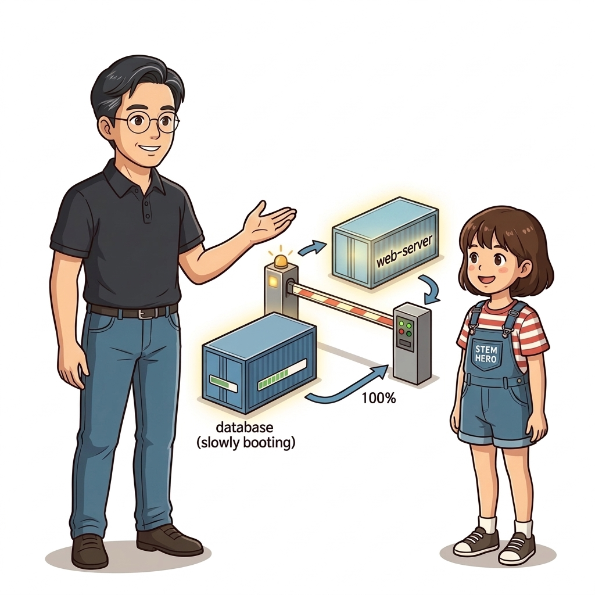
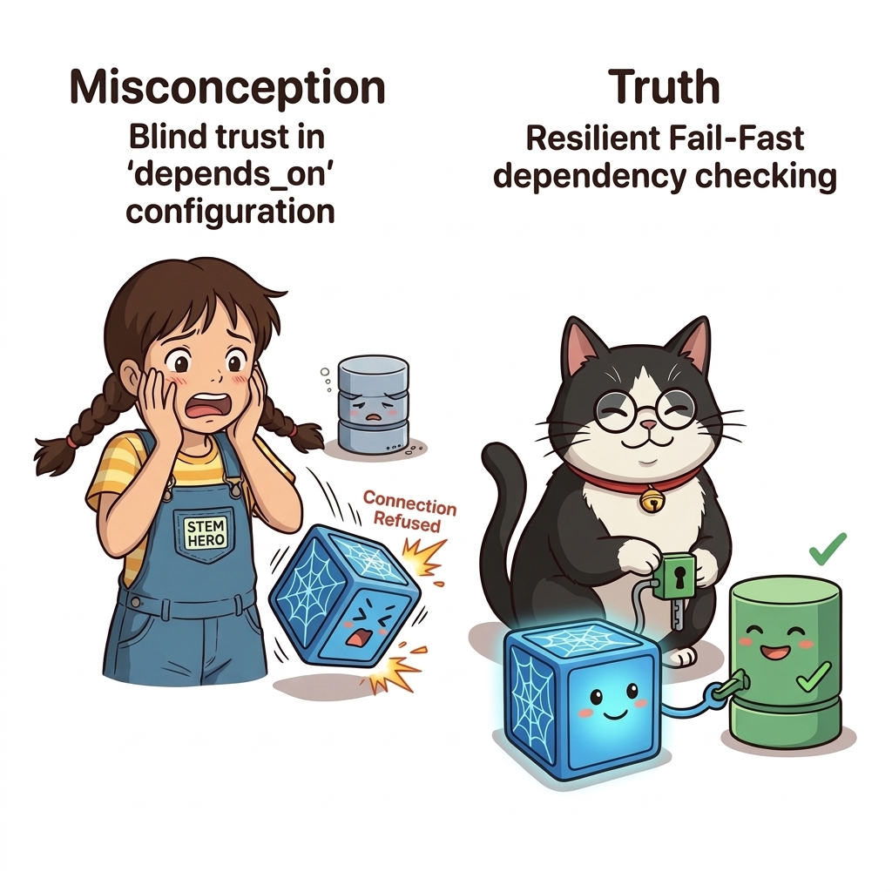
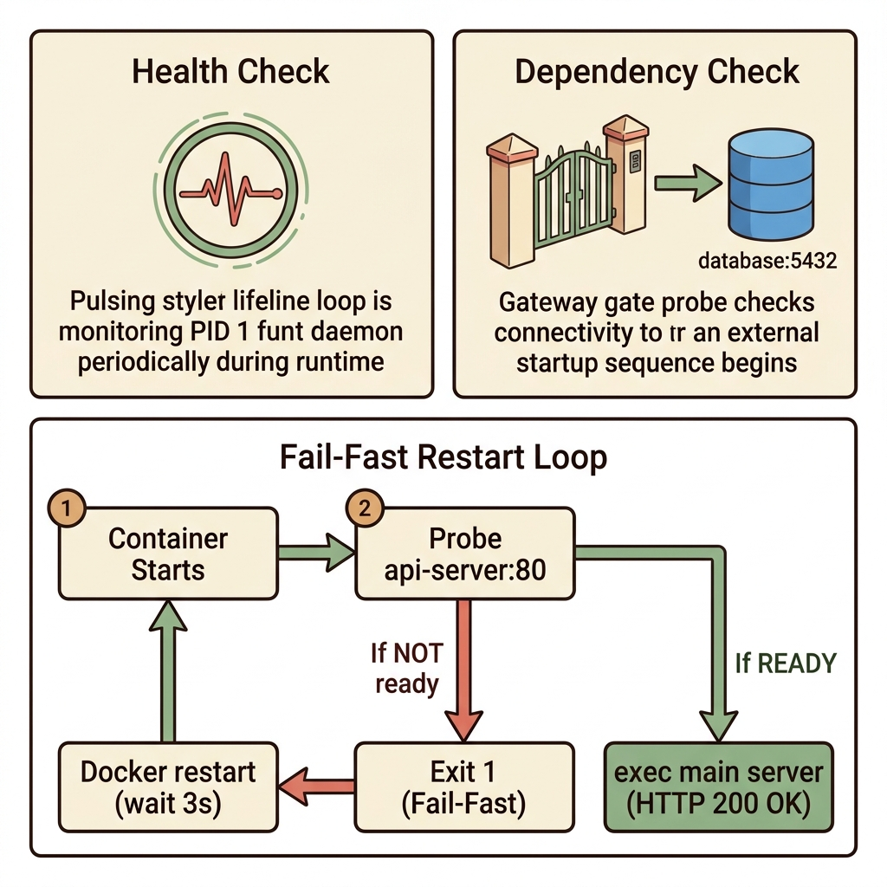
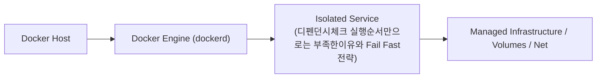
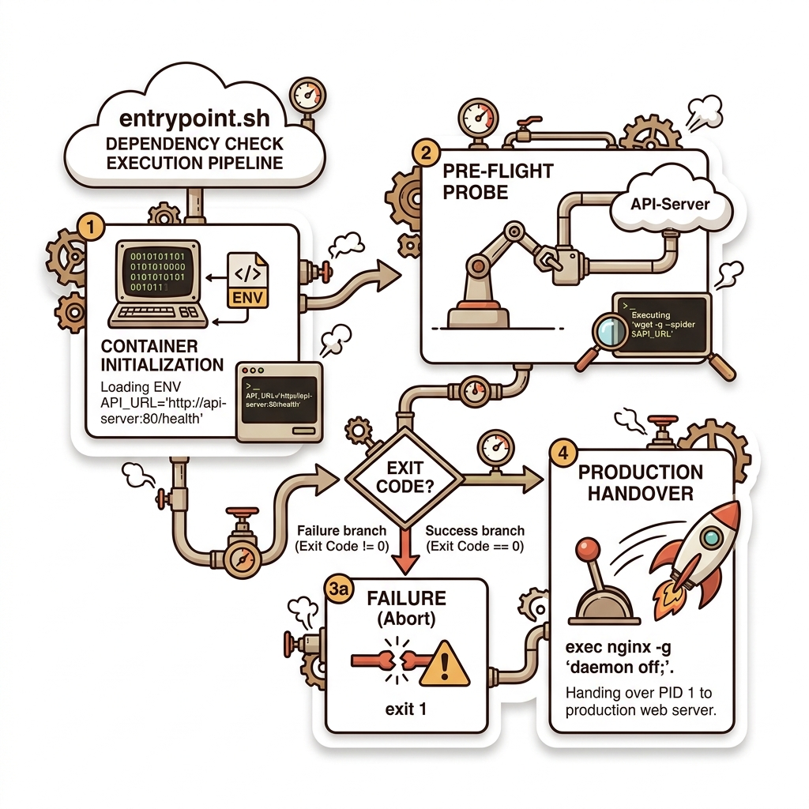
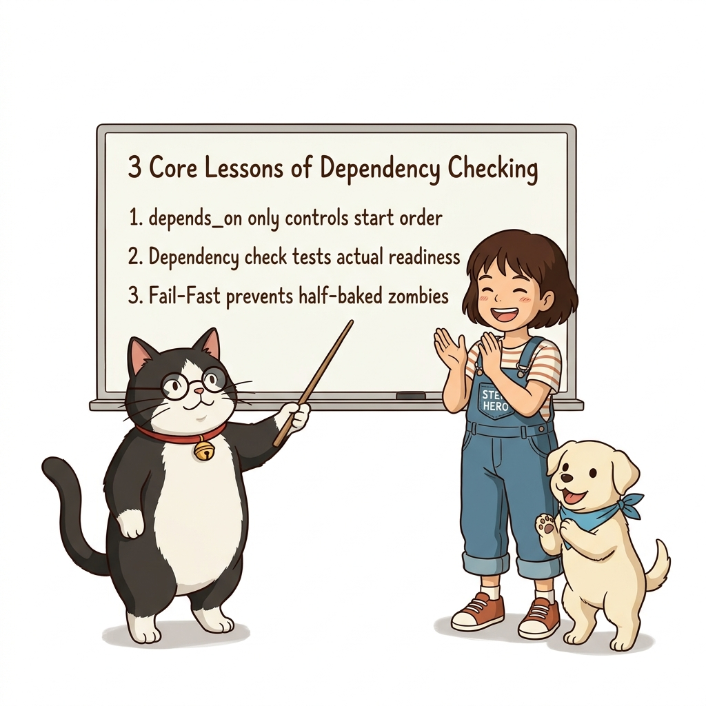

# 049. 디펜던시체크 실행순서만으로는 부족한이유와 Fail Fast전략

`depends_on`은 단지 컨테이너 프로세스를 '시작하는 순서'만 제어할 뿐, 선행 컨테이너 내부의 데이터베이스나 API 애플리케이션이 실제로 준비를 마치고 요청을 받을 수 있는지는 보장하지 못합니다.


**그림 04-8-1** 디펜던시체크 실행순서만으로는 부족한이유와 Fail Fast전략의 필요성과 현대 클라우드 아키텍처 관점의 개요

---

### 049.1 왜 디펜던시체크 실행순서만으로는 부족한이유와 Fail Fast전략이(가) 필요한가? (문제 정의와 현실적 배경)

소프트웨어 시스템이 복잡해질수록 설정을 다루는 방식은 전체 인프라의 신뢰성을 결정짓는 핵심 척도가 됩니다. **디펜던시체크 실행순서만으로는 부족한이유와 Fail Fast전략**이(가) 부재하거나 잘못 다루어질 때 현장에서는 다음과 같은 대표적인 병목과 장애가 발생합니다:

1. **하드코딩된 설정과 환경 불일치로 인한 유연성 상실**: 환경이 바뀔 때마다 코드를 다시 빌드해야 하므로 배포 주기가 지연되고 이미지 수가 기하급수적으로 폭증합니다.
2. **보안 민감 데이터의 무분별한 노출**: 비밀번호, 데이터베이스 토큰, 암호화 키가 이미지 레이어에 영구 박제되어 형상관리 시스템이나 외부에 유출될 위험이 커집니다.
3. **재현 불가능한 구성 드리프트**: 스테이징 환경과 프로덕션 환경의 미세한 설정 차이가 예기치 못한 서비스 중단 사고로 직결됩니다.


**그림 04-8-2** 디펜던시체크 실행순서만으로는 부족한이유와 Fail Fast전략에 대한 대표적인 오해와 실제 프로덕션 현장의 엔지니어링 진실

---

### 049.2 핵심 아키텍처와 엔지니어링 메커니즘

컨테이너 시작 명령(`CMD`) 앞단에 **자신이 의존하는 하위 서비스가 정상 응답할 수 있는지 먼저 확인하고, 아직 준비되지 않았다면 즉시 프로세스를 종료(`exit 1`)하여 도커의 자동 재시작 메커니즘을 타도록 만드는 디펜던시 체크(Dependency Check) 패턴**을 배웁니다.


**그림 04-8-3** 디펜던시체크 실행순서만으로는 부족한이유와 Fail Fast전략의 내부 아키텍처 및 데이터 흐름

#### 📊 핵심 비교 및 엔지니어링 표준 분석

| 구분 / 핵심 원리 | 상세 설명 및 동작 메커니즘 | 실무 적용 시 주의점 및 베스트 프랙티스 |
| :--- | :--- | :--- |
| **헬스 체크 vs 디펜던시 체크** | 헬스 체크는 **실행 중 주기적으로 나 자신의 건강을 검사** / 디펜던시 체크는 **시작할 때 딱 한 번 내가 의존하는 상대방의 준비 상태를 검사** | 두 체크가 결합되어야 분산 애플리케이션의 기동과 운영이 모두 완벽해짐 |
| **Fail-Fast (빠른 실패와 재시작)** | 의존하는 DB나 API가 아직 안 켜졌을 때 반쪽짜리 불구 상태로 웹 서버를 켜두지 않고, 즉시 종료(`exit 1`)하여 플랫폼이 재시작하게 유도 | 몇 초 뒤 도커(또는 오케스트레이터)가 컨테이너를 다시 실행할 때는 DB가 준비되어 정상 기동 완료! |
| **실무 시작 스크립트(`entrypoint.sh`)** | 실무에서는 `CMD`에 긴 `&&` 한 줄을 적는 대신 깔끔한 `entrypoint.sh` 스크립트로 디펜던시 체크 후 `exec "$@"`로 본 프로세스를 실행 | 가독성과 유지보수성을 모두 잡는 클라우드 네이티브 엔트리포인트 패턴 |

---

### 049.3 선언적 실습 및 아키텍처 다이어그램

본 실습은 외부 비공개 패키지에 의존하지 않고, 공식 표준 이미지를 기반으로 즉시 재현 가능한 살아있는 코드로 구성되어 있습니다.

```dockerfile
# [디펜던시 체크가 적용된 CMD] 시작할 때 백엔드 API(api-server)가 실제로 응답하는지 먼저 확인!
FROM nginx:1.27-alpine
ENV API_URL="http://api-server:80/health"

# api-server에 연결할 수 없으면 웹 서버를 아예 켜지 않고 즉시 실패(Fail-Fast) 종료!
CMD ["sh", "-c", "wget -q --spider $API_URL && nginx -g 'daemon off;'"]
```

#### 🔍 아키텍처 흐름도 (Mermaid Diagram)




**그림 04-8-4** 선언적 인프라 명세를 통한 디펜던시체크 실행순서만으로는 부족한이유와 Fail Fast전략 검증 파이프라인

---

### 049.4 핵심 정리: 캐릭터 대화와 3대 교훈

> 👧 **도로시**: "교수님! **디펜던시체크 실행순서만으로는 부족한이유와 Fail Fast전략**의 원리를 배우니까, 복잡하게 얽혀 있던 인프라 설정이 레고 블록처럼 질서정연하게 제자리를 찾는 게 보여요!"
> 
> 🐱 **조교 지니**: "야옹~ 맞습니다! 특히 런타임 환경과 불변 인프라의 경계를 명확히 지키는 것이 대규모 클라우드 운영의 제1원칙이랍니다!"
> 
> 🐶 **토토**: "멍멍! 선언적 코드로 한 번 적어두면 언제든 똑같이 복원되니까 정말 든든해요!"
> 
> 👨‍🏫 **이호진 교수님**: "훌륭하구나. 원리를 깊이 이해하고 실습을 통해 손에 익히는 것이 훌륭한 클라우드 엔지니어로 성장하는 가장 빠른 지름길이란다."


**그림 04-8-5** 디펜던시체크 실행순서만으로는 부족한이유와 Fail Fast전략 마스터를 위한 3대 핵심 교훈

1. **설정과 실행의 명확한 분리**:
   * 애플리케이션 코드는 불변으로 유지하고, 가변적인 설정값은 외부에서 주입하여 이식성을 극대화합니다.
2. **선언적 재현성 확보**:
   * 사람이 수작업으로 변경하지 않고 코드 명세를 통해 언제 어디서나 100% 동일한 실행 결과를 보장합니다.
3. **최소 권한 및 보안 모범 사례 준수**:
   * 불필요한 권한과 포트 노출을 최소화하고 민감 데이터를 암호화하여 프로덕션 안정성을 담보합니다.

---

### 049.5 랩노트 피날레와 다음 강의 예고


**그림 04-8-6** 연구실에서 다음 마일스톤인 [보안을위한 커스텀헬스체크 유틸리티제작] 실습을 예고하는 교수님과 토토

> 💡 **다음 강의 안내**:
> [보안을위한 커스텀헬스체크 유틸리티제작](../050_보안을위한_커스텀헬스체크_유틸리티제작/)에서는 더욱 심화된 실전 엔지니어링 실습과 아키텍처를 다룹니다!

---

## 🧭 강의 네비게이션
* [◀️ 이전 강의: 048_헬스체크2_interval_timeout_retries와_unhealthy_상태전환](../048_헬스체크2_interval_timeout_retries와_unhealthy_상태전환/)
* [📋 Part 04. 도커 컴포즈(Compose) 분산 앱 실행, 헬스/디펜던시 체크 & 모니터링 (042 ~ 061) 목차로 돌아가기](../)
* [▶️ 다음 강의: 050_보안을위한_커스텀헬스체크_유틸리티제작](../050_보안을위한_커스텀헬스체크_유틸리티제작/)
