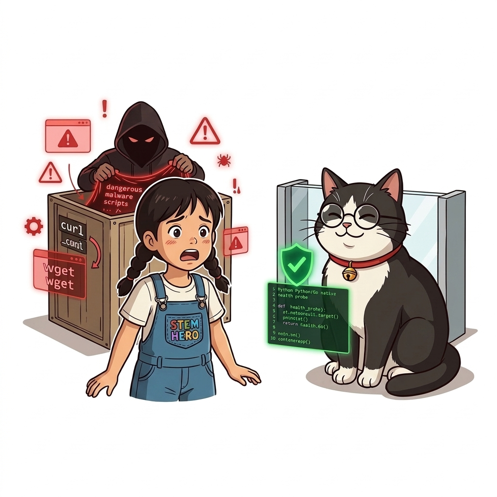
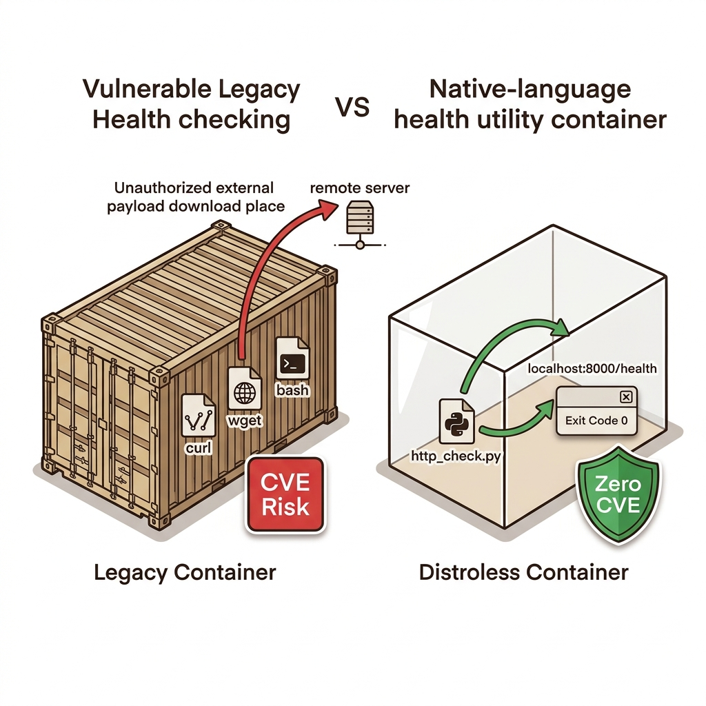
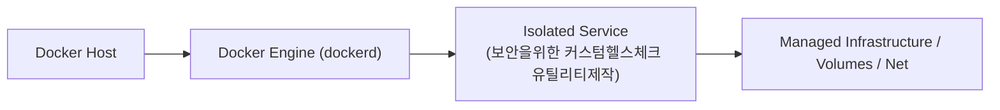
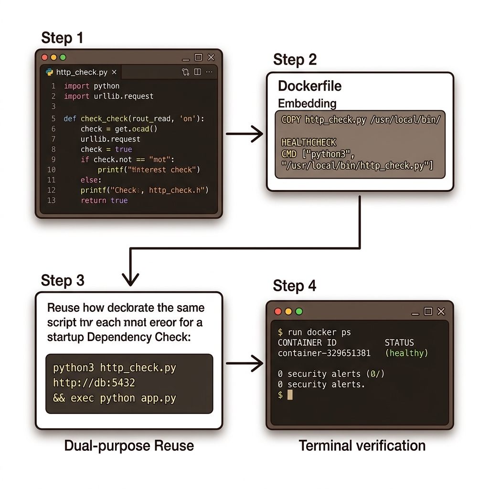

# 050. 보안을위한 커스텀헬스체크 유틸리티제작

실무 프로덕션 이미지에서는 공격자가 침투 후 외부 악성 스크립트를 다운로드하는 데 악용하지 못하도록 **`curl`과 `wget`을 아예 제거**하는 것이 보안 원칙입니다.


**그림 04-9-1** 보안을위한 커스텀헬스체크 유틸리티제작의 필요성과 현대 클라우드 아키텍처 관점의 개요

---

### 050.1 왜 보안을위한 커스텀헬스체크 유틸리티제작이(가) 필요한가? (문제 정의와 현실적 배경)

소프트웨어 시스템이 복잡해질수록 설정을 다루는 방식은 전체 인프라의 신뢰성을 결정짓는 핵심 척도가 됩니다. **보안을위한 커스텀헬스체크 유틸리티제작**이(가) 부재하거나 잘못 다루어질 때 현장에서는 다음과 같은 대표적인 병목과 장애가 발생합니다:

1. **하드코딩된 설정과 환경 불일치로 인한 유연성 상실**: 환경이 바뀔 때마다 코드를 다시 빌드해야 하므로 배포 주기가 지연되고 이미지 수가 기하급수적으로 폭증합니다.
2. **보안 민감 데이터의 무분별한 노출**: 비밀번호, 데이터베이스 토큰, 암호화 키가 이미지 레이어에 영구 박제되어 형상관리 시스템이나 외부에 유출될 위험이 커집니다.
3. **재현 불가능한 구성 드리프트**: 스테이징 환경과 프로덕션 환경의 미세한 설정 차이가 예기치 못한 서비스 중단 사고로 직결됩니다.


**그림 04-9-2** 보안을위한 커스텀헬스체크 유틸리티제작에 대한 대표적인 오해와 실제 프로덕션 현장의 엔지니어링 진실

---

### 050.2 핵심 아키텍처와 엔지니어링 메커니즘

외부 셸 도구에 의존하지 않고, **애플리케이션을 작성한 바로 그 언어(Python, Node.js, Go, Java)로 작은 전용 헬스/디펜던시 체크 스크립트(또는 바이너리)를 직접 만들어 이미지에 내장**하는 보안 아키텍처를 실습합니다!


**그림 04-9-3** 보안을위한 커스텀헬스체크 유틸리티제작의 내부 아키텍처 및 데이터 흐름

#### 📊 핵심 비교 및 엔지니어링 표준 분석

| 구분 / 핵심 원리 | 상세 설명 및 동작 메커니즘 | 실무 적용 시 주의점 및 베스트 프랙티스 |
| :--- | :--- | :--- |
| **왜 `curl`/`wget`을 빼야 하는가?** | 1) 불필요한 패키지 설치로 이미지 용량과 CVE 보안 취약점 증가, 2) 컨테이너 침투 시 원격 해킹 도구 다운로드 수단으로 악용 | Google Distroless 이미지나 최소 슬림 이미지에는 `curl`과 `sh` 자체가 아예 없음 |
| **동일 언어 체크 유틸리티의 장점** | `curl`은 단순 HTTP 상태 코드만 보지만, 자체 제작 유틸리티는 설정 파일을 공유하고 JSON 응답 본문이나 인증서까지 정밀 검증 가능! | 추가 런타임 설치 없이 이미 들어있는 언어 런타임(또는 멀티 스테이지 Go 바이너리)을 100% 활용 |
| **단일 유틸리티의 이중 활용** | 동일한 `http_check` 도구를 `HEALTHCHECK CMD ["python", "http_check.py", "http://localhost/health"]`와 시작 시 디펜던시 체크 양쪽에 모두 재사용! | 보안성, 정밀도, 재사용성을 동시에 달성하는 프로 엔지니어의 기법 |

---

### 050.3 선언적 실습 및 아키텍처 다이어그램

본 실습은 외부 비공개 패키지에 의존하지 않고, 공식 표준 이미지를 기반으로 즉시 재현 가능한 살아있는 코드로 구성되어 있습니다.

```python
# curl/wget이 없는 초경량/고보안 컨테이너 내부에서 사용하는 전용 파이썬 헬스/디펜던시 체크 유틸리티 (http_check.py)
import sys
import urllib.request

target_url = sys.argv[1] if len(sys.argv) > 1 else "http://localhost:8000/health"
try:
    with urllib.request.urlopen(target_url, timeout=3) as resp:
        if 200 <= resp.status < 400:
            print(f"OK: {target_url} returned {resp.status}")
            sys.exit(0)
except Exception as e:
    print(f"FAIL: {target_url} ({e})")
sys.exit(1)
```

#### 🔍 아키텍처 흐름도 (Mermaid Diagram)




**그림 04-9-4** 선언적 인프라 명세를 통한 보안을위한 커스텀헬스체크 유틸리티제작 검증 파이프라인

---

<!-- BIBLE_INTEGRATION_book3_correlation_id_tracing -->
---

### 050.B 📚 도커 바이블 심화: 분산 트레이싱과 상관관계 ID(Correlation ID / X-Request-ID) 엔드투엔드 추적
*출처 도서: 『도커를 활용한 마이크로서비스』 핵심 분석*

마이크로서비스 환경에서 사용자 요청 하나가 프런트엔드 -> 게이트웨이 -> 주문 서비스 -> 결제 서비스 -> 배송 서비스로 연쇄 호출될 때, 특정 서비스에서 에러가 터지면 수백 대 컨테이너의 파편화된 로그 속에서 원인을 찾기란 불가능에 가깝습니다.

이를 해결하는 결정적인 표준 패턴이 바로 **상관관계 ID(Correlation ID, 표준 헤더: `X-Request-ID`)**입니다:
1. **게이트웨이 진입 시 발급**: 최초 인그레스 프록시(Nginx/Traefik)가 요청을 수신했을 때 UUID 형태의 고유한 `X-Request-ID`를 HTTP 헤더에 생성하여 주입합니다.
2. **다운스트림 전파 (Header Propagation)**: 각 마이크로서비스는 후속 내부 REST/gRPC API를 호출할 때 수신한 `X-Request-ID`를 다음 요청 헤더에 반드시 그대로 복사하여 전달합니다.
3. **MDC 로그 컨텍스트 바인딩**: 모든 서비스의 로그 출력문 맨 앞에 해당 ID를 포함시켜, 중앙 로그 수집기(Fluentd, Elastic, Loki)에서 단 한 줄의 검색 쿼리로 전체 호출 여정을 1초 만에 타임라인으로 재구성할 수 있습니다.


**그림 050-B-1** 고유한 X-Request-ID 태그가 마이크로서비스 체인을 타고 흐르며 로그를 하나로 꿰뚫는 모습

```bash
# [실습] Nginx 리버스 프록시에서 X-Request-ID 자동 생성 및 전달 설정
cat << 'EOF' > nginx-correlation.conf
events {}
http {
    log_format trace '$remote_addr - [$time_local] "$request" '
                     'status=$status req_id="$request_id"';
    access_log /dev/stdout trace;

    server {
        listen 80;
        location / {
            # 요청에 기존 req_id가 없으면 Nginx 내장 $request_id(UUID) 주입
            proxy_set_header X-Request-ID $request_id;
            proxy_pass http://api-upstream;
        }
    }
}
EOF
```

> 👨‍🏫 **이호진 교수님의 바이블 멘토링 노트**:
> "마이크로서비스를 운영하면서 Correlation ID가 없다면 밤마다 깜깜한 동굴에서 촛불 하나 없이 길을 잃는 것과 같습니다. 아키텍처 설계 1일 차에 무조건 전파 미들웨어를 구축하세요."
>
> 👧 **도로시의 깨달음**:
> "황금 실타래처럼 번호 하나로 모든 컨테이너의 로그를 한 줄로 꿰어버리니 범인이 어디 숨어있는지 바로 찾을 수 있겠어요!"
>
> 🐱 **조교 지니의 아키텍처 체크포인트**:
> "OpenTelemetry나 Jaeger, Zipkin 같은 전문 분산 추적 시스템도 본질적으로는 이 헤더 전파 메커니즘을 기반으로 Span ID와 Trace ID를 생성한답니다."

---

### 050.C 📚 도커 바이블 심화: Distroless 무셸(No-Shell) 환경 전용 정적 Go 헬스체커와 스타트업 웜업(--start-period) 설계

> 📖 **참고 도서 심층 연계**:
> * 《트러블 슈팅 도커》 제1장 (컨테이너 헬스체크 실패와 무한 재시작 플래핑 방지)
> * 《도커 교과서》 제8장 (신뢰성 높은 헬스체크 프로브와 무중단 복구 메커니즘)

보안이 극도로 강화된 구글의 **Distroless**나 `scratch` 기반 이미지에는 `curl`, `wget`은 물론이고 셸(`/bin/sh`)조차 존재하지 않습니다. 여기에 무심코 `HEALTHCHECK CMD curl -f http://localhost/`를 넣으면 `executable file not found in $PATH` 에러와 함께 컨테이너가 영구 `unhealthy` 상태에 빠집니다.

#### 1. Distroless 전용 초경량 독립 Go 헬스체커 아키텍처

CGO를 끄고 정적으로 컴파일된 2MB짜리 전용 Go 바이너리를 빌드하여 이미지에 주입하면, 셸이 없는 극도의 미니멀 컨테이너에서도 완벽한 헬스체크가 가능합니다:

```go
// healthcheck.go (정적 컴파일용 최소 헬스체커)
package main

import (
    "net/http"
    "os"
    "time"
)

func main() {
    client := http.Client{Timeout: 2 * time.Second}
    resp, err := client.Get("http://127.0.0.1:8080/healthz")
    if err != nil || resp.StatusCode < 200 || resp.StatusCode >= 400 {
        os.Exit(1) // 도커 헬스체크 실패 신호 (Exit Code 1)
    }
    os.Exit(0) // 도커 헬스체크 성공 신호 (Exit Code 0)
}
```

```dockerfile
# 멀티스테이지 빌드로 정적 헬스체커 바이너리 생성 후 주입
FROM golang:1.22-alpine AS builder
WORKDIR /src
COPY healthcheck.go .
RUN CGO_ENABLED=0 go build -ldflags="-s -w" -o /bin/healthcheck healthcheck.go

# 최종 무셸 Distroless 이미지
FROM gcr.io/distroless/static-debian12
COPY --from=builder /bin/healthcheck /healthcheck
COPY myapp /myapp

# 셸 없이 바이너리를 직접 Exec 배열 형식으로 호출!
HEALTHCHECK --interval=10s --timeout=2s --start-period=30s --retries=3 \
  CMD ["/healthcheck"]
ENTRYPOINT ["/myapp"]
```

#### 2. 대규모 애플리케이션 플래핑 방지를 위한 `--start-period`의 비밀

스프링 부트나 대규모 데이터베이스는 기동 후 커넥션 풀을 맺고 캐시를 적재(Warmup)하는 데 수십 초가 소요됩니다.

* **문제 상황**: 컨테이너가 켜지자마자 도커 엔진이 헬스체크를 찌르면, 아직 초기화 중인 앱은 응답하지 못해 즉시 3회 실패(`unhealthy`) 판정을 받고 오케스트레이터에 의해 강제 살해당합니다.
* **해결책 (`--start-period=30s`)**: 이 웜업 유예 기간 동안 발생하는 헬스체크 실패는 **실패 카운트에 누적되지 않습니다.** 단, 웜업 시간 내에 단 한 번이라도 성공(Exit 0)하면 그 즉시 유예 기간을 종료하고 `healthy` 상태로 즉시 승격됩니다!

> 👧 **도로시**: "와! 셸이 아예 없는 텅 빈 컨테이너에서도 직접 만든 Go 바이너리 하나만 넣어두면 도커가 완벽하게 건강 검진을 할 수 있군요!"
> 
> 👨‍🏫 **이호진 교수님**: "그렇단다. 그리고 스프링이나 무거운 앱을 띄울 때 `--start-period`를 주지 않으면 컨테이너가 깨어나기도 전에 때려눕히는 끔찍한 플래핑(Flapping) 현상이 발생하니 반드시 기억해 두렴."
> 
> 🐶 **토토**: "멍멍! 헬스체크가 0을 반환하면 합격, 1을 반환하면 불합격이라는 리눅스 Exit Code 규약도 절대 잊지 말자!"


### 050.4 핵심 정리: 캐릭터 대화와 3대 교훈

> 👧 **도로시**: "교수님! **보안을위한 커스텀헬스체크 유틸리티제작**의 원리를 배우니까, 복잡하게 얽혀 있던 인프라 설정이 레고 블록처럼 질서정연하게 제자리를 찾는 게 보여요!"
> 
> 🐱 **조교 지니**: "야옹~ 맞습니다! 특히 런타임 환경과 불변 인프라의 경계를 명확히 지키는 것이 대규모 클라우드 운영의 제1원칙이랍니다!"
> 
> 🐶 **토토**: "멍멍! 선언적 코드로 한 번 적어두면 언제든 똑같이 복원되니까 정말 든든해요!"
> 
> 👨‍🏫 **이호진 교수님**: "훌륭하구나. 원리를 깊이 이해하고 실습을 통해 손에 익히는 것이 훌륭한 클라우드 엔지니어로 성장하는 가장 빠른 지름길이란다."


**그림 04-9-5** 보안을위한 커스텀헬스체크 유틸리티제작 마스터를 위한 3대 핵심 교훈

1. **설정과 실행의 명확한 분리**:
   * 애플리케이션 코드는 불변으로 유지하고, 가변적인 설정값은 외부에서 주입하여 이식성을 극대화합니다.
2. **선언적 재현성 확보**:
   * 사람이 수작업으로 변경하지 않고 코드 명세를 통해 언제 어디서나 100% 동일한 실행 결과를 보장합니다.
3. **최소 권한 및 보안 모범 사례 준수**:
   * 불필요한 권한과 포트 노출을 최소화하고 민감 데이터를 암호화하여 프로덕션 안정성을 담보합니다.

---

### 050.5 랩노트 피날레와 다음 강의 예고


**그림 04-9-6** 연구실에서 다음 마일스톤인 [도커컴포즈 헬스체크와 조건부의존성 service healthy] 실습을 예고하는 교수님과 토토

> 💡 **다음 강의 안내**:
> [도커컴포즈 헬스체크와 조건부의존성 service healthy](../051_도커컴포즈_헬스체크와_조건부의존성_service_healthy/)에서는 더욱 심화된 실전 엔지니어링 실습과 아키텍처를 다룹니다!

---

## 🧭 강의 네비게이션
* [◀️ 이전 강의: 049_디펜던시체크_실행순서만으로는_부족한이유와_Fail_Fast전략](../049_디펜던시체크_실행순서만으로는_부족한이유와_Fail_Fast전략/)
* [📋 Part 04. 도커 컴포즈(Compose) 분산 앱 실행, 헬스/디펜던시 체크 & 모니터링 (042 ~ 061) 목차로 돌아가기](../)
* [▶️ 다음 강의: 051_도커컴포즈_헬스체크와_조건부의존성_service_healthy](../051_도커컴포즈_헬스체크와_조건부의존성_service_healthy/)
