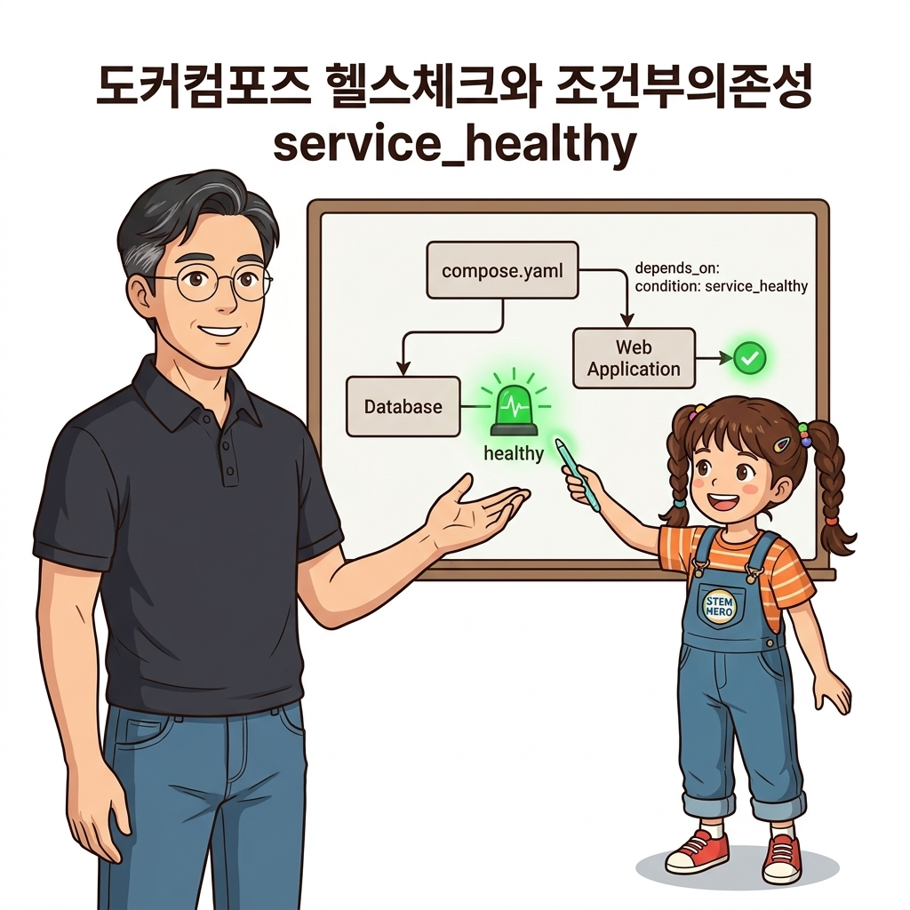
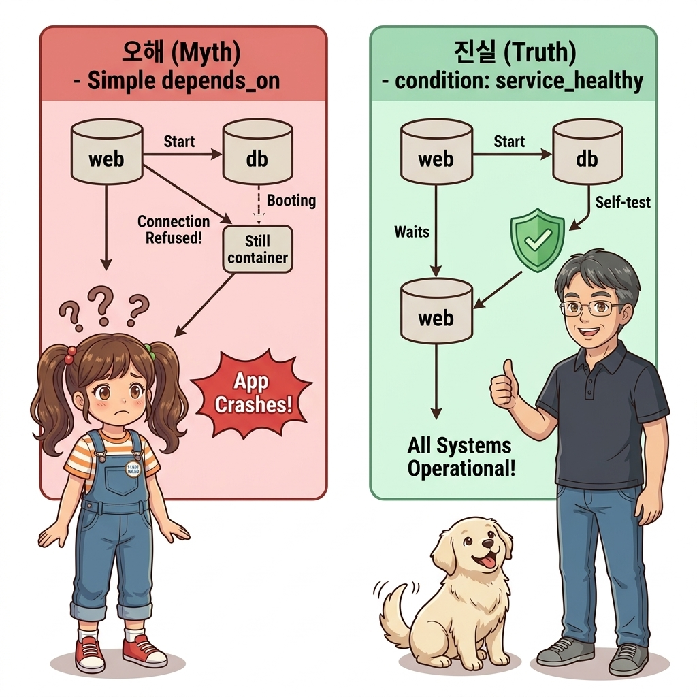
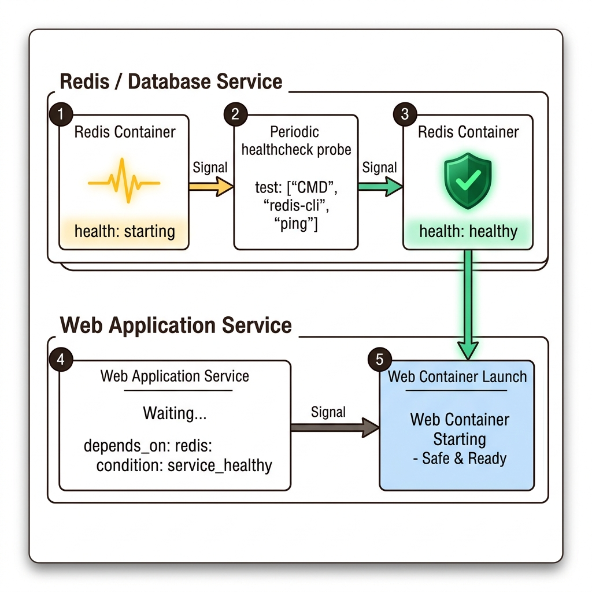
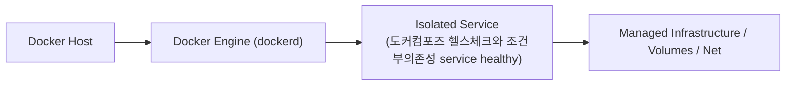
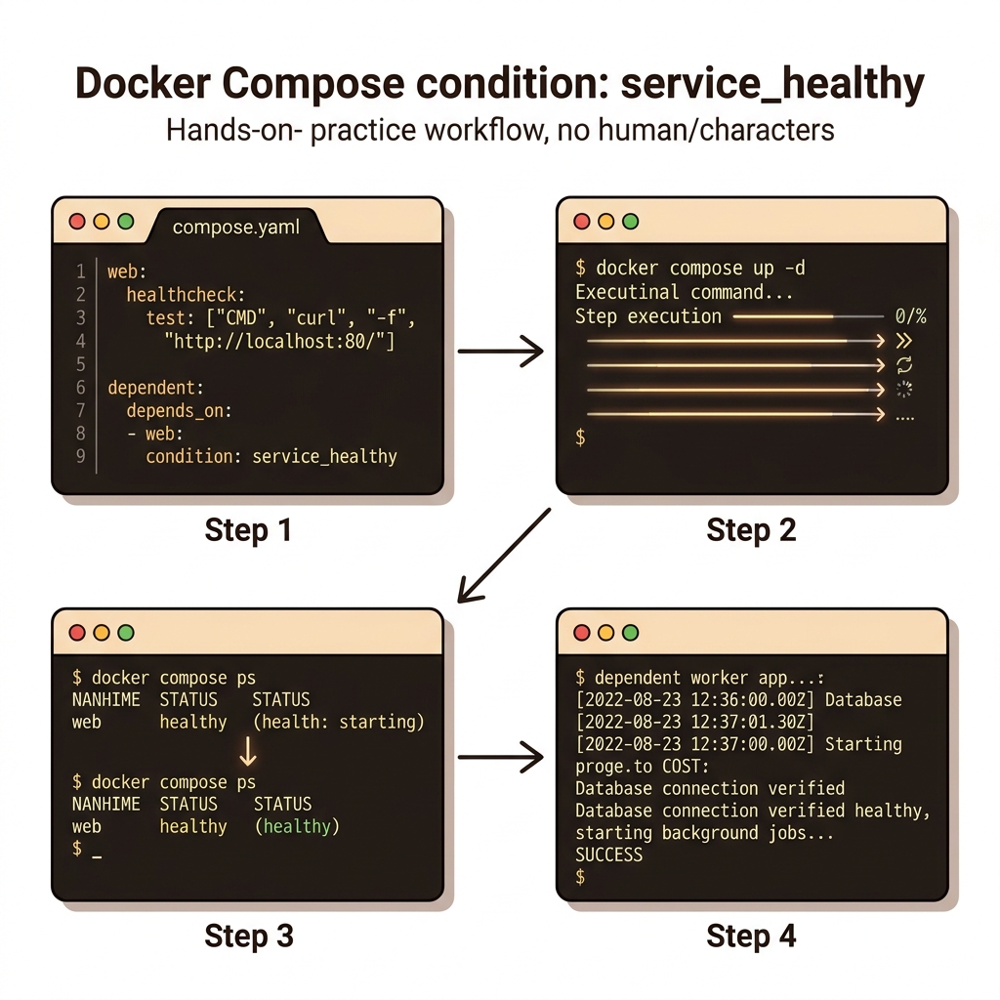
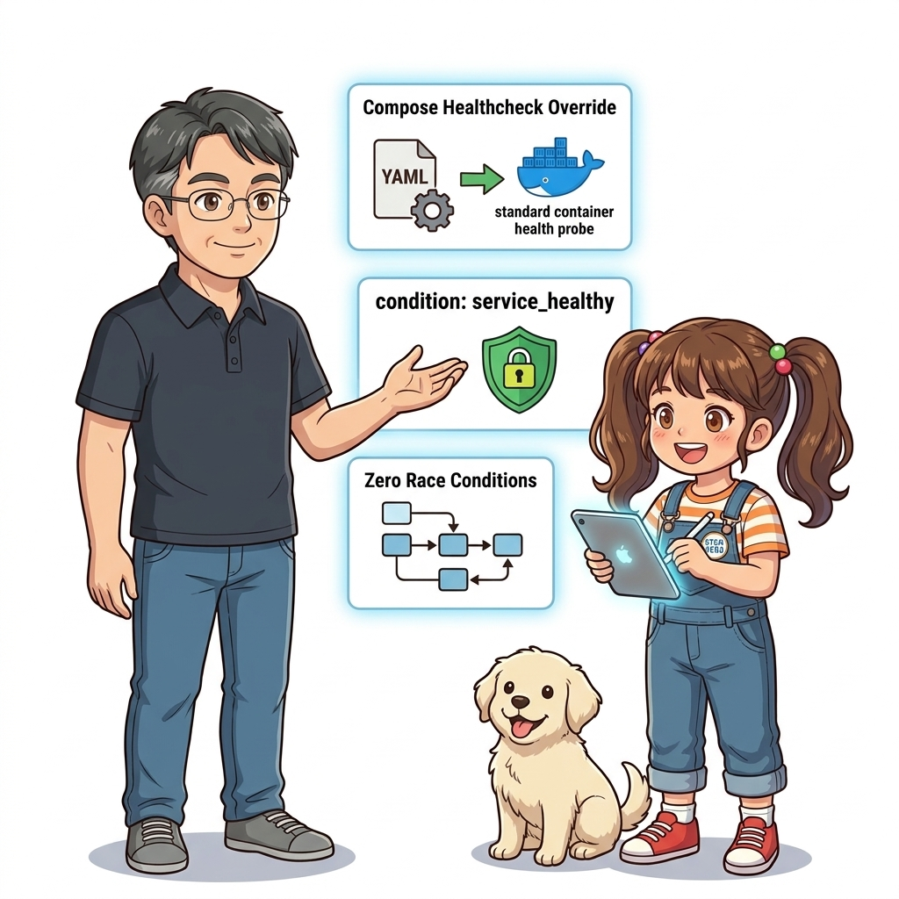
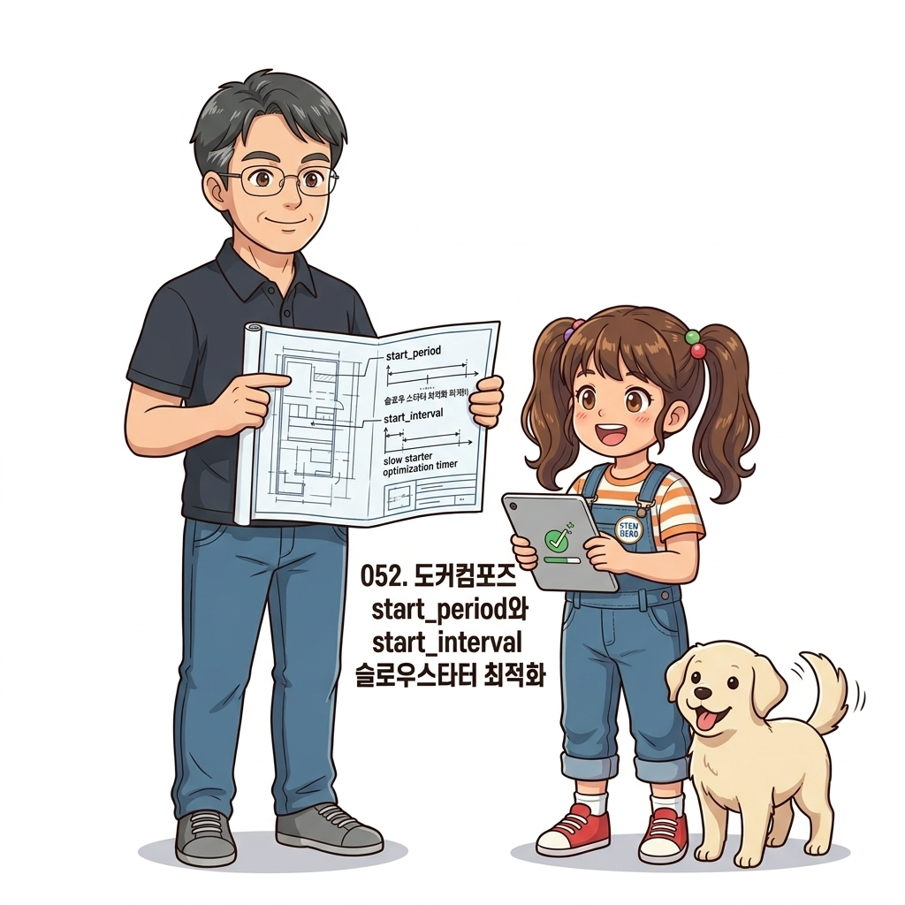

# 051. 도커컴포즈 헬스체크와 조건부의존성 service healthy

이미지에 `HEALTHCHECK`가 빠져 있더라도 `compose.yaml`의 **`healthcheck:` 블록**에서 검진 명령과 주기를 직접 주입하거나 오버라이드할 수 있습니다.


**그림 04-10-1** 도커컴포즈 헬스체크와 조건부의존성 service healthy의 필요성과 현대 클라우드 아키텍처 관점의 개요

---

### 051.1 왜 도커컴포즈 헬스체크와 조건부의존성 service healthy이(가) 필요한가? (문제 정의와 현실적 배경)

소프트웨어 시스템이 복잡해질수록 설정을 다루는 방식은 전체 인프라의 신뢰성을 결정짓는 핵심 척도가 됩니다. **도커컴포즈 헬스체크와 조건부의존성 service healthy**이(가) 부재하거나 잘못 다루어질 때 현장에서는 다음과 같은 대표적인 병목과 장애가 발생합니다:

1. **하드코딩된 설정과 환경 불일치로 인한 유연성 상실**: 환경이 바뀔 때마다 코드를 다시 빌드해야 하므로 배포 주기가 지연되고 이미지 수가 기하급수적으로 폭증합니다.
2. **보안 민감 데이터의 무분별한 노출**: 비밀번호, 데이터베이스 토큰, 암호화 키가 이미지 레이어에 영구 박제되어 형상관리 시스템이나 외부에 유출될 위험이 커집니다.
3. **재현 불가능한 구성 드리프트**: 스테이징 환경과 프로덕션 환경의 미세한 설정 차이가 예기치 못한 서비스 중단 사고로 직결됩니다.


**그림 04-10-2** 도커컴포즈 헬스체크와 조건부의존성 service healthy에 대한 대표적인 오해와 실제 프로덕션 현장의 엔지니어링 진실

---

### 051.2 핵심 아키텍처와 엔지니어링 메커니즘

나아가 도커 컴포즈 V2의 강력한 기능인 **`depends_on: condition: service_healthy`**와 **`restart: on-failure`**를 결합하여, 하위 서비스가 완전히 건강해질 때까지 기다렸다가 안전하게 기동하는 무결점 오케스트레이션을 실습합니다.


**그림 04-10-3** 도커컴포즈 헬스체크와 조건부의존성 service healthy의 내부 아키텍처 및 데이터 흐름

#### 📊 핵심 비교 및 엔지니어링 표준 분석

| 구분 / 핵심 원리 | 상세 설명 및 동작 메커니즘 | 실무 적용 시 주의점 및 베스트 프랙티스 |
| :--- | :--- | :--- |
| **컴포즈 `healthcheck:` 블록** | 외부 오픈소스 이미지(예: Redis, Postgres, Nginx)의 `Dockerfile`을 수정하지 않고도 컴포즈 파일에서 맞춤형 헬스 체크 정의 가능 | `test`, `interval`, `timeout`, `retries`, `start_period`를 직관적인 YAML로 선언 |
| **`condition: service_healthy`** | 단순히 컨테이너가 시작(`service_started`)된 것이 아니라, 헬스 체크를 통과해 `healthy` 상태가 될 때까지 후속 컨테이너 시작을 대기 | 초기화 시간이 긴 DB나 무거운 백엔드 API와 연동할 때 기동 순서 경쟁 조건(Race Condition)을 완벽히 해결! |
| **`restart: on-failure`** | 디펜던시 체크 실패 등으로 컨테이너가 0이 아닌 종료 코드로 꺼졌을 때 도커 엔진이 자동으로 컨테이너를 다시 시작 | 스웜이나 쿠버네티스 환경에서도 동일하게 동작하는 복원력 설계의 핵심 |

---

### 051.3 선언적 실습 및 아키텍처 다이어그램

본 실습은 외부 비공개 패키지에 의존하지 않고, 공식 표준 이미지를 기반으로 즉시 재현 가능한 살아있는 코드로 구성되어 있습니다.

```yaml
# [compose.yaml] 헬스 체크 + 조건부 의존성(service_healthy) + 실패 시 자동 재시작(restart) 결합!
services:
  core-api:
    image: nginx:1.27-alpine
    healthcheck:
      test: ["CMD", "wget", "-q", "--spider", "http://localhost/"]
      interval: 5s
      timeout: 2s
      retries: 3
      start_period: 2s

  web-front:
    image: nginx:1.27-alpine
    ports: ["8080:80"]
    restart: on-failure
    depends_on:
      core-api:
        condition: service_healthy
```

#### 🔍 아키텍처 흐름도 (Mermaid Diagram)




**그림 04-10-4** 선언적 인프라 명세를 통한 도커컴포즈 헬스체크와 조건부의존성 service healthy 검증 파이프라인

---

### 051.4 핵심 정리: 캐릭터 대화와 3대 교훈

> 👧 **도로시**: "교수님! **도커컴포즈 헬스체크와 조건부의존성 service healthy**의 원리를 배우니까, 복잡하게 얽혀 있던 인프라 설정이 레고 블록처럼 질서정연하게 제자리를 찾는 게 보여요!"
> 
> 🐱 **조교 지니**: "야옹~ 맞습니다! 특히 런타임 환경과 불변 인프라의 경계를 명확히 지키는 것이 대규모 클라우드 운영의 제1원칙이랍니다!"
> 
> 🐶 **토토**: "멍멍! 선언적 코드로 한 번 적어두면 언제든 똑같이 복원되니까 정말 든든해요!"
> 
> 👨‍🏫 **이호진 교수님**: "훌륭하구나. 원리를 깊이 이해하고 실습을 통해 손에 익히는 것이 훌륭한 클라우드 엔지니어로 성장하는 가장 빠른 지름길이란다."


**그림 04-10-5** 도커컴포즈 헬스체크와 조건부의존성 service healthy 마스터를 위한 3대 핵심 교훈

1. **설정과 실행의 명확한 분리**:
   * 애플리케이션 코드는 불변으로 유지하고, 가변적인 설정값은 외부에서 주입하여 이식성을 극대화합니다.
2. **선언적 재현성 확보**:
   * 사람이 수작업으로 변경하지 않고 코드 명세를 통해 언제 어디서나 100% 동일한 실행 결과를 보장합니다.
3. **최소 권한 및 보안 모범 사례 준수**:
   * 불필요한 권한과 포트 노출을 최소화하고 민감 데이터를 암호화하여 프로덕션 안정성을 담보합니다.

---

### 051.5 랩노트 피날레와 다음 강의 예고


**그림 04-10-6** 연구실에서 다음 마일스톤인 [자기치유 Self Healing 아키텍처의 원리와 Part04 중간점검] 실습을 예고하는 교수님과 토토

> 💡 **다음 강의 안내**:
> [자기치유 Self Healing 아키텍처의 원리와 Part04 중간점검](../052_자기치유_Self_Healing_아키텍처의_원리와_Part04_중간점검/)에서는 더욱 심화된 실전 엔지니어링 실습과 아키텍처를 다룹니다!

---

## 🧭 강의 네비게이션
* [◀️ 이전 강의: 050_보안을위한_커스텀헬스체크_유틸리티제작](../050_보안을위한_커스텀헬스체크_유틸리티제작/)
* [📋 Part 04. 도커 컴포즈(Compose) 분산 앱 실행, 헬스/디펜던시 체크 & 모니터링 (042 ~ 061) 목차로 돌아가기](../)
* [▶️ 다음 강의: 052_자기치유_Self_Healing_아키텍처의_원리와_Part04_중간점검](../052_자기치유_Self_Healing_아키텍처의_원리와_Part04_중간점검/)
