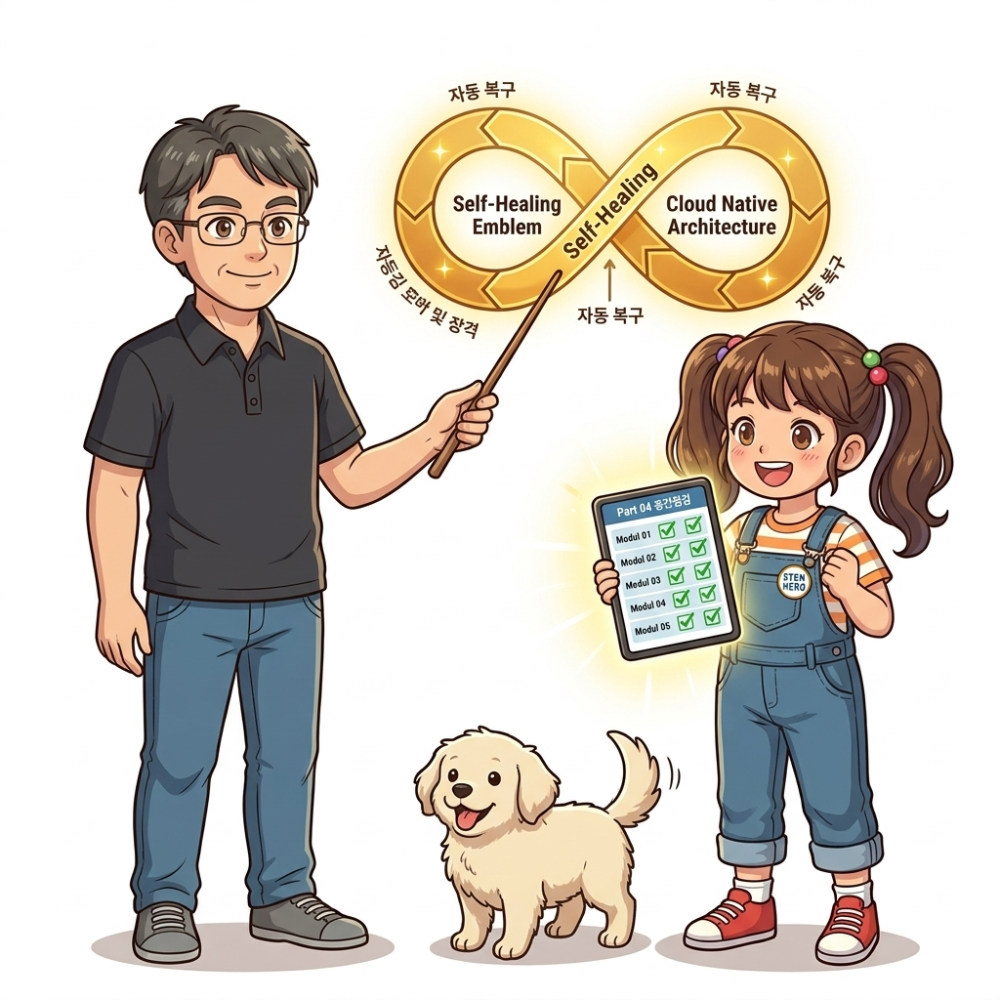
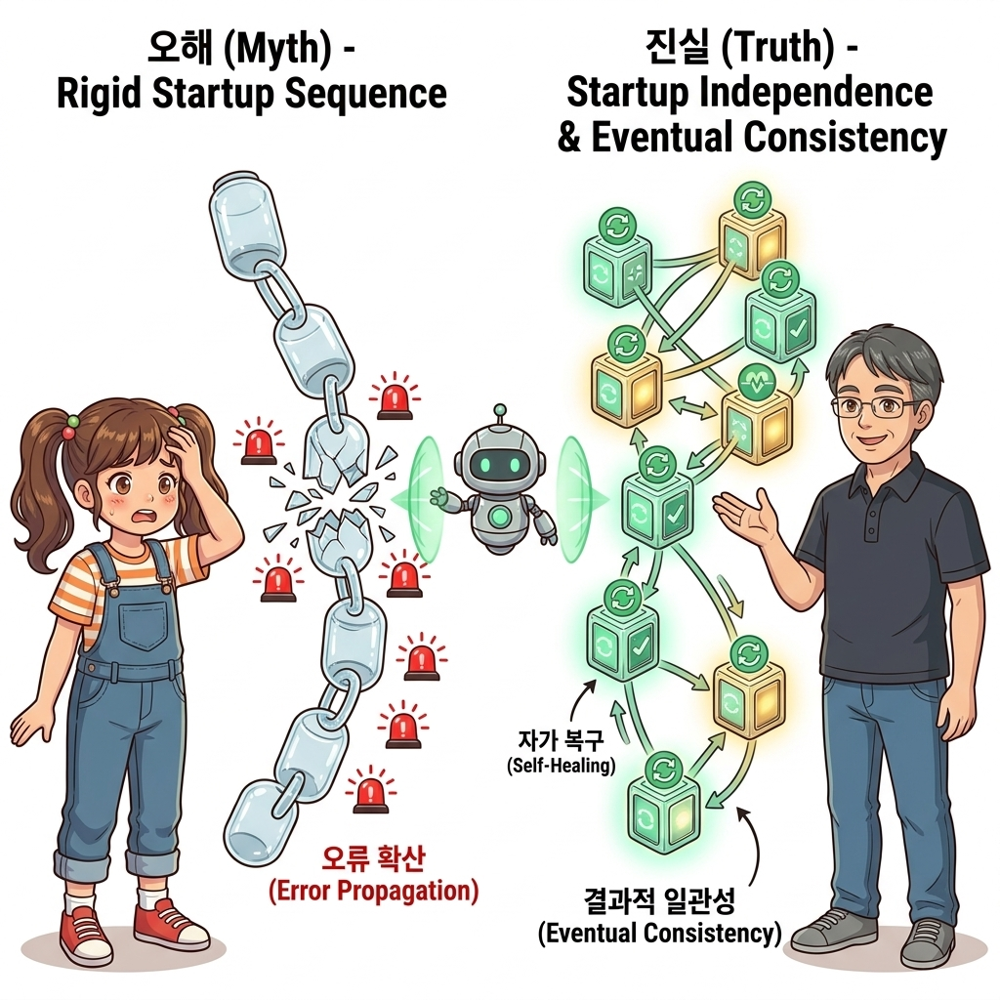
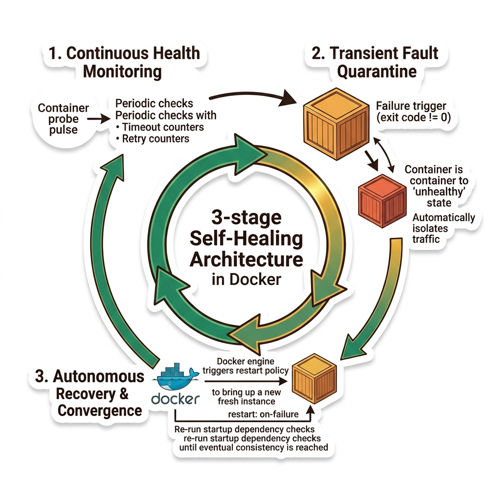
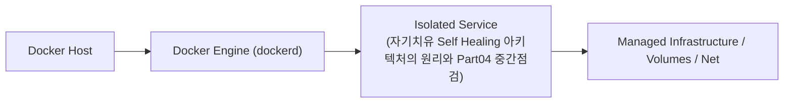
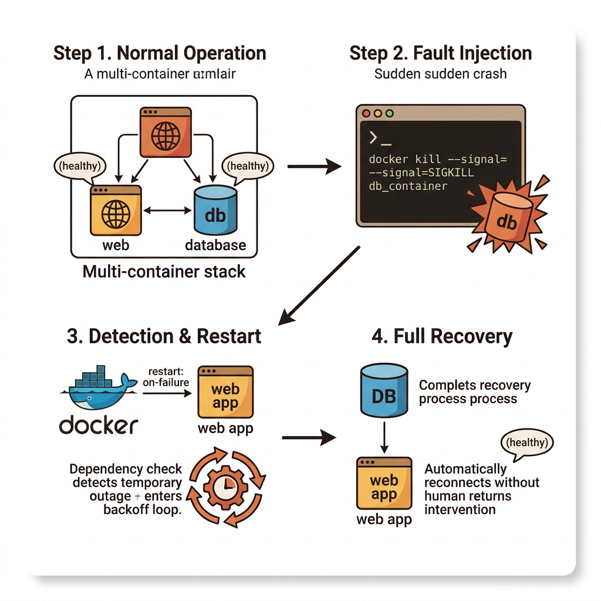
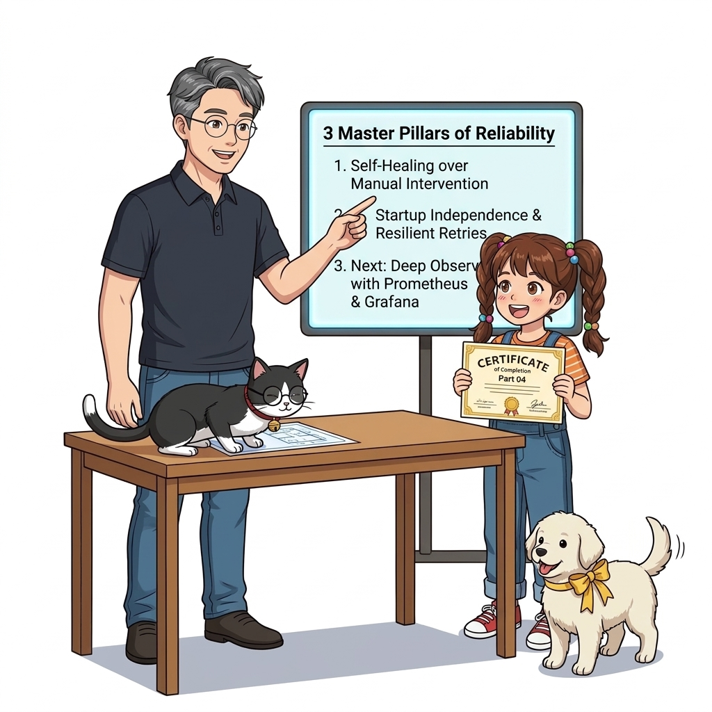
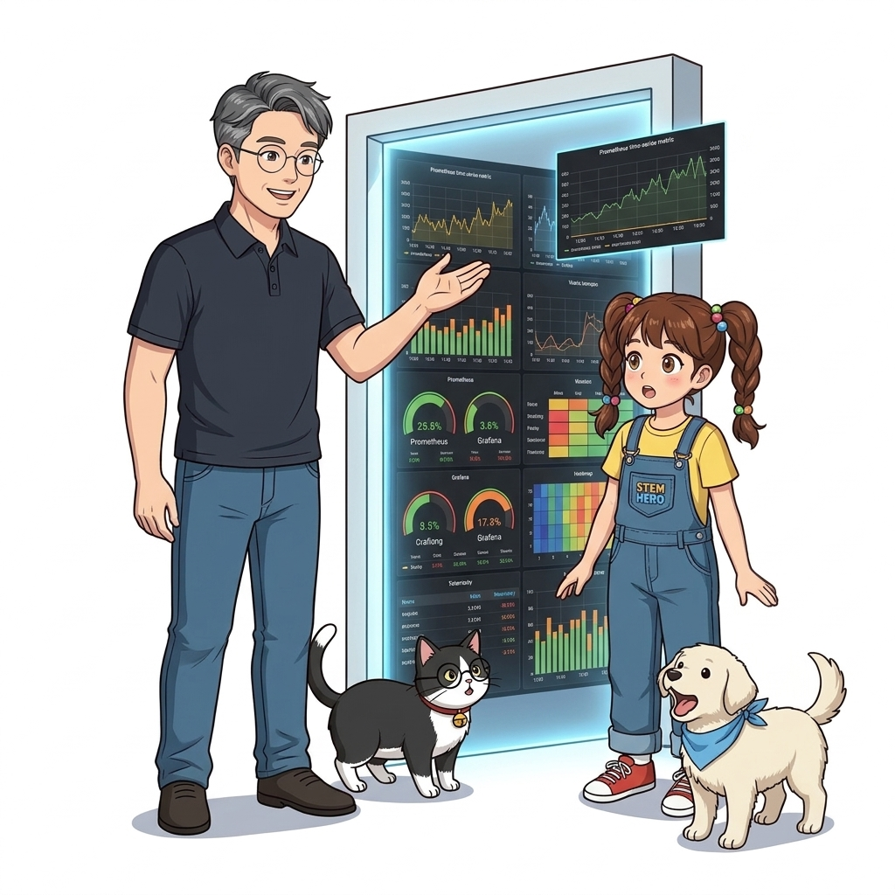

# 052. 자기치유 Self Healing 아키텍처의 원리와 Part04 중간점검

8장에서 배운 **헬스 체크(Health Check)**와 **디펜던시 체크(Dependency Check)**가 어떻게 결합되어 대규모 분산 시스템의 **복원력(Resilience)과 자기 치유(Self-Healing)**를 만들어내는지 전체 그림을 정리합니다.


**그림 04-11-1** 자기치유 Self Healing 아키텍처의 원리와 Part04 중간점검의 필요성과 현대 클라우드 아키텍처 관점의 개요

---

### 052.1 왜 자기치유 Self Healing 아키텍처의 원리와 Part04 중간점검이(가) 필요한가? (문제 정의와 현실적 배경)

소프트웨어 시스템이 복잡해질수록 설정을 다루는 방식은 전체 인프라의 신뢰성을 결정짓는 핵심 척도가 됩니다. **자기치유 Self Healing 아키텍처의 원리와 Part04 중간점검**이(가) 부재하거나 잘못 다루어질 때 현장에서는 다음과 같은 대표적인 병목과 장애가 발생합니다:

1. **하드코딩된 설정과 환경 불일치로 인한 유연성 상실**: 환경이 바뀔 때마다 코드를 다시 빌드해야 하므로 배포 주기가 지연되고 이미지 수가 기하급수적으로 폭증합니다.
2. **보안 민감 데이터의 무분별한 노출**: 비밀번호, 데이터베이스 토큰, 암호화 키가 이미지 레이어에 영구 박제되어 형상관리 시스템이나 외부에 유출될 위험이 커집니다.
3. **재현 불가능한 구성 드리프트**: 스테이징 환경과 프로덕션 환경의 미세한 설정 차이가 예기치 못한 서비스 중단 사고로 직결됩니다.


**그림 04-11-2** 자기치유 Self Healing 아키텍처의 원리와 Part04 중간점검에 대한 대표적인 오해와 실제 프로덕션 현장의 엔지니어링 진실

---

### 052.2 핵심 아키텍처와 엔지니어링 메커니즘

컨테이너 기동 순서에 절대 의존하지 않고, 어느 컴포넌트가 먼저 켜지거나 중간에 재시작되더라도 결국 전체 시스템이 정상 상태로 수렴(Eventual Consistency)하도록 만드는 클라우드 네이티브 설계 철학을 확립합니다.


**그림 04-11-3** 자기치유 Self Healing 아키텍처의 원리와 Part04 중간점검의 내부 아키텍처 및 데이터 흐름

#### 📊 핵심 비교 및 엔지니어링 표준 분석

| 구분 / 핵심 원리 | 상세 설명 및 동작 메커니즘 | 실무 적용 시 주의점 및 베스트 프랙티스 |
| :--- | :--- | :--- |
| **기동 순서 독립성 확보** | 실제 운영 클러스터에서는 네트워크 지연이나 노드 장애로 컨테이너 실행 순서를 100% 통제할 수 없음 | 디펜던시 체크 + 자동 재시작이 있으면 아무 순서로나 컨테이너를 던져 놓아도 스스로 짝을 찾아 정상 기동됨! |
| **일시적 장애(Transient Fault) 극복** | 순간적인 메모리 스파이크나 네트워크 순단으로 고장 난 컨테이너를 헬스 체크가 잡아내어 재시작/교체 | 사람의 수동 개입 없이 99.9%의 일시적 장애가 수 초 내에 자동 복구됨 |
| **모니터링으로의 연결** | 컨테이너가 스스로 재시작하며 버티고 있더라도, '왜 자주 재시작되는지' 근본 원인을 알려면 내부 지표를 들여다봐야 함 | 바로 이어지는 9장(053~061강)에서 **Prometheus와 Grafana 모니터링**으로 투명성을 확보합니다! |

---

### 052.3 선언적 실습 및 아키텍처 다이어그램

본 실습은 외부 비공개 패키지에 의존하지 않고, 공식 표준 이미지를 기반으로 즉시 재현 가능한 살아있는 코드로 구성되어 있습니다.

```bash
# 자기 치유(Self-Healing) 분산 애플리케이션의 3대 핵심 방어선 검증 스크립트
cat << 'EOF'
[Defense 1: Startup Dependency Check] -> 하위 서비스 미준비 시 Fail-Fast 종료 후 자동 재시도
[Defense 2: Runtime Health Check]     -> 실행 중 데드락/500 에러 발생 시 unhealthy 상태 전환 감지
[Defense 3: Auto Restart / Replace]   -> 오케스트레이터가 unhealthy 컨테이너를 새 컨테이너로 즉시 교체!
EOF
```

#### 🔍 아키텍처 흐름도 (Mermaid Diagram)




**그림 04-11-4** 선언적 인프라 명세를 통한 자기치유 Self Healing 아키텍처의 원리와 Part04 중간점검 검증 파이프라인

---

### 052.4 핵심 정리: 캐릭터 대화와 3대 교훈

> 👧 **도로시**: "교수님! **자기치유 Self Healing 아키텍처의 원리와 Part04 중간점검**의 원리를 배우니까, 복잡하게 얽혀 있던 인프라 설정이 레고 블록처럼 질서정연하게 제자리를 찾는 게 보여요!"
> 
> 🐱 **조교 지니**: "야옹~ 맞습니다! 특히 런타임 환경과 불변 인프라의 경계를 명확히 지키는 것이 대규모 클라우드 운영의 제1원칙이랍니다!"
> 
> 🐶 **토토**: "멍멍! 선언적 코드로 한 번 적어두면 언제든 똑같이 복원되니까 정말 든든해요!"
> 
> 👨‍🏫 **이호진 교수님**: "훌륭하구나. 원리를 깊이 이해하고 실습을 통해 손에 익히는 것이 훌륭한 클라우드 엔지니어로 성장하는 가장 빠른 지름길이란다."


**그림 04-11-5** 자기치유 Self Healing 아키텍처의 원리와 Part04 중간점검 마스터를 위한 3대 핵심 교훈

1. **설정과 실행의 명확한 분리**:
   * 애플리케이션 코드는 불변으로 유지하고, 가변적인 설정값은 외부에서 주입하여 이식성을 극대화합니다.
2. **선언적 재현성 확보**:
   * 사람이 수작업으로 변경하지 않고 코드 명세를 통해 언제 어디서나 100% 동일한 실행 결과를 보장합니다.
3. **최소 권한 및 보안 모범 사례 준수**:
   * 불필요한 권한과 포트 노출을 최소화하고 민감 데이터를 암호화하여 프로덕션 안정성을 담보합니다.

---

### 052.5 랩노트 피날레와 다음 강의 예고


**그림 04-11-6** 연구실에서 다음 마일스톤인 [컨테이너 모니터링 기술스택 Prometheus와 Grafana] 실습을 예고하는 교수님과 토토

> 💡 **다음 강의 안내**:
> [컨테이너 모니터링 기술스택 Prometheus와 Grafana](../053_컨테이너_모니터링_기술스택_Prometheus와_Grafana/)에서는 더욱 심화된 실전 엔지니어링 실습과 아키텍처를 다룹니다!

---

## 🧭 강의 네비게이션
* [◀️ 이전 강의: 051_도커컴포즈_헬스체크와_조건부의존성_service_healthy](../051_도커컴포즈_헬스체크와_조건부의존성_service_healthy/)
* [📋 Part 04. 도커 컴포즈(Compose) 분산 앱 실행, 헬스/디펜던시 체크 & 모니터링 (042 ~ 061) 목차로 돌아가기](../)
* [▶️ 다음 강의: 053_컨테이너_모니터링_기술스택_Prometheus와_Grafana](../053_컨테이너_모니터링_기술스택_Prometheus와_Grafana/)
