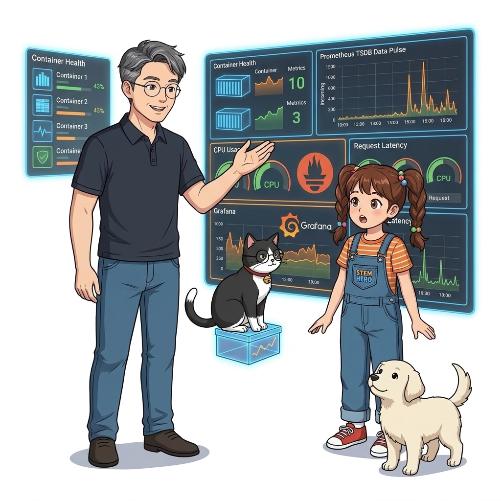
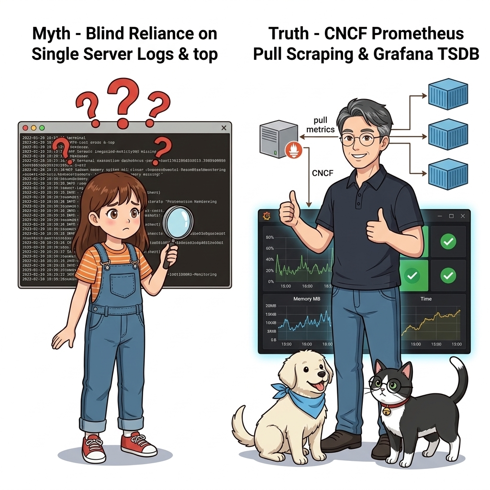
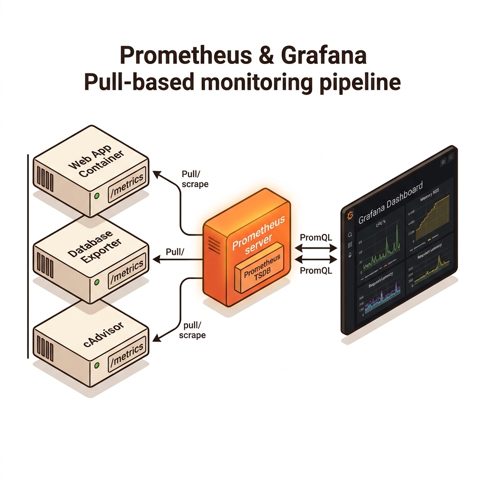
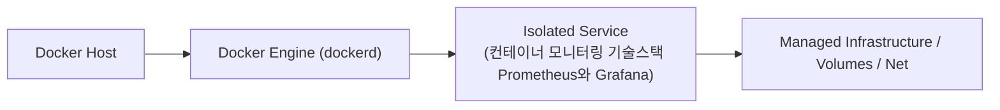
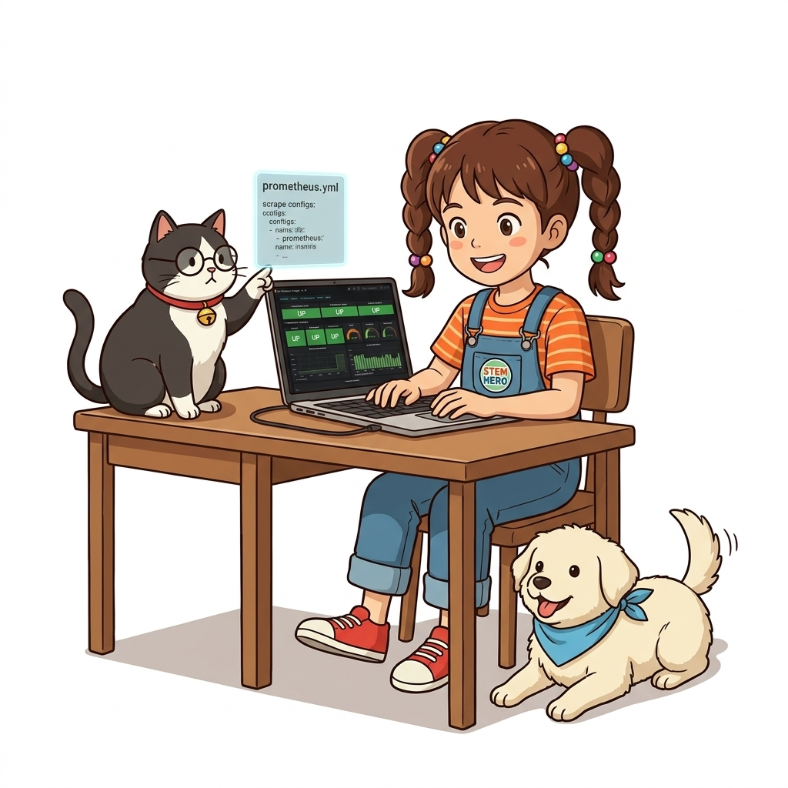
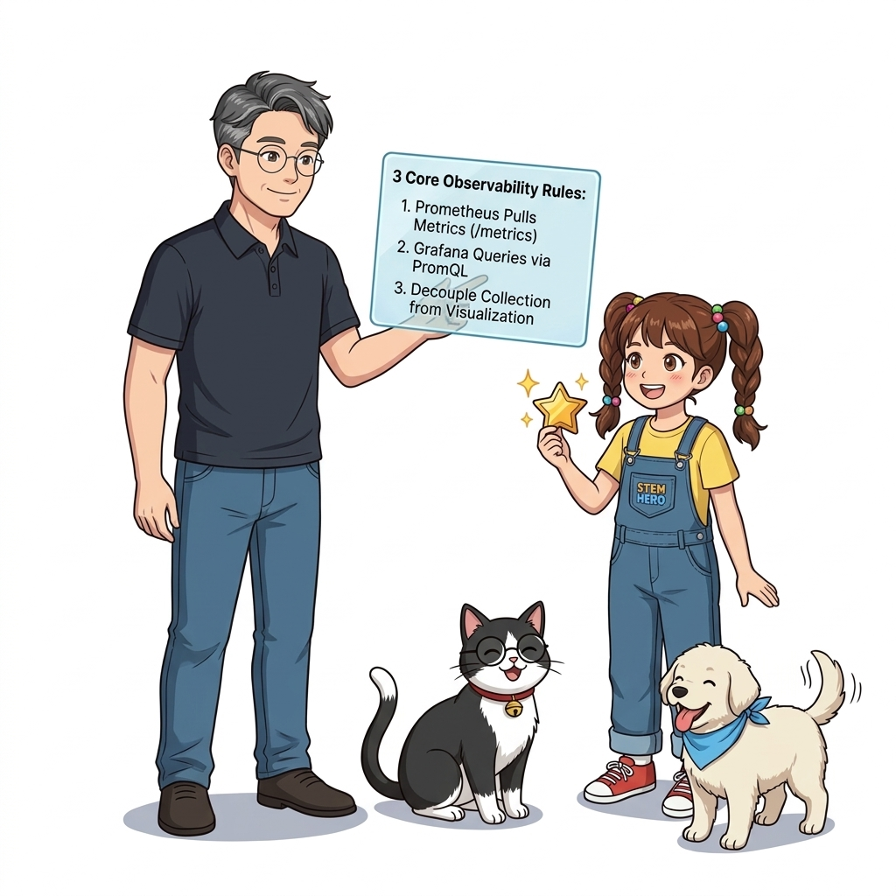
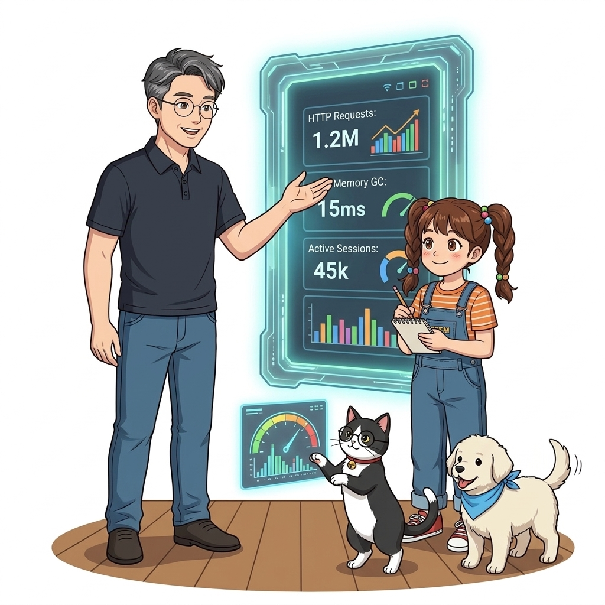

# 053. 컨테이너 모니터링 기술스택 Prometheus와 Grafana

단일 서버 시절에는 `top`이나 `htop` 명령어로 충분했지만, 수십 개의 컨테이너가 동적으로 생성·소멸하는 환경에서는 **모든 컨테이너의 기술적 지표(CPU/메모리)와 비즈니스 지표(요청 수/응답 시간/에러율)를 한곳으로 모으는 중앙 모니터링 스택**이 필수입니다.


**그림 04-12-1** 컨테이너 모니터링 기술스택 Prometheus와 Grafana의 필요성과 현대 클라우드 아키텍처 관점의 개요

---

### 053.1 왜 컨테이너 모니터링 기술스택 Prometheus와 Grafana이(가) 필요한가? (문제 정의와 현실적 배경)

소프트웨어 시스템이 복잡해질수록 설정을 다루는 방식은 전체 인프라의 신뢰성을 결정짓는 핵심 척도가 됩니다. **컨테이너 모니터링 기술스택 Prometheus와 Grafana**이(가) 부재하거나 잘못 다루어질 때 현장에서는 다음과 같은 대표적인 병목과 장애가 발생합니다:

1. **하드코딩된 설정과 환경 불일치로 인한 유연성 상실**: 환경이 바뀔 때마다 코드를 다시 빌드해야 하므로 배포 주기가 지연되고 이미지 수가 기하급수적으로 폭증합니다.
2. **보안 민감 데이터의 무분별한 노출**: 비밀번호, 데이터베이스 토큰, 암호화 키가 이미지 레이어에 영구 박제되어 형상관리 시스템이나 외부에 유출될 위험이 커집니다.
3. **재현 불가능한 구성 드리프트**: 스테이징 환경과 프로덕션 환경의 미세한 설정 차이가 예기치 못한 서비스 중단 사고로 직결됩니다.


**그림 04-12-2** 컨테이너 모니터링 기술스택 Prometheus와 Grafana에 대한 대표적인 오해와 실제 프로덕션 현장의 엔지니어링 진실

---

### 053.2 핵심 아키텍처와 엔지니어링 메커니즘

클라우드 네이티브 재단(CNCF)의 핵심 졸업 프로젝트인 **프로메테우스(Prometheus: 메트릭 수집 및 시계열 DB)**와 **그라파나(Grafana: 시각화 대시보드)**의 Pull 기반 모니터링 아키텍처를 배웁니다.


**그림 04-12-3** 컨테이너 모니터링 기술스택 Prometheus와 Grafana의 내부 아키텍처 및 데이터 흐름

#### 📊 핵심 비교 및 엔지니어링 표준 분석

| 구분 / 핵심 원리 | 상세 설명 및 동작 메커니즘 | 실무 적용 시 주의점 및 베스트 프랙티스 |
| :--- | :--- | :--- |
| **Push 방식 vs Pull(Scraping) 방식** | 에이전트가 서버로 데이터를 밀어넣는(Push) 대신, **Prometheus 서버가 주기적으로 컨테이너들의 `/metrics` HTTP 엔드포인트를 호출해 긁어오는(Pull/Scrape)** 방식 | 애플리케이션은 모니터링 서버 주소를 알 필요 없이 자기 포트에 `/metrics`만 열어두면 되어 결합도가 매우 낮음! |
| **프로메테우스 (Prometheus)** | 컨테이너와 도커 엔진의 측정값(Metrics)을 주기적으로 수집해 타임스탬프와 함께 저장하는 시계열 데이터베이스(TSDB) | 도커 스웜 및 쿠버네티스 서비스 디스커버리를 기본 내장하여 스케일 아웃된 컨테이너도 자동 감지 |
| **그라파나 (Grafana)** | 프로메테우스에 저장된 시계열 데이터를 PromQL로 질의하여 아름다운 실시간 그래프, 게이지, 알림판으로 시각화 | 전 세계 데브옵스 엔지니어들이 가장 널리 사용하는 관제 센터 UI |

---

### 053.3 선언적 실습 및 아키텍처 다이어그램

본 실습은 외부 비공개 패키지에 의존하지 않고, 공식 표준 이미지를 기반으로 즉시 재현 가능한 살아있는 코드로 구성되어 있습니다.

```yaml
# 클라우드 네이티브 표준 모니터링 아키텍처 (Target Containers <---Pull--- Prometheus <---Query--- Grafana)
services:
  prometheus:
    image: prom/prometheus:v2.53.0
    ports: ["9090:9090"]
  grafana:
    image: grafana/grafana-oss:11.1.0
    ports: ["3000:3000"]
    depends_on: [prometheus]
```

#### 🔍 아키텍처 흐름도 (Mermaid Diagram)




**그림 04-12-4** 선언적 인프라 명세를 통한 컨테이너 모니터링 기술스택 Prometheus와 Grafana 검증 파이프라인

---

### 053.4 핵심 정리: 캐릭터 대화와 3대 교훈

> 👧 **도로시**: "교수님! **컨테이너 모니터링 기술스택 Prometheus와 Grafana**의 원리를 배우니까, 복잡하게 얽혀 있던 인프라 설정이 레고 블록처럼 질서정연하게 제자리를 찾는 게 보여요!"
> 
> 🐱 **조교 지니**: "야옹~ 맞습니다! 특히 런타임 환경과 불변 인프라의 경계를 명확히 지키는 것이 대규모 클라우드 운영의 제1원칙이랍니다!"
> 
> 🐶 **토토**: "멍멍! 선언적 코드로 한 번 적어두면 언제든 똑같이 복원되니까 정말 든든해요!"
> 
> 👨‍🏫 **이호진 교수님**: "훌륭하구나. 원리를 깊이 이해하고 실습을 통해 손에 익히는 것이 훌륭한 클라우드 엔지니어로 성장하는 가장 빠른 지름길이란다."


**그림 04-12-5** 컨테이너 모니터링 기술스택 Prometheus와 Grafana 마스터를 위한 3대 핵심 교훈

1. **설정과 실행의 명확한 분리**:
   * 애플리케이션 코드는 불변으로 유지하고, 가변적인 설정값은 외부에서 주입하여 이식성을 극대화합니다.
2. **선언적 재현성 확보**:
   * 사람이 수작업으로 변경하지 않고 코드 명세를 통해 언제 어디서나 100% 동일한 실행 결과를 보장합니다.
3. **최소 권한 및 보안 모범 사례 준수**:
   * 불필요한 권한과 포트 노출을 최소화하고 민감 데이터를 암호화하여 프로덕션 안정성을 담보합니다.

---

### 053.5 랩노트 피날레와 다음 강의 예고


**그림 04-12-6** 연구실에서 다음 마일스톤인 [애플리케이션 메트릭노출1 런타임지표와 비즈니스지표] 실습을 예고하는 교수님과 토토

> 💡 **다음 강의 안내**:
> [애플리케이션 메트릭노출1 런타임지표와 비즈니스지표](../054_애플리케이션_메트릭노출1_런타임지표와_비즈니스지표/)에서는 더욱 심화된 실전 엔지니어링 실습과 아키텍처를 다룹니다!

---

## 🧭 강의 네비게이션
* [◀️ 이전 강의: 052_자기치유_Self_Healing_아키텍처의_원리와_Part04_중간점검](../052_자기치유_Self_Healing_아키텍처의_원리와_Part04_중간점검/)
* [📋 Part 04. 도커 컴포즈(Compose) 분산 앱 실행, 헬스/디펜던시 체크 & 모니터링 (042 ~ 061) 목차로 돌아가기](../)
* [▶️ 다음 강의: 054_애플리케이션_메트릭노출1_런타임지표와_비즈니스지표](../054_애플리케이션_메트릭노출1_런타임지표와_비즈니스지표/)
