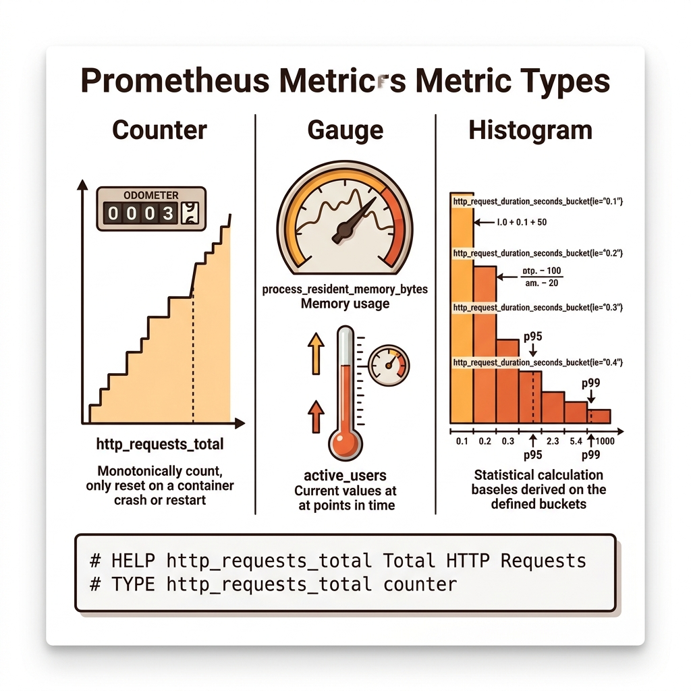
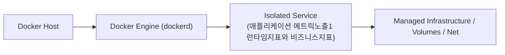
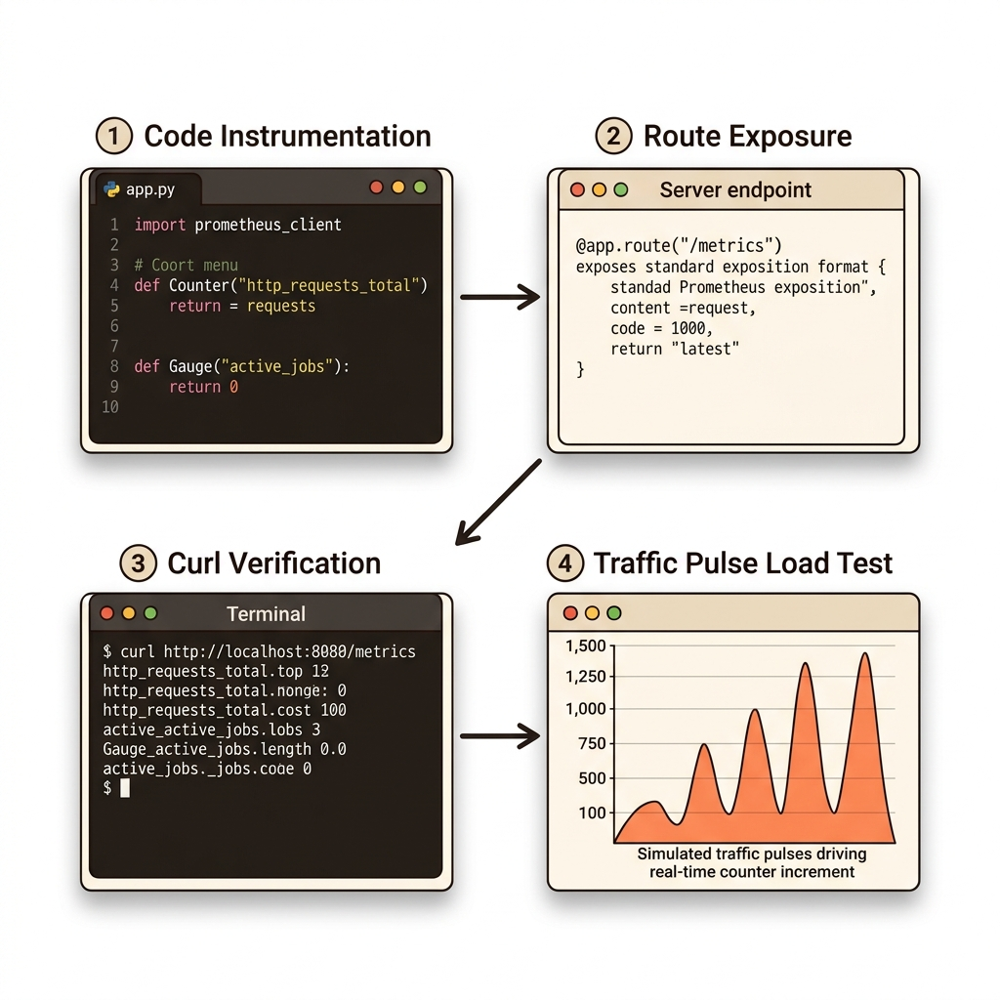

# 054. 애플리케이션 메트릭노출1 런타임지표와 비즈니스지표

프로메테우스가 읽어들일 수 있는 표준 텍스트 포맷(`# HELP`, `# TYPE`, `메트릭이름{레이블="값"} 숫자`)의 구조를 이해합니다.


**그림 04-13-1** 애플리케이션 메트릭노출1 런타임지표와 비즈니스지표의 필요성과 현대 클라우드 아키텍처 관점의 개요

---

### 054.1 왜 애플리케이션 메트릭노출1 런타임지표와 비즈니스지표이(가) 필요한가? (문제 정의와 현실적 배경)

소프트웨어 시스템이 복잡해질수록 설정을 다루는 방식은 전체 인프라의 신뢰성을 결정짓는 핵심 척도가 됩니다. **애플리케이션 메트릭노출1 런타임지표와 비즈니스지표**이(가) 부재하거나 잘못 다루어질 때 현장에서는 다음과 같은 대표적인 병목과 장애가 발생합니다:

1. **하드코딩된 설정과 환경 불일치로 인한 유연성 상실**: 환경이 바뀔 때마다 코드를 다시 빌드해야 하므로 배포 주기가 지연되고 이미지 수가 기하급수적으로 폭증합니다.
2. **보안 민감 데이터의 무분별한 노출**: 비밀번호, 데이터베이스 토큰, 암호화 키가 이미지 레이어에 영구 박제되어 형상관리 시스템이나 외부에 유출될 위험이 커집니다.
3. **재현 불가능한 구성 드리프트**: 스테이징 환경과 프로덕션 환경의 미세한 설정 차이가 예기치 못한 서비스 중단 사고로 직결됩니다.


**그림 04-13-2** 애플리케이션 메트릭노출1 런타임지표와 비즈니스지표에 대한 대표적인 오해와 실제 프로덕션 현장의 엔지니어링 진실

---

### 054.2 핵심 아키텍처와 엔지니어링 메커니즘

언어별 공식 프로메테우스 클라이언트 라이브러리(`prometheus-client` for Python/Node/Go/Java)가 기본 제공하는 **런타임 지표(메모리, GC, 스레드 수)**와 개발자가 직접 정의하는 **커스텀 비즈니스 지표(HTTP 요청 카운터, 현재 활성 작업 게이지)**를 출력하는 마이크로서비스를 직접 작성합니다!


**그림 04-13-3** 애플리케이션 메트릭노출1 런타임지표와 비즈니스지표의 내부 아키텍처 및 데이터 흐름

#### 📊 핵심 비교 및 엔지니어링 표준 분석

| 구분 / 핵심 원리 | 상세 설명 및 동작 메커니즘 | 실무 적용 시 주의점 및 베스트 프랙티스 |
| :--- | :--- | :--- |
| **카운터 (Counter)** | 오직 증가하거나(컨테이너 재시작 시 0으로 초기화) 누적되기만 하는 지표 | 총 HTTP 요청 수(`http_requests_total`), 누적 주문 건수, 누적 에러 발생 횟수 측정에 사용 |
| **게이지 (Gauge)** | 현재 시점의 상태에 따라 올라갈 수도 있고 내려갈 수도 있는 온도계 같은 지표 | 현재 메모리 사용량, 현재 접속 중인 사용자 수, 대기 중인 큐(Queue) 작업 수 측정에 사용 |
| **히스토그램 (Histogram) & 서머리** | 요청 응답 시간(Latency)이나 응답 크기처럼 값의 분포(백분위수 95%, 99%)와 평균을 계산하기 위한 버킷 지표 | 평균의 함정에 빠지지 않고 상위 1% 느린 요청(Tail Latency)을 잡아내는 핵심 지표 |

---

### 054.3 선언적 실습 및 아키텍처 다이어그램

본 실습은 외부 비공개 패키지에 의존하지 않고, 공식 표준 이미지를 기반으로 즉시 재현 가능한 살아있는 코드로 구성되어 있습니다.

```python
# 프로메테우스 표준 포맷의 런타임 & 비즈니스 메트릭(/metrics)을 생성하는 파이썬 원리 검증
def render_prometheus_metrics(active_users: int, total_orders: int, error_count: int) -> str:
    return f"""# HELP oz_active_users Current active users in service
# TYPE oz_active_users gauge
oz_active_users{{service="order-web"}} {active_users}
# HELP oz_orders_total Total processed orders
# TYPE oz_orders_total counter
oz_orders_total{{status="success"}} {total_orders}
oz_orders_total{{status="error"}} {error_count}"""

print(render_prometheus_metrics(active_users=42, total_orders=1280, error_count=3))
```

#### 🔍 아키텍처 흐름도 (Mermaid Diagram)




**그림 04-13-4** 선언적 인프라 명세를 통한 애플리케이션 메트릭노출1 런타임지표와 비즈니스지표 검증 파이프라인

---

### 054.4 핵심 정리: 캐릭터 대화와 3대 교훈

> 👧 **도로시**: "교수님! **애플리케이션 메트릭노출1 런타임지표와 비즈니스지표**의 원리를 배우니까, 복잡하게 얽혀 있던 인프라 설정이 레고 블록처럼 질서정연하게 제자리를 찾는 게 보여요!"
> 
> 🐱 **조교 지니**: "야옹~ 맞습니다! 특히 런타임 환경과 불변 인프라의 경계를 명확히 지키는 것이 대규모 클라우드 운영의 제1원칙이랍니다!"
> 
> 🐶 **토토**: "멍멍! 선언적 코드로 한 번 적어두면 언제든 똑같이 복원되니까 정말 든든해요!"
> 
> 👨‍🏫 **이호진 교수님**: "훌륭하구나. 원리를 깊이 이해하고 실습을 통해 손에 익히는 것이 훌륭한 클라우드 엔지니어로 성장하는 가장 빠른 지름길이란다."


**그림 04-13-5** 애플리케이션 메트릭노출1 런타임지표와 비즈니스지표 마스터를 위한 3대 핵심 교훈

1. **설정과 실행의 명확한 분리**:
   * 애플리케이션 코드는 불변으로 유지하고, 가변적인 설정값은 외부에서 주입하여 이식성을 극대화합니다.
2. **선언적 재현성 확보**:
   * 사람이 수작업으로 변경하지 않고 코드 명세를 통해 언제 어디서나 100% 동일한 실행 결과를 보장합니다.
3. **최소 권한 및 보안 모범 사례 준수**:
   * 불필요한 권한과 포트 노출을 최소화하고 민감 데이터를 암호화하여 프로덕션 안정성을 담보합니다.

---

### 054.5 랩노트 피날레와 다음 강의 예고


**그림 04-13-6** 연구실에서 다음 마일스톤인 [애플리케이션 메트릭노출2 cAdvisor와 Node Exporter연동] 실습을 예고하는 교수님과 토토

> 💡 **다음 강의 안내**:
> [애플리케이션 메트릭노출2 cAdvisor와 Node Exporter연동](../055_애플리케이션_메트릭노출2_cAdvisor와_Node_Exporter연동/)에서는 더욱 심화된 실전 엔지니어링 실습과 아키텍처를 다룹니다!

---

## 🧭 강의 네비게이션
* [◀️ 이전 강의: 053_컨테이너_모니터링_기술스택_Prometheus와_Grafana](../053_컨테이너_모니터링_기술스택_Prometheus와_Grafana/)
* [📋 Part 04. 도커 컴포즈(Compose) 분산 앱 실행, 헬스/디펜던시 체크 & 모니터링 (042 ~ 061) 목차로 돌아가기](../)
* [▶️ 다음 강의: 055_애플리케이션_메트릭노출2_cAdvisor와_Node_Exporter연동](../055_애플리케이션_메트릭노출2_cAdvisor와_Node_Exporter연동/)
