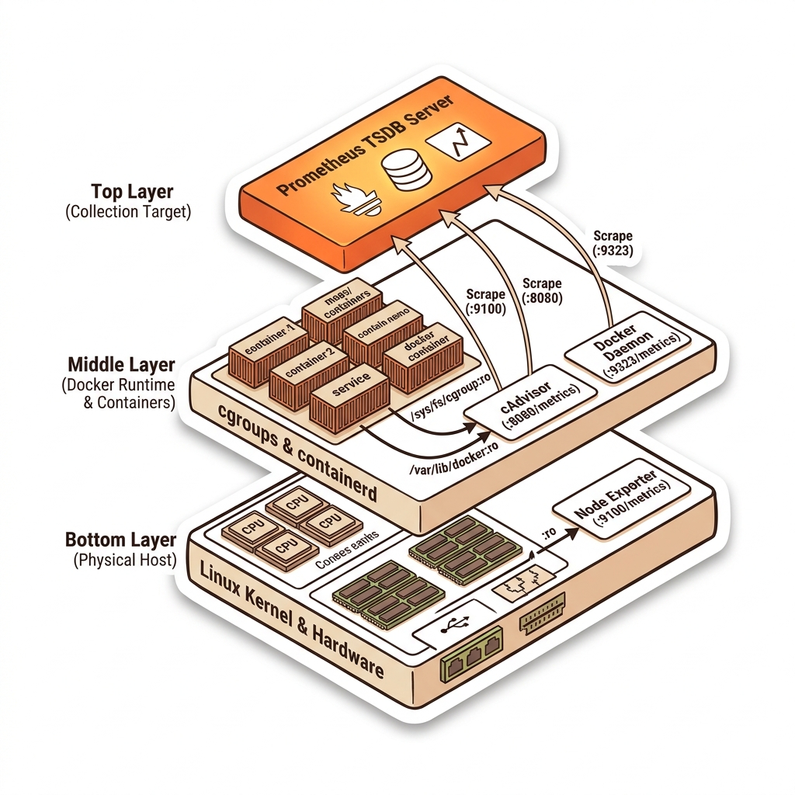
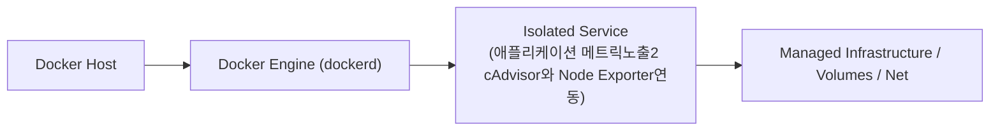
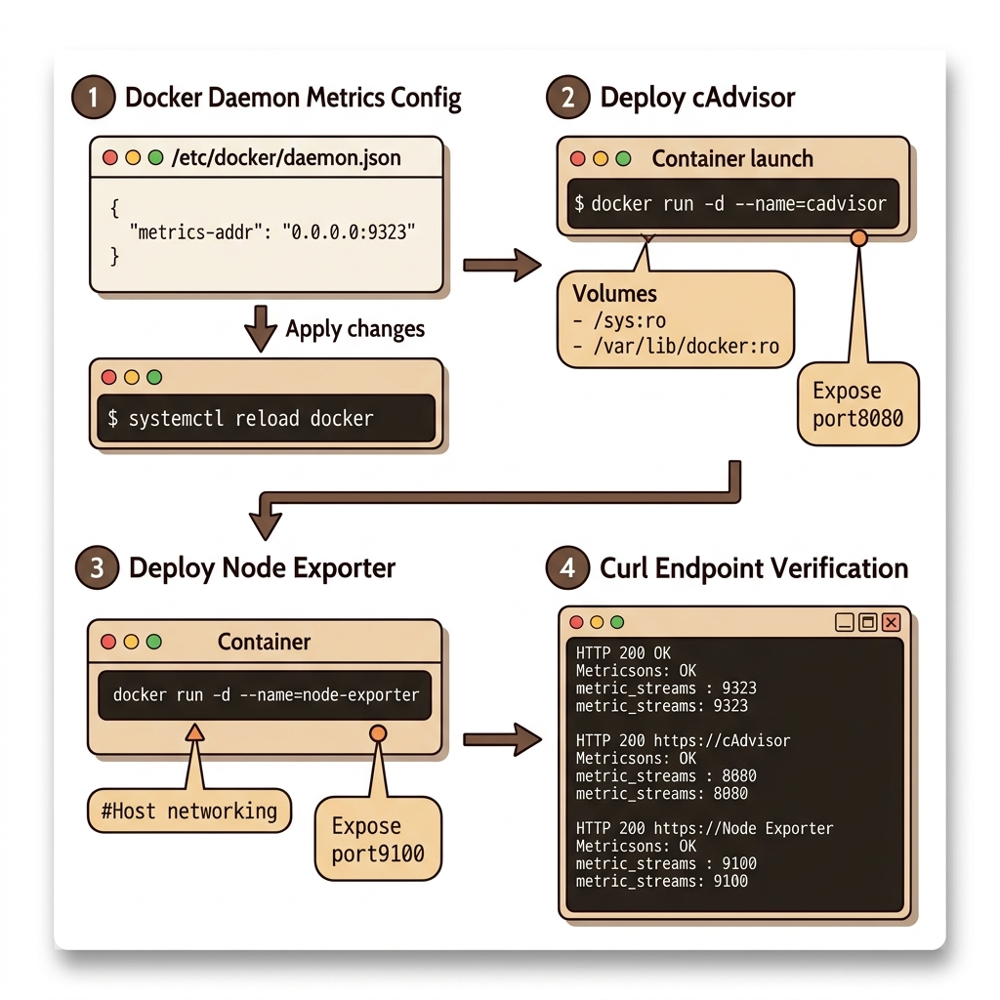

# 055. 애플리케이션 메트릭노출2 cAdvisor와 Node Exporter연동

애플리케이션 내부 지표뿐만 아니라, 도커 데몬(`daemon.json`의 `metrics-addr: 0.0.0.0:9323`)이 노출하는 엔진 상태 지표(실행 중/중지된 컨테이너 수, 이미지 레이어 작업 시간)를 활성화하는 법을 배웁니다.


**그림 04-14-1** 애플리케이션 메트릭노출2 cAdvisor와 Node Exporter연동의 필요성과 현대 클라우드 아키텍처 관점의 개요

---

### 055.1 왜 애플리케이션 메트릭노출2 cAdvisor와 Node Exporter연동이(가) 필요한가? (문제 정의와 현실적 배경)

소프트웨어 시스템이 복잡해질수록 설정을 다루는 방식은 전체 인프라의 신뢰성을 결정짓는 핵심 척도가 됩니다. **애플리케이션 메트릭노출2 cAdvisor와 Node Exporter연동**이(가) 부재하거나 잘못 다루어질 때 현장에서는 다음과 같은 대표적인 병목과 장애가 발생합니다:

1. **하드코딩된 설정과 환경 불일치로 인한 유연성 상실**: 환경이 바뀔 때마다 코드를 다시 빌드해야 하므로 배포 주기가 지연되고 이미지 수가 기하급수적으로 폭증합니다.
2. **보안 민감 데이터의 무분별한 노출**: 비밀번호, 데이터베이스 토큰, 암호화 키가 이미지 레이어에 영구 박제되어 형상관리 시스템이나 외부에 유출될 위험이 커집니다.
3. **재현 불가능한 구성 드리프트**: 스테이징 환경과 프로덕션 환경의 미세한 설정 차이가 예기치 못한 서비스 중단 사고로 직결됩니다.


**그림 04-14-2** 애플리케이션 메트릭노출2 cAdvisor와 Node Exporter연동에 대한 대표적인 오해와 실제 프로덕션 현장의 엔지니어링 진실

---

### 055.2 핵심 아키텍처와 엔지니어링 메커니즘

또한 구글이 만든 컨테이너 리소스 수집기 **cAdvisor**와 리눅스 호스트 하드웨어 지표 수집기 **Node Exporter**를 컨테이너로 띄워 인프라부터 앱까지 빈틈없는 메트릭 파이프라인을 구성합니다.


**그림 04-14-3** 애플리케이션 메트릭노출2 cAdvisor와 Node Exporter연동의 내부 아키텍처 및 데이터 흐름

#### 📊 핵심 비교 및 엔지니어링 표준 분석

| 구분 / 핵심 원리 | 상세 설명 및 동작 메커니즘 | 실무 적용 시 주의점 및 베스트 프랙티스 |
| :--- | :--- | :--- |
| **도커 엔진 메트릭 (`9323` 포트)** | `daemon.json`에 `"metrics-addr": "0.0.0.0:9323"` 설정 시 도커 엔진의 내부 상태와 액션 처리 시간 노출 | 도커 데몬 자체의 부하나 컨테이너 생성 지연을 감시할 때 활용 |
| **cAdvisor (Container Advisor)** | 호스트에서 실행 중인 모든 컨테이너의 `cgroups` 통계(CPU, 메모리, 파일시스템, 네트워크 I/O)를 실시간 수집해 `:8080/metrics`로 제공 | 개별 앱에 프로메테우스 라이브러리를 심지 못했을 때도 모든 컨테이너의 리소스 사용량을 즉시 모니터링 가능! |
| **읽기 전용(`:ro`) 호스트 마운트** | cAdvisor나 Node Exporter는 호스트의 `/sys`, `/var/lib/docker`를 읽기 전용(`:ro`)으로 마운트하여 안전하게 커널 통계를 읽음 | Part 03에서 배운 읽기 전용 바인드 마운트가 실무 모니터링 컨테이너에 그대로 쓰이는 대표 사례 |

---

### 055.3 선언적 실습 및 아키텍처 다이어그램

본 실습은 외부 비공개 패키지에 의존하지 않고, 공식 표준 이미지를 기반으로 즉시 재현 가능한 살아있는 코드로 구성되어 있습니다.

```yaml
# 컨테이너별 CPU/RAM/네트워크 사용량을 프로메테우스 포맷으로 노출하는 cAdvisor 컴포즈 설정
services:
  cadvisor:
    image: gcr.io/cadvisor/cadvisor:v0.49.1
    ports: ["8080:8080"]
    volumes:
      - /:/rootfs:ro
      - /var/run:/var/run:ro
      - /sys:/sys:ro
      - /var/lib/docker/:/var/lib/docker:ro
```

#### 🔍 아키텍처 흐름도 (Mermaid Diagram)




**그림 04-14-4** 선언적 인프라 명세를 통한 애플리케이션 메트릭노출2 cAdvisor와 Node Exporter연동 검증 파이프라인

---

### 055.4 핵심 정리: 캐릭터 대화와 3대 교훈

> 👧 **도로시**: "교수님! **애플리케이션 메트릭노출2 cAdvisor와 Node Exporter연동**의 원리를 배우니까, 복잡하게 얽혀 있던 인프라 설정이 레고 블록처럼 질서정연하게 제자리를 찾는 게 보여요!"
> 
> 🐱 **조교 지니**: "야옹~ 맞습니다! 특히 런타임 환경과 불변 인프라의 경계를 명확히 지키는 것이 대규모 클라우드 운영의 제1원칙이랍니다!"
> 
> 🐶 **토토**: "멍멍! 선언적 코드로 한 번 적어두면 언제든 똑같이 복원되니까 정말 든든해요!"
> 
> 👨‍🏫 **이호진 교수님**: "훌륭하구나. 원리를 깊이 이해하고 실습을 통해 손에 익히는 것이 훌륭한 클라우드 엔지니어로 성장하는 가장 빠른 지름길이란다."


**그림 04-14-5** 애플리케이션 메트릭노출2 cAdvisor와 Node Exporter연동 마스터를 위한 3대 핵심 교훈

1. **설정과 실행의 명확한 분리**:
   * 애플리케이션 코드는 불변으로 유지하고, 가변적인 설정값은 외부에서 주입하여 이식성을 극대화합니다.
2. **선언적 재현성 확보**:
   * 사람이 수작업으로 변경하지 않고 코드 명세를 통해 언제 어디서나 100% 동일한 실행 결과를 보장합니다.
3. **최소 권한 및 보안 모범 사례 준수**:
   * 불필요한 권한과 포트 노출을 최소화하고 민감 데이터를 암호화하여 프로덕션 안정성을 담보합니다.

---

### 055.5 랩노트 피날레와 다음 강의 예고


**그림 04-14-6** 연구실에서 다음 마일스톤인 [프로메테우스 컨테이너구축과 스크래핑 Scraping 설정] 실습을 예고하는 교수님과 토토

> 💡 **다음 강의 안내**:
> [프로메테우스 컨테이너구축과 스크래핑 Scraping 설정](../056_프로메테우스_컨테이너구축과_스크래핑_Scraping_설정/)에서는 더욱 심화된 실전 엔지니어링 실습과 아키텍처를 다룹니다!

---

## 🧭 강의 네비게이션
* [◀️ 이전 강의: 054_애플리케이션_메트릭노출1_런타임지표와_비즈니스지표](../054_애플리케이션_메트릭노출1_런타임지표와_비즈니스지표/)
* [📋 Part 04. 도커 컴포즈(Compose) 분산 앱 실행, 헬스/디펜던시 체크 & 모니터링 (042 ~ 061) 목차로 돌아가기](../)
* [▶️ 다음 강의: 056_프로메테우스_컨테이너구축과_스크래핑_Scraping_설정](../056_프로메테우스_컨테이너구축과_스크래핑_Scraping_설정/)
