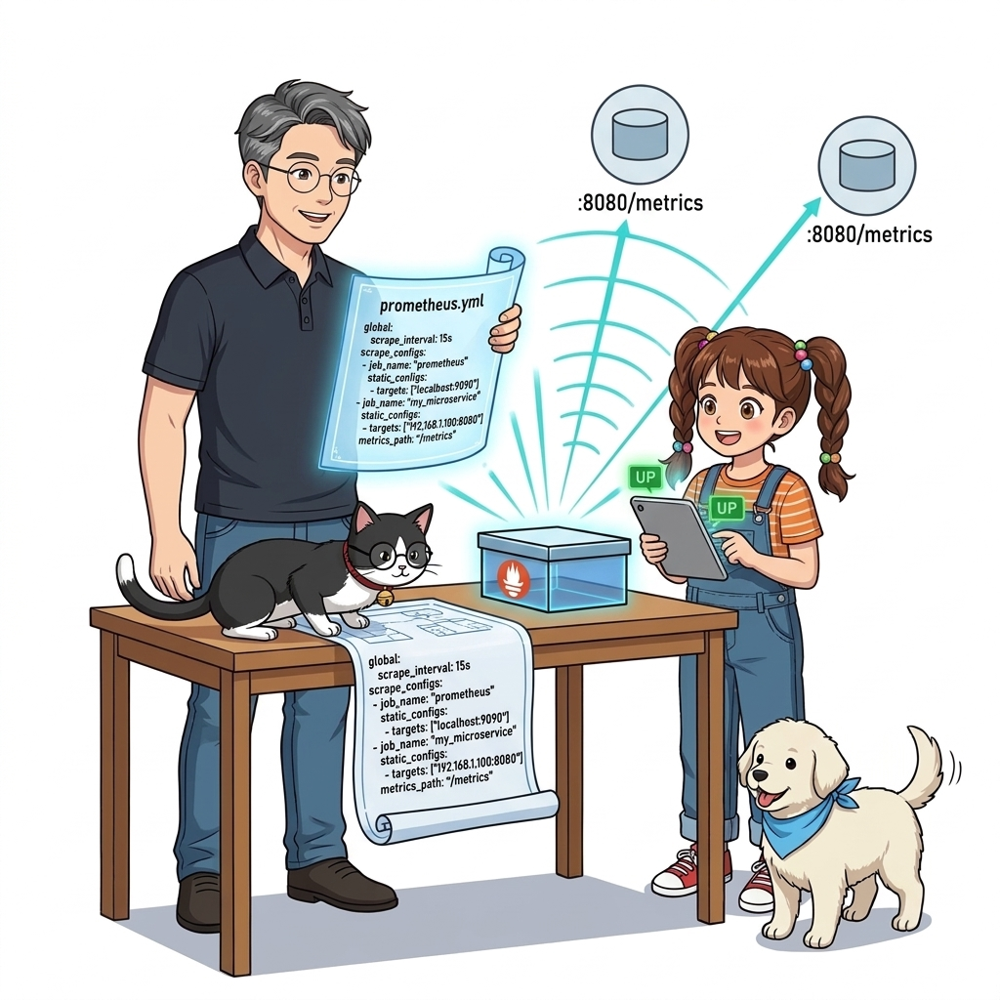
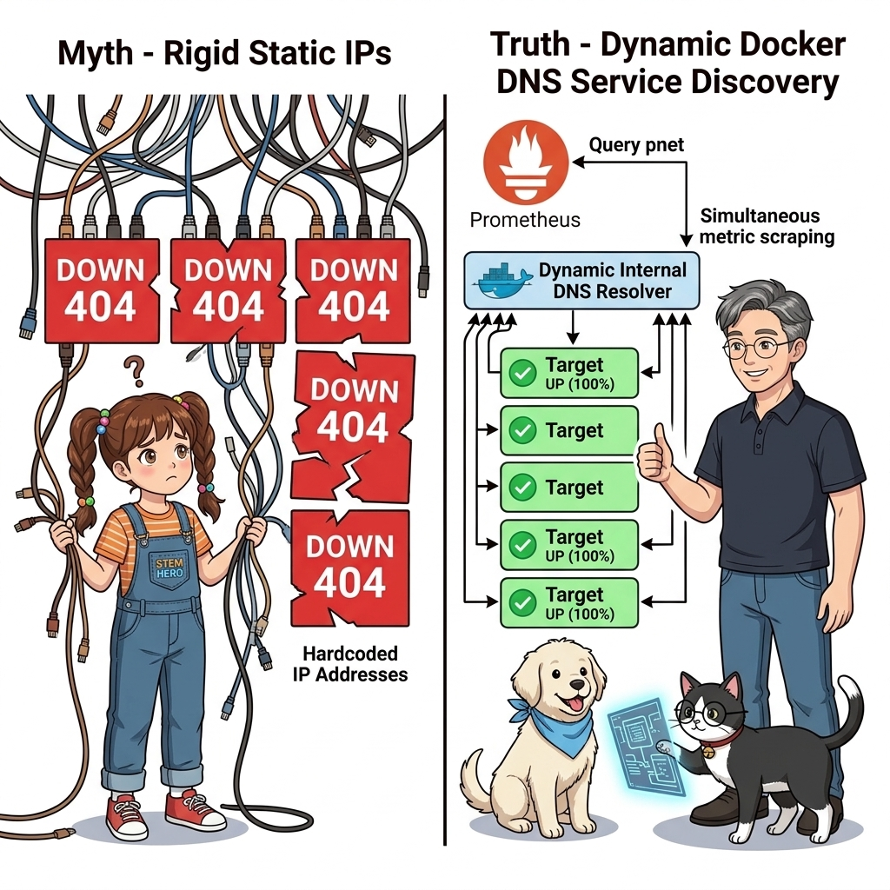
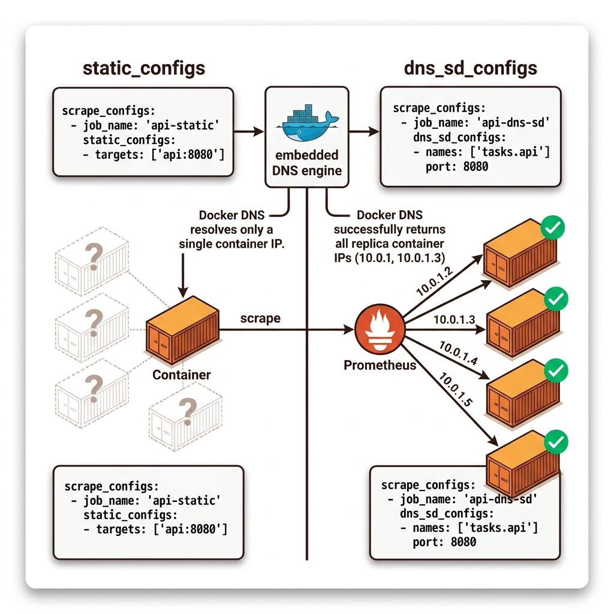
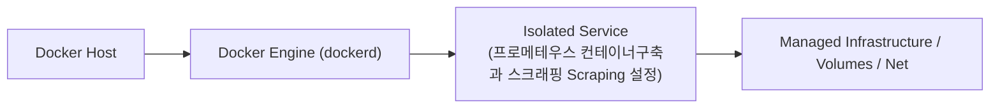
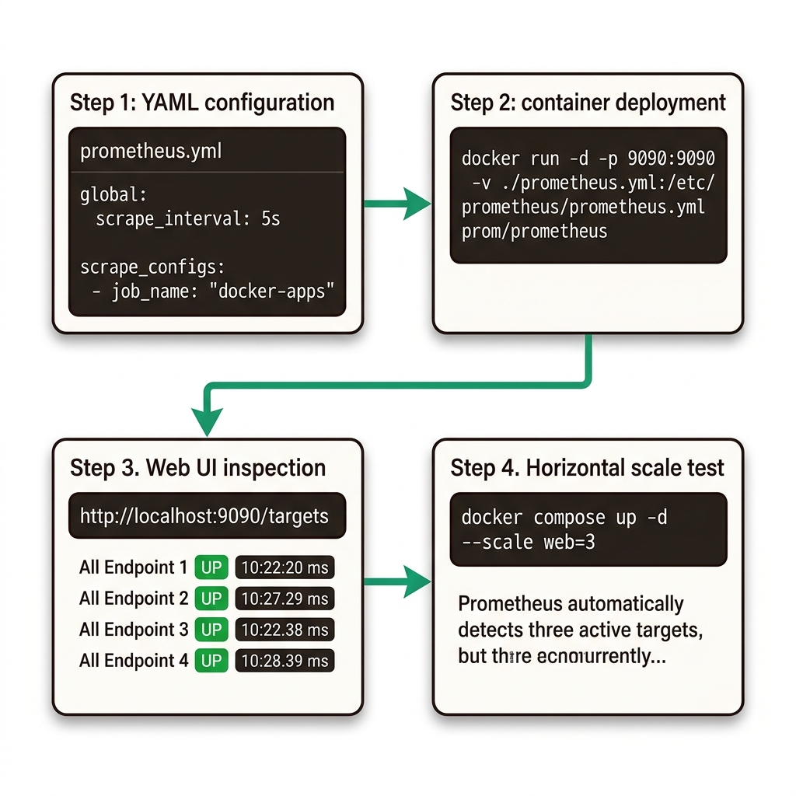

# 056. 프로메테우스 컨테이너구축과 스크래핑 Scraping 설정

프로메테우스가 어떤 대상(Targets)을 몇 초 주기(`scrape_interval`)로 긁어올지 정의하는 **`prometheus.yml`** 설정 파일을 작성합니다.


**그림 04-15-1** 프로메테우스 컨테이너구축과 스크래핑 Scraping 설정의 필요성과 현대 클라우드 아키텍처 관점의 개요

---

### 056.1 왜 프로메테우스 컨테이너구축과 스크래핑 Scraping 설정이(가) 필요한가? (문제 정의와 현실적 배경)

소프트웨어 시스템이 복잡해질수록 설정을 다루는 방식은 전체 인프라의 신뢰성을 결정짓는 핵심 척도가 됩니다. **프로메테우스 컨테이너구축과 스크래핑 Scraping 설정**이(가) 부재하거나 잘못 다루어질 때 현장에서는 다음과 같은 대표적인 병목과 장애가 발생합니다:

1. **하드코딩된 설정과 환경 불일치로 인한 유연성 상실**: 환경이 바뀔 때마다 코드를 다시 빌드해야 하므로 배포 주기가 지연되고 이미지 수가 기하급수적으로 폭증합니다.
2. **보안 민감 데이터의 무분별한 노출**: 비밀번호, 데이터베이스 토큰, 암호화 키가 이미지 레이어에 영구 박제되어 형상관리 시스템이나 외부에 유출될 위험이 커집니다.
3. **재현 불가능한 구성 드리프트**: 스테이징 환경과 프로덕션 환경의 미세한 설정 차이가 예기치 못한 서비스 중단 사고로 직결됩니다.


**그림 04-15-2** 프로메테우스 컨테이너구축과 스크래핑 Scraping 설정에 대한 대표적인 오해와 실제 프로덕션 현장의 엔지니어링 진실

---

### 056.2 핵심 아키텍처와 엔지니어링 메커니즘

단일 컨테이너는 `static_configs`로, `--scale`로 여러 개 늘어난 컨테이너들은 도커 내장 DNS를 조회해 모든 레플리카 IP를 자동으로 찾아내는 **`dns_sd_configs` (DNS 서비스 디스커버리)**로 설정하여 누락 없는 스크래핑 환경을 구축합니다!


**그림 04-15-3** 프로메테우스 컨테이너구축과 스크래핑 Scraping 설정의 내부 아키텍처 및 데이터 흐름

#### 📊 핵심 비교 및 엔지니어링 표준 분석

| 구분 / 핵심 원리 | 상세 설명 및 동작 메커니즘 | 실무 적용 시 주의점 및 베스트 프랙티스 |
| :--- | :--- | :--- |
| **`static_configs` vs `dns_sd_configs`** | `static_configs`는 호스트명 하나당 1개의 IP만 스크래핑 / `dns_sd_configs`는 DNS `A` 레코드 조회로 반환된 모든 컨테이너 IP를 각각 개별 스크래핑! | 컨테이너를 `--scale oz-api=5`로 늘려도 프로메테우스 설정 수정 없이 5개 컨테이너 지표를 모두 수집! |
| **Prometheus 웹 UI (`:9090`)** | 브라우저에서 `http://localhost:9090/targets`에 접속하면 연결된 모든 컨테이너의 수집 상태(`UP`/`DOWN`)와 마지막 응답 시간을 즉시 확인 가능 | 스크래핑 네트워크 연결 디버깅 시 가장 먼저 확인하는 페이지 |
| **커스텀 프로메테우스 이미지 빌드** | `FROM prom/prometheus`에 작성한 `prometheus.yml`을 `COPY`하여 프로젝트 전용 프로메테우스 이미지를 만들거나 바인드 마운트로 주입 | 어느 환경에서나 즉시 실행 가능한 모니터링 컨테이너 완성 |

---

### 056.3 선언적 실습 및 아키텍처 다이어그램

본 실습은 외부 비공개 패키지에 의존하지 않고, 공식 표준 이미지를 기반으로 즉시 재현 가능한 살아있는 코드로 구성되어 있습니다.

```yaml
# [prometheus.yml] 단일 서비스(static_configs)와 스케일 아웃된 다중 컨테이너(dns_sd_configs) 자동 수집 설정!
global:
  scrape_interval: 10s

scrape_configs:
  - job_name: "oz-web"
    static_configs:
      - targets: ["oz-web:8000"]

  - job_name: "oz-api-cluster"
    dns_sd_configs:
      - names: ["oz-api"]
        type: A
        port: 8080
```

#### 🔍 아키텍처 흐름도 (Mermaid Diagram)




**그림 04-15-4** 선언적 인프라 명세를 통한 프로메테우스 컨테이너구축과 스크래핑 Scraping 설정 검증 파이프라인

---

### 056.4 핵심 정리: 캐릭터 대화와 3대 교훈

> 👧 **도로시**: "교수님! **프로메테우스 컨테이너구축과 스크래핑 Scraping 설정**의 원리를 배우니까, 복잡하게 얽혀 있던 인프라 설정이 레고 블록처럼 질서정연하게 제자리를 찾는 게 보여요!"
> 
> 🐱 **조교 지니**: "야옹~ 맞습니다! 특히 런타임 환경과 불변 인프라의 경계를 명확히 지키는 것이 대규모 클라우드 운영의 제1원칙이랍니다!"
> 
> 🐶 **토토**: "멍멍! 선언적 코드로 한 번 적어두면 언제든 똑같이 복원되니까 정말 든든해요!"
> 
> 👨‍🏫 **이호진 교수님**: "훌륭하구나. 원리를 깊이 이해하고 실습을 통해 손에 익히는 것이 훌륭한 클라우드 엔지니어로 성장하는 가장 빠른 지름길이란다."


**그림 04-15-5** 프로메테우스 컨테이너구축과 스크래핑 Scraping 설정 마스터를 위한 3대 핵심 교훈

1. **설정과 실행의 명확한 분리**:
   * 애플리케이션 코드는 불변으로 유지하고, 가변적인 설정값은 외부에서 주입하여 이식성을 극대화합니다.
2. **선언적 재현성 확보**:
   * 사람이 수작업으로 변경하지 않고 코드 명세를 통해 언제 어디서나 100% 동일한 실행 결과를 보장합니다.
3. **최소 권한 및 보안 모범 사례 준수**:
   * 불필요한 권한과 포트 노출을 최소화하고 민감 데이터를 암호화하여 프로덕션 안정성을 담보합니다.

---

### 056.5 랩노트 피날레와 다음 강의 예고


**그림 04-15-6** 연구실에서 다음 마일스톤인 [PromQL 기초질의와 카운터 게이지 히스토그램 분석] 실습을 예고하는 교수님과 토토

> 💡 **다음 강의 안내**:
> [PromQL 기초질의와 카운터 게이지 히스토그램 분석](../057_PromQL_기초질의와_카운터_게이지_히스토그램_분석/)에서는 더욱 심화된 실전 엔지니어링 실습과 아키텍처를 다룹니다!

---

## 🧭 강의 네비게이션
* [◀️ 이전 강의: 055_애플리케이션_메트릭노출2_cAdvisor와_Node_Exporter연동](../055_애플리케이션_메트릭노출2_cAdvisor와_Node_Exporter연동/)
* [📋 Part 04. 도커 컴포즈(Compose) 분산 앱 실행, 헬스/디펜던시 체크 & 모니터링 (042 ~ 061) 목차로 돌아가기](../)
* [▶️ 다음 강의: 057_PromQL_기초질의와_카운터_게이지_히스토그램_분석](../057_PromQL_기초질의와_카운터_게이지_히스토그램_분석/)
