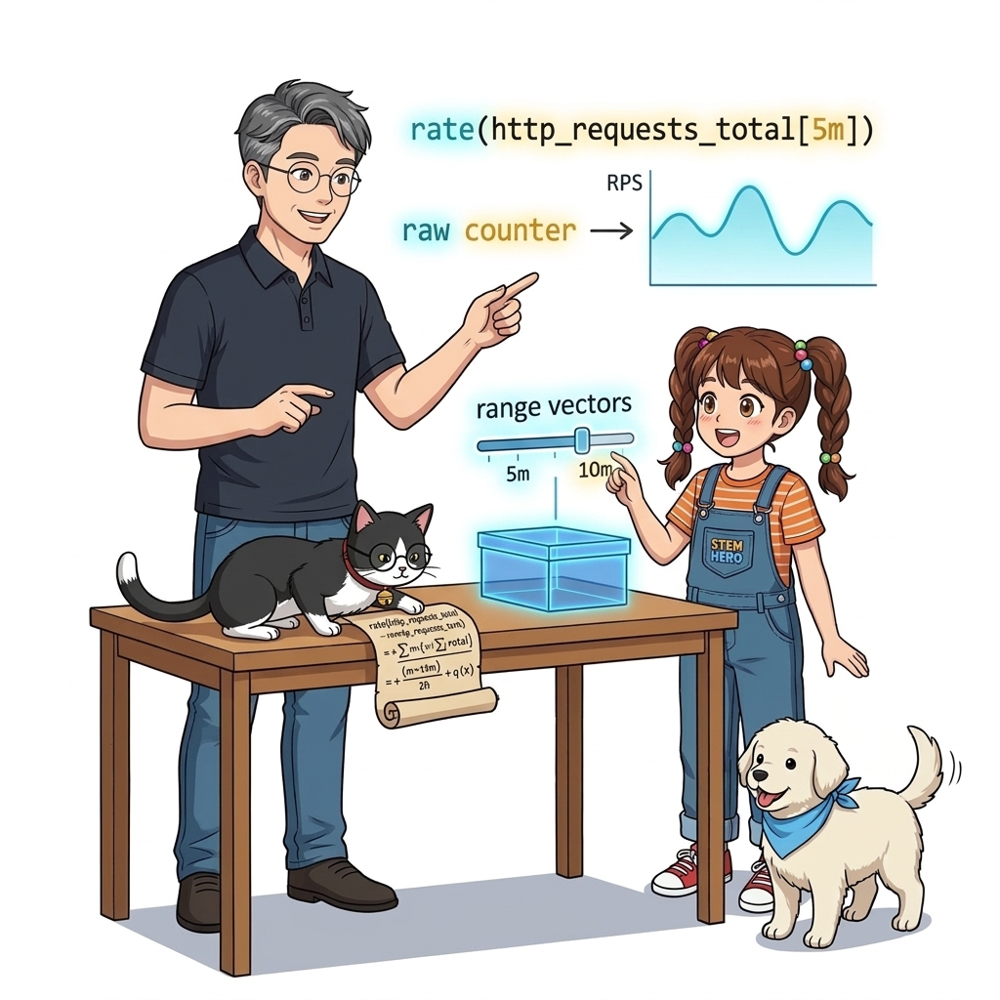
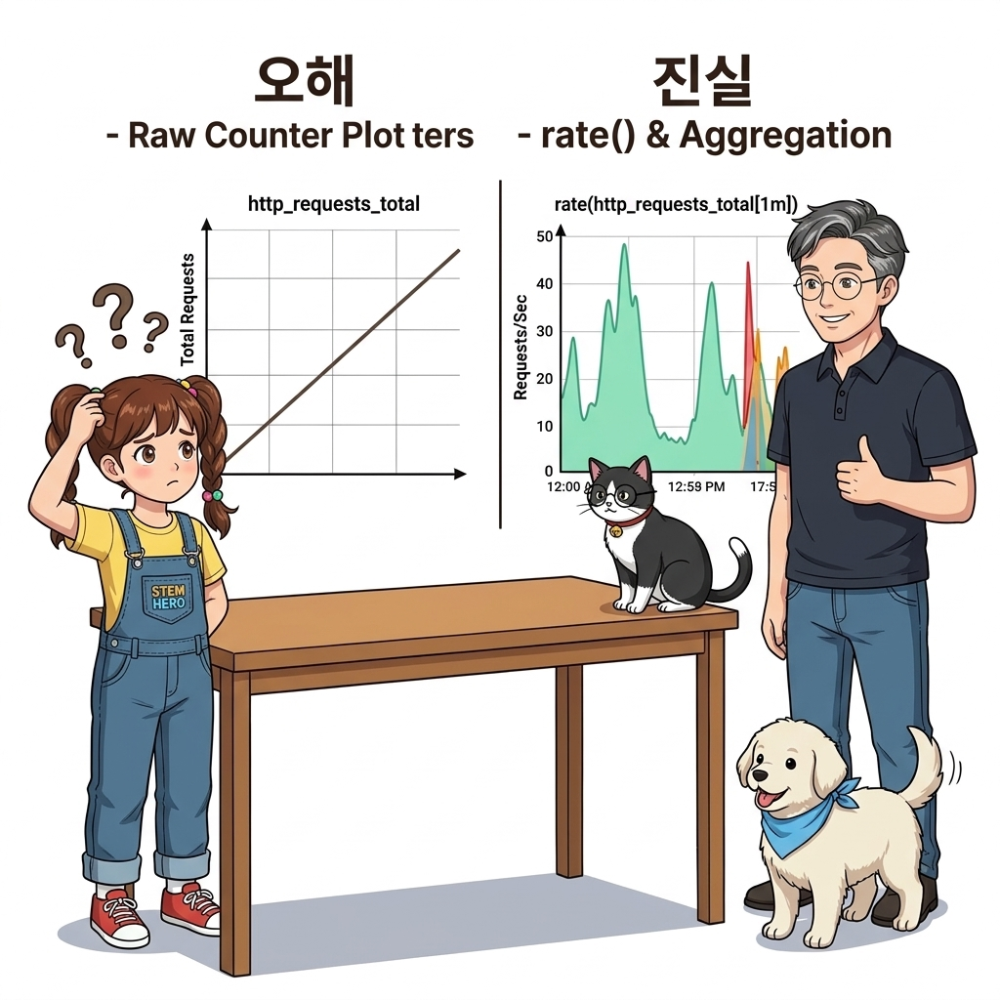
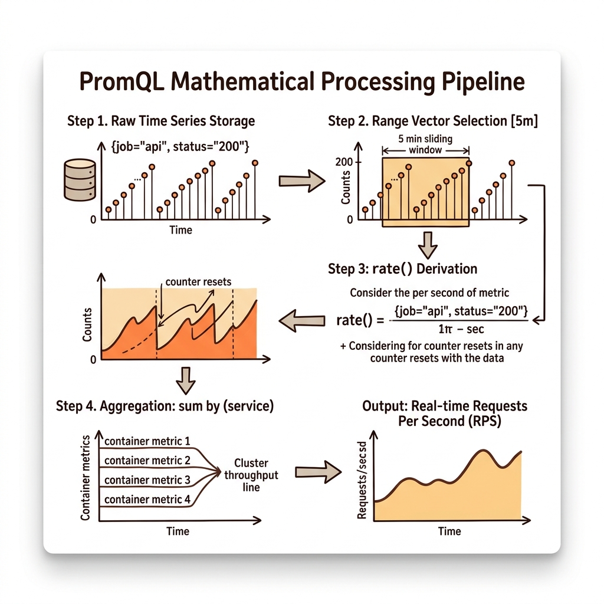
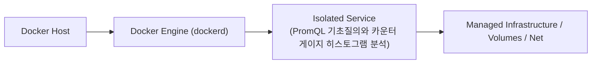
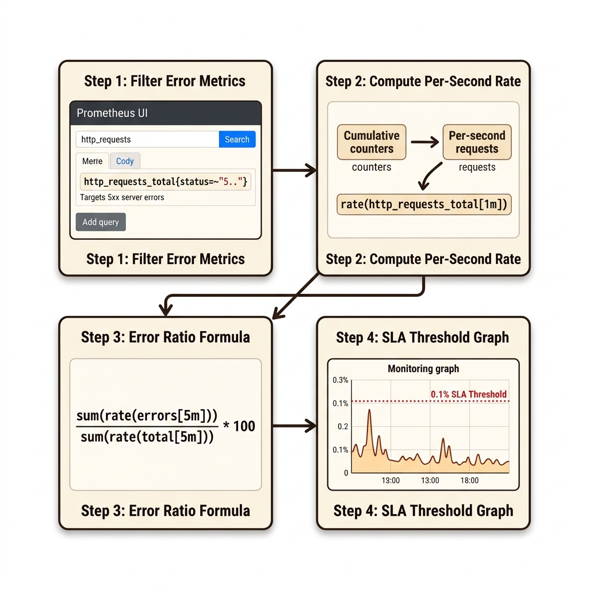
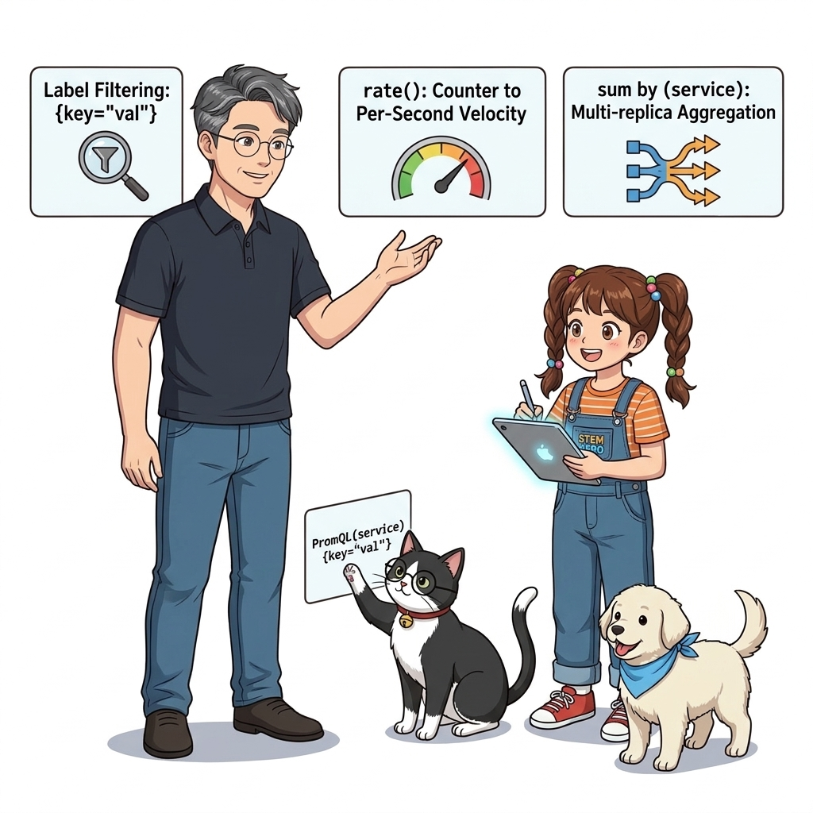

# 057. PromQL 기초질의와 카운터 게이지 히스토그램 분석

프로메테우스에 쌓인 시계열 데이터를 의미 있는 운영 정보로 변환하는 전용 쿼리 언어 **PromQL(Prometheus Query Language)**의 핵심 문법을 배웁니다.


**그림 04-16-1** PromQL 기초질의와 카운터 게이지 히스토그램 분석의 필요성과 현대 클라우드 아키텍처 관점의 개요

---

### 057.1 왜 PromQL 기초질의와 카운터 게이지 히스토그램 분석이(가) 필요한가? (문제 정의와 현실적 배경)

소프트웨어 시스템이 복잡해질수록 설정을 다루는 방식은 전체 인프라의 신뢰성을 결정짓는 핵심 척도가 됩니다. **PromQL 기초질의와 카운터 게이지 히스토그램 분석**이(가) 부재하거나 잘못 다루어질 때 현장에서는 다음과 같은 대표적인 병목과 장애가 발생합니다:

1. **하드코딩된 설정과 환경 불일치로 인한 유연성 상실**: 환경이 바뀔 때마다 코드를 다시 빌드해야 하므로 배포 주기가 지연되고 이미지 수가 기하급수적으로 폭증합니다.
2. **보안 민감 데이터의 무분별한 노출**: 비밀번호, 데이터베이스 토큰, 암호화 키가 이미지 레이어에 영구 박제되어 형상관리 시스템이나 외부에 유출될 위험이 커집니다.
3. **재현 불가능한 구성 드리프트**: 스테이징 환경과 프로덕션 환경의 미세한 설정 차이가 예기치 못한 서비스 중단 사고로 직결됩니다.


**그림 04-16-2** PromQL 기초질의와 카운터 게이지 히스토그램 분석에 대한 대표적인 오해와 실제 프로덕션 현장의 엔지니어링 진실

---

### 057.2 핵심 아키텍처와 엔지니어링 메커니즘

단순 누적값인 카운터(Counter)에 **`rate(지표[1m])`** 함수를 씌워 '초당 요청 수(RPS)'로 변환하거나, 여러 컨테이너 레플리카의 메모리 사용량을 **`sum(지표) by (service)`**로 집계하고, 전체 요청 대비 HTTP 500 에러 비율을 계산하는 실전 쿼리를 작성합니다.


**그림 04-16-3** PromQL 기초질의와 카운터 게이지 히스토그램 분석의 내부 아키텍처 및 데이터 흐름

#### 📊 핵심 비교 및 엔지니어링 표준 분석

| 구분 / 핵심 원리 | 상세 설명 및 동작 메커니즘 | 실무 적용 시 주의점 및 베스트 프랙티스 |
| :--- | :--- | :--- |
| **레이블 필터링 (`{key="val"}`)** | 중괄호 안에 조건(`=`, `!=`, `=~` 정규식)을 적어 원하는 상태 코드나 특정 컨테이너의 데이터만 정밀 필터링 | 예: `http_requests_total{method="POST", status=~"5.."}` |
| **`rate(counter[1m])`의 마법** | 끝없이 증가하기만 하는 누적 카운터 값에서 '최근 1분 동안 초당 평균 얼마나 증가했는가'를 계산해 실시간 변화율 그래프로 변환 | 카운터 지표는 절대 그냥 그래프에 그리지 말고 반드시 `rate()` 또는 `increase()`와 함께 사용! |
| **집계 연산자 (`sum`, `avg` + `by`/`without`)** | 스케일 아웃된 3개의 컨테이너 지표를 개별 인스턴스(`without (instance)`) 대신 서비스 단위로 합산하거나 평균 산출 | 클러스터 전체의 건강 상태를 한눈에 파악하는 핵심 문법 |

---

### 057.3 선언적 실습 및 아키텍처 다이어그램

본 실습은 외부 비공개 패키지에 의존하지 않고, 공식 표준 이미지를 기반으로 즉시 재현 가능한 살아있는 코드로 구성되어 있습니다.

```bash
# 실무 관제 대시보드에서 가장 많이 사용하는 4대 PromQL 핵심 쿼리 패턴 레퍼런스
cat << 'EOF'
1. 서비스별 현재 메모리 합계 (Gauge 집계) : sum(container_memory_usage_bytes) by (container_label_com_docker_compose_service)
2. 초당 HTTP 요청 처리량 RPS (Counter 변화율): sum(rate(http_requests_total[1m])) by (service)
3. HTTP 500 에러 발생 비율 (%)             : sum(rate(http_requests_total{code="500"}[1m])) / sum(rate(http_requests_total[1m])) * 100
4. 현재 실행 중인 고루틴/스레드 부하        : sum(go_goroutines{job="oz-api-cluster"}) without (instance)
EOF
```

#### 🔍 아키텍처 흐름도 (Mermaid Diagram)




**그림 04-16-4** 선언적 인프라 명세를 통한 PromQL 기초질의와 카운터 게이지 히스토그램 분석 검증 파이프라인

---

### 057.4 핵심 정리: 캐릭터 대화와 3대 교훈

> 👧 **도로시**: "교수님! **PromQL 기초질의와 카운터 게이지 히스토그램 분석**의 원리를 배우니까, 복잡하게 얽혀 있던 인프라 설정이 레고 블록처럼 질서정연하게 제자리를 찾는 게 보여요!"
> 
> 🐱 **조교 지니**: "야옹~ 맞습니다! 특히 런타임 환경과 불변 인프라의 경계를 명확히 지키는 것이 대규모 클라우드 운영의 제1원칙이랍니다!"
> 
> 🐶 **토토**: "멍멍! 선언적 코드로 한 번 적어두면 언제든 똑같이 복원되니까 정말 든든해요!"
> 
> 👨‍🏫 **이호진 교수님**: "훌륭하구나. 원리를 깊이 이해하고 실습을 통해 손에 익히는 것이 훌륭한 클라우드 엔지니어로 성장하는 가장 빠른 지름길이란다."


**그림 04-16-5** PromQL 기초질의와 카운터 게이지 히스토그램 분석 마스터를 위한 3대 핵심 교훈

1. **설정과 실행의 명확한 분리**:
   * 애플리케이션 코드는 불변으로 유지하고, 가변적인 설정값은 외부에서 주입하여 이식성을 극대화합니다.
2. **선언적 재현성 확보**:
   * 사람이 수작업으로 변경하지 않고 코드 명세를 통해 언제 어디서나 100% 동일한 실행 결과를 보장합니다.
3. **최소 권한 및 보안 모범 사례 준수**:
   * 불필요한 권한과 포트 노출을 최소화하고 민감 데이터를 암호화하여 프로덕션 안정성을 담보합니다.

---

### 057.5 랩노트 피날레와 다음 강의 예고


**그림 04-16-6** 연구실에서 다음 마일스톤인 [그라파나 Grafana 컨테이너구축과 실시간대시보드 시각화] 실습을 예고하는 교수님과 토토

> 💡 **다음 강의 안내**:
> [그라파나 Grafana 컨테이너구축과 실시간대시보드 시각화](../058_그라파나_Grafana_컨테이너구축과_실시간대시보드_시각화/)에서는 더욱 심화된 실전 엔지니어링 실습과 아키텍처를 다룹니다!

---

## 🧭 강의 네비게이션
* [◀️ 이전 강의: 056_프로메테우스_컨테이너구축과_스크래핑_Scraping_설정](../056_프로메테우스_컨테이너구축과_스크래핑_Scraping_설정/)
* [📋 Part 04. 도커 컴포즈(Compose) 분산 앱 실행, 헬스/디펜던시 체크 & 모니터링 (042 ~ 061) 목차로 돌아가기](../)
* [▶️ 다음 강의: 058_그라파나_Grafana_컨테이너구축과_실시간대시보드_시각화](../058_그라파나_Grafana_컨테이너구축과_실시간대시보드_시각화/)
