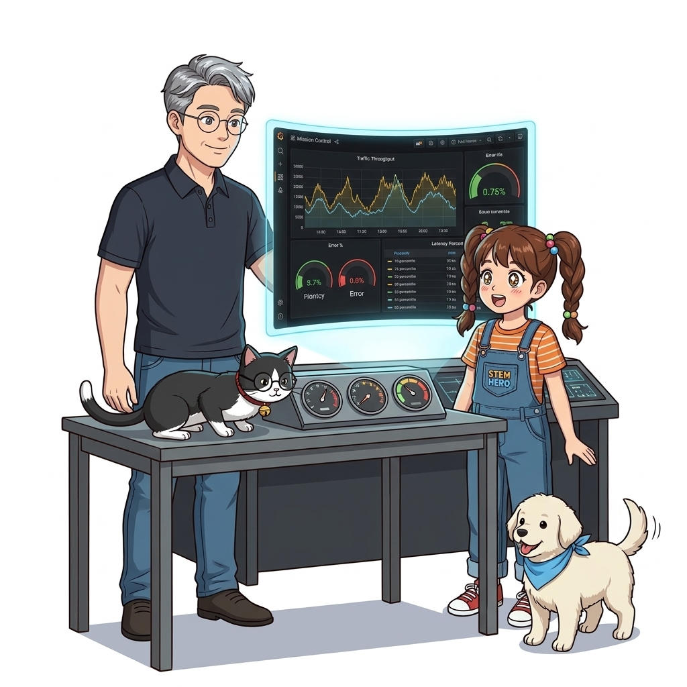
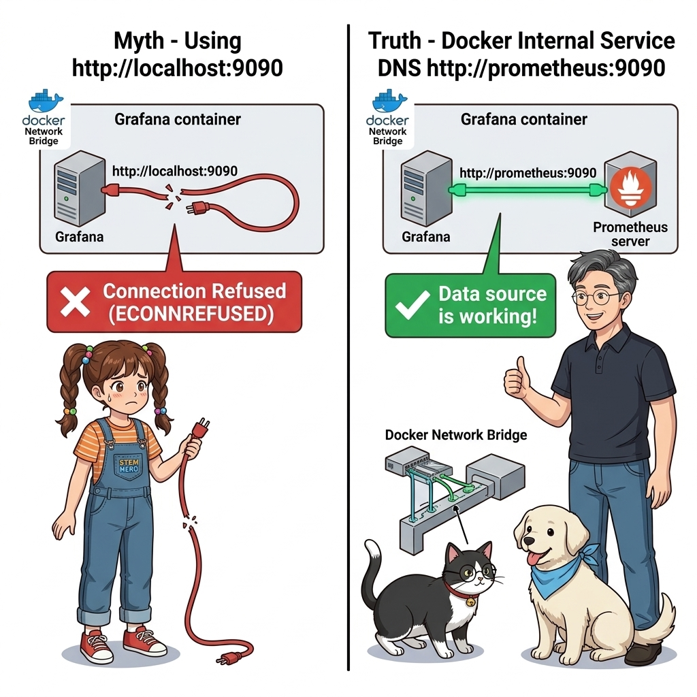
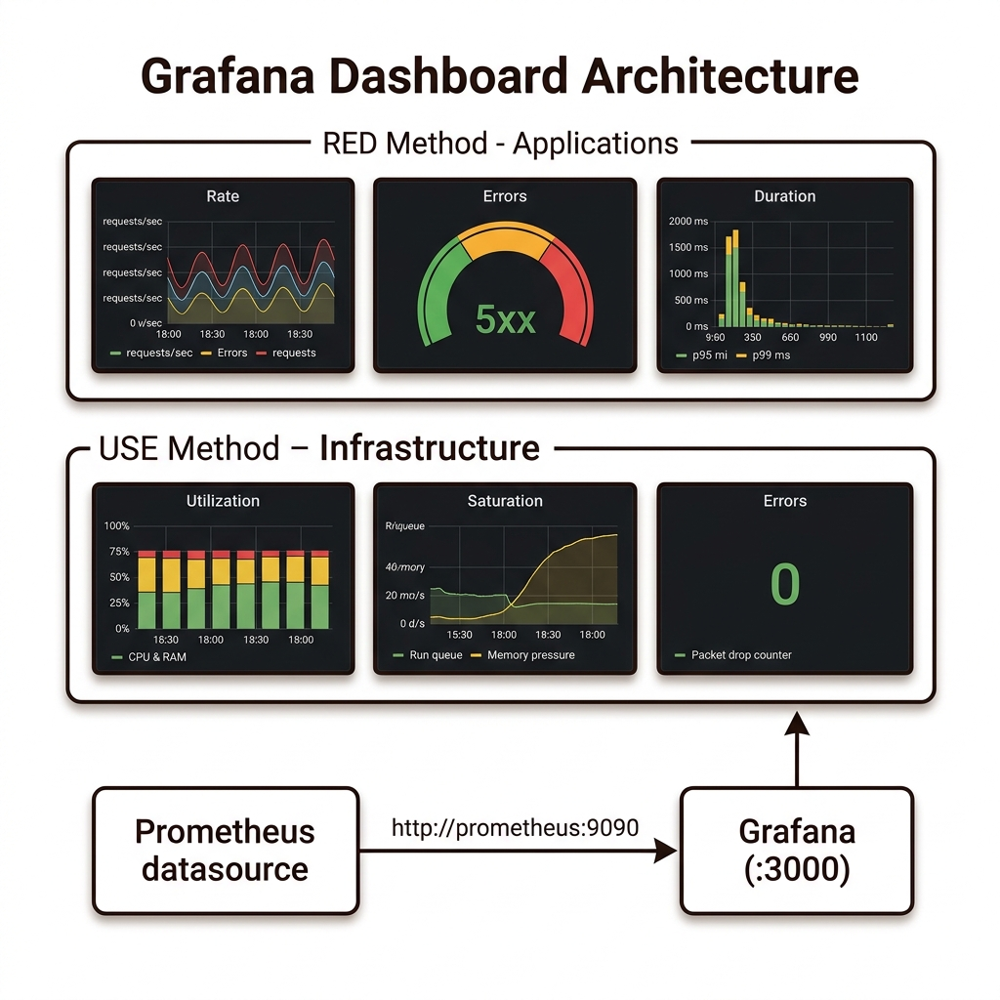
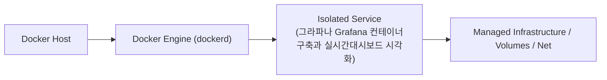
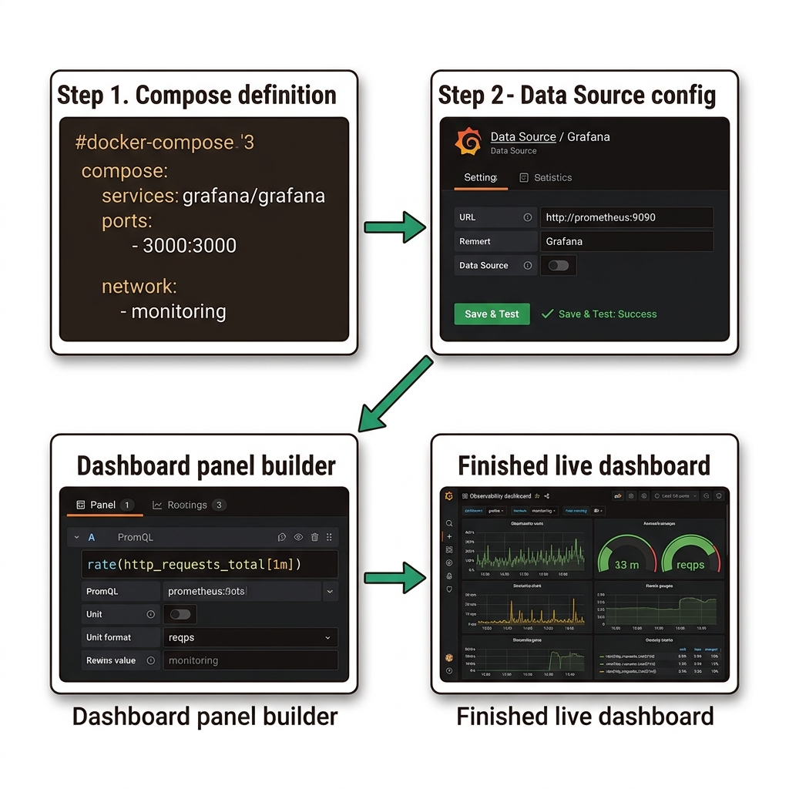

# 058. 그라파나 Grafana 컨테이너구축과 실시간대시보드 시각화

그라파나(Grafana) 컨테이너를 `3000`번 포트로 띄우고, 프로메테우스 컨테이너(`http://prometheus:9090`)를 데이터 소스로 연결하는 방법을 배웁니다.


**그림 04-17-1** 그라파나 Grafana 컨테이너구축과 실시간대시보드 시각화의 필요성과 현대 클라우드 아키텍처 관점의 개요

---

### 058.1 왜 그라파나 Grafana 컨테이너구축과 실시간대시보드 시각화이(가) 필요한가? (문제 정의와 현실적 배경)

소프트웨어 시스템이 복잡해질수록 설정을 다루는 방식은 전체 인프라의 신뢰성을 결정짓는 핵심 척도가 됩니다. **그라파나 Grafana 컨테이너구축과 실시간대시보드 시각화**이(가) 부재하거나 잘못 다루어질 때 현장에서는 다음과 같은 대표적인 병목과 장애가 발생합니다:

1. **하드코딩된 설정과 환경 불일치로 인한 유연성 상실**: 환경이 바뀔 때마다 코드를 다시 빌드해야 하므로 배포 주기가 지연되고 이미지 수가 기하급수적으로 폭증합니다.
2. **보안 민감 데이터의 무분별한 노출**: 비밀번호, 데이터베이스 토큰, 암호화 키가 이미지 레이어에 영구 박제되어 형상관리 시스템이나 외부에 유출될 위험이 커집니다.
3. **재현 불가능한 구성 드리프트**: 스테이징 환경과 프로덕션 환경의 미세한 설정 차이가 예기치 못한 서비스 중단 사고로 직결됩니다.


**그림 04-17-2** 그라파나 Grafana 컨테이너구축과 실시간대시보드 시각화에 대한 대표적인 오해와 실제 프로덕션 현장의 엔지니어링 진실

---

### 058.2 핵심 아키텍처와 엔지니어링 메커니즘

마이크로서비스 모니터링의 황금 표준인 **RED 메트릭(Rate: 초당 요청 수, Errors: 실패율, Duration: 응답 시간)**과 **USE 메트릭(Utilization: 자원 사용률, Saturation: 포화도, Errors: 에러)**을 시계열 라인 차트, 게이지, 단일 통계(Stat) 패널로 시각화합니다.


**그림 04-17-3** 그라파나 Grafana 컨테이너구축과 실시간대시보드 시각화의 내부 아키텍처 및 데이터 흐름

#### 📊 핵심 비교 및 엔지니어링 표준 분석

| 구분 / 핵심 원리 | 상세 설명 및 동작 메커니즘 | 실무 적용 시 주의점 및 베스트 프랙티스 |
| :--- | :--- | :--- |
| **데이터 소스 연결 주의점** | 그라파나 웹 화면에서 프로메테우스 URL을 입력할 때 `http://localhost:9090`이 아니라 **도커 네트워크 서비스 이름인 `http://prometheus:9090`**을 입력해야 함! | 프로메테우스를 호출하는 주체는 내 브라우저가 아니라 도커 네트워크 안의 그라파나 컨테이너이기 때문! |
| **핵심 대시보드 패널 구성** | 상단에는 현재 정상 컨테이너 수·평균 응답시간·에러율(Stat/Gauge), 하단에는 시간대별 트래픽·메모리 추이(Time series) 배치 | 이상이 발생했을 때 3초 안에 어느 서비스가 문제인지 직관적으로 인지하도록 설계 |
| **커뮤니티 대시보드 임포트** | Grafana Labs 공식 사이트의 검증된 대시보드 ID(예: Docker/Node Exporter 대시보드)만 입력하면 1초 만에 전문가급 대시보드 생성 | 바퀴를 처음부터 다시 발명하지 않고 사내 환경에 맞게 커스텀 가능 |

---

### 058.3 선언적 실습 및 아키텍처 다이어그램

본 실습은 외부 비공개 패키지에 의존하지 않고, 공식 표준 이미지를 기반으로 즉시 재현 가능한 살아있는 코드로 구성되어 있습니다.

```bash
# 프로메테우스와 그라파나를 도커 네트워크로 연결하고 그라파나 헬스 API로 정상 기동 확인하기
docker network create mon-net
docker container run -d --name mon-grafana --network mon-net -p 3000:3000 grafana/grafana-oss:11.1.0
sleep 3
curl -s http://localhost:3000/api/health
docker container rm -f mon-grafana && docker network rm mon-net
```

#### 🔍 아키텍처 흐름도 (Mermaid Diagram)




**그림 04-17-4** 선언적 인프라 명세를 통한 그라파나 Grafana 컨테이너구축과 실시간대시보드 시각화 검증 파이프라인

---

### 058.4 핵심 정리: 캐릭터 대화와 3대 교훈

> 👧 **도로시**: "교수님! **그라파나 Grafana 컨테이너구축과 실시간대시보드 시각화**의 원리를 배우니까, 복잡하게 얽혀 있던 인프라 설정이 레고 블록처럼 질서정연하게 제자리를 찾는 게 보여요!"
> 
> 🐱 **조교 지니**: "야옹~ 맞습니다! 특히 런타임 환경과 불변 인프라의 경계를 명확히 지키는 것이 대규모 클라우드 운영의 제1원칙이랍니다!"
> 
> 🐶 **토토**: "멍멍! 선언적 코드로 한 번 적어두면 언제든 똑같이 복원되니까 정말 든든해요!"
> 
> 👨‍🏫 **이호진 교수님**: "훌륭하구나. 원리를 깊이 이해하고 실습을 통해 손에 익히는 것이 훌륭한 클라우드 엔지니어로 성장하는 가장 빠른 지름길이란다."


**그림 04-17-5** 그라파나 Grafana 컨테이너구축과 실시간대시보드 시각화 마스터를 위한 3대 핵심 교훈

1. **설정과 실행의 명확한 분리**:
   * 애플리케이션 코드는 불변으로 유지하고, 가변적인 설정값은 외부에서 주입하여 이식성을 극대화합니다.
2. **선언적 재현성 확보**:
   * 사람이 수작업으로 변경하지 않고 코드 명세를 통해 언제 어디서나 100% 동일한 실행 결과를 보장합니다.
3. **최소 권한 및 보안 모범 사례 준수**:
   * 불필요한 권한과 포트 노출을 최소화하고 민감 데이터를 암호화하여 프로덕션 안정성을 담보합니다.

---

### 058.5 랩노트 피날레와 다음 강의 예고


**그림 04-17-6** 연구실에서 다음 마일스톤인 [대시보드 코드화 Grafana 프로비저닝 자동화] 실습을 예고하는 교수님과 토토

> 💡 **다음 강의 안내**:
> [대시보드 코드화 Grafana 프로비저닝 자동화](../059_대시보드_코드화_Grafana_프로비저닝_자동화/)에서는 더욱 심화된 실전 엔지니어링 실습과 아키텍처를 다룹니다!

---

## 🧭 강의 네비게이션
* [◀️ 이전 강의: 057_PromQL_기초질의와_카운터_게이지_히스토그램_분석](../057_PromQL_기초질의와_카운터_게이지_히스토그램_분석/)
* [📋 Part 04. 도커 컴포즈(Compose) 분산 앱 실행, 헬스/디펜던시 체크 & 모니터링 (042 ~ 061) 목차로 돌아가기](../)
* [▶️ 다음 강의: 059_대시보드_코드화_Grafana_프로비저닝_자동화](../059_대시보드_코드화_Grafana_프로비저닝_자동화/)
