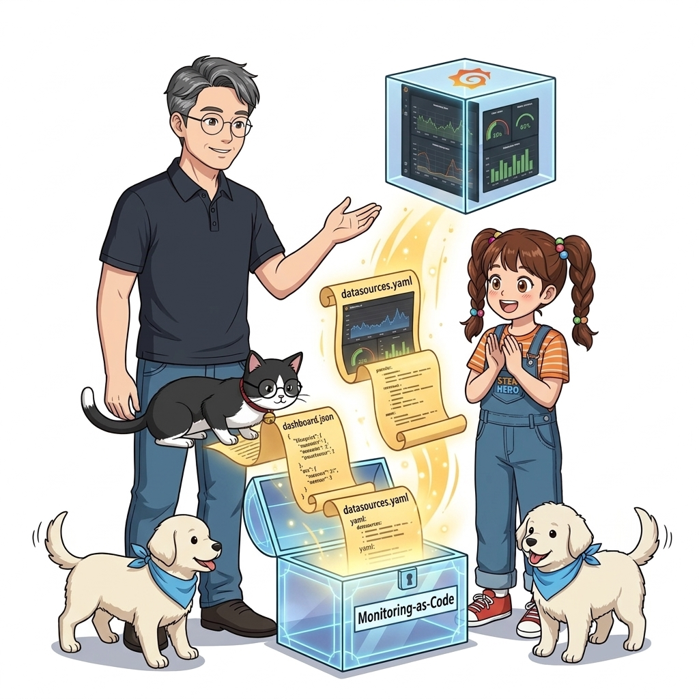
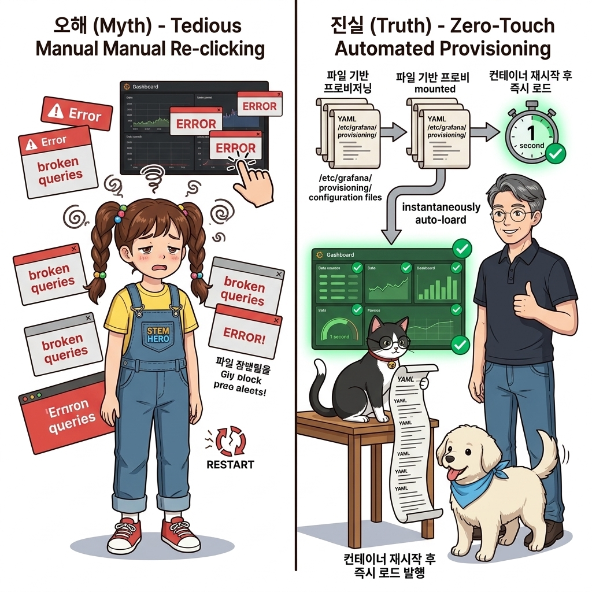
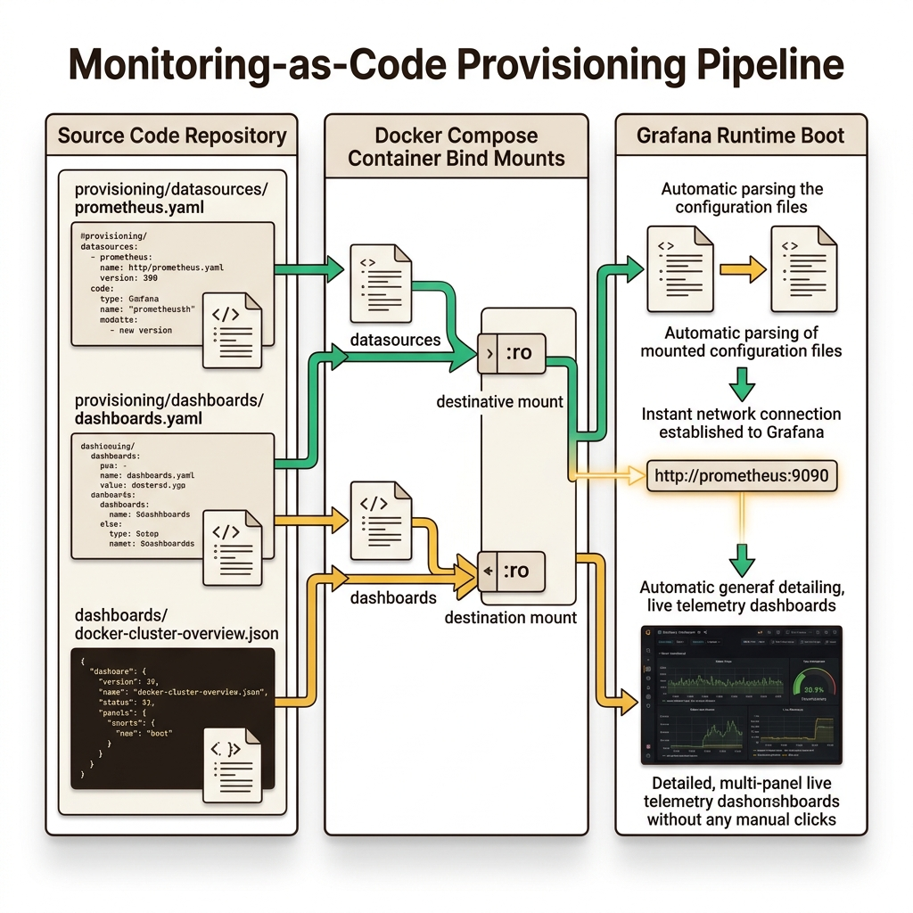
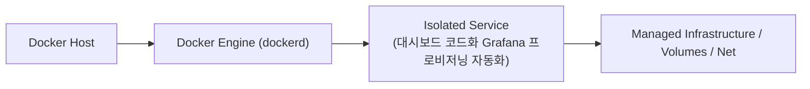
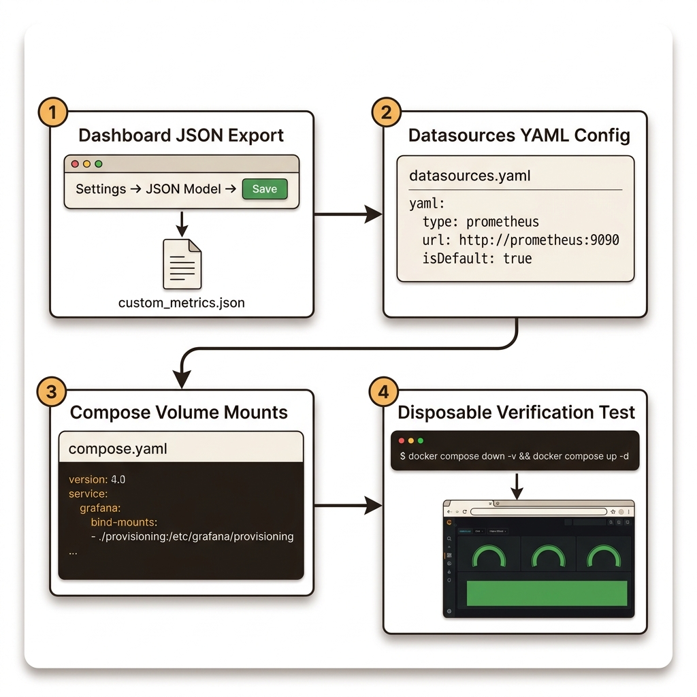
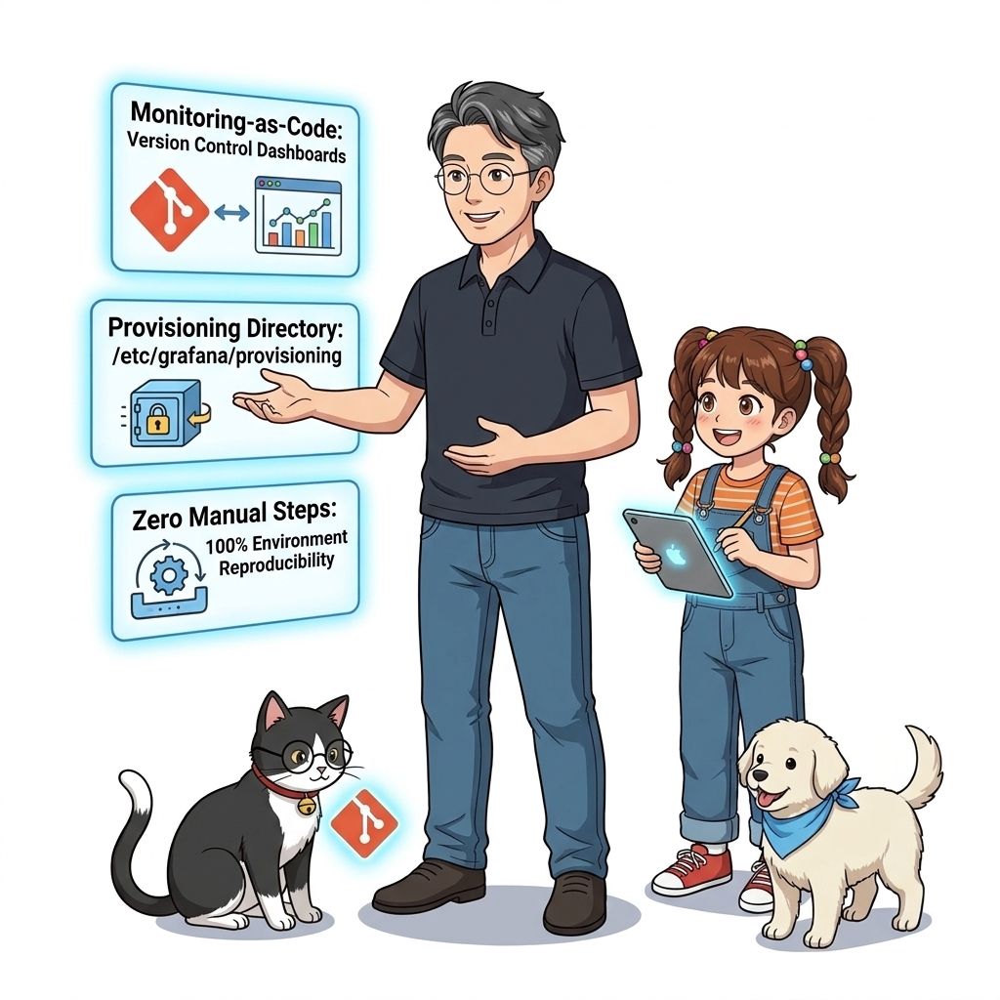
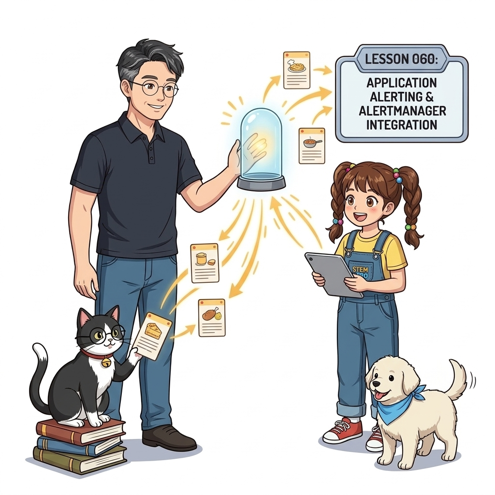

# 059. 대시보드 코드화 Grafana 프로비저닝 자동화

그라파나 웹 UI에서 멋지게 만든 대시보드를 **JSON 모델 파일**로 추출(Export)하고, 데이터 소스 설정 YAML과 함께 그라파나 컨테이너의 `/etc/grafana/provisioning/` 경로에 주입하는 자동화 기법을 배웁니다.


**그림 04-18-1** 대시보드 코드화 Grafana 프로비저닝 자동화의 필요성과 현대 클라우드 아키텍처 관점의 개요

---

### 059.1 왜 대시보드 코드화 Grafana 프로비저닝 자동화이(가) 필요한가? (문제 정의와 현실적 배경)

소프트웨어 시스템이 복잡해질수록 설정을 다루는 방식은 전체 인프라의 신뢰성을 결정짓는 핵심 척도가 됩니다. **대시보드 코드화 Grafana 프로비저닝 자동화**이(가) 부재하거나 잘못 다루어질 때 현장에서는 다음과 같은 대표적인 병목과 장애가 발생합니다:

1. **하드코딩된 설정과 환경 불일치로 인한 유연성 상실**: 환경이 바뀔 때마다 코드를 다시 빌드해야 하므로 배포 주기가 지연되고 이미지 수가 기하급수적으로 폭증합니다.
2. **보안 민감 데이터의 무분별한 노출**: 비밀번호, 데이터베이스 토큰, 암호화 키가 이미지 레이어에 영구 박제되어 형상관리 시스템이나 외부에 유출될 위험이 커집니다.
3. **재현 불가능한 구성 드리프트**: 스테이징 환경과 프로덕션 환경의 미세한 설정 차이가 예기치 못한 서비스 중단 사고로 직결됩니다.


**그림 04-18-2** 대시보드 코드화 Grafana 프로비저닝 자동화에 대한 대표적인 오해와 실제 프로덕션 현장의 엔지니어링 진실

---

### 059.2 핵심 아키텍처와 엔지니어링 메커니즘

덕분에 그라파나 컨테이너를 삭제하고 다른 서버에서 새로 실행하더라도, 로그인하는 순간 데이터 소스와 대시보드가 100% 완성된 상태로 즉시 나타나는 **Monitoring-as-Code**를 달성합니다!


**그림 04-18-3** 대시보드 코드화 Grafana 프로비저닝 자동화의 내부 아키텍처 및 데이터 흐름

#### 📊 핵심 비교 및 엔지니어링 표준 분석

| 구분 / 핵심 원리 | 상세 설명 및 동작 메커니즘 | 실무 적용 시 주의점 및 베스트 프랙티스 |
| :--- | :--- | :--- |
| **Grafana 프로비저닝 디렉터리** | `/etc/grafana/provisioning/datasources/`(데이터 소스 자동 등록) 및 `/etc/grafana/provisioning/dashboards/`(대시보드 JSON 자동 로드) | 그라파나 시작 시 해당 폴더의 YAML/JSON을 읽어 DB에 자동 세팅함 |
| **Monitoring-as-Code (모니터링의 코드화)** | 대시보드 JSON 파일을 애플리케이션 소스 코드 및 `Dockerfile`, `compose.yaml`과 함께 Git 저장소에서 버전 관리 | 애플리케이션에 새 기능이 추가될 때 대시보드 패널도 함께 PR(Pull Request)로 코드 리뷰 가능! |
| **재현성 100% 보장** | 신규 리전이나 테스트 환경에 스택을 배포할 때 수동 마우스 클릭 작업이 0번으로 줄어듦 | 데브옵스 자동화의 진정한 완성 |

---

### 059.3 선언적 실습 및 아키텍처 다이어그램

본 실습은 외부 비공개 패키지에 의존하지 않고, 공식 표준 이미지를 기반으로 즉시 재현 가능한 살아있는 코드로 구성되어 있습니다.

```dockerfile
# 데이터 소스와 대시보드 JSON이 처음부터 자동 등록(Provisioning)된 커스텀 Grafana 이미지 Dockerfile
FROM grafana/grafana-oss:11.1.0

# 1. Prometheus 데이터 소스 자동 연결 설정 복사
COPY datasource-prometheus.yaml /etc/grafana/provisioning/datasources/
# 2. 대시보드 로더 설정 및 추출한 대시보드 JSON 파일 복사
COPY dashboard-provider.yaml /etc/grafana/provisioning/dashboards/
COPY oz-app-dashboard.json /var/lib/grafana/dashboards/
```

#### 🔍 아키텍처 흐름도 (Mermaid Diagram)




**그림 04-18-4** 선언적 인프라 명세를 통한 대시보드 코드화 Grafana 프로비저닝 자동화 검증 파이프라인

---

### 059.4 핵심 정리: 캐릭터 대화와 3대 교훈

> 👧 **도로시**: "교수님! **대시보드 코드화 Grafana 프로비저닝 자동화**의 원리를 배우니까, 복잡하게 얽혀 있던 인프라 설정이 레고 블록처럼 질서정연하게 제자리를 찾는 게 보여요!"
> 
> 🐱 **조교 지니**: "야옹~ 맞습니다! 특히 런타임 환경과 불변 인프라의 경계를 명확히 지키는 것이 대규모 클라우드 운영의 제1원칙이랍니다!"
> 
> 🐶 **토토**: "멍멍! 선언적 코드로 한 번 적어두면 언제든 똑같이 복원되니까 정말 든든해요!"
> 
> 👨‍🏫 **이호진 교수님**: "훌륭하구나. 원리를 깊이 이해하고 실습을 통해 손에 익히는 것이 훌륭한 클라우드 엔지니어로 성장하는 가장 빠른 지름길이란다."


**그림 04-18-5** 대시보드 코드화 Grafana 프로비저닝 자동화 마스터를 위한 3대 핵심 교훈

1. **설정과 실행의 명확한 분리**:
   * 애플리케이션 코드는 불변으로 유지하고, 가변적인 설정값은 외부에서 주입하여 이식성을 극대화합니다.
2. **선언적 재현성 확보**:
   * 사람이 수작업으로 변경하지 않고 코드 명세를 통해 언제 어디서나 100% 동일한 실행 결과를 보장합니다.
3. **최소 권한 및 보안 모범 사례 준수**:
   * 불필요한 권한과 포트 노출을 최소화하고 민감 데이터를 암호화하여 프로덕션 안정성을 담보합니다.

---

### 059.5 랩노트 피날레와 다음 강의 예고


**그림 04-18-6** 연구실에서 다음 마일스톤인 [투명성있는 애플리케이션 수준과 경보 Alerting 설계] 실습을 예고하는 교수님과 토토

> 💡 **다음 강의 안내**:
> [투명성있는 애플리케이션 수준과 경보 Alerting 설계](../060_투명성있는_애플리케이션_수준과_경보_Alerting_설계/)에서는 더욱 심화된 실전 엔지니어링 실습과 아키텍처를 다룹니다!

---

## 🧭 강의 네비게이션
* [◀️ 이전 강의: 058_그라파나_Grafana_컨테이너구축과_실시간대시보드_시각화](../058_그라파나_Grafana_컨테이너구축과_실시간대시보드_시각화/)
* [📋 Part 04. 도커 컴포즈(Compose) 분산 앱 실행, 헬스/디펜던시 체크 & 모니터링 (042 ~ 061) 목차로 돌아가기](../)
* [▶️ 다음 강의: 060_투명성있는_애플리케이션_수준과_경보_Alerting_설계](../060_투명성있는_애플리케이션_수준과_경보_Alerting_설계/)
