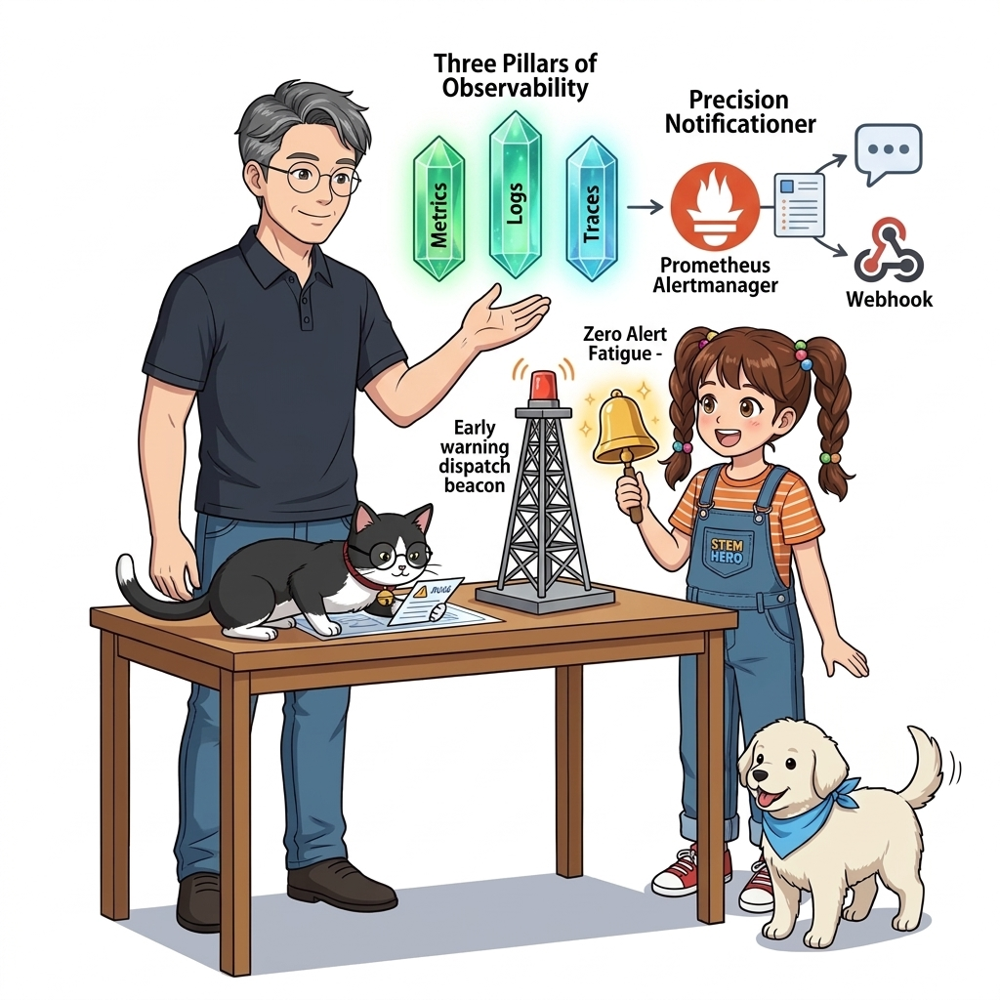
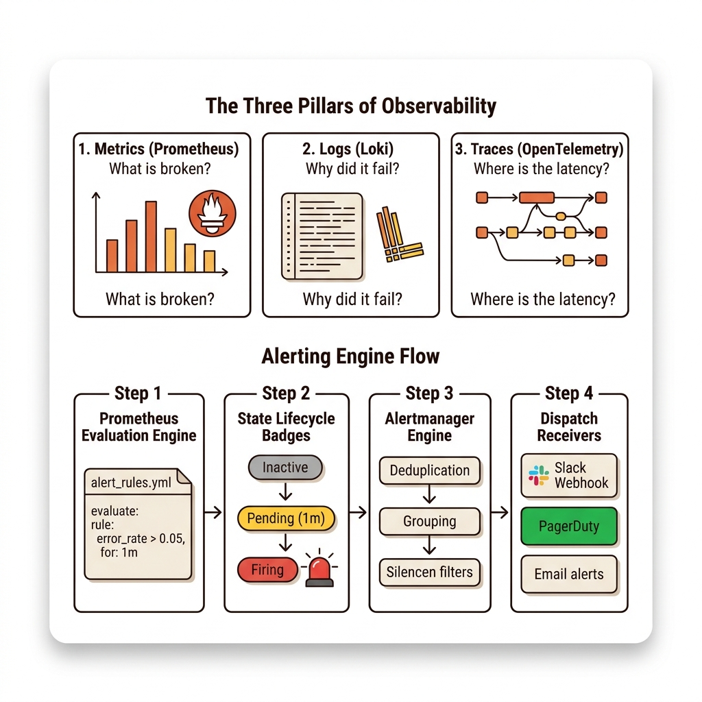
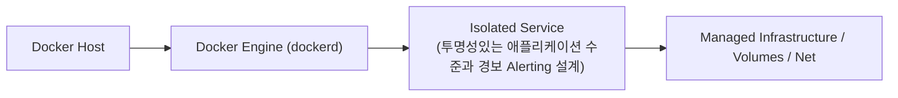
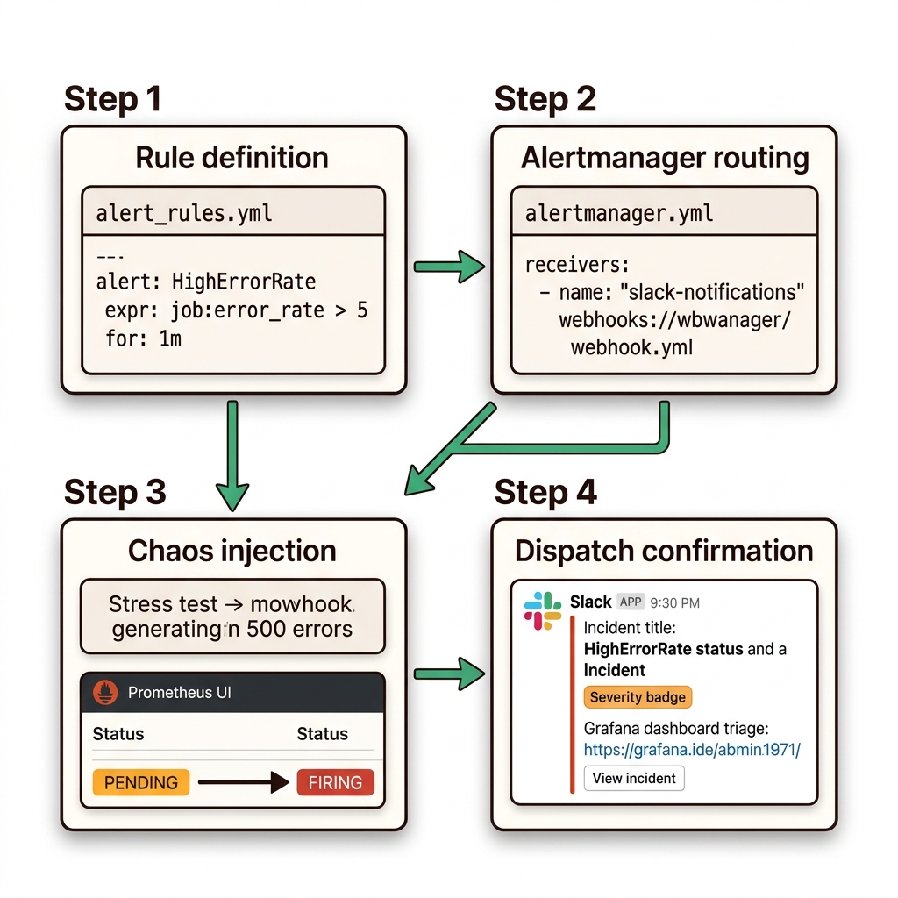

# 060. 투명성있는 애플리케이션 수준과 경보 Alerting 설계

애플리케이션 모니터링의 성숙도 단계(1단계: 인프라 지표 ➔ 2단계: 런타임 지표 ➔ 3단계: 핵심 비즈니스 지표 및 분산 추적)를 점검합니다.


**그림 04-19-1** 투명성있는 애플리케이션 수준과 경보 Alerting 설계의 필요성과 현대 클라우드 아키텍처 관점의 개요

---

### 060.1 왜 투명성있는 애플리케이션 수준과 경보 Alerting 설계이(가) 필요한가? (문제 정의와 현실적 배경)

소프트웨어 시스템이 복잡해질수록 설정을 다루는 방식은 전체 인프라의 신뢰성을 결정짓는 핵심 척도가 됩니다. **투명성있는 애플리케이션 수준과 경보 Alerting 설계**이(가) 부재하거나 잘못 다루어질 때 현장에서는 다음과 같은 대표적인 병목과 장애가 발생합니다:

1. **하드코딩된 설정과 환경 불일치로 인한 유연성 상실**: 환경이 바뀔 때마다 코드를 다시 빌드해야 하므로 배포 주기가 지연되고 이미지 수가 기하급수적으로 폭증합니다.
2. **보안 민감 데이터의 무분별한 노출**: 비밀번호, 데이터베이스 토큰, 암호화 키가 이미지 레이어에 영구 박제되어 형상관리 시스템이나 외부에 유출될 위험이 커집니다.
3. **재현 불가능한 구성 드리프트**: 스테이징 환경과 프로덕션 환경의 미세한 설정 차이가 예기치 못한 서비스 중단 사고로 직결됩니다.


**그림 04-19-2** 투명성있는 애플리케이션 수준과 경보 Alerting 설계에 대한 대표적인 오해와 실제 프로덕션 현장의 엔지니어링 진실

---

### 060.2 핵심 아키텍처와 엔지니어링 메커니즘

또한 에러율이 5%를 넘거나 가용 메모리가 90%를 초과하는 상태가 1분 이상 지속될 때(`for: 1m`), 슬랙(Slack)·디스코드·이메일·웹훅으로 즉시 장애 경보를 발송하는 **Alerting 규칙 설계 원칙**을 배웁니다.


**그림 04-19-3** 투명성있는 애플리케이션 수준과 경보 Alerting 설계의 내부 아키텍처 및 데이터 흐름

#### 📊 핵심 비교 및 엔지니어링 표준 분석

| 구분 / 핵심 원리 | 상세 설명 및 동작 메커니즘 | 실무 적용 시 주의점 및 베스트 프랙티스 |
| :--- | :--- | :--- |
| **관측 가능성 3대 기둥 (3 Pillars)** | 1) **Metrics**(Prometheus/Grafana: 무엇이 이상한가?), 2) **Logs**(Fluentd/Loki, 19장: 왜 에러가 났는가?), 3) **Traces**(OpenTelemetry/Jaeger: 어느 구간이 느린가?) | 세 가지가 결합될 때 어떤 복잡한 마이크로서비스 장애도 5분 안에 원인 규명 가능 |
| **경보 피로도(Alert Fatigue) 방지** | 사소한 경고까지 모두 알람을 보내면 정작 중요한 장애 알람을 무시하게 됨 (늑대와 양치기 소년 현상) | **즉시 사람이 개입해야 하는 치명적 증상(에러율 급증, 응답 지연, 디스크 고갈 임박)**에만 Critical 알람 설정! |
| **`for:` 지속 시간 조건** | 순간적인 1초짜리 스파이크에는 알람을 울리지 않고, `for: 1m`처럼 일정 시간 이상 이상 상태가 지속될 때만 발령 | 헬스 체크 자동 복구로 해결될 일시적 순단과 진짜 장애를 구분하는 핵심 설정 |

---

### 060.3 선언적 실습 및 아키텍처 다이어그램

본 실습은 외부 비공개 패키지에 의존하지 않고, 공식 표준 이미지를 기반으로 즉시 재현 가능한 살아있는 코드로 구성되어 있습니다.

```yaml
# [alert-rules.yml] 에러율 급증 또는 컨테이너 다운 시 자동으로 경보를 발령하는 프로메테우스 알림 규칙
groups:
  - name: oz-production-alerts
    rules:
      - alert: HighHttpErrorRate
        expr: sum(rate(http_requests_total{status=~"5.."}[1m])) / sum(rate(http_requests_total[1m])) > 0.05
        for: 1m
        labels:
          severity: critical
        annotations:
          summary: "HTTP 5xx 에러율이 5%를 초과했습니다!" 
```

#### 🔍 아키텍처 흐름도 (Mermaid Diagram)




**그림 04-19-4** 선언적 인프라 명세를 통한 투명성있는 애플리케이션 수준과 경보 Alerting 설계 검증 파이프라인

---

### 060.4 핵심 정리: 캐릭터 대화와 3대 교훈

> 👧 **도로시**: "교수님! **투명성있는 애플리케이션 수준과 경보 Alerting 설계**의 원리를 배우니까, 복잡하게 얽혀 있던 인프라 설정이 레고 블록처럼 질서정연하게 제자리를 찾는 게 보여요!"
> 
> 🐱 **조교 지니**: "야옹~ 맞습니다! 특히 런타임 환경과 불변 인프라의 경계를 명확히 지키는 것이 대규모 클라우드 운영의 제1원칙이랍니다!"
> 
> 🐶 **토토**: "멍멍! 선언적 코드로 한 번 적어두면 언제든 똑같이 복원되니까 정말 든든해요!"
> 
> 👨‍🏫 **이호진 교수님**: "훌륭하구나. 원리를 깊이 이해하고 실습을 통해 손에 익히는 것이 훌륭한 클라우드 엔지니어로 성장하는 가장 빠른 지름길이란다."


**그림 04-19-5** 투명성있는 애플리케이션 수준과 경보 Alerting 설계 마스터를 위한 3대 핵심 교훈

1. **설정과 실행의 명확한 분리**:
   * 애플리케이션 코드는 불변으로 유지하고, 가변적인 설정값은 외부에서 주입하여 이식성을 극대화합니다.
2. **선언적 재현성 확보**:
   * 사람이 수작업으로 변경하지 않고 코드 명세를 통해 언제 어디서나 100% 동일한 실행 결과를 보장합니다.
3. **최소 권한 및 보안 모범 사례 준수**:
   * 불필요한 권한과 포트 노출을 최소화하고 민감 데이터를 암호화하여 프로덕션 안정성을 담보합니다.

---

### 060.5 랩노트 피날레와 다음 강의 예고


**그림 04-19-6** 연구실에서 다음 마일스톤인 [Part04 실전미션 헬스체크와 그라파나관제가 결합된 마이크로서비스] 실습을 예고하는 교수님과 토토

> 💡 **다음 강의 안내**:
> [Part04 실전미션 헬스체크와 그라파나관제가 결합된 마이크로서비스](../061_Part04_실전미션_헬스체크와_그라파나관제가_결합된_마이크로서비스/)에서는 더욱 심화된 실전 엔지니어링 실습과 아키텍처를 다룹니다!

---

## 🧭 강의 네비게이션
* [◀️ 이전 강의: 059_대시보드_코드화_Grafana_프로비저닝_자동화](../059_대시보드_코드화_Grafana_프로비저닝_자동화/)
* [📋 Part 04. 도커 컴포즈(Compose) 분산 앱 실행, 헬스/디펜던시 체크 & 모니터링 (042 ~ 061) 목차로 돌아가기](../)
* [▶️ 다음 강의: 061_Part04_실전미션_헬스체크와_그라파나관제가_결합된_마이크로서비스](../061_Part04_실전미션_헬스체크와_그라파나관제가_결합된_마이크로서비스/)
