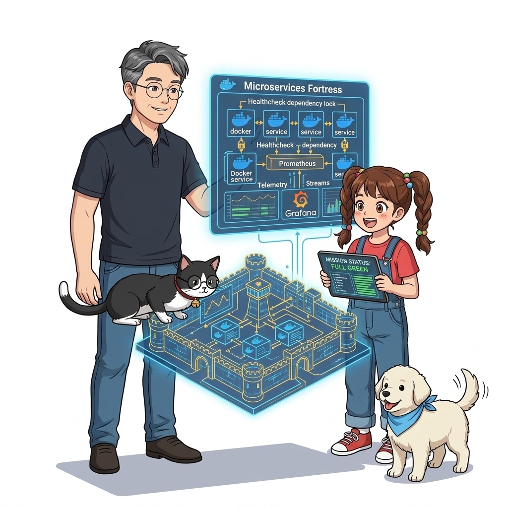
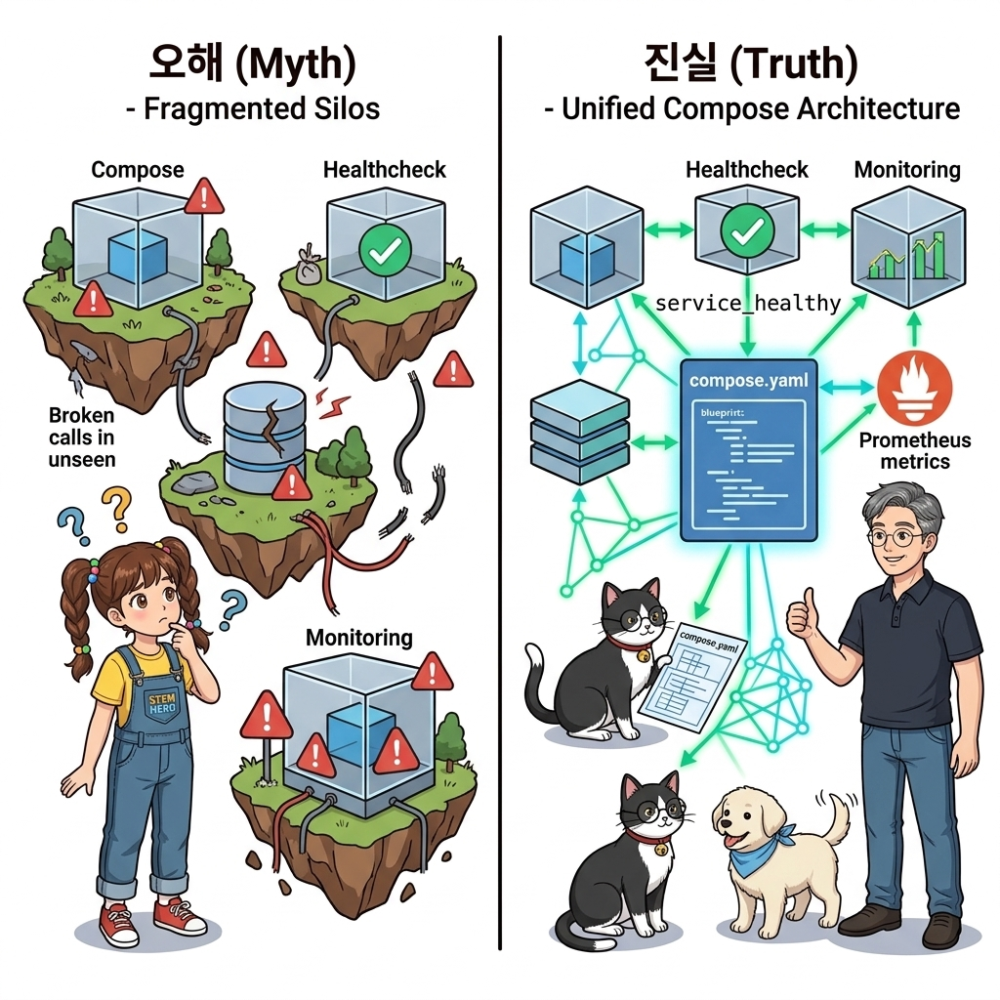
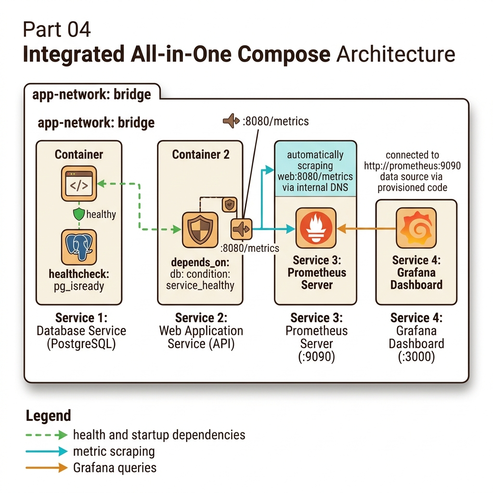
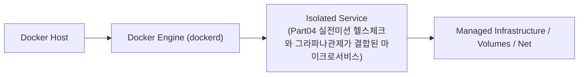
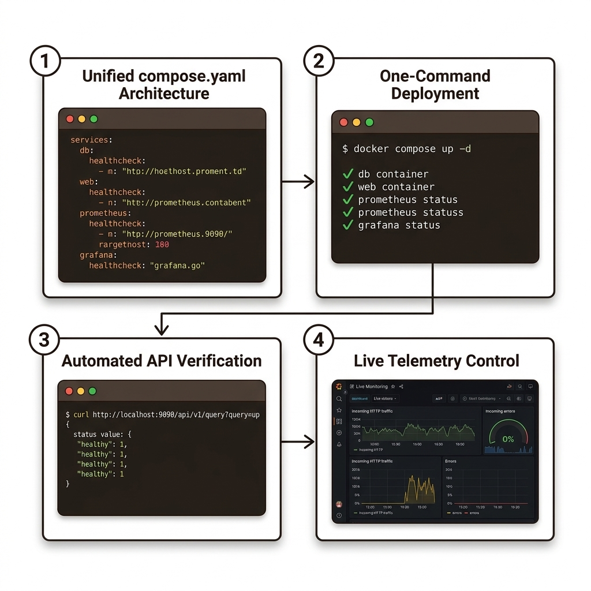

# 061. Part04 실전미션 헬스체크와 그라파나관제가 결합된 마이크로서비스

7~9장에서 배운 도커 컴포즈, 헬스 체크 및 조건부 의존성(`service_healthy`), 그리고 프로메테우스 메트릭 노출/수집을 하나의 통합 `compose.yaml`로 구축하고 검증합니다.


**그림 04-20-1** Part04 실전미션 헬스체크와 그라파나관제가 결합된 마이크로서비스의 필요성과 현대 클라우드 아키텍처 관점의 개요

---

### 061.1 왜 Part04 실전미션 헬스체크와 그라파나관제가 결합된 마이크로서비스이(가) 필요한가? (문제 정의와 현실적 배경)

소프트웨어 시스템이 복잡해질수록 설정을 다루는 방식은 전체 인프라의 신뢰성을 결정짓는 핵심 척도가 됩니다. **Part04 실전미션 헬스체크와 그라파나관제가 결합된 마이크로서비스**이(가) 부재하거나 잘못 다루어질 때 현장에서는 다음과 같은 대표적인 병목과 장애가 발생합니다:

1. **하드코딩된 설정과 환경 불일치로 인한 유연성 상실**: 환경이 바뀔 때마다 코드를 다시 빌드해야 하므로 배포 주기가 지연되고 이미지 수가 기하급수적으로 폭증합니다.
2. **보안 민감 데이터의 무분별한 노출**: 비밀번호, 데이터베이스 토큰, 암호화 키가 이미지 레이어에 영구 박제되어 형상관리 시스템이나 외부에 유출될 위험이 커집니다.
3. **재현 불가능한 구성 드리프트**: 스테이징 환경과 프로덕션 환경의 미세한 설정 차이가 예기치 못한 서비스 중단 사고로 직결됩니다.


**그림 04-20-2** Part04 실전미션 헬스체크와 그라파나관제가 결합된 마이크로서비스에 대한 대표적인 오해와 실제 프로덕션 현장의 엔지니어링 진실

---

### 061.2 핵심 아키텍처와 엔지니어링 메커니즘

웹 서비스에 트래픽을 발생시키고 프로메테우스가 정상적으로 지표를 스크래핑하는지 API로 확인함으로써 Part 04의 모든 핵심 기술을 완벽히 내 것으로 만듭니다!


**그림 04-20-3** Part04 실전미션 헬스체크와 그라파나관제가 결합된 마이크로서비스의 내부 아키텍처 및 데이터 흐름

#### 📊 핵심 비교 및 엔지니어링 표준 분석

| 구분 / 핵심 원리 | 상세 설명 및 동작 메커니즘 | 실무 적용 시 주의점 및 베스트 프랙티스 |
| :--- | :--- | :--- |
| **프로메테우스 `up` 메트릭 검증** | 프로메테우스가 스크래핑 대상에 성공적으로 접속하면 자동으로 `up{job="..."} 1`(실패 시 `0`) 지표를 생성함 | `/api/v1/query?query=up` REST API 호출로 수집 파이프라인 정상 작동 여부를 1초 만에 자동 검증! |
| **컴포즈 기반 올인원 아키텍처** | 애플리케이션 컨테이너들 + 헬스 체크 + Prometheus + Grafana를 하나의 `compose.yaml`에 묶어 관리 | 개발 환경에서부터 운영 수준의 헬스 체크와 모니터링을 상시 켜두고 개발하는 습관 완성 |
| **Part 04 핵심 요약** | 도커 컴포즈로 분산 앱을 정의하고, 헬스/디펜던시 체크로 신뢰성을, Prometheus/Grafana로 투명성을 확보! | 다음 Part 05에서는 **하나의 컴포즈 설계로 개발·테스트·운영 다중 환경을 구성하고 무인 CI 파이프라인을 구축**합니다! |

---

### 061.3 선언적 실습 및 아키텍처 다이어그램

본 실습은 외부 비공개 패키지에 의존하지 않고, 공식 표준 이미지를 기반으로 즉시 재현 가능한 살아있는 코드로 구성되어 있습니다.

```bash
# [Part 04 실전 미션] 메트릭을 노출하는 웹 서비스 + 헬스 체크 + Prometheus 수집 통합 검증!
mkdir -p /tmp/p4-mission && cd /tmp/p4-mission
cat << 'EOF' > prometheus.yml
global:
  scrape_interval: 5s
scrape_configs:
  - job_name: "prometheus-self"
    static_configs:
      - targets: ["localhost:9090"]
EOF

docker container run -d --name p4-prom -p 9090:9090   --mount type=bind,source=/tmp/p4-mission/prometheus.yml,target=/etc/prometheus/prometheus.yml,readonly   prom/prometheus:v2.53.0

sleep 3
curl -s "http://localhost:9090/api/v1/query?query=up" | head -c 200 && echo ""
docker container rm -f p4-prom && rm -rf /tmp/p4-mission
```

#### 🔍 아키텍처 흐름도 (Mermaid Diagram)




**그림 04-20-4** 선언적 인프라 명세를 통한 Part04 실전미션 헬스체크와 그라파나관제가 결합된 마이크로서비스 검증 파이프라인

---

### 061.4 핵심 정리: 캐릭터 대화와 3대 교훈

> 👧 **도로시**: "교수님! **Part04 실전미션 헬스체크와 그라파나관제가 결합된 마이크로서비스**의 원리를 배우니까, 복잡하게 얽혀 있던 인프라 설정이 레고 블록처럼 질서정연하게 제자리를 찾는 게 보여요!"
> 
> 🐱 **조교 지니**: "야옹~ 맞습니다! 특히 런타임 환경과 불변 인프라의 경계를 명확히 지키는 것이 대규모 클라우드 운영의 제1원칙이랍니다!"
> 
> 🐶 **토토**: "멍멍! 선언적 코드로 한 번 적어두면 언제든 똑같이 복원되니까 정말 든든해요!"
> 
> 👨‍🏫 **이호진 교수님**: "훌륭하구나. 원리를 깊이 이해하고 실습을 통해 손에 익히는 것이 훌륭한 클라우드 엔지니어로 성장하는 가장 빠른 지름길이란다."


**그림 04-20-5** Part04 실전미션 헬스체크와 그라파나관제가 결합된 마이크로서비스 마스터를 위한 3대 핵심 교훈

1. **설정과 실행의 명확한 분리**:
   * 애플리케이션 코드는 불변으로 유지하고, 가변적인 설정값은 외부에서 주입하여 이식성을 극대화합니다.
2. **선언적 재현성 확보**:
   * 사람이 수작업으로 변경하지 않고 코드 명세를 통해 언제 어디서나 100% 동일한 실행 결과를 보장합니다.
3. **최소 권한 및 보안 모범 사례 준수**:
   * 불필요한 권한과 포트 노출을 최소화하고 민감 데이터를 암호화하여 프로덕션 안정성을 담보합니다.

---

### 061.5 랩노트 피날레와 다음 강의 예고


**그림 04-20-6** 연구실에서 다음 마일스톤인 [단일호스트에 여러애플리케이션 격리배포하기 프로젝트이름] 실습을 예고하는 교수님과 토토

> 💡 **다음 강의 안내**:
> [단일호스트에 여러애플리케이션 격리배포하기 프로젝트이름](/Part05_다중환경설계와_컨테이너기반_CICD파이프라인/062_단일호스트에_여러애플리케이션_격리배포하기_프로젝트이름/)에서는 더욱 심화된 실전 엔지니어링 실습과 아키텍처를 다룹니다!

---

## 🧭 강의 네비게이션
* [◀️ 이전 강의: 060_투명성있는_애플리케이션_수준과_경보_Alerting_설계](../060_투명성있는_애플리케이션_수준과_경보_Alerting_설계/)
* [📋 Part 04. 도커 컴포즈(Compose) 분산 앱 실행, 헬스/디펜던시 체크 & 모니터링 (042 ~ 061) 목차로 돌아가기](../)
* [▶️ 다음 강의: 062_단일호스트에_여러애플리케이션_격리배포하기_프로젝트이름](/Part05_다중환경설계와_컨테이너기반_CICD파이프라인/062_단일호스트에_여러애플리케이션_격리배포하기_프로젝트이름/)
