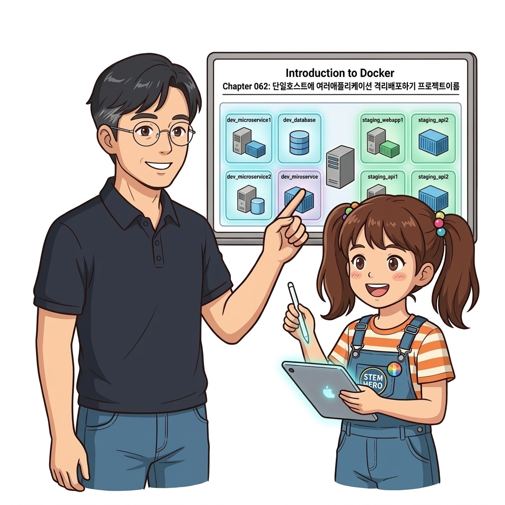
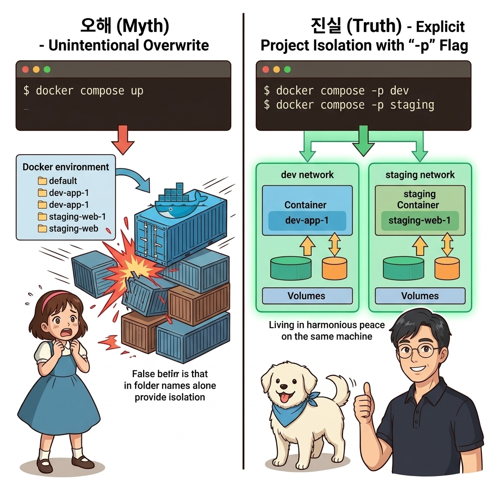
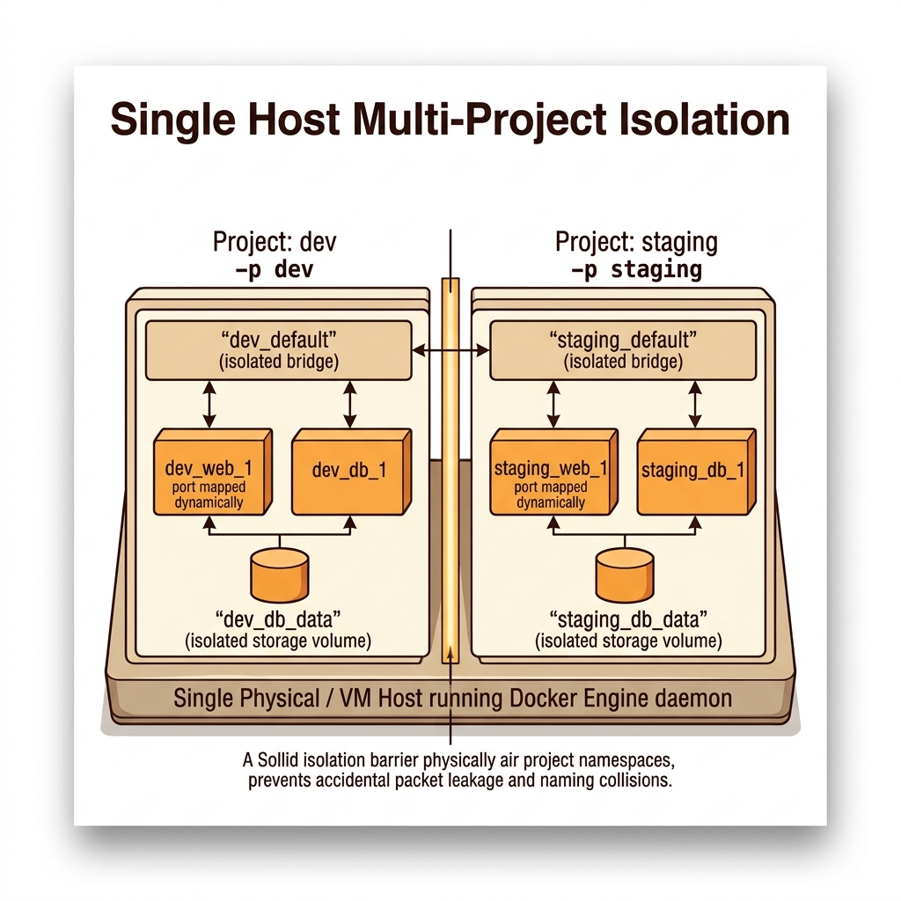
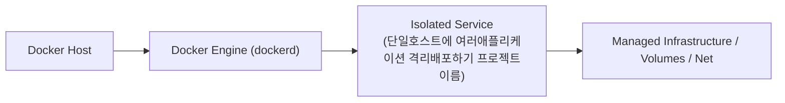
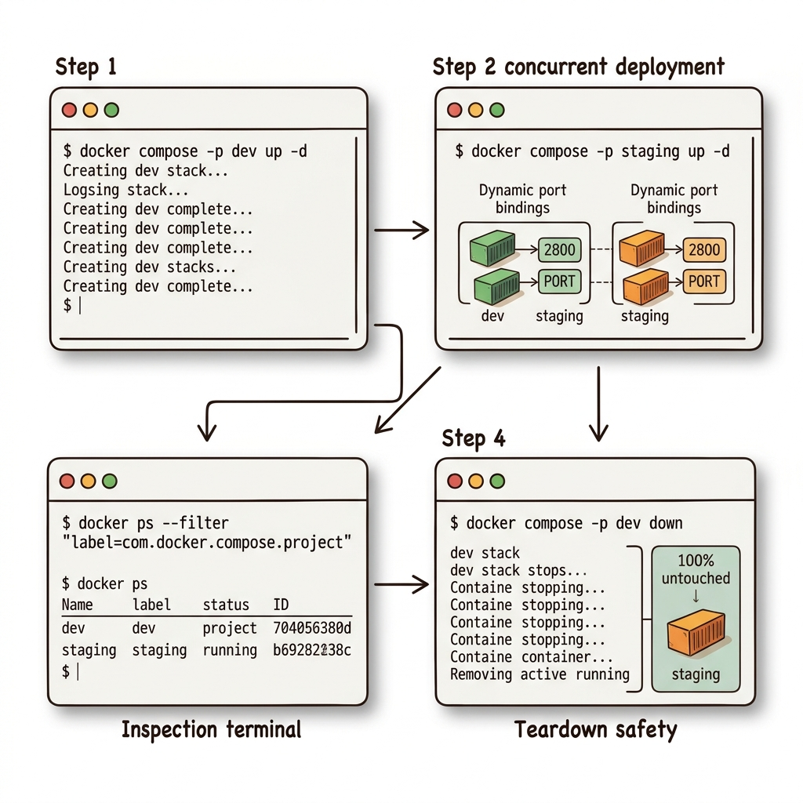

# 062. 단일호스트에 여러애플리케이션 격리배포하기 프로젝트이름

도커 컴포즈는 컨테이너·네트워크·볼륨의 이름 앞에 항상 **`[프로젝트 이름]_[리소스 이름]`** 프리픽스를 붙여 관리하며, 별도 지정이 없으면 **현재 폴더 이름**을 프로젝트 이름으로 삼습니다.


**그림 05-1-1** 단일호스트에 여러애플리케이션 격리배포하기 프로젝트이름의 필요성과 현대 클라우드 아키텍처 관점의 개요

---

### 062.1 왜 단일호스트에 여러애플리케이션 격리배포하기 프로젝트이름이(가) 필요한가? (문제 정의와 현실적 배경)

소프트웨어 시스템이 복잡해질수록 설정을 다루는 방식은 전체 인프라의 신뢰성을 결정짓는 핵심 척도가 됩니다. **단일호스트에 여러애플리케이션 격리배포하기 프로젝트이름**이(가) 부재하거나 잘못 다루어질 때 현장에서는 다음과 같은 대표적인 병목과 장애가 발생합니다:

1. **하드코딩된 설정과 환경 불일치로 인한 유연성 상실**: 환경이 바뀔 때마다 코드를 다시 빌드해야 하므로 배포 주기가 지연되고 이미지 수가 기하급수적으로 폭증합니다.
2. **보안 민감 데이터의 무분별한 노출**: 비밀번호, 데이터베이스 토큰, 암호화 키가 이미지 레이어에 영구 박제되어 형상관리 시스템이나 외부에 유출될 위험이 커집니다.
3. **재현 불가능한 구성 드리프트**: 스테이징 환경과 프로덕션 환경의 미세한 설정 차이가 예기치 못한 서비스 중단 사고로 직결됩니다.


**그림 05-1-2** 단일호스트에 여러애플리케이션 격리배포하기 프로젝트이름에 대한 대표적인 오해와 실제 프로덕션 현장의 엔지니어링 진실

---

### 062.2 핵심 아키텍처와 엔지니어링 메커니즘

따라서 같은 폴더에서 그냥 `docker compose up`을 실행하면 같은 프로젝트로 인식해 기존 환경을 덮어쓰게 됩니다. **`--project-name`(`-p`)** 플래그를 사용해 단일 서버 안에 완벽히 격리된 여러 개의 환경을 동시에 띄우는 법을 실습합니다!


**그림 05-1-3** 단일호스트에 여러애플리케이션 격리배포하기 프로젝트이름의 내부 아키텍처 및 데이터 흐름

#### 📊 핵심 비교 및 엔지니어링 표준 분석

| 구분 / 핵심 원리 | 상세 설명 및 동작 메커니즘 | 실무 적용 시 주의점 및 베스트 프랙티스 |
| :--- | :--- | :--- |
| **프로젝트 이름 기본값** | `compose.yaml`이 위치한 디렉터리 이름(예: `todo-list`)이 기본 프로젝트 이름이 됨 | 생성되는 컨테이너 이름은 `todo-list-web-1`, 네트워크 이름은 `todo-list_default` 형태로 자동 명명 |
| **`-p` (`--project-name`) 플래그** | `docker compose -p dev up -d`처럼 명시적 프로젝트 이름을 부여해 리소스 이름 공간을 완전히 분리 | 주의: `-p`로 띄운 환경을 내릴 때도 반드시 동일한 `-p dev down`을 지정해야 정확히 찾아서 종료함! |
| **포트 번호 동적 할당 (`ports: ["80"]`)** | 호스트 포트를 생략하고 컨테이너 포트(`80`)만 적으면 도커가 호스트의 비어 있는 임의 포트(예: `32768`, `32769`)를 자동 할당 | 단일 서버에 동일 앱을 여러 개 띄울 때 호스트 포트 충돌을 피하는 유용한 기법 |

---

### 062.3 선언적 실습 및 아키텍처 다이어그램

본 실습은 외부 비공개 패키지에 의존하지 않고, 공식 표준 이미지를 기반으로 즉시 재현 가능한 살아있는 코드로 구성되어 있습니다.

```bash
# 동일한 compose.yaml 파일로 개발용(oz-dev)과 테스트용(oz-test) 두 개의 독립 환경을 동시에 기동하기!
mkdir -p /tmp/oz-multi && cd /tmp/oz-multi
cat << 'EOF' > compose.yaml
services:
  web:
    image: nginx:1.27-alpine
    ports: ["80"]
EOF

docker compose -p oz-dev up -d
docker compose -p oz-test up -d
docker compose ls
docker compose -p oz-dev down && docker compose -p oz-test down && rm -rf /tmp/oz-multi
```

#### 🔍 아키텍처 흐름도 (Mermaid Diagram)




**그림 05-1-4** 선언적 인프라 명세를 통한 단일호스트에 여러애플리케이션 격리배포하기 프로젝트이름 검증 파이프라인

---

### 062.4 핵심 정리: 캐릭터 대화와 3대 교훈

> 👧 **도로시**: "교수님! **단일호스트에 여러애플리케이션 격리배포하기 프로젝트이름**의 원리를 배우니까, 복잡하게 얽혀 있던 인프라 설정이 레고 블록처럼 질서정연하게 제자리를 찾는 게 보여요!"
> 
> 🐱 **조교 지니**: "야옹~ 맞습니다! 특히 런타임 환경과 불변 인프라의 경계를 명확히 지키는 것이 대규모 클라우드 운영의 제1원칙이랍니다!"
> 
> 🐶 **토토**: "멍멍! 선언적 코드로 한 번 적어두면 언제든 똑같이 복원되니까 정말 든든해요!"
> 
> 👨‍🏫 **이호진 교수님**: "훌륭하구나. 원리를 깊이 이해하고 실습을 통해 손에 익히는 것이 훌륭한 클라우드 엔지니어로 성장하는 가장 빠른 지름길이란다."


**그림 05-1-5** 단일호스트에 여러애플리케이션 격리배포하기 프로젝트이름 마스터를 위한 3대 핵심 교훈

1. **설정과 실행의 명확한 분리**:
   * 애플리케이션 코드는 불변으로 유지하고, 가변적인 설정값은 외부에서 주입하여 이식성을 극대화합니다.
2. **선언적 재현성 확보**:
   * 사람이 수작업으로 변경하지 않고 코드 명세를 통해 언제 어디서나 100% 동일한 실행 결과를 보장합니다.
3. **최소 권한 및 보안 모범 사례 준수**:
   * 불필요한 권한과 포트 노출을 최소화하고 민감 데이터를 암호화하여 프로덕션 안정성을 담보합니다.

---

### 062.5 랩노트 피날레와 다음 강의 예고


**그림 05-1-6** 연구실에서 다음 마일스톤인 [도커컴포즈 오버라이드파일 병합원리와 config검증] 실습을 예고하는 교수님과 토토

> 💡 **다음 강의 안내**:
> [도커컴포즈 오버라이드파일 병합원리와 config검증](../063_도커컴포즈_오버라이드파일_병합원리와_config검증/)에서는 더욱 심화된 실전 엔지니어링 실습과 아키텍처를 다룹니다!

---

## 🧭 강의 네비게이션
* [◀️ 이전 강의: 061_Part04_실전미션_헬스체크와_그라파나관제가_결합된_마이크로서비스](/Part04_도커컴포즈와_신뢰성_헬스체크_모니터링/061_Part04_실전미션_헬스체크와_그라파나관제가_결합된_마이크로서비스/)
* [📋 Part 05. 다중 환경 구성(Dev/Test/Prod)과 컨테이너 기반 CI/CD 파이프라인 (062 ~ 075) 목차로 돌아가기](../)
* [▶️ 다음 강의: 063_도커컴포즈_오버라이드파일_병합원리와_config검증](../063_도커컴포즈_오버라이드파일_병합원리와_config검증/)
