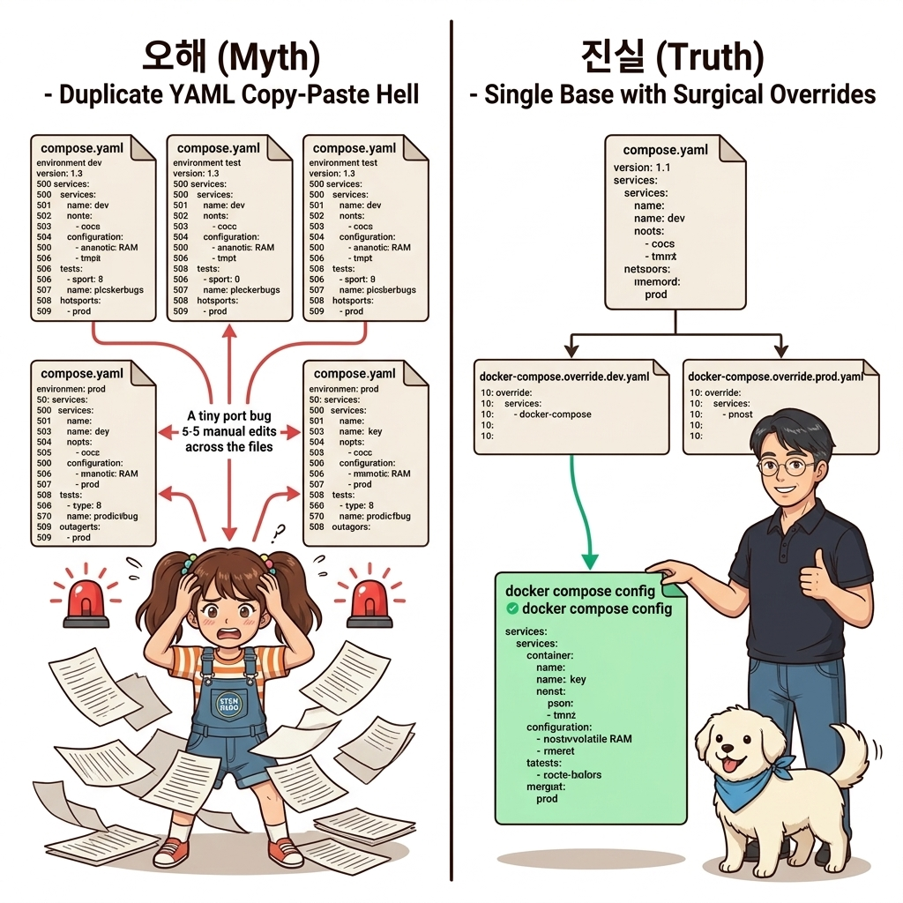
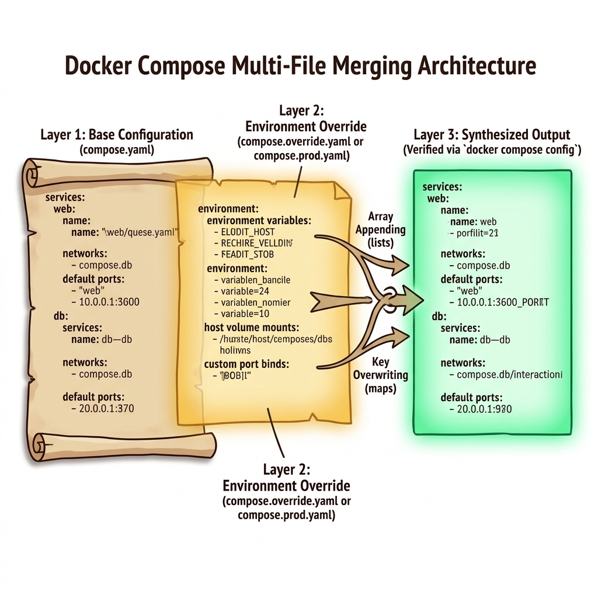
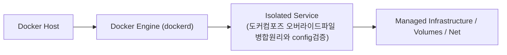
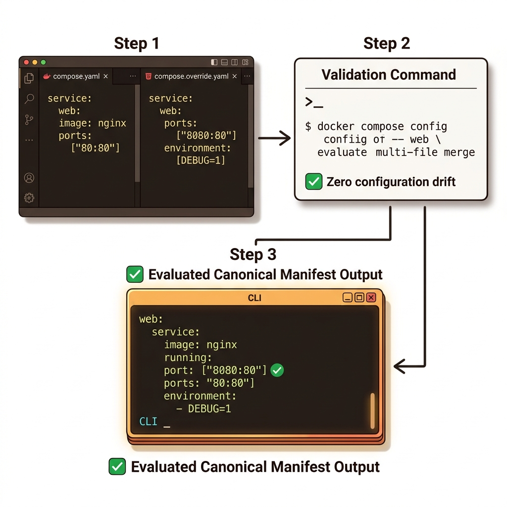
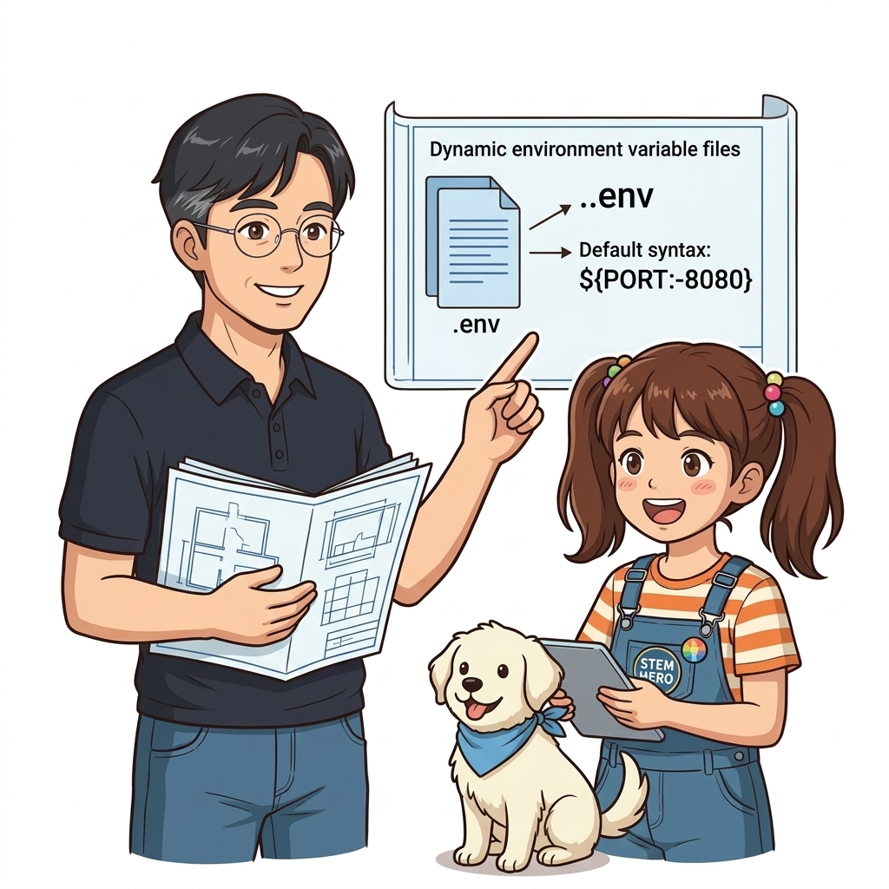

# 063. 도커컴포즈 오버라이드파일 병합원리와 config검증

모든 환경에서 공통으로 쓰이는 핵심 구조(서비스 목록, 내부 연결 관계)는 기본 **`compose.yaml`** 한 곳에 두고, 환경별로 달라지는 설정(포트, 볼륨, 이미지 태그, 리소스 제한)만 **오버라이드 파일(`compose.dev.yaml`, `compose.prod.yaml`)**에 분리해 작성합니다.


**그림 05-2-1** 도커컴포즈 오버라이드파일 병합원리와 config검증의 필요성과 현대 클라우드 아키텍처 관점의 개요

---

### 063.1 왜 도커컴포즈 오버라이드파일 병합원리와 config검증이(가) 필요한가? (문제 정의와 현실적 배경)

소프트웨어 시스템이 복잡해질수록 설정을 다루는 방식은 전체 인프라의 신뢰성을 결정짓는 핵심 척도가 됩니다. **도커컴포즈 오버라이드파일 병합원리와 config검증**이(가) 부재하거나 잘못 다루어질 때 현장에서는 다음과 같은 대표적인 병목과 장애가 발생합니다:

1. **하드코딩된 설정과 환경 불일치로 인한 유연성 상실**: 환경이 바뀔 때마다 코드를 다시 빌드해야 하므로 배포 주기가 지연되고 이미지 수가 기하급수적으로 폭증합니다.
2. **보안 민감 데이터의 무분별한 노출**: 비밀번호, 데이터베이스 토큰, 암호화 키가 이미지 레이어에 영구 박제되어 형상관리 시스템이나 외부에 유출될 위험이 커집니다.
3. **재현 불가능한 구성 드리프트**: 스테이징 환경과 프로덕션 환경의 미세한 설정 차이가 예기치 못한 서비스 중단 사고로 직결됩니다.


**그림 05-2-2** 도커컴포즈 오버라이드파일 병합원리와 config검증에 대한 대표적인 오해와 실제 프로덕션 현장의 엔지니어링 진실

---

### 063.2 핵심 아키텍처와 엔지니어링 메커니즘

여러 개의 `-f` 플래그로 파일들을 순서대로 덧씌워 병합하는 원리와, 실제 실행 전에 병합된 최종 YAML 결과를 눈으로 확인하는 **`docker compose config`** 명령을 마스터합니다.


**그림 05-2-3** 도커컴포즈 오버라이드파일 병합원리와 config검증의 내부 아키텍처 및 데이터 흐름

#### 📊 핵심 비교 및 엔지니어링 표준 분석

| 구분 / 핵심 원리 | 상세 설명 및 동작 메커니즘 | 실무 적용 시 주의점 및 베스트 프랙티스 |
| :--- | :--- | :--- |
| **다중 `-f` 병합 규칙** | 앞선 파일(`-f compose.yaml`)의 설정 위에 뒤따르는 파일(`-f compose.prod.yaml`)의 설정이 덮어써짐(Override) | 단일 값(예: `image`, `restart`, 동일 환경 변수 키)은 교체되고, 리스트/맵(예: 다른 이름의 환경 변수, 포트)은 합집합으로 추가됨! |
| **`compose.override.yaml` 자동 로드** | 별도의 `-f` 옵션을 주지 않고 그냥 `docker compose up`을 치면 `compose.yaml`과 `compose.override.yaml` 두 파일을 자동으로 찾아 병합함 | 로컬 개발용 설정을 `compose.override.yaml`에 넣어두면 개발자는 평소처럼 `docker compose up`만 치면 됨! |
| **`docker compose config`** | 여러 오버라이드 파일과 환경 변수가 모두 합쳐진 최종 컴포즈 명세를 표준 출력으로 보여줌 | 배포 전 오타나 병합 우선순위 실수를 100% 잡아내는 필수 검증 명령 |

---

### 063.3 선언적 실습 및 아키텍처 다이어그램

본 실습은 외부 비공개 패키지에 의존하지 않고, 공식 표준 이미지를 기반으로 즉시 재현 가능한 살아있는 코드로 구성되어 있습니다.

```bash
# 코어 compose.yaml과 환경별 오버라이드(compose.prod.yaml)를 병합해 최종 결과(config) 확인하기!
mkdir -p /tmp/oz-override && cd /tmp/oz-override
cat << 'EOF' > compose.yaml
services:
  api:
    image: nginx:1.27-alpine
    environment:
      LOG_LEVEL: info
EOF

cat << 'EOF' > compose.prod.yaml
services:
  api:
    ports: ["8080:80"]
    environment:
      LOG_LEVEL: warn
    restart: always
EOF

docker compose -f compose.yaml -f compose.prod.yaml config
rm -rf /tmp/oz-override
```

#### 🔍 아키텍처 흐름도 (Mermaid Diagram)




**그림 05-2-4** 선언적 인프라 명세를 통한 도커컴포즈 오버라이드파일 병합원리와 config검증 검증 파이프라인

---

### 063.4 핵심 정리: 캐릭터 대화와 3대 교훈

> 👧 **도로시**: "교수님! **도커컴포즈 오버라이드파일 병합원리와 config검증**의 원리를 배우니까, 복잡하게 얽혀 있던 인프라 설정이 레고 블록처럼 질서정연하게 제자리를 찾는 게 보여요!"
> 
> 🐱 **조교 지니**: "야옹~ 맞습니다! 특히 런타임 환경과 불변 인프라의 경계를 명확히 지키는 것이 대규모 클라우드 운영의 제1원칙이랍니다!"
> 
> 🐶 **토토**: "멍멍! 선언적 코드로 한 번 적어두면 언제든 똑같이 복원되니까 정말 든든해요!"
> 
> 👨‍🏫 **이호진 교수님**: "훌륭하구나. 원리를 깊이 이해하고 실습을 통해 손에 익히는 것이 훌륭한 클라우드 엔지니어로 성장하는 가장 빠른 지름길이란다."


**그림 05-2-5** 도커컴포즈 오버라이드파일 병합원리와 config검증 마스터를 위한 3대 핵심 교훈

1. **설정과 실행의 명확한 분리**:
   * 애플리케이션 코드는 불변으로 유지하고, 가변적인 설정값은 외부에서 주입하여 이식성을 극대화합니다.
2. **선언적 재현성 확보**:
   * 사람이 수작업으로 변경하지 않고 코드 명세를 통해 언제 어디서나 100% 동일한 실행 결과를 보장합니다.
3. **최소 권한 및 보안 모범 사례 준수**:
   * 불필요한 권한과 포트 노출을 최소화하고 민감 데이터를 암호화하여 프로덕션 안정성을 담보합니다.

---

### 063.5 랩노트 피날레와 다음 강의 예고


**그림 05-2-6** 연구실에서 다음 마일스톤인 [환경변수파일 dotenv와 컴포즈 변수치환 기본값문법] 실습을 예고하는 교수님과 토토

> 💡 **다음 강의 안내**:
> [환경변수파일 dotenv와 컴포즈 변수치환 기본값문법](../064_환경변수파일_dotenv와_컴포즈_변수치환_기본값문법/)에서는 더욱 심화된 실전 엔지니어링 실습과 아키텍처를 다룹니다!

---

## 🧭 강의 네비게이션
* [◀️ 이전 강의: 062_단일호스트에_여러애플리케이션_격리배포하기_프로젝트이름](../062_단일호스트에_여러애플리케이션_격리배포하기_프로젝트이름/)
* [📋 Part 05. 다중 환경 구성(Dev/Test/Prod)과 컨테이너 기반 CI/CD 파이프라인 (062 ~ 075) 목차로 돌아가기](../)
* [▶️ 다음 강의: 064_환경변수파일_dotenv와_컴포즈_변수치환_기본값문법](../064_환경변수파일_dotenv와_컴포즈_변수치환_기본값문법/)
