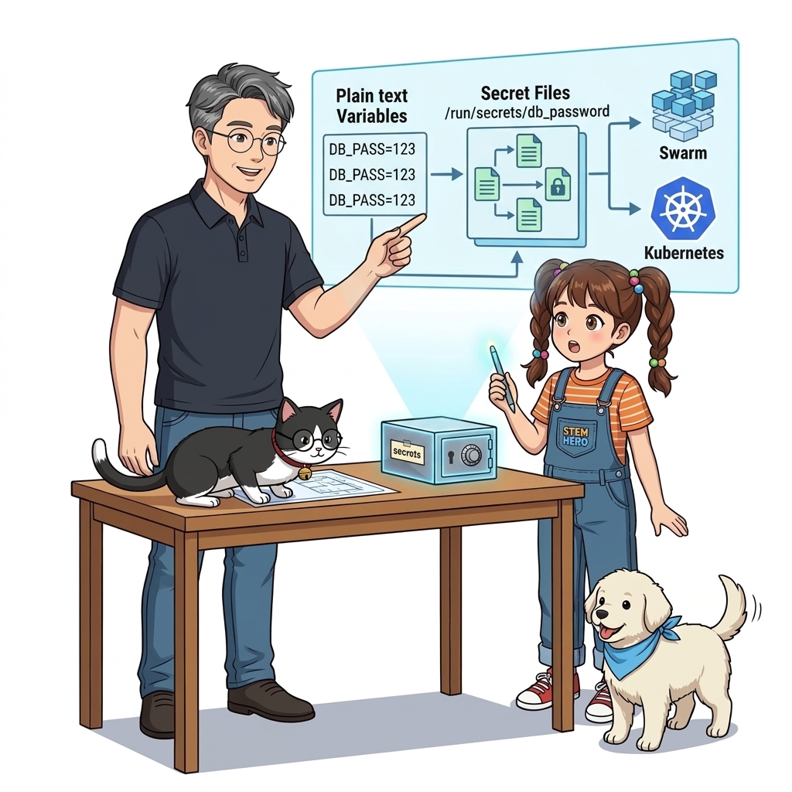
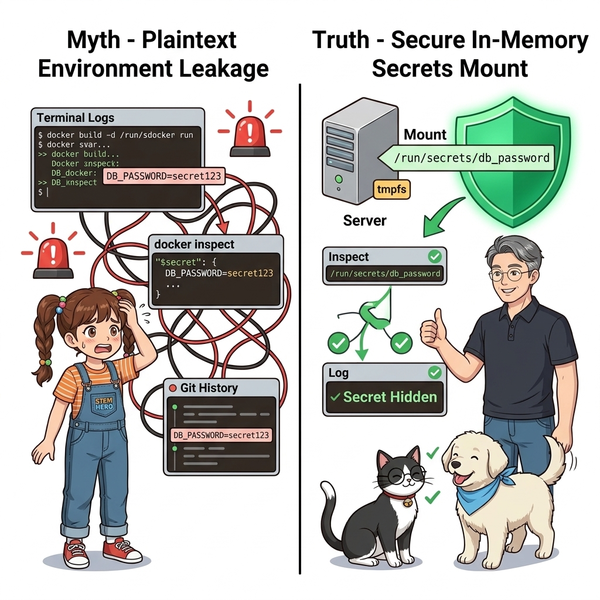
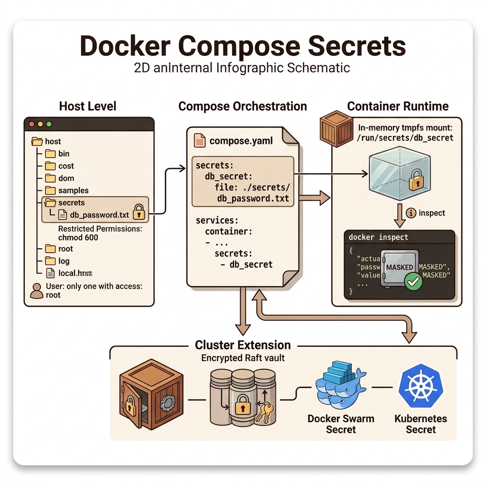
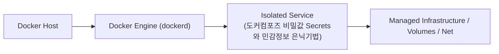
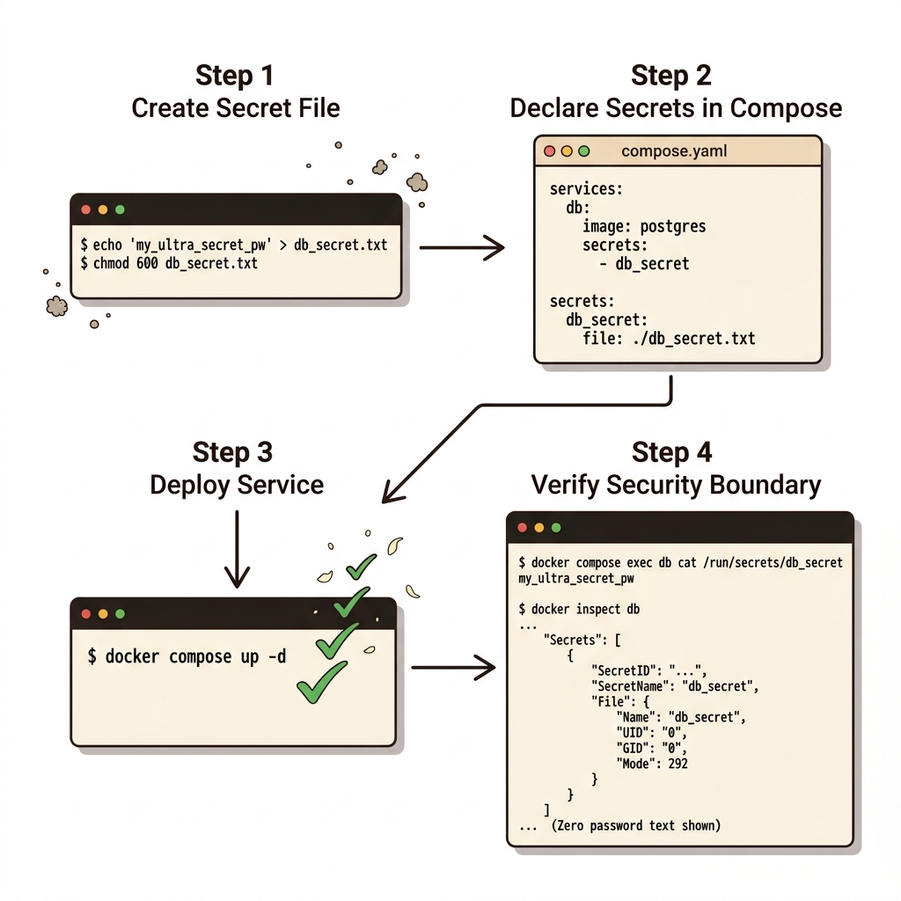
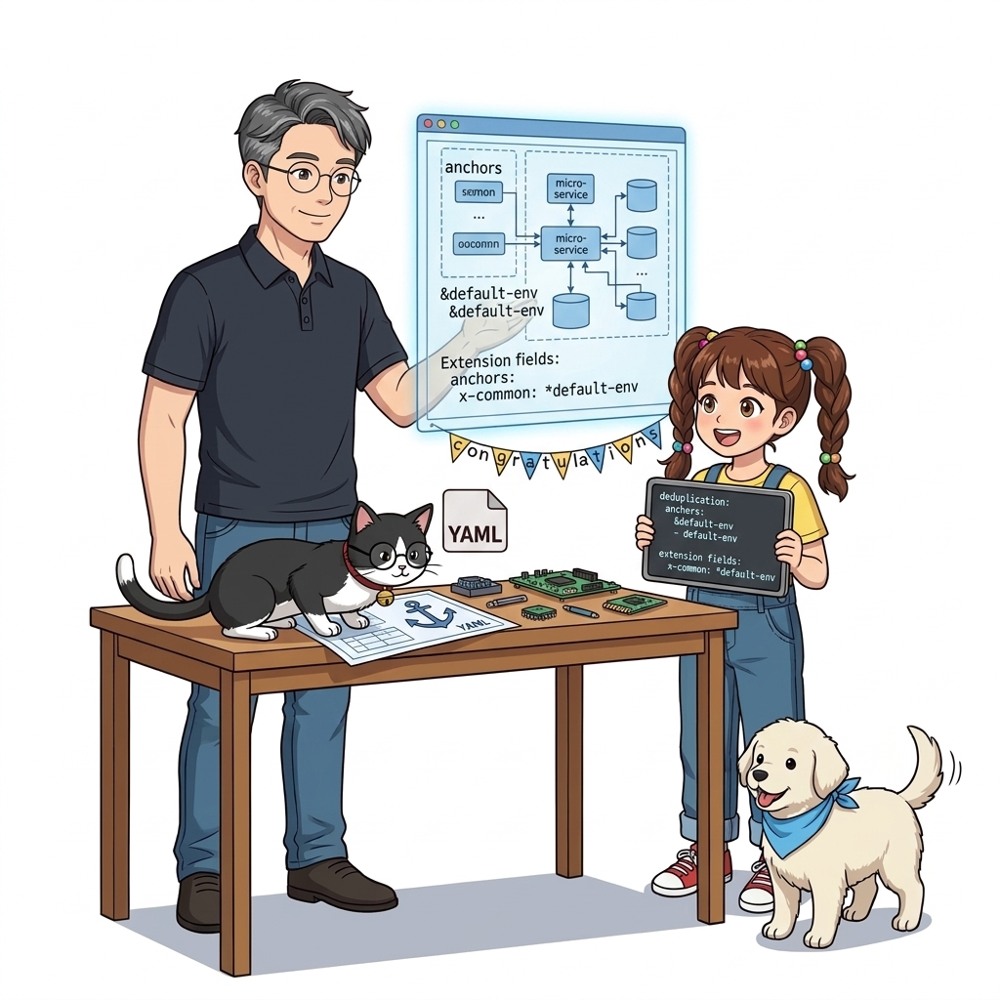

# 065. 도커컴포즈 비밀값 Secrets와 민감정보 은닉기법

환경 변수는 일반 설정에는 편리하지만, 컨테이너에 접근 권한이 있는 누구나 `docker container inspect`나 프로세스 환경 목록(`/proc/1/environ`)으로 평문을 볼 수 있고 에러 로그 덤프에 노출될 위험이 큽니다.


**그림 05-4-1** 도커컴포즈 비밀값 Secrets와 민감정보 은닉기법의 필요성과 현대 클라우드 아키텍처 관점의 개요

---

### 065.1 왜 도커컴포즈 비밀값 Secrets와 민감정보 은닉기법이(가) 필요한가? (문제 정의와 현실적 배경)

소프트웨어 시스템이 복잡해질수록 설정을 다루는 방식은 전체 인프라의 신뢰성을 결정짓는 핵심 척도가 됩니다. **도커컴포즈 비밀값 Secrets와 민감정보 은닉기법**이(가) 부재하거나 잘못 다루어질 때 현장에서는 다음과 같은 대표적인 병목과 장애가 발생합니다:

1. **하드코딩된 설정과 환경 불일치로 인한 유연성 상실**: 환경이 바뀔 때마다 코드를 다시 빌드해야 하므로 배포 주기가 지연되고 이미지 수가 기하급수적으로 폭증합니다.
2. **보안 민감 데이터의 무분별한 노출**: 비밀번호, 데이터베이스 토큰, 암호화 키가 이미지 레이어에 영구 박제되어 형상관리 시스템이나 외부에 유출될 위험이 커집니다.
3. **재현 불가능한 구성 드리프트**: 스테이징 환경과 프로덕션 환경의 미세한 설정 차이가 예기치 못한 서비스 중단 사고로 직결됩니다.


**그림 05-4-2** 도커컴포즈 비밀값 Secrets와 민감정보 은닉기법에 대한 대표적인 오해와 실제 프로덕션 현장의 엔지니어링 진실

---

### 065.2 핵심 아키텍처와 엔지니어링 메커니즘

비밀번호·API 키·개인키 같은 대외비 정보를 파일 기반 **`secrets:`** 객체로 정의하여, 컨테이너 내부의 인메모리 경로인 **`/run/secrets/<시크릿이름>`** 파일로만 안전하게 전달하는 보안 기법을 실습합니다!


**그림 05-4-3** 도커컴포즈 비밀값 Secrets와 민감정보 은닉기법의 내부 아키텍처 및 데이터 흐름

#### 📊 핵심 비교 및 엔지니어링 표준 분석

| 구분 / 핵심 원리 | 상세 설명 및 동작 메커니즘 | 실무 적용 시 주의점 및 베스트 프랙티스 |
| :--- | :--- | :--- |
| **왜 환경 변수보다 시크릿 파일이 안전한가?** | `docker inspect`로 컨테이너를 조회해도 비밀값 내용이 출력되지 않으며, 승인된 서비스 컨테이너 내부의 `/run/secrets/`에만 마운트됨 | 실수로 환경 변수 전체를 로그에 찍더라도 비밀번호가 유출되지 않음! |
| **공식 이미지의 `*_FILE` 규약** | Postgres(`POSTGRES_PASSWORD_FILE`), MySQL(`MYSQL_ROOT_PASSWORD_FILE`), WordPress 등 주요 공식 이미지는 모두 파일 경로에서 암호를 읽는 `_FILE` 환경 변수를 기본 지원! | 애플리케이션 코드 수정 없이 즉시 도커 시크릿과 완벽 연동 가능 |
| **클러스터(Swarm/K8s)로의 확장** | 로컬 컴포즈에서는 호스트 파일(`file: ./secret.txt`)을 참조하지만, Part 06의 스웜 운영 클러스터에서는 암호화된 중앙 금고(`external: true`)에서 메모리로 직접 주입됨 | 개발 환경과 운영 환경에서 동일한 `/run/secrets/` 파일 읽기 코드 유지! |

---

### 065.3 선언적 실습 및 아키텍처 다이어그램

본 실습은 외부 비공개 패키지에 의존하지 않고, 공식 표준 이미지를 기반으로 즉시 재현 가능한 살아있는 코드로 구성되어 있습니다.

```yaml
# 평문 환경 변수 대신 /run/secrets/db_password 파일로 민감 정보를 안전하게 주입하는 컴포즈 설정!
services:
  secure-db:
    image: postgres:16-alpine
    environment:
      POSTGRES_USER: ozadmin
      POSTGRES_PASSWORD_FILE: /run/secrets/db_password
    secrets:
      - db_password

secrets:
  db_password:
    file: ./secrets/postgres_pwd.txt
```

#### 🔍 아키텍처 흐름도 (Mermaid Diagram)




**그림 05-4-4** 선언적 인프라 명세를 통한 도커컴포즈 비밀값 Secrets와 민감정보 은닉기법 검증 파이프라인

---

### 065.4 핵심 정리: 캐릭터 대화와 3대 교훈

> 👧 **도로시**: "교수님! **도커컴포즈 비밀값 Secrets와 민감정보 은닉기법**의 원리를 배우니까, 복잡하게 얽혀 있던 인프라 설정이 레고 블록처럼 질서정연하게 제자리를 찾는 게 보여요!"
> 
> 🐱 **조교 지니**: "야옹~ 맞습니다! 특히 런타임 환경과 불변 인프라의 경계를 명확히 지키는 것이 대규모 클라우드 운영의 제1원칙이랍니다!"
> 
> 🐶 **토토**: "멍멍! 선언적 코드로 한 번 적어두면 언제든 똑같이 복원되니까 정말 든든해요!"
> 
> 👨‍🏫 **이호진 교수님**: "훌륭하구나. 원리를 깊이 이해하고 실습을 통해 손에 익히는 것이 훌륭한 클라우드 엔지니어로 성장하는 가장 빠른 지름길이란다."


**그림 05-4-5** 도커컴포즈 비밀값 Secrets와 민감정보 은닉기법 마스터를 위한 3대 핵심 교훈

1. **설정과 실행의 명확한 분리**:
   * 애플리케이션 코드는 불변으로 유지하고, 가변적인 설정값은 외부에서 주입하여 이식성을 극대화합니다.
2. **선언적 재현성 확보**:
   * 사람이 수작업으로 변경하지 않고 코드 명세를 통해 언제 어디서나 100% 동일한 실행 결과를 보장합니다.
3. **최소 권한 및 보안 모범 사례 준수**:
   * 불필요한 권한과 포트 노출을 최소화하고 민감 데이터를 암호화하여 프로덕션 안정성을 담보합니다.

---

### 065.5 랩노트 피날레와 다음 강의 예고


**그림 05-4-6** 연구실에서 다음 마일스톤인 [YAML 앵커와 확장필드 x 로 컴포즈중복 완벽제거] 실습을 예고하는 교수님과 토토

> 💡 **다음 강의 안내**:
> [YAML 앵커와 확장필드 x 로 컴포즈중복 완벽제거](../066_YAML_앵커와_확장필드_x_로_컴포즈중복_완벽제거/)에서는 더욱 심화된 실전 엔지니어링 실습과 아키텍처를 다룹니다!

---

## 🧭 강의 네비게이션
* [◀️ 이전 강의: 064_환경변수파일_dotenv와_컴포즈_변수치환_기본값문법](../064_환경변수파일_dotenv와_컴포즈_변수치환_기본값문법/)
* [📋 Part 05. 다중 환경 구성(Dev/Test/Prod)과 컨테이너 기반 CI/CD 파이프라인 (062 ~ 075) 목차로 돌아가기](../)
* [▶️ 다음 강의: 066_YAML_앵커와_확장필드_x_로_컴포즈중복_완벽제거](../066_YAML_앵커와_확장필드_x_로_컴포즈중복_완벽제거/)
