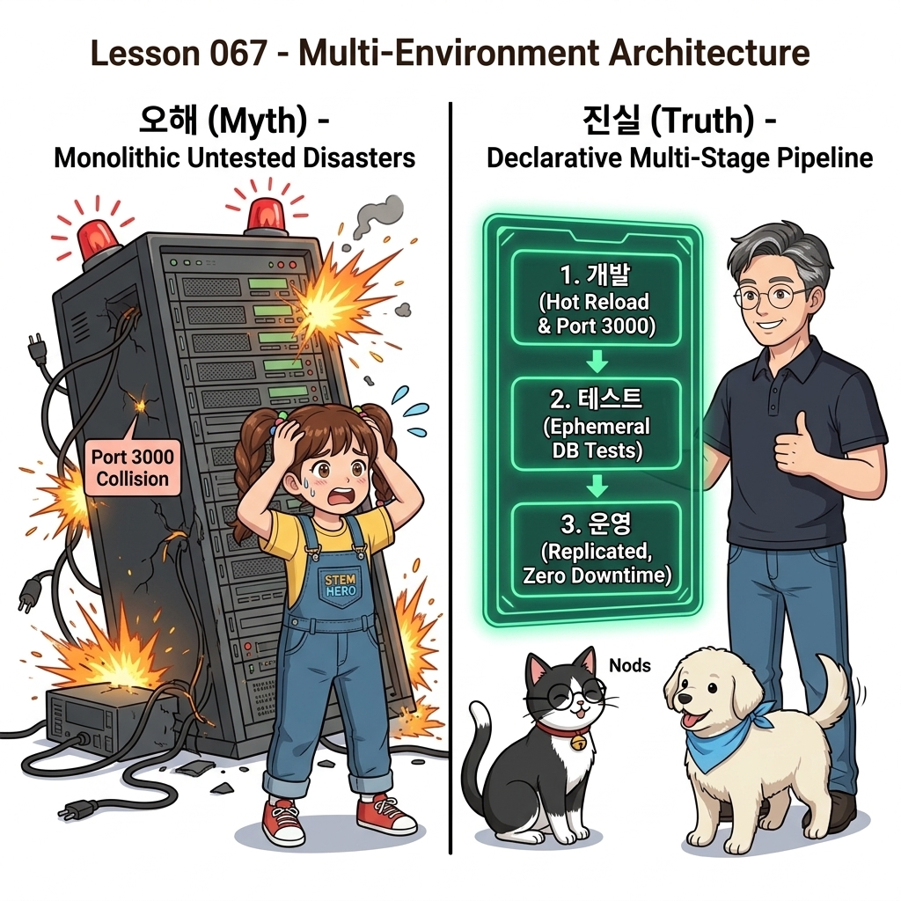
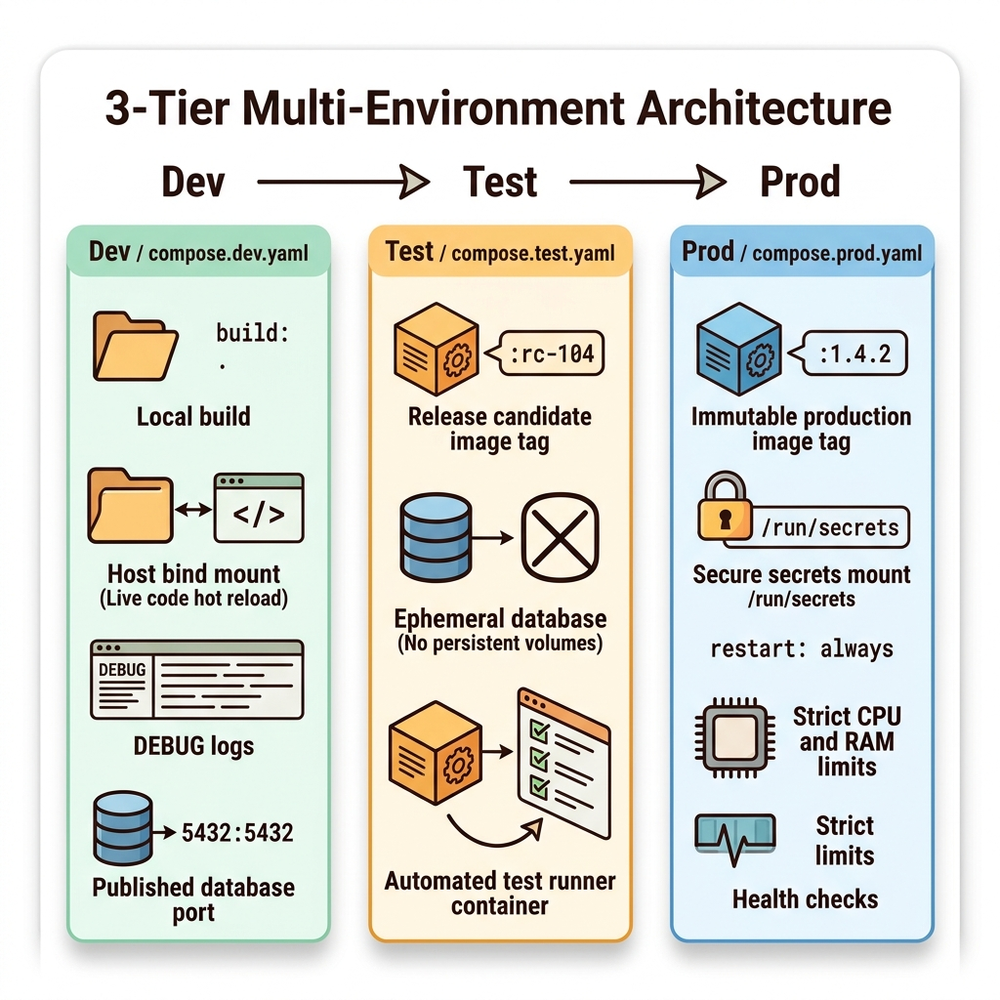
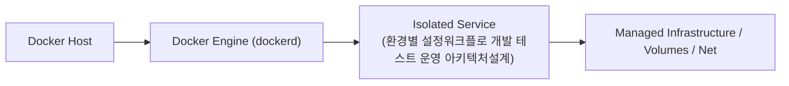
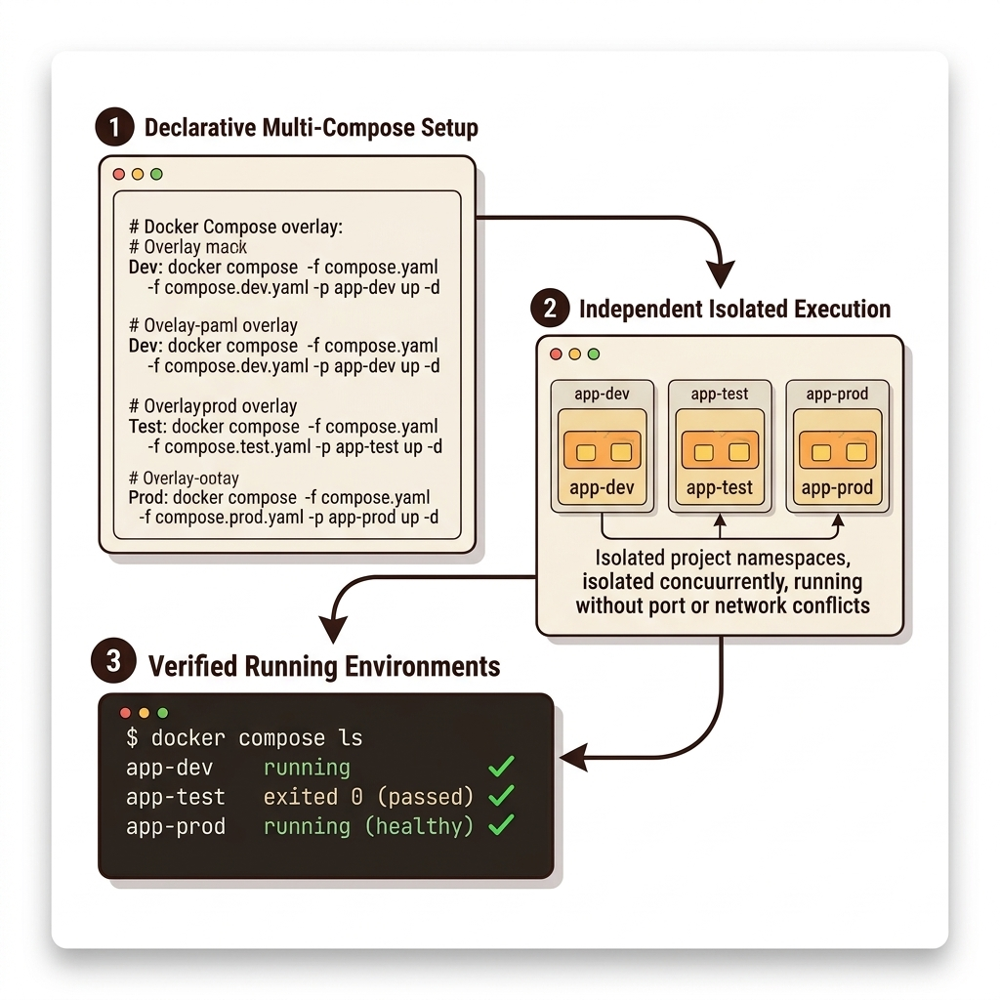
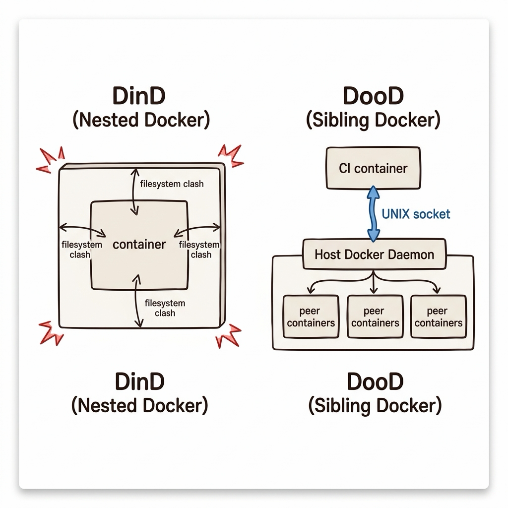
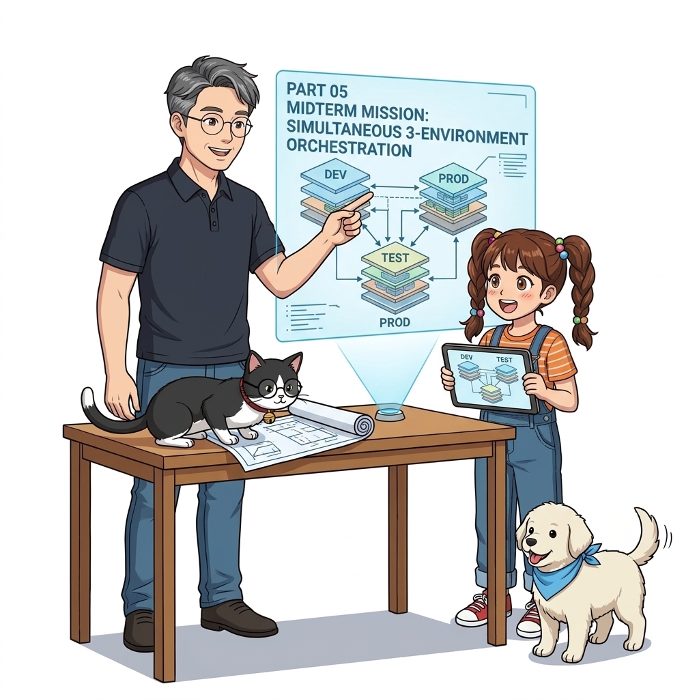

# 067. 환경별 설정워크플로 개발 테스트 운영 아키텍처설계

10장에서 배운 모든 기법(오버라이드 파일, `.env`, 시크릿, 확장 필드, 프로젝트 이름)을 종합하여 실제 소프트웨어 개발 생명주기(SDLC)의 3대 환경을 어떻게 설계하는지 정립합니다.


**그림 05-6-1** 환경별 설정워크플로 개발 테스트 운영 아키텍처설계의 필요성과 현대 클라우드 아키텍처 관점의 개요

---

### 067.1 왜 환경별 설정워크플로 개발 테스트 운영 아키텍처설계이(가) 필요한가? (문제 정의와 현실적 배경)

소프트웨어 시스템이 복잡해질수록 설정을 다루는 방식은 전체 인프라의 신뢰성을 결정짓는 핵심 척도가 됩니다. **환경별 설정워크플로 개발 테스트 운영 아키텍처설계**이(가) 부재하거나 잘못 다루어질 때 현장에서는 다음과 같은 대표적인 병목과 장애가 발생합니다:

1. **하드코딩된 설정과 환경 불일치로 인한 유연성 상실**: 환경이 바뀔 때마다 코드를 다시 빌드해야 하므로 배포 주기가 지연되고 이미지 수가 기하급수적으로 폭증합니다.
2. **보안 민감 데이터의 무분별한 노출**: 비밀번호, 데이터베이스 토큰, 암호화 키가 이미지 레이어에 영구 박제되어 형상관리 시스템이나 외부에 유출될 위험이 커집니다.
3. **재현 불가능한 구성 드리프트**: 스테이징 환경과 프로덕션 환경의 미세한 설정 차이가 예기치 못한 서비스 중단 사고로 직결됩니다.


**그림 05-6-2** 환경별 설정워크플로 개발 테스트 운영 아키텍처설계에 대한 대표적인 오해와 실제 프로덕션 현장의 엔지니어링 진실

---

### 067.2 핵심 아키텍처와 엔지니어링 메커니즘

코어 `compose.yaml`을 중심으로 각 환경 오버라이드 파일이 무엇을 바꾸는지 비교표를 통해 완벽히 구조화합니다.


**그림 05-6-3** 환경별 설정워크플로 개발 테스트 운영 아키텍처설계의 내부 아키텍처 및 데이터 흐름

#### 📊 핵심 비교 및 엔지니어링 표준 분석

| 구분 / 핵심 원리 | 상세 설명 및 동작 메커니즘 | 실무 적용 시 주의점 및 베스트 프랙티스 |
| :--- | :--- | :--- |
| **개발 환경 (`compose.dev.yaml`)** | 로컬 빌드(`build: .`), 호스트 소스 코드 바인드 마운트, `DEBUG` 상세 로그 레벨, DB 포트 로컬 노출 | 빠른 코드 수정과 즉각적인 디버깅에 초점 |
| **테스트 환경 (`compose.test.yaml`)** | CI 레지스트리의 후보 이미지(`:rc-104`) 사용, 일회성 컨테이너 DB(볼륨 미사용으로 매번 깨끗한 상태에서 테스트), 테스트 러너 컨테이너 포함 | 외부 의존성 없이 언제 실행해도 동일한 결과가 나오는 격리된 자동화 검증 |
| **운영 환경 (`compose.prod.yaml`)** | 명시적 고정 버전 태그(`:1.4.2`), 파일/클러스터 기반 `secrets`, `restart: always`, CPU/RAM 리소스 제한, 헬스 체크 및 중앙 로깅 활성화 | 보안성, 안정성, 무중단 가용성에 모든 초점을 맞춘 최종 형태 |

---

### 067.3 선언적 실습 및 아키텍처 다이어그램

본 실습은 외부 비공개 패키지에 의존하지 않고, 공식 표준 이미지를 기반으로 즉시 재현 가능한 살아있는 코드로 구성되어 있습니다.

```bash
# 환경별 컴포즈 실행 명령어 표준 패턴 (Dev / Test / Prod)
cat << 'EOF'
[1. Dev 환경]  : docker compose -f compose.yaml -f compose.dev.yaml -p app-dev up -d
[2. Test 환경] : docker compose -f compose.yaml -f compose.test.yaml -p app-test up -d
[3. Prod 환경] : docker compose -f compose.yaml -f compose.prod.yaml --env-file prod.env -p app-prod up -d
EOF
```

#### 🔍 아키텍처 흐름도 (Mermaid Diagram)




**그림 05-6-4** 선언적 인프라 명세를 통한 환경별 설정워크플로 개발 테스트 운영 아키텍처설계 검증 파이프라인

---

<!-- BIBLE_INTEGRATION_book5_dind_vs_dood_cicd -->
---

### 067.B 📚 도커 바이블 심화: CI/CD 파이프라인에서의 Docker: DinD(Docker-in-Docker) vs DooD(Docker-out-of-Docker) 심층 비교
*출처 도서: 『제대로 배우는 도커』 핵심 분석*

Jenkins, GitLab CI, GitHub Actions 같은 CI 시스템을 컨테이너 기반으로 운영할 때, '빌드 컨테이너 내부에서 새로운 도커 이미지를 빌드'해야 하는 필연적인 요구사항에 직면합니다. 이때 선택할 수 있는 양대 아키텍처의 장단점은 극명합니다:

| 비교 항목 | DinD (Docker-in-Docker) | DooD (Docker-outside-of-Docker) |
| :--- | :--- | :--- |
| **구현 방식** | 컨테이너 내부에 독립된 `dockerd` 데몬을 추가 실행 | 호스트의 `/var/run/docker.sock`을 컨테이너에 바인드 마운트 |
| **필요 권한** | `--privileged` (호스트의 모든 디바이스 및 커널 완전 개방 필요) | 일반 권한 (단, 도커 소켓 접근 권한 소유) |
| **스토리지 이슈** | 컨테이너 파일시스템(Overlay2) 위에 Overlay2를 중첩하므로 심각한 손상 위험 | 호스트 파일시스템을 직접 사용하므로 안전하고 캐시 효율 극대화 |
| **보안 위험** | 호스트 커널 완전 장악 가능 (치명적) | 빌드 컨테이너가 호스트의 다른 형제 컨테이너를 조작할 수 있음 |
| **실무 권장** | 특수한 격리 테스트 환경에만 제한적 사용 | 대부분의 엔터프라이즈 CI/CD 파이프라인에서 표준으로 채택 |


**그림 067-B-1** 위험한 DinD 중첩 구조와 효율적이고 안전한 DooD 형제 컨테이너 제어 구조 비교 다이어그램

```bash
# [실습] DooD(Docker-outside-of-Docker) 패턴으로 호스트 도커 제어
# 호스트의 도커 소켓을 마운트하여 경량 alpine 내부에서 호스트 docker CLI 제어
docker container run --rm -v /var/run/docker.sock:/var/run/docker.sock \
  docker:cli docker container ls
```

> 👨‍🏫 **이호진 교수님의 바이블 멘토링 노트**:
> "특별한 이유가 없다면 무조건 DooD 방식을 선택하세요. DinD는 설정하기도 까다로울 뿐더러 스토리지 드라이버 충돌로 인해 빌드 도중 디스크가 깨지는 고통스러운 버그를 자주 유발합니다."
>
> 👧 **도로시의 깨달음**:
> "상자 안에 상자를 억지로 우겨넣는(DinD) 것보다, 밖으로 문(소켓)을 내어 이웃 상자를 부르는(DooD) 게 훨씬 깔끔하네요!"
>
> 🐱 **조교 지니의 아키텍처 체크포인트**:
> "하지만 DooD에서도 컨테이너가 호스트 도커 소켓을 쥐고 있으므로, 신뢰할 수 없는 외부 PR의 코드가 마음대로 호스트 컨테이너를 지우지 못하도록 러너 권한을 잘 제한해야 합니다."

---

### 067.C 📚 도커 바이블 심화: /var/run/docker.sock 권한 탈취 방지와 무데몬(Daemonless) Kaniko/Buildah CI 아키텍처

> 📖 **참고 도서 심층 연계**:
> * 《도커 교과서》 제19장 (안전한 CI 파이프라인과 비특권 컨테이너 빌드)
> * 《도커를 활용한 마이크로서비스》 제7장 (멀티테넌트 환경에서의 빌드 보안 격리)

DooD(`-v /var/run/docker.sock`) 패턴은 간편하지만 중대한 보안 구멍(Security Hole)을 내포하고 있습니다. 도커 소켓에 접근할 수 있는 컨테이너는 실질적으로 **호스트 머신의 무제한 root 권한**을 보유한 것과 같습니다. 컨테이너 내부에서 `docker run -v /:/host alpine rm -rf /host`를 실행하면 호스트 전체가 1초 만에 파괴됩니다.

#### 1. 데몬리스(Daemonless) 컨테이너 빌더의 등장

금융권, 공공 클라우드, 멀티테넌트 쿠버네티스 클러스터에서는 도커 소켓 마운트가 엄격히 차단(OPA Gatekeeper 차단 정책)됩니다. 이를 해결하기 위해 백그라운드 도커 데몬 없이 사용자 공간(Userspace)에서 순수하게 OCI 이미지를 굽는 도구들이 표준으로 자리 잡았습니다:

| 도구명 | 개발 주체 | 동작 원리 및 보안 특성 |
| :--- | :--- | :--- |
| **Google Kaniko** | Google Cloud Native 팀 | 도커 데몬 없이 컨테이너 내부에서 사용자 공간 스냅샷을 생성하여 직접 레지스트리에 푸시. 비특권(Rootless) 파드에서 안전하게 실행 가능 |
| **Red Hat Buildah** | Red Hat / OpenShift 팀 | 데몬이 필요 없는 단독 CLI 바이너리. 리눅스 사용자 네임스페이스(`userns`)를 활용하여 일반 사용자 계정으로 OCI 이미지 빌드 |
| **BuildKit in Rootless Mode** | Docker / Moby 프로젝트 | rootlesskit을 이용해 `dockerd` 없이 일반 사용자 권한으로 격리된 BuildKit 데몬 실행 |

#### 2. 쿠버네티스 CI 환경에서의 Kaniko 빌드 파이프라인 선언 예시

```yaml
# [GitOps / Kubernetes CI 파이프라인] 도커 소켓 없이 안전하게 이미지를 빌드하는 Kaniko Pod 명세
apiVersion: v1
kind: Pod
metadata:
  name: kaniko-builder
spec:
  restartPolicy: Never
  containers:
  - name: kaniko
    image: gcr.io/kaniko-project/executor:latest
    args:
    - "--context=git://github.com/mycorp/my-service.git"
    - "--dockerfile=Dockerfile"
    - "--destination=myregistry.io/my-service:v2.1.0"
    - "--cache=true"
    volumeMounts:
    - name: registry-secret
      mountPath: /kaniko/.docker
  volumes:
  - name: registry-secret
    secret:
      secretName: regcred
      items:
        - key: .dockerconfigjson
          path: config.json
```

> 👧 **도로시**: "도커 소켓을 넘겨주는 건 집 열쇠 전체를 빌드 컨테이너에 넘겨주는 거였군요! Kaniko나 Buildah를 쓰면 도커 데몬이 아예 없어도 이미지를 안전하게 구울 수 있다니 정말 안심이 돼요!"
> 
> 👨‍🏫 **이호진 교수님**: "정확하단다, 도로시! 공용 CI 러너나 클라우드 네이티브 쿠버네티스 환경으로 갈수록 도커 소켓을 완전히 배제한 '무데몬(Daemonless) 빌드'가 필수적인 보안 요건이란다."
> 
> 🐱 **조교 지니**: "야옹~ 사내 보안팀에서 `docker.sock` 마운트를 금지시켰다면 주저하지 말고 Kaniko를 파이프라인에 적용해 보세요!"


### 067.4 핵심 정리: 캐릭터 대화와 3대 교훈

> 👧 **도로시**: "교수님! **환경별 설정워크플로 개발 테스트 운영 아키텍처설계**의 원리를 배우니까, 복잡하게 얽혀 있던 인프라 설정이 레고 블록처럼 질서정연하게 제자리를 찾는 게 보여요!"
> 
> 🐱 **조교 지니**: "야옹~ 맞습니다! 특히 런타임 환경과 불변 인프라의 경계를 명확히 지키는 것이 대규모 클라우드 운영의 제1원칙이랍니다!"
> 
> 🐶 **토토**: "멍멍! 선언적 코드로 한 번 적어두면 언제든 똑같이 복원되니까 정말 든든해요!"
> 
> 👨‍🏫 **이호진 교수님**: "훌륭하구나. 원리를 깊이 이해하고 실습을 통해 손에 익히는 것이 훌륭한 클라우드 엔지니어로 성장하는 가장 빠른 지름길이란다."


**그림 05-6-5** 환경별 설정워크플로 개발 테스트 운영 아키텍처설계 마스터를 위한 3대 핵심 교훈

1. **설정과 실행의 명확한 분리**:
   * 애플리케이션 코드는 불변으로 유지하고, 가변적인 설정값은 외부에서 주입하여 이식성을 극대화합니다.
2. **선언적 재현성 확보**:
   * 사람이 수작업으로 변경하지 않고 코드 명세를 통해 언제 어디서나 100% 동일한 실행 결과를 보장합니다.
3. **최소 권한 및 보안 모범 사례 준수**:
   * 불필요한 권한과 포트 노출을 최소화하고 민감 데이터를 암호화하여 프로덕션 안정성을 담보합니다.

---

### 067.5 랩노트 피날레와 다음 강의 예고


**그림 05-6-6** 연구실에서 다음 마일스톤인 [Part05 중간미션 단일컴포즈로 Dev Test Prod 3대환경 동시구동] 실습을 예고하는 교수님과 토토

> 💡 **다음 강의 안내**:
> [Part05 중간미션 단일컴포즈로 Dev Test Prod 3대환경 동시구동](../068_Part05_중간미션_단일컴포즈로_Dev_Test_Prod_3대환경_동시구동/)에서는 더욱 심화된 실전 엔지니어링 실습과 아키텍처를 다룹니다!

---

## 🧭 강의 네비게이션
* [◀️ 이전 강의: 066_YAML_앵커와_확장필드_x_로_컴포즈중복_완벽제거](../066_YAML_앵커와_확장필드_x_로_컴포즈중복_완벽제거/)
* [📋 Part 05. 다중 환경 구성(Dev/Test/Prod)과 컨테이너 기반 CI/CD 파이프라인 (062 ~ 075) 목차로 돌아가기](../)
* [▶️ 다음 강의: 068_Part05_중간미션_단일컴포즈로_Dev_Test_Prod_3대환경_동시구동](../068_Part05_중간미션_단일컴포즈로_Dev_Test_Prod_3대환경_동시구동/)
