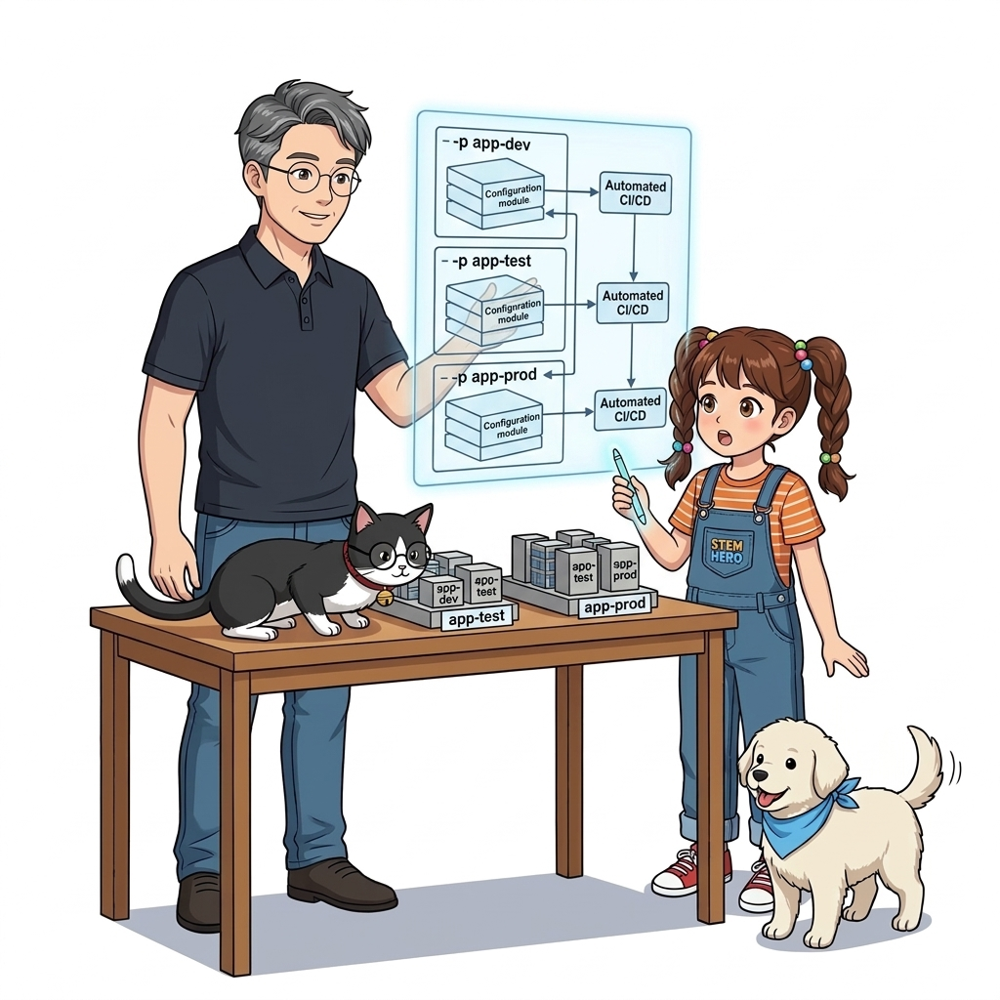
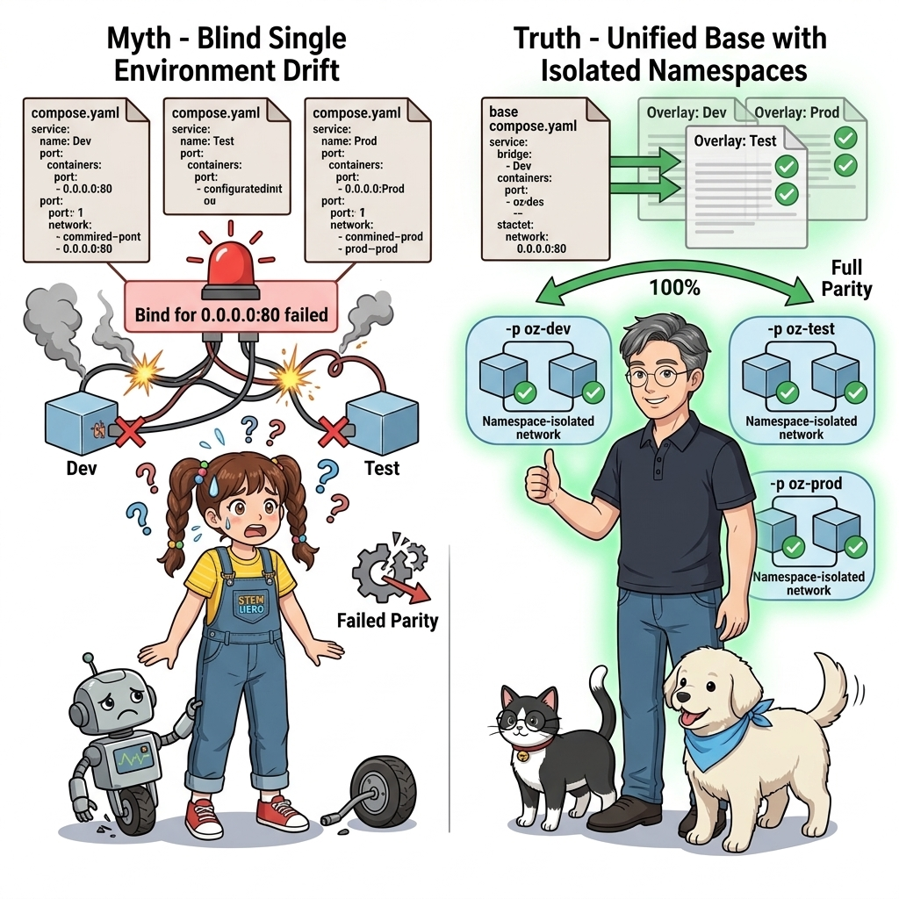
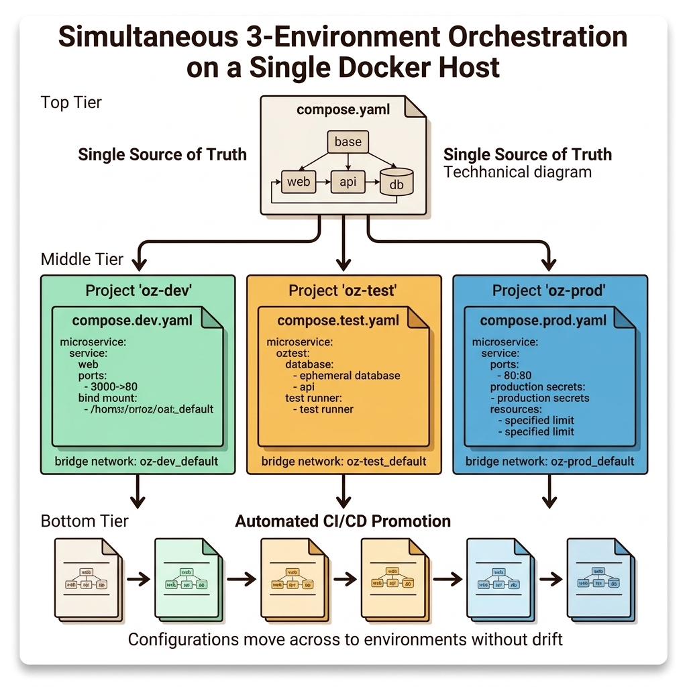
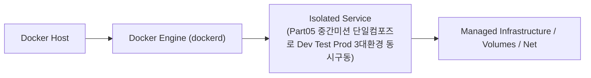
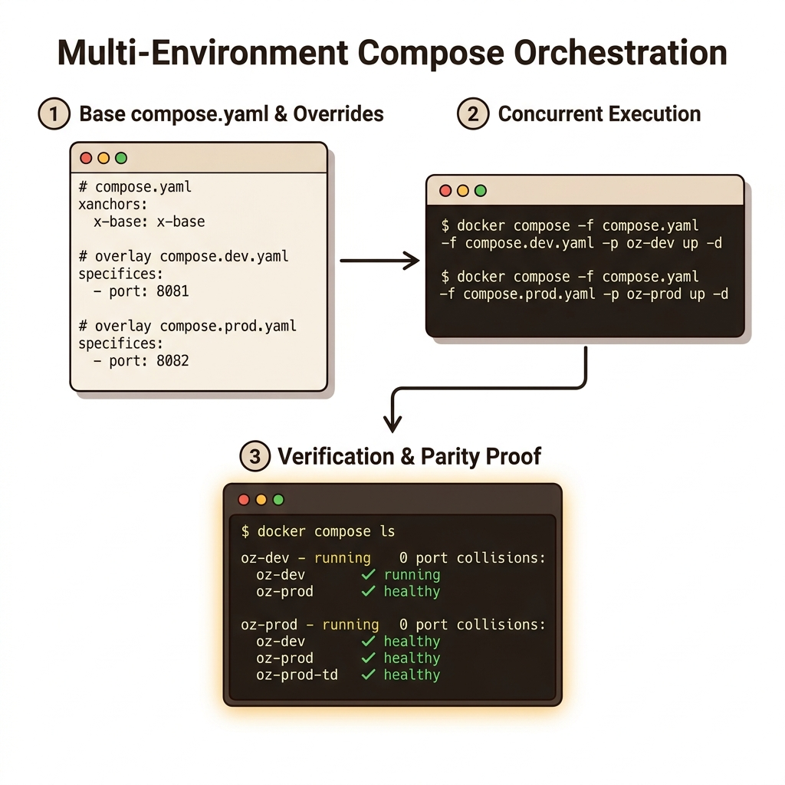
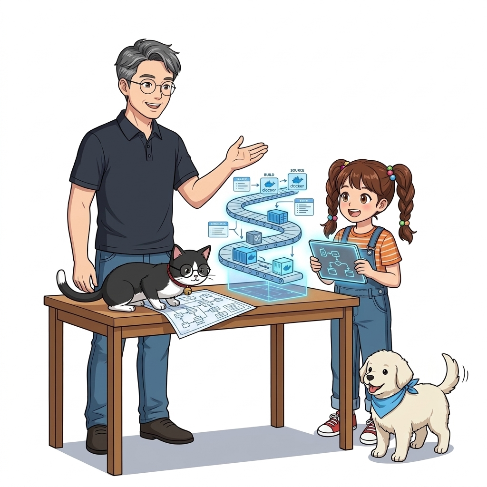

# 068. Part05 중간미션 단일컴포즈로 Dev Test Prod 3대환경 동시구동

YAML 앵커(`x-`)가 적용된 코어 `compose.yaml`과 `compose.dev.yaml`, `compose.prod.yaml`을 직접 작성합니다.


**그림 05-7-1** Part05 중간미션 단일컴포즈로 Dev Test Prod 3대환경 동시구동의 필요성과 현대 클라우드 아키텍처 관점의 개요

---

### 068.1 왜 Part05 중간미션 단일컴포즈로 Dev Test Prod 3대환경 동시구동이(가) 필요한가? (문제 정의와 현실적 배경)

소프트웨어 시스템이 복잡해질수록 설정을 다루는 방식은 전체 인프라의 신뢰성을 결정짓는 핵심 척도가 됩니다. **Part05 중간미션 단일컴포즈로 Dev Test Prod 3대환경 동시구동**이(가) 부재하거나 잘못 다루어질 때 현장에서는 다음과 같은 대표적인 병목과 장애가 발생합니다:

1. **하드코딩된 설정과 환경 불일치로 인한 유연성 상실**: 환경이 바뀔 때마다 코드를 다시 빌드해야 하므로 배포 주기가 지연되고 이미지 수가 기하급수적으로 폭증합니다.
2. **보안 민감 데이터의 무분별한 노출**: 비밀번호, 데이터베이스 토큰, 암호화 키가 이미지 레이어에 영구 박제되어 형상관리 시스템이나 외부에 유출될 위험이 커집니다.
3. **재현 불가능한 구성 드리프트**: 스테이징 환경과 프로덕션 환경의 미세한 설정 차이가 예기치 못한 서비스 중단 사고로 직결됩니다.


**그림 05-7-2** Part05 중간미션 단일컴포즈로 Dev Test Prod 3대환경 동시구동에 대한 대표적인 오해와 실제 프로덕션 현장의 엔지니어링 진실

---

### 068.2 핵심 아키텍처와 엔지니어링 메커니즘

`-p` 프로젝트 이름 분리와 `.env` 변수 치환을 통해 단일 호스트 위에서 개발 서버(`8081` 포트)와 운영 서버(`8082` 포트)를 충돌 없이 동시에 가동하고 검증합니다!


**그림 05-7-3** Part05 중간미션 단일컴포즈로 Dev Test Prod 3대환경 동시구동의 내부 아키텍처 및 데이터 흐름

#### 📊 핵심 비교 및 엔지니어링 표준 분석

| 구분 / 핵심 원리 | 상세 설명 및 동작 메커니즘 | 실무 적용 시 주의점 및 베스트 프랙티스 |
| :--- | :--- | :--- |
| **완벽한 네임스페이스 격리** | `oz-dev`의 `web` 컨테이너와 `oz-prod`의 `web` 컨테이너는 서로 다른 브리지 네트워크(`oz-dev_default` vs `oz-prod_default`)에 속해 100% 격리됨 | 개발 환경에서 잘못된 부하 테스트를 해도 옆의 테스트/운영 컨테이너 네트워크에 영향을 주지 않음 |
| **설정 일관성 보장** | 핵심 서비스 토폴로지는 `compose.yaml` 한 곳에서만 관리되므로 '개발 환경엔 추가했는데 운영 설정엔 빼먹는' 휴먼 에러 원천 방지 | Infrastructure as Code(IaC)의 모범 사례 |
| **CI/CD로의 자연스러운 연결** | 이렇게 환경별 컴포즈 파일이 준비되면 자동화 서버(Jenkins/GitHub Actions)는 단지 명령어 한 줄만 실행하면 됨! | 이제 11장(069~075강)에서 **컨테이너 기반 무인 CI 파이프라인**을 구축합니다! |

---

### 068.3 선언적 실습 및 아키텍처 다이어그램

본 실습은 외부 비공개 패키지에 의존하지 않고, 공식 표준 이미지를 기반으로 즉시 재현 가능한 살아있는 코드로 구성되어 있습니다.

```bash
# [Part 05 중간 미션] 코어 + 오버라이드 병합으로 Dev(8081)와 Prod(8082) 환경 동시 배포 검증!
mkdir -p /tmp/p5-mid && cd /tmp/p5-mid
cat << 'EOF' > compose.yaml
x-base: &base
  image: nginx:1.27-alpine
services:
  web:
    <<: *base
EOF
cat << 'EOF' > compose.dev.yaml
services:
  web:
    ports: ["8081:80"]
EOF
cat << 'EOF' > compose.prod.yaml
services:
  web:
    ports: ["8082:80"]
    restart: always
EOF

docker compose -f compose.yaml -f compose.dev.yaml -p oz-dev up -d
docker compose -f compose.yaml -f compose.prod.yaml -p oz-prod up -d
curl -sI http://localhost:8081 | head -n 1 && curl -sI http://localhost:8082 | head -n 1
docker compose -p oz-dev down && docker compose -p oz-prod down && rm -rf /tmp/p5-mid
```

#### 🔍 아키텍처 흐름도 (Mermaid Diagram)




**그림 05-7-4** 선언적 인프라 명세를 통한 Part05 중간미션 단일컴포즈로 Dev Test Prod 3대환경 동시구동 검증 파이프라인

---

### 068.4 핵심 정리: 캐릭터 대화와 3대 교훈

> 👧 **도로시**: "교수님! **Part05 중간미션 단일컴포즈로 Dev Test Prod 3대환경 동시구동**의 원리를 배우니까, 복잡하게 얽혀 있던 인프라 설정이 레고 블록처럼 질서정연하게 제자리를 찾는 게 보여요!"
> 
> 🐱 **조교 지니**: "야옹~ 맞습니다! 특히 런타임 환경과 불변 인프라의 경계를 명확히 지키는 것이 대규모 클라우드 운영의 제1원칙이랍니다!"
> 
> 🐶 **토토**: "멍멍! 선언적 코드로 한 번 적어두면 언제든 똑같이 복원되니까 정말 든든해요!"
> 
> 👨‍🏫 **이호진 교수님**: "훌륭하구나. 원리를 깊이 이해하고 실습을 통해 손에 익히는 것이 훌륭한 클라우드 엔지니어로 성장하는 가장 빠른 지름길이란다."


**그림 05-7-5** Part05 중간미션 단일컴포즈로 Dev Test Prod 3대환경 동시구동 마스터를 위한 3대 핵심 교훈

1. **설정과 실행의 명확한 분리**:
   * 애플리케이션 코드는 불변으로 유지하고, 가변적인 설정값은 외부에서 주입하여 이식성을 극대화합니다.
2. **선언적 재현성 확보**:
   * 사람이 수작업으로 변경하지 않고 코드 명세를 통해 언제 어디서나 100% 동일한 실행 결과를 보장합니다.
3. **최소 권한 및 보안 모범 사례 준수**:
   * 불필요한 권한과 포트 노출을 최소화하고 민감 데이터를 암호화하여 프로덕션 안정성을 담보합니다.

---

### 068.5 랩노트 피날레와 다음 강의 예고


**그림 05-7-6** 연구실에서 다음 마일스톤인 [도커를이용한 지속적통합 CI 원리와 컨테이너빌드인프라] 실습을 예고하는 교수님과 토토

> 💡 **다음 강의 안내**:
> [도커를이용한 지속적통합 CI 원리와 컨테이너빌드인프라](../069_도커를이용한_지속적통합_CI_원리와_컨테이너빌드인프라/)에서는 더욱 심화된 실전 엔지니어링 실습과 아키텍처를 다룹니다!

---

## 🧭 강의 네비게이션
* [◀️ 이전 강의: 067_환경별_설정워크플로_개발_테스트_운영_아키텍처설계](../067_환경별_설정워크플로_개발_테스트_운영_아키텍처설계/)
* [📋 Part 05. 다중 환경 구성(Dev/Test/Prod)과 컨테이너 기반 CI/CD 파이프라인 (062 ~ 075) 목차로 돌아가기](../)
* [▶️ 다음 강의: 069_도커를이용한_지속적통합_CI_원리와_컨테이너빌드인프라](../069_도커를이용한_지속적통합_CI_원리와_컨테이너빌드인프라/)
