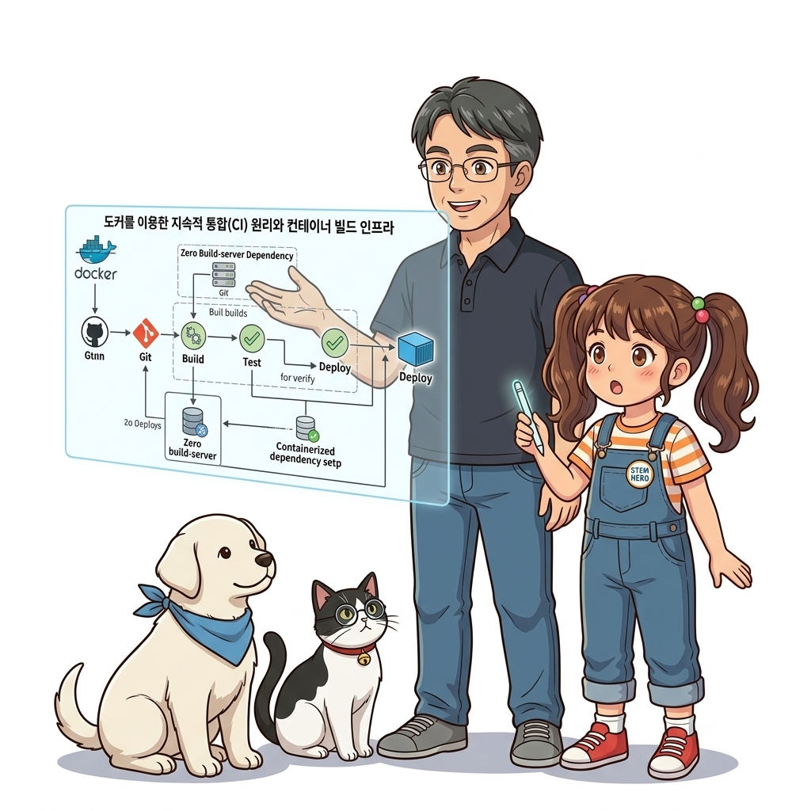
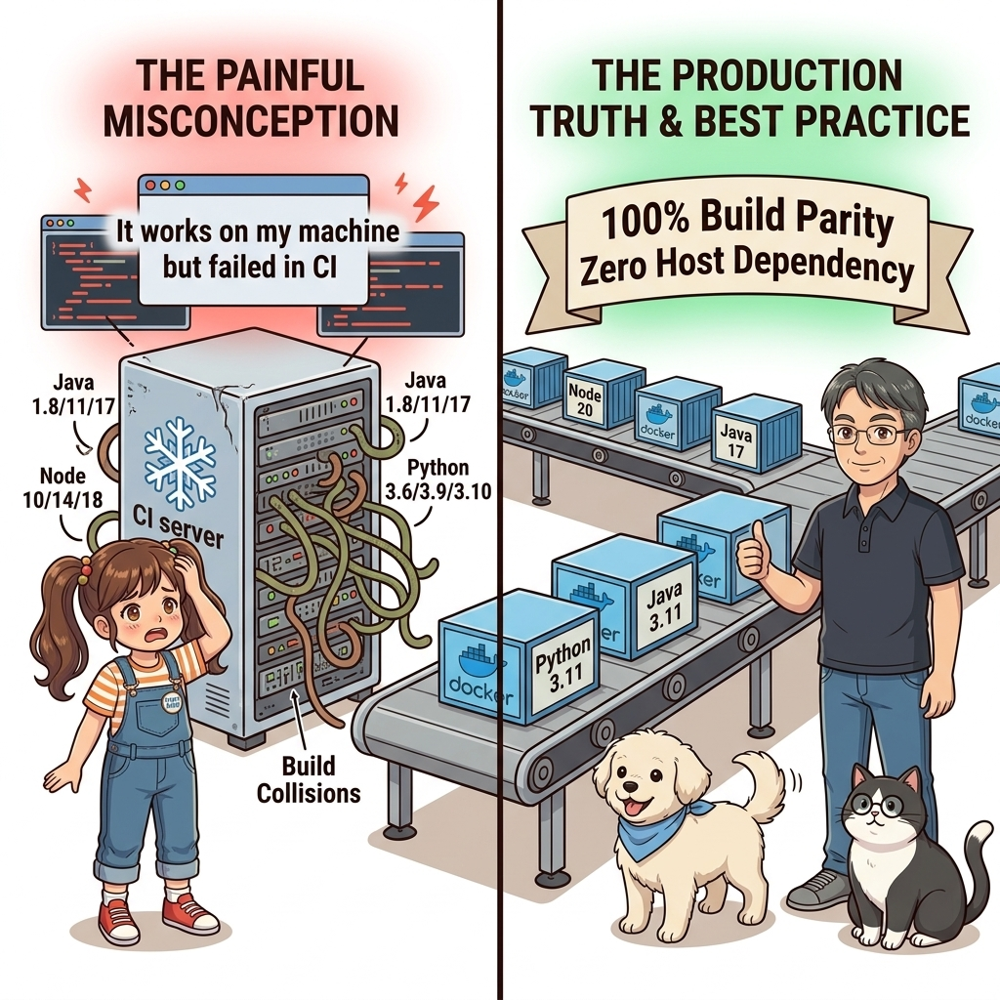
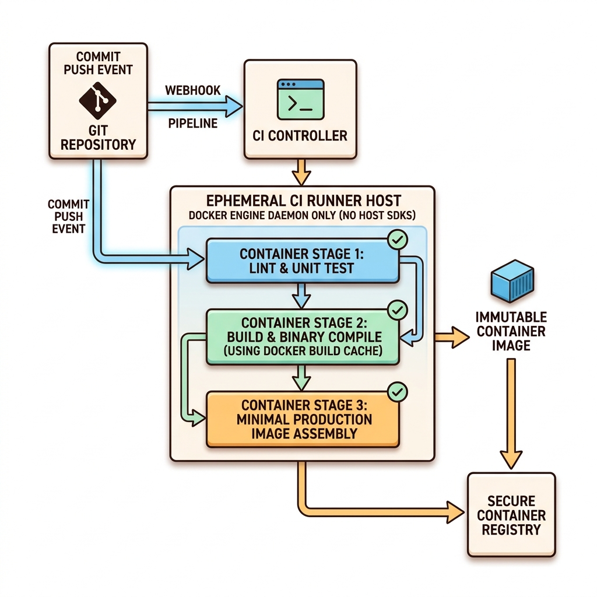
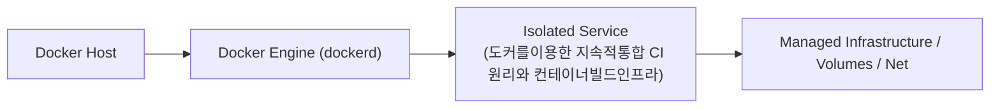
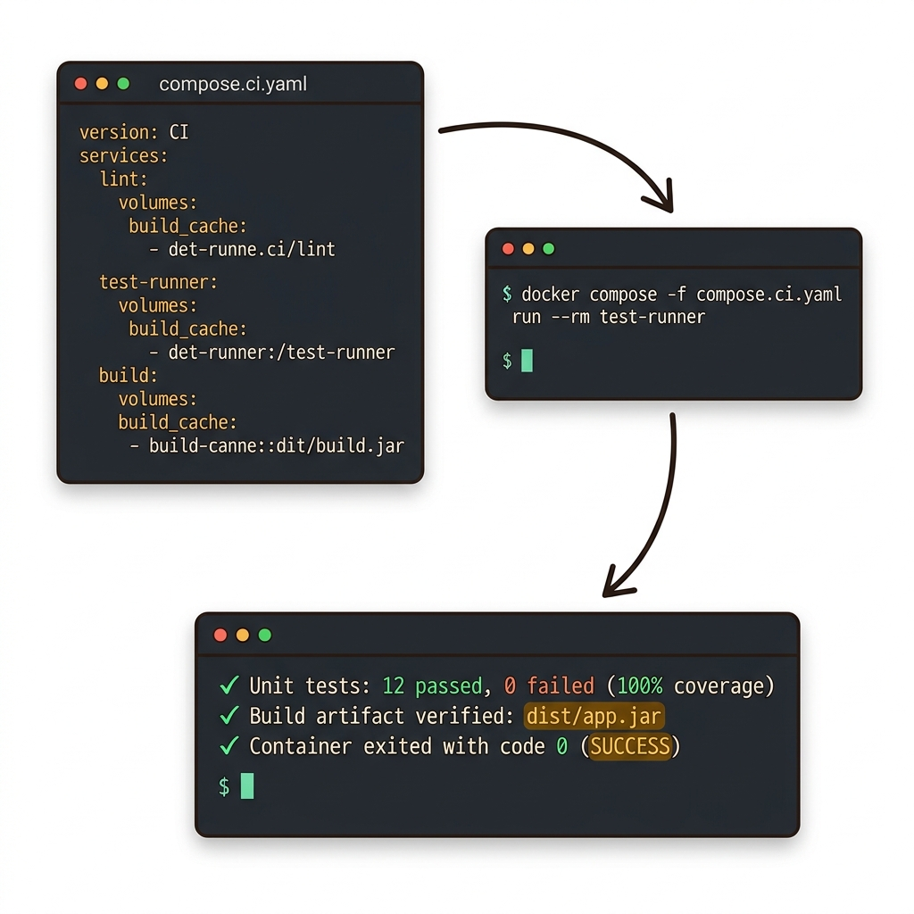
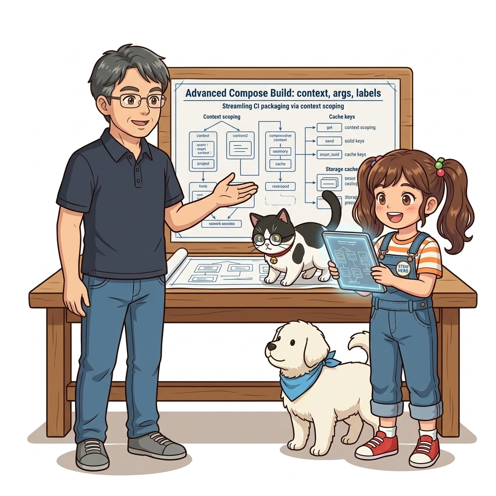

# 069. 도커를이용한 지속적통합 CI 원리와 컨테이너빌드인프라

전통적인 빌드 서버(Jenkins 등)는 서버 자체에 Java 8, Java 17, Node 18, Node 20, Python, Go를 모두 설치해 두어야 해서 버전 충돌과 관리 지옥이 발생했습니다.


**그림 05-8-1** 도커를이용한 지속적통합 CI 원리와 컨테이너빌드인프라의 필요성과 현대 클라우드 아키텍처 관점의 개요

---

### 069.1 왜 도커를이용한 지속적통합 CI 원리와 컨테이너빌드인프라이(가) 필요한가? (문제 정의와 현실적 배경)

소프트웨어 시스템이 복잡해질수록 설정을 다루는 방식은 전체 인프라의 신뢰성을 결정짓는 핵심 척도가 됩니다. **도커를이용한 지속적통합 CI 원리와 컨테이너빌드인프라**이(가) 부재하거나 잘못 다루어질 때 현장에서는 다음과 같은 대표적인 병목과 장애가 발생합니다:

1. **하드코딩된 설정과 환경 불일치로 인한 유연성 상실**: 환경이 바뀔 때마다 코드를 다시 빌드해야 하므로 배포 주기가 지연되고 이미지 수가 기하급수적으로 폭증합니다.
2. **보안 민감 데이터의 무분별한 노출**: 비밀번호, 데이터베이스 토큰, 암호화 키가 이미지 레이어에 영구 박제되어 형상관리 시스템이나 외부에 유출될 위험이 커집니다.
3. **재현 불가능한 구성 드리프트**: 스테이징 환경과 프로덕션 환경의 미세한 설정 차이가 예기치 못한 서비스 중단 사고로 직결됩니다.


**그림 05-8-2** 도커를이용한 지속적통합 CI 원리와 컨테이너빌드인프라에 대한 대표적인 오해와 실제 프로덕션 현장의 엔지니어링 진실

---

### 069.2 핵심 아키텍처와 엔지니어링 메커니즘

**빌드 인프라 자체(Git 서버, 사설 레지스트리, CI 자동화 서버)도 모두 도커 컨테이너로 띄우고, 실제 애플리케이션 컴파일과 단위/통합 테스트 역시 100% 멀티 스테이지 도커 빌드 안에서 수행**하는 현대적 컨테이너 CI 아키텍처를 배웁니다!


**그림 05-8-3** 도커를이용한 지속적통합 CI 원리와 컨테이너빌드인프라의 내부 아키텍처 및 데이터 흐름

#### 📊 핵심 비교 및 엔지니어링 표준 분석

| 구분 / 핵심 원리 | 상세 설명 및 동작 메커니즘 | 실무 적용 시 주의점 및 베스트 프랙티스 |
| :--- | :--- | :--- |
| **지속적 통합 (CI, Continuous Integration)** | 개발자가 Git 저장소에 코드를 푸시할 때마다 자동으로 빌드와 테스트를 실행해 코드 결함을 즉시 발견하고 검증된 아티팩트(도커 이미지)를 생성하는 프로세스 | 컨테이너 환경에서 CI의 최종 산출물은 JAR나 ZIP이 아니라 **검증을 마친 도커 이미지**! |
| **빌드 서버 의존성 제로** | CI 서버에는 오직 **Git CLI와 Docker CLI** 단 두 가지만 있으면 모든 언어의 프로젝트를 빌드 및 테스트 가능! | CI 서버를 업그레이드하거나 새 노드를 증설할 때 환경 세팅 시간이 0초 |
| **로컬 개발 = CI 빌드 100% 일치** | 개발자가 내 노트북에서 실행하는 `docker compose build && docker compose run test` 명령과 CI 서버가 실행하는 명령이 100% 동일함 | '내 PC에서는 테스트 통과했는데 CI 서버에서만 깨지는' 고질적 문제 완전 해결! |

---

### 069.3 선언적 실습 및 아키텍처 다이어그램

본 실습은 외부 비공개 패키지에 의존하지 않고, 공식 표준 이미지를 기반으로 즉시 재현 가능한 살아있는 코드로 구성되어 있습니다.

```yaml
# 로컬에서 완벽한 자급자족 CI 인프라(Gitea Git 서버 + Registry + CI Runner)를 띄우는 아키텍처
services:
  git-server:
    image: gitea/gitea:1.22-rootless
    ports: ["3000:3000"]
  ci-registry:
    image: registry:2
    ports: ["5000:5000"]
```

#### 🔍 아키텍처 흐름도 (Mermaid Diagram)




**그림 05-8-4** 선언적 인프라 명세를 통한 도커를이용한 지속적통합 CI 원리와 컨테이너빌드인프라 검증 파이프라인

---

### 069.4 핵심 정리: 캐릭터 대화와 3대 교훈

> 👧 **도로시**: "교수님! **도커를이용한 지속적통합 CI 원리와 컨테이너빌드인프라**의 원리를 배우니까, 복잡하게 얽혀 있던 인프라 설정이 레고 블록처럼 질서정연하게 제자리를 찾는 게 보여요!"
> 
> 🐱 **조교 지니**: "야옹~ 맞습니다! 특히 런타임 환경과 불변 인프라의 경계를 명확히 지키는 것이 대규모 클라우드 운영의 제1원칙이랍니다!"
> 
> 🐶 **토토**: "멍멍! 선언적 코드로 한 번 적어두면 언제든 똑같이 복원되니까 정말 든든해요!"
> 
> 👨‍🏫 **이호진 교수님**: "훌륭하구나. 원리를 깊이 이해하고 실습을 통해 손에 익히는 것이 훌륭한 클라우드 엔지니어로 성장하는 가장 빠른 지름길이란다."


**그림 05-8-5** 도커를이용한 지속적통합 CI 원리와 컨테이너빌드인프라 마스터를 위한 3대 핵심 교훈

1. **설정과 실행의 명확한 분리**:
   * 애플리케이션 코드는 불변으로 유지하고, 가변적인 설정값은 외부에서 주입하여 이식성을 극대화합니다.
2. **선언적 재현성 확보**:
   * 사람이 수작업으로 변경하지 않고 코드 명세를 통해 언제 어디서나 100% 동일한 실행 결과를 보장합니다.
3. **최소 권한 및 보안 모범 사례 준수**:
   * 불필요한 권한과 포트 노출을 최소화하고 민감 데이터를 암호화하여 프로덕션 안정성을 담보합니다.

---

### 069.5 랩노트 피날레와 다음 강의 예고


**그림 05-8-6** 연구실에서 다음 마일스톤인 [도커컴포즈 build 속성심화 context args labels] 실습을 예고하는 교수님과 토토

> 💡 **다음 강의 안내**:
> [도커컴포즈 build 속성심화 context args labels](../070_도커컴포즈_build_속성심화_context_args_labels/)에서는 더욱 심화된 실전 엔지니어링 실습과 아키텍처를 다룹니다!

---

## 🧭 강의 네비게이션
* [◀️ 이전 강의: 068_Part05_중간미션_단일컴포즈로_Dev_Test_Prod_3대환경_동시구동](../068_Part05_중간미션_단일컴포즈로_Dev_Test_Prod_3대환경_동시구동/)
* [📋 Part 05. 다중 환경 구성(Dev/Test/Prod)과 컨테이너 기반 CI/CD 파이프라인 (062 ~ 075) 목차로 돌아가기](../)
* [▶️ 다음 강의: 070_도커컴포즈_build_속성심화_context_args_labels](../070_도커컴포즈_build_속성심화_context_args_labels/)
