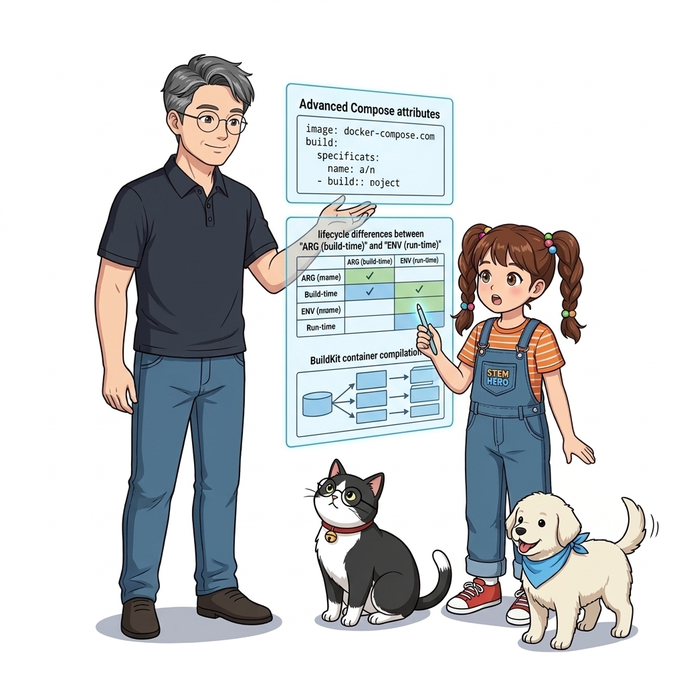
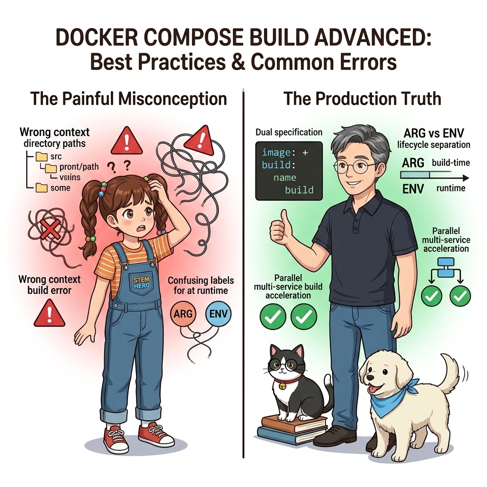
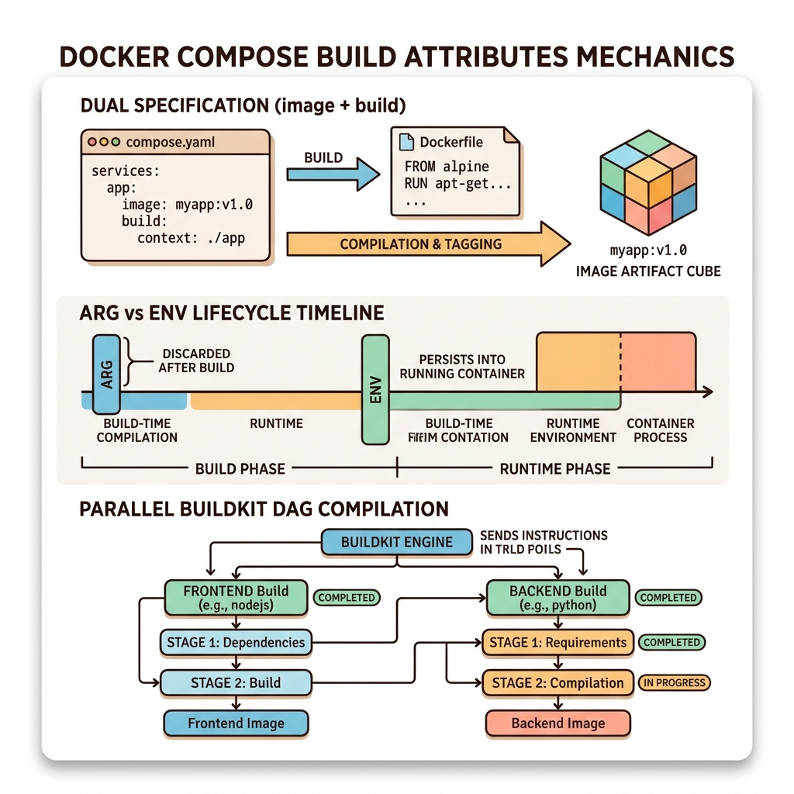
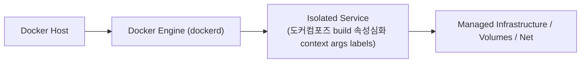
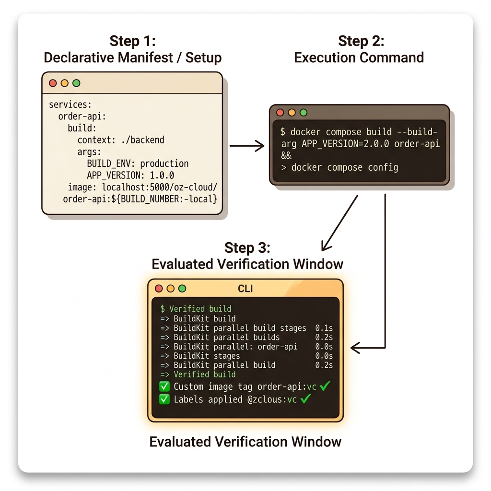
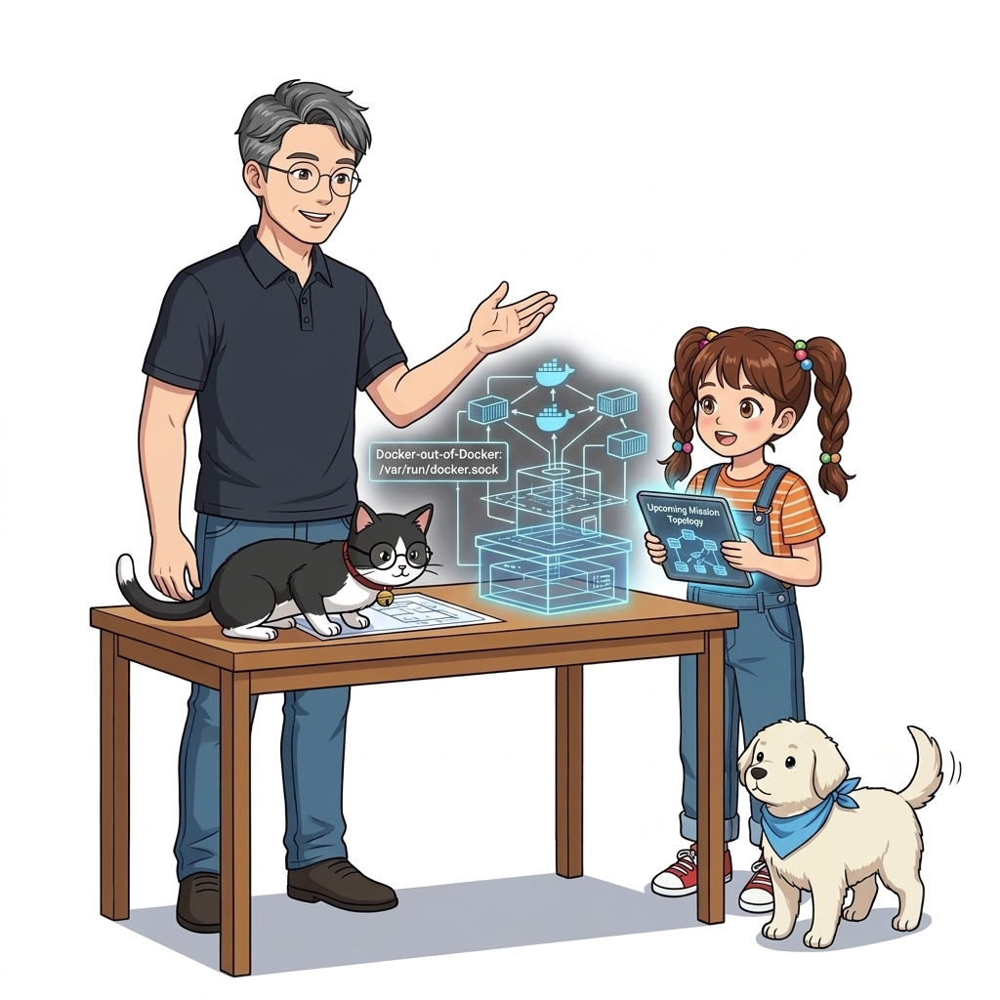

# 070. 도커컴포즈 build 속성심화 context args labels

여러 개의 컨테이너로 구성된 애플리케이션에서 각 디렉터리를 돌아다니며 `docker image build`를 일일이 치는 대신, `compose.yaml`의 **`build:` 블록**에 빌드 설정을 통합하는 법을 배웁니다.


**그림 05-9-1** 도커컴포즈 build 속성심화 context args labels의 필요성과 현대 클라우드 아키텍처 관점의 개요

---

### 070.1 왜 도커컴포즈 build 속성심화 context args labels이(가) 필요한가? (문제 정의와 현실적 배경)

소프트웨어 시스템이 복잡해질수록 설정을 다루는 방식은 전체 인프라의 신뢰성을 결정짓는 핵심 척도가 됩니다. **도커컴포즈 build 속성심화 context args labels**이(가) 부재하거나 잘못 다루어질 때 현장에서는 다음과 같은 대표적인 병목과 장애가 발생합니다:

1. **하드코딩된 설정과 환경 불일치로 인한 유연성 상실**: 환경이 바뀔 때마다 코드를 다시 빌드해야 하므로 배포 주기가 지연되고 이미지 수가 기하급수적으로 폭증합니다.
2. **보안 민감 데이터의 무분별한 노출**: 비밀번호, 데이터베이스 토큰, 암호화 키가 이미지 레이어에 영구 박제되어 형상관리 시스템이나 외부에 유출될 위험이 커집니다.
3. **재현 불가능한 구성 드리프트**: 스테이징 환경과 프로덕션 환경의 미세한 설정 차이가 예기치 못한 서비스 중단 사고로 직결됩니다.


**그림 05-9-2** 도커컴포즈 build 속성심화 context args labels에 대한 대표적인 오해와 실제 프로덕션 현장의 엔지니어링 진실

---

### 070.2 핵심 아키텍처와 엔지니어링 메커니즘

빌드 컨텍스트 경로(`context`), 커스텀 파일명(`dockerfile`), 빌드 시점 변수(`args`), 그리고 이미지 레이블(`labels`)을 선언하여 `docker compose build` 단 한 줄로 전체 시스템을 패키징합니다.


**그림 05-9-3** 도커컴포즈 build 속성심화 context args labels의 내부 아키텍처 및 데이터 흐름

#### 📊 핵심 비교 및 엔지니어링 표준 분석

| 구분 / 핵심 원리 | 상세 설명 및 동작 메커니즘 | 실무 적용 시 주의점 및 베스트 프랙티스 |
| :--- | :--- | :--- |
| **`image:` + `build:` 동시 지정** | `build:`만 적으면 자동 생성된 이름이 붙지만, `image:`와 `build:`를 함께 적으면 **빌드된 결과 이미지에 `image:`에 적힌 정확한 태그 이름이 부여됨**! | 빌드 직후 `docker compose push` 명령 한 줄로 레지스트리에 즉시 업로드할 수 있게 해주는 핵심 팁 |
| **`ARG` vs `ENV` 차이점** | `ARG`는 **오직 이미지 빌드(`docker build`) 중에만 존재하는 변수** / `ENV`는 **빌드 중 + 컨테이너 실행(`docker run`) 시점까지 계속 남아있는 변수** | 빌드 번호나 컴파일 옵션처럼 런타임 컨테이너에 노출할 필요 없는 값은 `ARG`로 전달! |
| **병렬 빌드 가속** | 최신 Docker Compose V2(BuildKit 내장)는 `docker compose build` 실행 시 의존성이 없는 여러 서비스 이미지를 동시에 병렬로 빌드함 | 전체 마이크로서비스 빌드 시간을 획기적으로 단축 |

---

### 070.3 선언적 실습 및 아키텍처 다이어그램

본 실습은 외부 비공개 패키지에 의존하지 않고, 공식 표준 이미지를 기반으로 즉시 재현 가능한 살아있는 코드로 구성되어 있습니다.

```yaml
# [compose.yaml] build 속성을 활용해 빌드 컨텍스트, Dockerfile 경로, 빌드 인자(args)를 통합 정의!
services:
  order-api:
    image: localhost:5000/oz-cloud/order-api:${BUILD_NUMBER:-local}
    build:
      context: ./services/order-api
      dockerfile: Dockerfile.ci
      args:
        APP_VERSION: "2.1.0"
        GIT_COMMIT: "${GIT_SHA:-dev}" 
```

#### 🔍 아키텍처 흐름도 (Mermaid Diagram)




**그림 05-9-4** 선언적 인프라 명세를 통한 도커컴포즈 build 속성심화 context args labels 검증 파이프라인

---

### 070.4 핵심 정리: 캐릭터 대화와 3대 교훈

> 👧 **도로시**: "교수님! **도커컴포즈 build 속성심화 context args labels**의 원리를 배우니까, 복잡하게 얽혀 있던 인프라 설정이 레고 블록처럼 질서정연하게 제자리를 찾는 게 보여요!"
> 
> 🐱 **조교 지니**: "야옹~ 맞습니다! 특히 런타임 환경과 불변 인프라의 경계를 명확히 지키는 것이 대규모 클라우드 운영의 제1원칙이랍니다!"
> 
> 🐶 **토토**: "멍멍! 선언적 코드로 한 번 적어두면 언제든 똑같이 복원되니까 정말 든든해요!"
> 
> 👨‍🏫 **이호진 교수님**: "훌륭하구나. 원리를 깊이 이해하고 실습을 통해 손에 익히는 것이 훌륭한 클라우드 엔지니어로 성장하는 가장 빠른 지름길이란다."


**그림 05-9-5** 도커컴포즈 build 속성심화 context args labels 마스터를 위한 3대 핵심 교훈

1. **설정과 실행의 명확한 분리**:
   * 애플리케이션 코드는 불변으로 유지하고, 가변적인 설정값은 외부에서 주입하여 이식성을 극대화합니다.
2. **선언적 재현성 확보**:
   * 사람이 수작업으로 변경하지 않고 코드 명세를 통해 언제 어디서나 100% 동일한 실행 결과를 보장합니다.
3. **최소 권한 및 보안 모범 사례 준수**:
   * 불필요한 권한과 포트 노출을 최소화하고 민감 데이터를 암호화하여 프로덕션 안정성을 담보합니다.

---

### 070.5 랩노트 피날레와 다음 강의 예고


**그림 05-9-6** 연구실에서 다음 마일스톤인 [호스트의존성 제로 Docker out of Docker 소켓마운트] 실습을 예고하는 교수님과 토토

> 💡 **다음 강의 안내**:
> [호스트의존성 제로 Docker out of Docker 소켓마운트](../071_호스트의존성_제로_Docker_out_of_Docker_소켓마운트/)에서는 더욱 심화된 실전 엔지니어링 실습과 아키텍처를 다룹니다!

---

## 🧭 강의 네비게이션
* [◀️ 이전 강의: 069_도커를이용한_지속적통합_CI_원리와_컨테이너빌드인프라](../069_도커를이용한_지속적통합_CI_원리와_컨테이너빌드인프라/)
* [📋 Part 05. 다중 환경 구성(Dev/Test/Prod)과 컨테이너 기반 CI/CD 파이프라인 (062 ~ 075) 목차로 돌아가기](../)
* [▶️ 다음 강의: 071_호스트의존성_제로_Docker_out_of_Docker_소켓마운트](../071_호스트의존성_제로_Docker_out_of_Docker_소켓마운트/)
