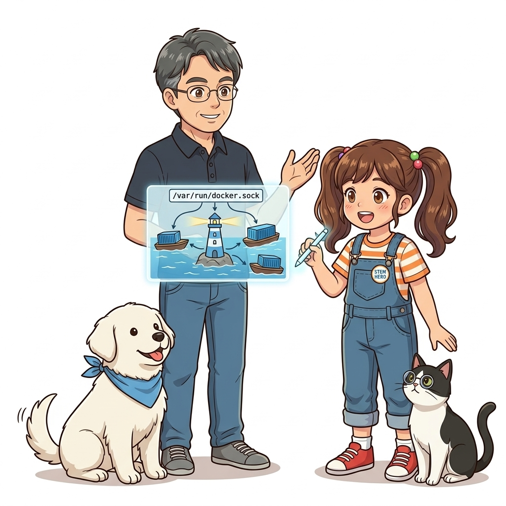
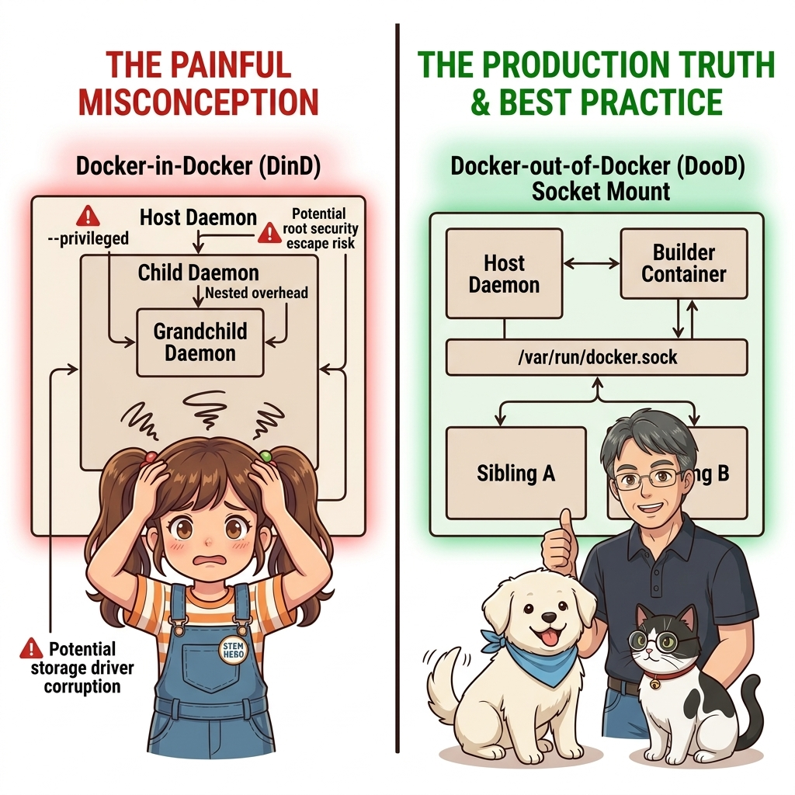
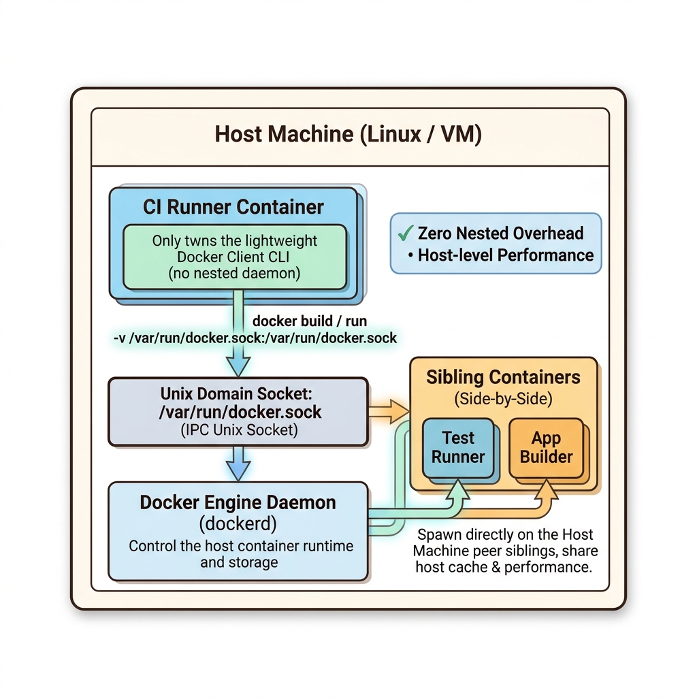
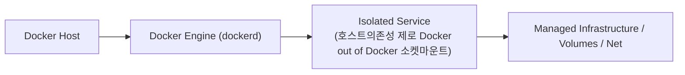
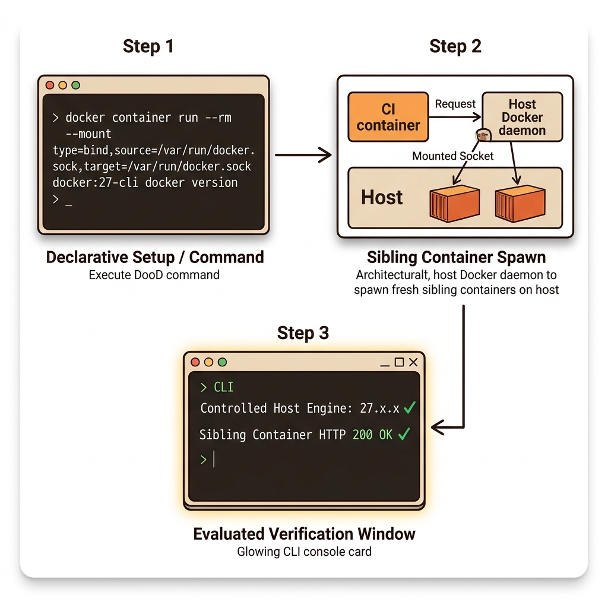
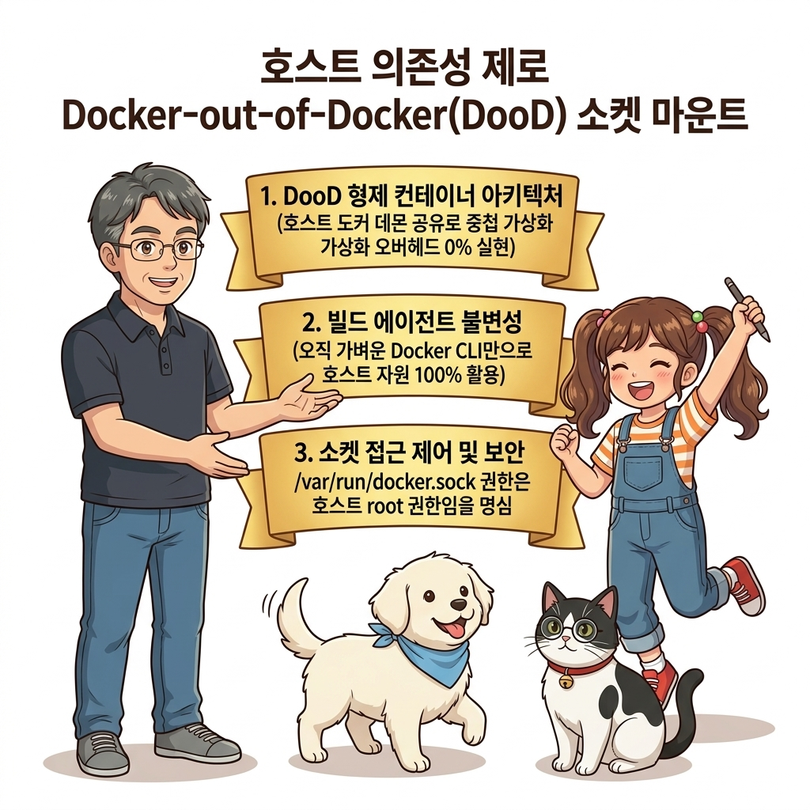
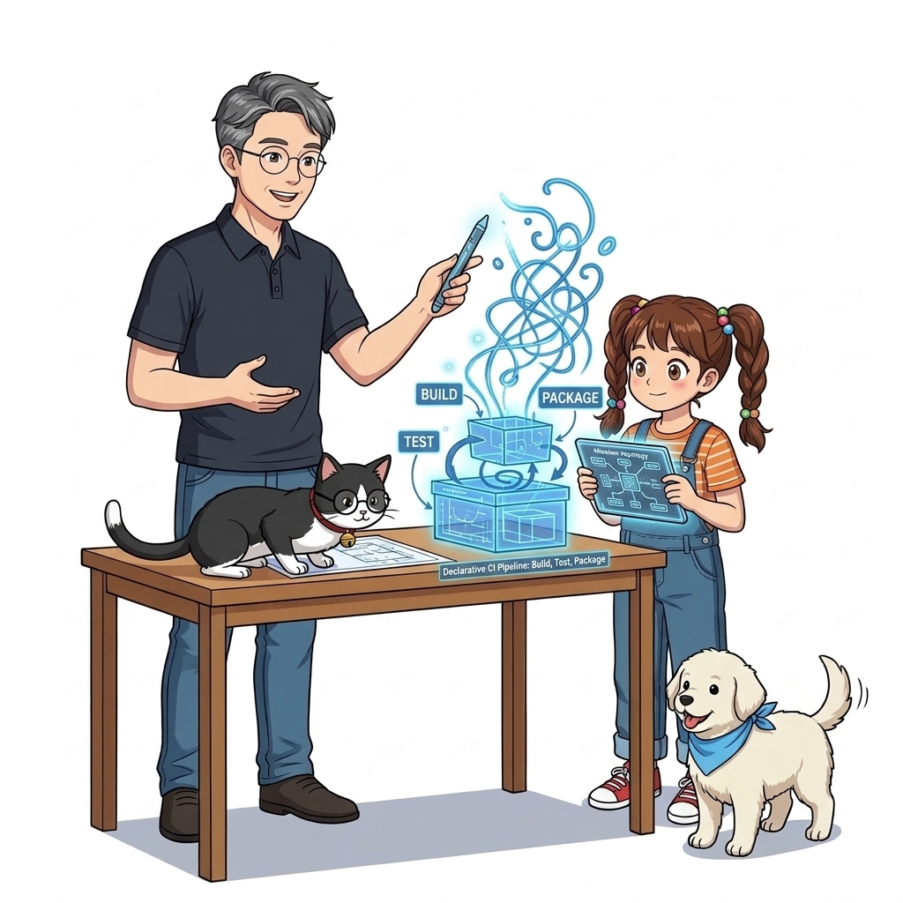

# 071. 호스트의존성 제로 Docker out of Docker 소켓마운트

CI 서버(Jenkins, GitLab Runner 등) 자체가 컨테이너로 실행 중일 때, 그 컨테이너 안에서 `docker build`나 `docker compose up`을 실행하려면 도커 엔진과 통신할 수 있어야 합니다.


**그림 05-10-1** 호스트의존성 제로 Docker out of Docker 소켓마운트의 필요성과 현대 클라우드 아키텍처 관점의 개요

---

### 071.1 왜 호스트의존성 제로 Docker out of Docker 소켓마운트이(가) 필요한가? (문제 정의와 현실적 배경)

소프트웨어 시스템이 복잡해질수록 설정을 다루는 방식은 전체 인프라의 신뢰성을 결정짓는 핵심 척도가 됩니다. **호스트의존성 제로 Docker out of Docker 소켓마운트**이(가) 부재하거나 잘못 다루어질 때 현장에서는 다음과 같은 대표적인 병목과 장애가 발생합니다:

1. **하드코딩된 설정과 환경 불일치로 인한 유연성 상실**: 환경이 바뀔 때마다 코드를 다시 빌드해야 하므로 배포 주기가 지연되고 이미지 수가 기하급수적으로 폭증합니다.
2. **보안 민감 데이터의 무분별한 노출**: 비밀번호, 데이터베이스 토큰, 암호화 키가 이미지 레이어에 영구 박제되어 형상관리 시스템이나 외부에 유출될 위험이 커집니다.
3. **재현 불가능한 구성 드리프트**: 스테이징 환경과 프로덕션 환경의 미세한 설정 차이가 예기치 못한 서비스 중단 사고로 직결됩니다.


**그림 05-10-2** 호스트의존성 제로 Docker out of Docker 소켓마운트에 대한 대표적인 오해와 실제 프로덕션 현장의 엔지니어링 진실

---

### 071.2 핵심 아키텍처와 엔지니어링 메커니즘

컨테이너 안에 또 다른 무거운 도커 데몬을 띄우는(DinD) 대신, **호스트 도커 엔진의 유닉스 소켓 파일(`/var/run/docker.sock`)을 CI 컨테이너 내부에 바인드 마운트하여 호스트의 도커 데몬에게 형제(Sibling) 컨테이너 생성을 요청하는 Docker-out-of-Docker(DooD)** 아키텍처를 실습합니다!


**그림 05-10-3** 호스트의존성 제로 Docker out of Docker 소켓마운트의 내부 아키텍처 및 데이터 흐름

#### 📊 핵심 비교 및 엔지니어링 표준 분석

| 구분 / 핵심 원리 | 상세 설명 및 동작 메커니즘 | 실무 적용 시 주의점 및 베스트 프랙티스 |
| :--- | :--- | :--- |
| **Docker-out-of-Docker (DooD)** | CI 컨테이너 안에는 가벼운 **Docker CLI**만 설치하고, 실제 통신 소켓(`/var/run/docker.sock`)은 호스트와 공유 | CI 컨테이너가 `docker build`를 실행하면 실제로는 호스트 도커 엔진이 이미지를 빌드하므로 호스트의 레이어 캐시를 100% 그대로 공유! |
| **형제 컨테이너 (Sibling Containers)** | DooD 방식으로 띄운 컨테이너는 CI 컨테이너의 '자식'이 아니라 호스트 도커 엔진 위에서 나란히 실행되는 '형제' 컨테이너가 됨 | 성능 저하가 전혀 없고 파일시스템 중첩 문제도 발생하지 않는 실무 표준 방식 |
| **보안 주의사항** | `/var/run/docker.sock` 접근 권한은 곧 호스트 서버의 `root` 권한과 동급임! | 신뢰할 수 있는 내부 전용 CI Runner 컨테이너에만 마운트하고 일반 웹 애플리케이션에는 절대 마운트 금지 |

---

### 071.3 선언적 실습 및 아키텍처 다이어그램

본 실습은 외부 비공개 패키지에 의존하지 않고, 공식 표준 이미지를 기반으로 즉시 재현 가능한 살아있는 코드로 구성되어 있습니다.

```bash
# 컨테이너 내부에 호스트의 /var/run/docker.sock 소켓을 마운트하여 컨테이너 안에서 호스트 도커 제어하기!
docker container run --rm   --mount type=bind,source=/var/run/docker.sock,target=/var/run/docker.sock   docker:27-cli docker version --format 'Controlled Host Engine: {{.Server.Version}}'
```

#### 🔍 아키텍처 흐름도 (Mermaid Diagram)




**그림 05-10-4** 선언적 인프라 명세를 통한 호스트의존성 제로 Docker out of Docker 소켓마운트 검증 파이프라인

---

### 071.4 핵심 정리: 캐릭터 대화와 3대 교훈

> 👧 **도로시**: "교수님! **호스트의존성 제로 Docker out of Docker 소켓마운트**의 원리를 배우니까, 복잡하게 얽혀 있던 인프라 설정이 레고 블록처럼 질서정연하게 제자리를 찾는 게 보여요!"
> 
> 🐱 **조교 지니**: "야옹~ 맞습니다! 특히 런타임 환경과 불변 인프라의 경계를 명확히 지키는 것이 대규모 클라우드 운영의 제1원칙이랍니다!"
> 
> 🐶 **토토**: "멍멍! 선언적 코드로 한 번 적어두면 언제든 똑같이 복원되니까 정말 든든해요!"
> 
> 👨‍🏫 **이호진 교수님**: "훌륭하구나. 원리를 깊이 이해하고 실습을 통해 손에 익히는 것이 훌륭한 클라우드 엔지니어로 성장하는 가장 빠른 지름길이란다."


**그림 05-10-5** 호스트의존성 제로 Docker out of Docker 소켓마운트 마스터를 위한 3대 핵심 교훈

1. **설정과 실행의 명확한 분리**:
   * 애플리케이션 코드는 불변으로 유지하고, 가변적인 설정값은 외부에서 주입하여 이식성을 극대화합니다.
2. **선언적 재현성 확보**:
   * 사람이 수작업으로 변경하지 않고 코드 명세를 통해 언제 어디서나 100% 동일한 실행 결과를 보장합니다.
3. **최소 권한 및 보안 모범 사례 준수**:
   * 불필요한 권한과 포트 노출을 최소화하고 민감 데이터를 암호화하여 프로덕션 안정성을 담보합니다.

---

### 071.5 랩노트 피날레와 다음 강의 예고


**그림 05-10-6** 연구실에서 다음 마일스톤인 [선언적 CI파이프라인 스크립트작성 빌드 테스트 패키징] 실습을 예고하는 교수님과 토토

> 💡 **다음 강의 안내**:
> [선언적 CI파이프라인 스크립트작성 빌드 테스트 패키징](../072_선언적_CI파이프라인_스크립트작성_빌드_테스트_패키징/)에서는 더욱 심화된 실전 엔지니어링 실습과 아키텍처를 다룹니다!

---

## 🧭 강의 네비게이션
* [◀️ 이전 강의: 070_도커컴포즈_build_속성심화_context_args_labels](../070_도커컴포즈_build_속성심화_context_args_labels/)
* [📋 Part 05. 다중 환경 구성(Dev/Test/Prod)과 컨테이너 기반 CI/CD 파이프라인 (062 ~ 075) 목차로 돌아가기](../)
* [▶️ 다음 강의: 072_선언적_CI파이프라인_스크립트작성_빌드_테스트_패키징](../072_선언적_CI파이프라인_스크립트작성_빌드_테스트_패키징/)
