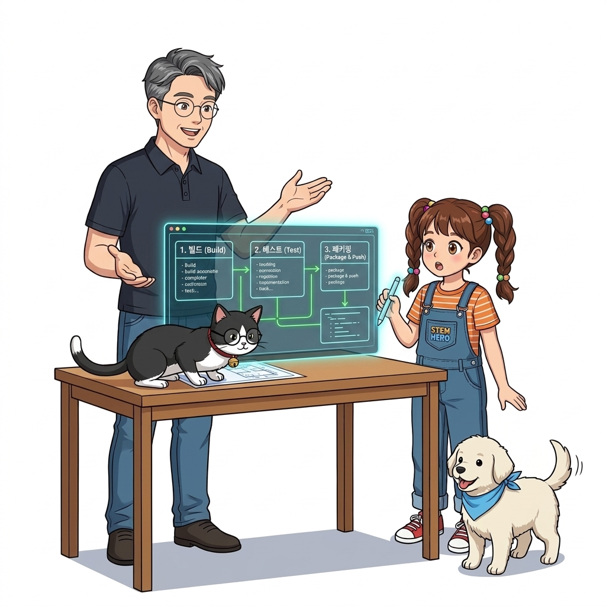
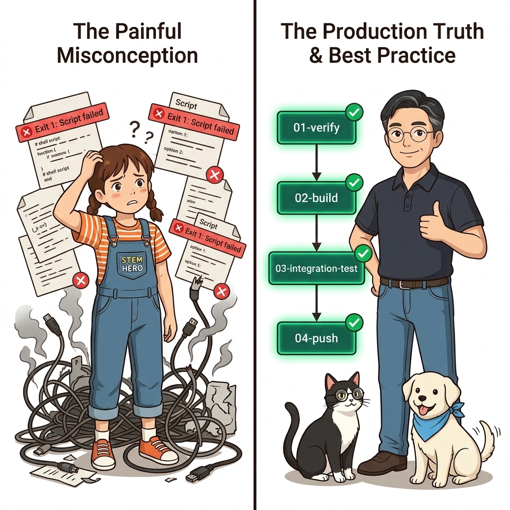
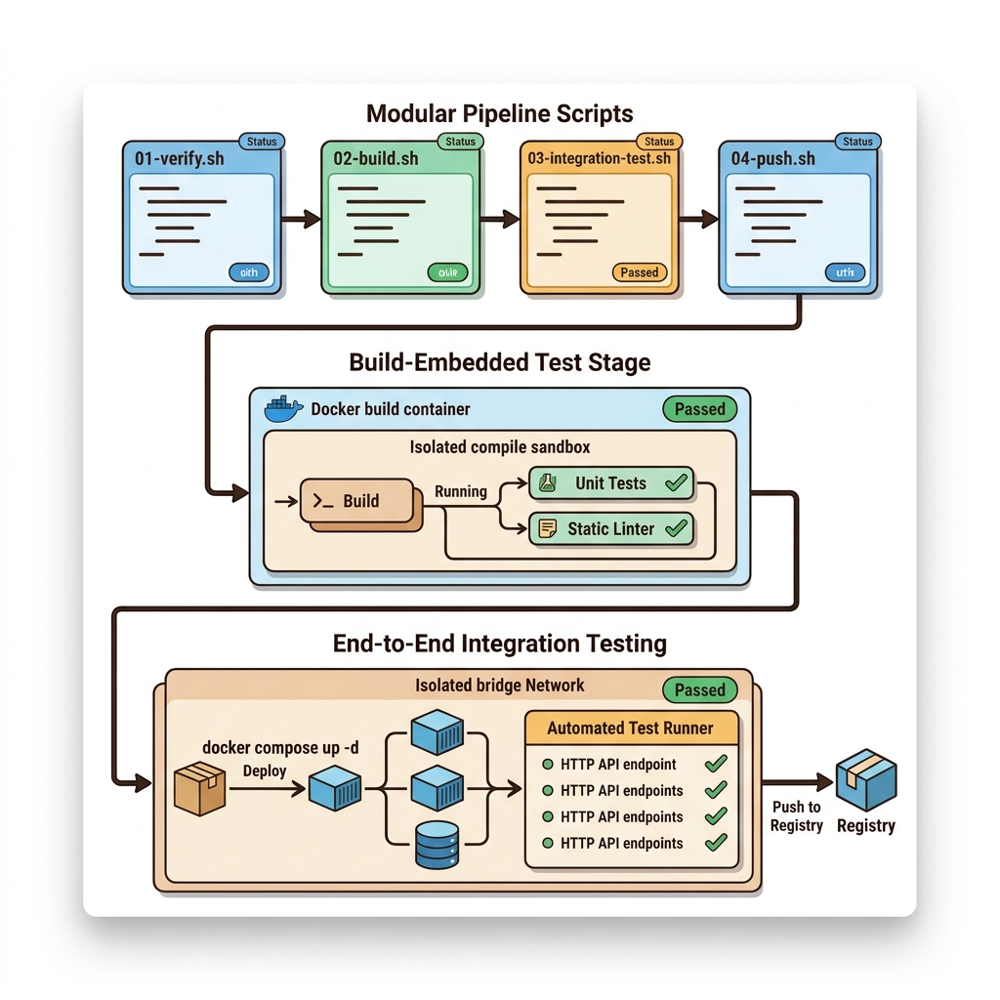
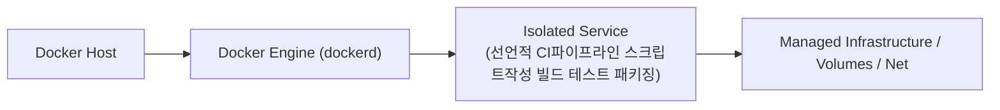
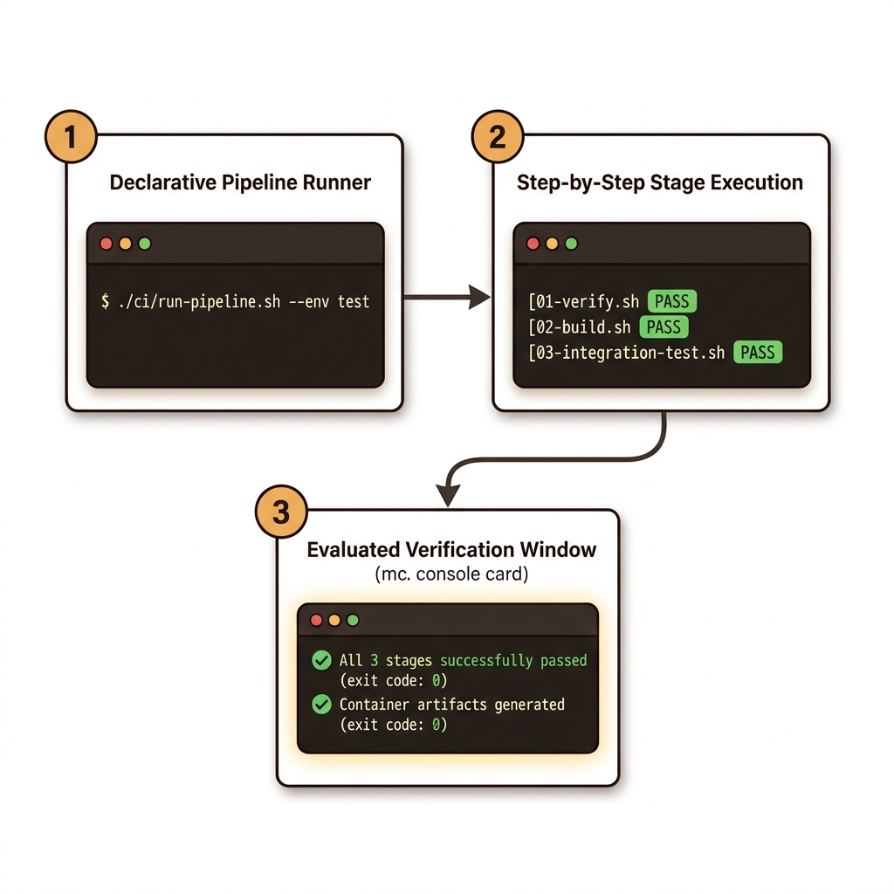
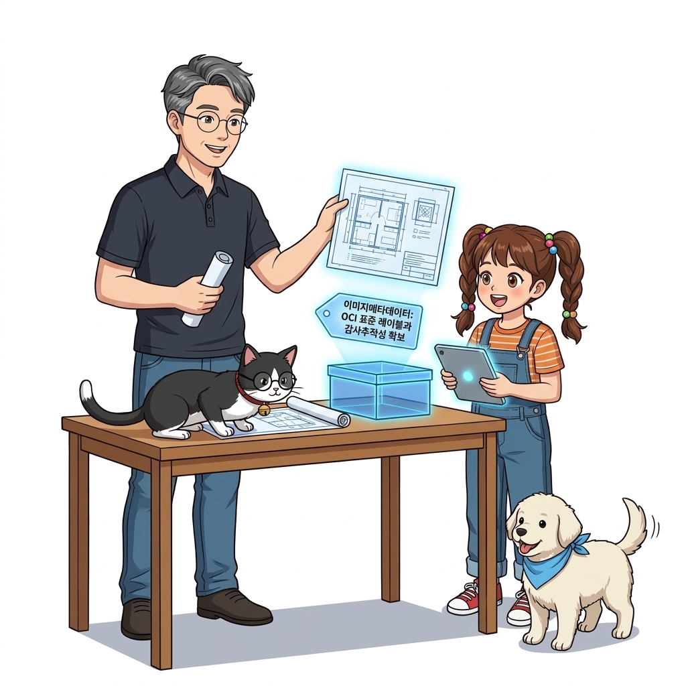

# 072. 선언적 CI파이프라인 스크립트작성 빌드 테스트 패키징

멀티 스테이지 `Dockerfile`을 `[1단계: 의존성 복원] ➔ [2단계: 자동화 테스트 실행(test 스테이지)] ➔ [3단계: 프로덕션 패키징]`으로 구성하는 **컨테이너 네이티브 테스트 패턴**을 배웁니다.


**그림 05-11-1** 선언적 CI파이프라인 스크립트작성 빌드 테스트 패키징의 필요성과 현대 클라우드 아키텍처 관점의 개요

---

### 072.1 왜 선언적 CI파이프라인 스크립트작성 빌드 테스트 패키징이(가) 필요한가? (문제 정의와 현실적 배경)

소프트웨어 시스템이 복잡해질수록 설정을 다루는 방식은 전체 인프라의 신뢰성을 결정짓는 핵심 척도가 됩니다. **선언적 CI파이프라인 스크립트작성 빌드 테스트 패키징**이(가) 부재하거나 잘못 다루어질 때 현장에서는 다음과 같은 대표적인 병목과 장애가 발생합니다:

1. **하드코딩된 설정과 환경 불일치로 인한 유연성 상실**: 환경이 바뀔 때마다 코드를 다시 빌드해야 하므로 배포 주기가 지연되고 이미지 수가 기하급수적으로 폭증합니다.
2. **보안 민감 데이터의 무분별한 노출**: 비밀번호, 데이터베이스 토큰, 암호화 키가 이미지 레이어에 영구 박제되어 형상관리 시스템이나 외부에 유출될 위험이 커집니다.
3. **재현 불가능한 구성 드리프트**: 스테이징 환경과 프로덕션 환경의 미세한 설정 차이가 예기치 못한 서비스 중단 사고로 직결됩니다.


**그림 05-11-2** 선언적 CI파이프라인 스크립트작성 빌드 테스트 패키징에 대한 대표적인 오해와 실제 프로덕션 현장의 엔지니어링 진실

---

### 072.2 핵심 아키텍처와 엔지니어링 메커니즘

만약 2단계 `RUN pytest`나 `RUN go test`에서 단 하나의 단위 테스트라도 실패하면 종료 코드가 `0`이 아니므로 **`docker image build` 자체가 즉시 중단되어 불량 이미지가 생성조차 되지 않는 강력한 안전장치**를 구현합니다!


**그림 05-11-3** 선언적 CI파이프라인 스크립트작성 빌드 테스트 패키징의 내부 아키텍처 및 데이터 흐름

#### 📊 핵심 비교 및 엔지니어링 표준 분석

| 구분 / 핵심 원리 | 상세 설명 및 동작 메커니즘 | 실무 적용 시 주의점 및 베스트 프랙티스 |
| :--- | :--- | :--- |
| **테스트 스테이지 내장 패턴** | 별도의 테스트 러너 세팅 없이 `docker build` 과정의 일부로 단위 테스트(Unit Test)와 정적 분석을 강제 수행 | BuildKit이 사용되지 않는 중간 스테이지를 건너뛰지 않도록 `test-stage`의 결과 파일(`/test-passed`)을 최종 스테이지에서 `COPY --from=test-stage`로 참조! |
| **파이프라인 스크립트 모듈화** | `01-verify.sh` ➔ `02-build.sh` ➔ `03-integration-test.sh` ➔ `04-push.sh` 형태로 셸 스크립트를 분리하고 `Jenkinsfile`이나 GitHub Actions YAML에서는 해당 스크립트만 호출 | CI 도구를 Jenkins에서 GitHub Actions나 GitLab CI로 바꾸더라도 셸 스크립트는 100% 그대로 재사용 가능! |
| **통합 테스트 (End-to-End Test)** | 빌드된 이미지들을 `docker compose up -d`로 실제 네트워크에 띄운 뒤 테스트 컨테이너가 HTTP API 요청을 보내 응답을 검증 | DB와 API가 실제로 연동된 상태까지 완벽히 검증 |

---

### 072.3 선언적 실습 및 아키텍처 다이어그램

본 실습은 외부 비공개 패키지에 의존하지 않고, 공식 표준 이미지를 기반으로 즉시 재현 가능한 살아있는 코드로 구성되어 있습니다.

```dockerfile
# [테스트가 내장된 3단계 멀티 스테이지 Dockerfile] 테스트 통과 시에만 최종 런타임 이미지 생성!
FROM python:3.12-alpine AS base
WORKDIR /src
COPY app.py test_app.py ./

FROM base AS test-stage
# 단위 테스트가 실패하면 여기서 빌드가 즉시 멈추고 에러를 반환함!
RUN python -m unittest test_app.py && touch /test-passed

FROM python:3.12-alpine AS release-stage
WORKDIR /app
COPY --from=test-stage /test-passed /app/.test-passed
COPY --from=base /src/app.py /app/app.py
CMD ["python", "/app/app.py"]
```

#### 🔍 아키텍처 흐름도 (Mermaid Diagram)




**그림 05-11-4** 선언적 인프라 명세를 통한 선언적 CI파이프라인 스크립트작성 빌드 테스트 패키징 검증 파이프라인

---

### 072.4 핵심 정리: 캐릭터 대화와 3대 교훈

> 👧 **도로시**: "교수님! **선언적 CI파이프라인 스크립트작성 빌드 테스트 패키징**의 원리를 배우니까, 복잡하게 얽혀 있던 인프라 설정이 레고 블록처럼 질서정연하게 제자리를 찾는 게 보여요!"
> 
> 🐱 **조교 지니**: "야옹~ 맞습니다! 특히 런타임 환경과 불변 인프라의 경계를 명확히 지키는 것이 대규모 클라우드 운영의 제1원칙이랍니다!"
> 
> 🐶 **토토**: "멍멍! 선언적 코드로 한 번 적어두면 언제든 똑같이 복원되니까 정말 든든해요!"
> 
> 👨‍🏫 **이호진 교수님**: "훌륭하구나. 원리를 깊이 이해하고 실습을 통해 손에 익히는 것이 훌륭한 클라우드 엔지니어로 성장하는 가장 빠른 지름길이란다."


**그림 05-11-5** 선언적 CI파이프라인 스크립트작성 빌드 테스트 패키징 마스터를 위한 3대 핵심 교훈

1. **설정과 실행의 명확한 분리**:
   * 애플리케이션 코드는 불변으로 유지하고, 가변적인 설정값은 외부에서 주입하여 이식성을 극대화합니다.
2. **선언적 재현성 확보**:
   * 사람이 수작업으로 변경하지 않고 코드 명세를 통해 언제 어디서나 100% 동일한 실행 결과를 보장합니다.
3. **최소 권한 및 보안 모범 사례 준수**:
   * 불필요한 권한과 포트 노출을 최소화하고 민감 데이터를 암호화하여 프로덕션 안정성을 담보합니다.

---

### 072.5 랩노트 피날레와 다음 강의 예고


**그림 05-11-6** 연구실에서 다음 마일스톤인 [이미지메타데이터 OCI표준레이블과 감사추적성 확보] 실습을 예고하는 교수님과 토토

> 💡 **다음 강의 안내**:
> [이미지메타데이터 OCI표준레이블과 감사추적성 확보](../073_이미지메타데이터_OCI표준레이블과_감사추적성_확보/)에서는 더욱 심화된 실전 엔지니어링 실습과 아키텍처를 다룹니다!

---

## 🧭 강의 네비게이션
* [◀️ 이전 강의: 071_호스트의존성_제로_Docker_out_of_Docker_소켓마운트](../071_호스트의존성_제로_Docker_out_of_Docker_소켓마운트/)
* [📋 Part 05. 다중 환경 구성(Dev/Test/Prod)과 컨테이너 기반 CI/CD 파이프라인 (062 ~ 075) 목차로 돌아가기](../)
* [▶️ 다음 강의: 073_이미지메타데이터_OCI표준레이블과_감사추적성_확보](../073_이미지메타데이터_OCI표준레이블과_감사추적성_확보/)
