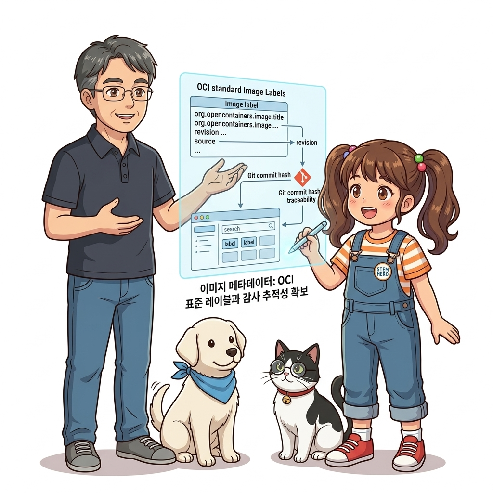
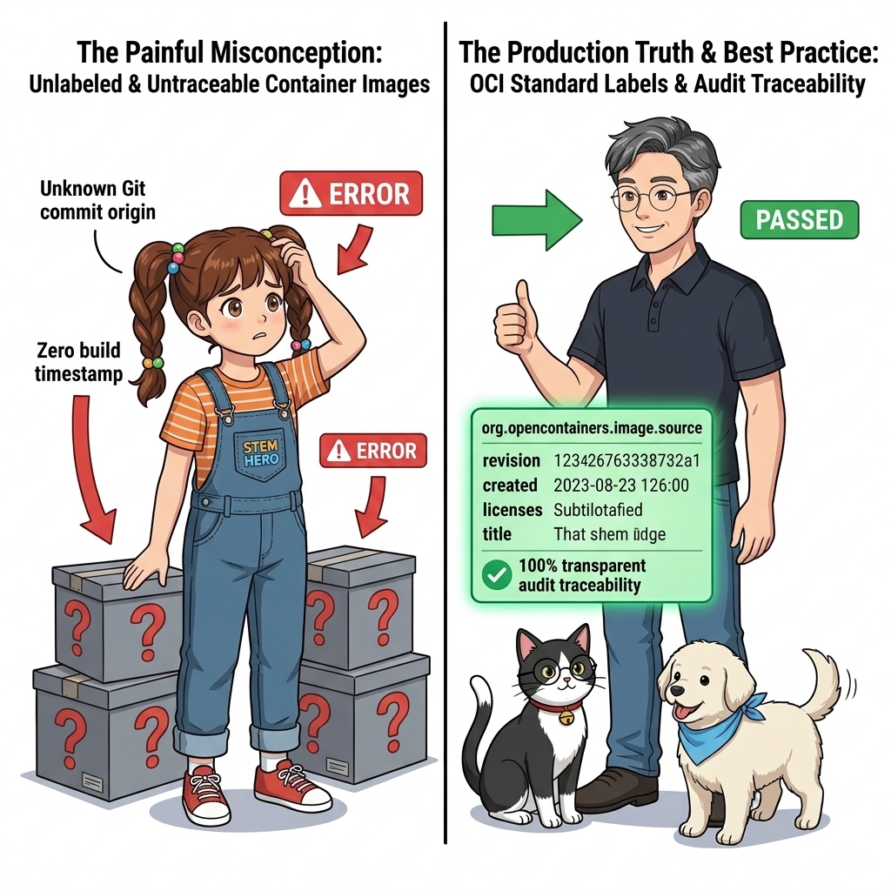
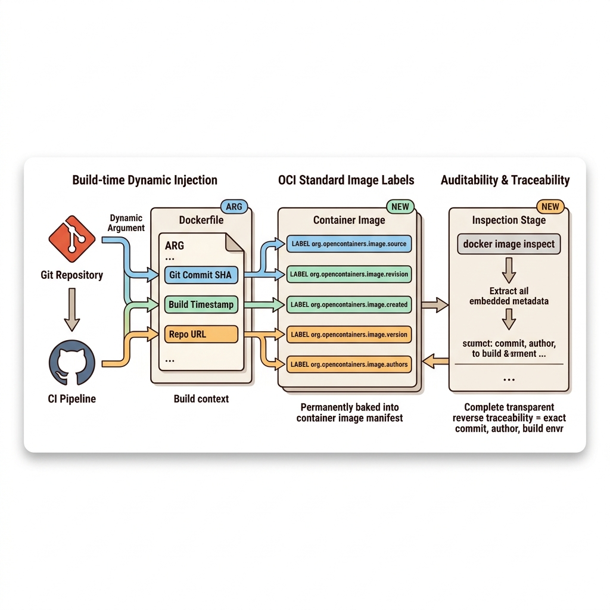
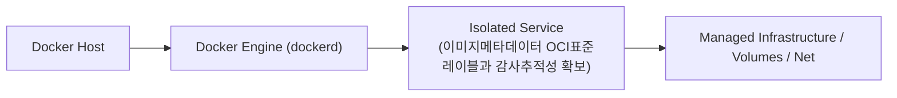
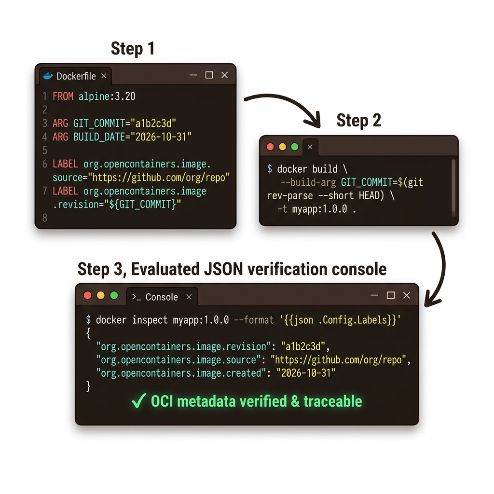

# 073. 이미지메타데이터 OCI표준레이블과 감사추적성 확보

운영 환경에서 장애가 발생했을 때 해당 컨테이너 이미지가 **어느 Git 저장소의 몇 번 커밋(`revision`)에서, 몇 번 CI 빌드 잡(`build-tag`)을 통해 만들어졌는지 1초 만에 역추적(Audit Trail)**할 수 있어야 합니다.


**그림 05-12-1** 이미지메타데이터 OCI표준레이블과 감사추적성 확보의 필요성과 현대 클라우드 아키텍처 관점의 개요

---

### 073.1 왜 이미지메타데이터 OCI표준레이블과 감사추적성 확보이(가) 필요한가? (문제 정의와 현실적 배경)

소프트웨어 시스템이 복잡해질수록 설정을 다루는 방식은 전체 인프라의 신뢰성을 결정짓는 핵심 척도가 됩니다. **이미지메타데이터 OCI표준레이블과 감사추적성 확보**이(가) 부재하거나 잘못 다루어질 때 현장에서는 다음과 같은 대표적인 병목과 장애가 발생합니다:

1. **하드코딩된 설정과 환경 불일치로 인한 유연성 상실**: 환경이 바뀔 때마다 코드를 다시 빌드해야 하므로 배포 주기가 지연되고 이미지 수가 기하급수적으로 폭증합니다.
2. **보안 민감 데이터의 무분별한 노출**: 비밀번호, 데이터베이스 토큰, 암호화 키가 이미지 레이어에 영구 박제되어 형상관리 시스템이나 외부에 유출될 위험이 커집니다.
3. **재현 불가능한 구성 드리프트**: 스테이징 환경과 프로덕션 환경의 미세한 설정 차이가 예기치 못한 서비스 중단 사고로 직결됩니다.


**그림 05-12-2** 이미지메타데이터 OCI표준레이블과 감사추적성 확보에 대한 대표적인 오해와 실제 프로덕션 현장의 엔지니어링 진실

---

### 073.2 핵심 아키텍처와 엔지니어링 메커니즘

`Dockerfile`의 `ARG`와 **`LABEL`** 인스트럭션을 결합해 OCI(Open Container Initiative) 표준 어노테이션(`org.opencontainers.image.*`)을 이미지에 각인하고 `docker image inspect`로 조회하는 법을 실습합니다.


**그림 05-12-3** 이미지메타데이터 OCI표준레이블과 감사추적성 확보의 내부 아키텍처 및 데이터 흐름

#### 📊 핵심 비교 및 엔지니어링 표준 분석

| 구분 / 핵심 원리 | 상세 설명 및 동작 메커니즘 | 실무 적용 시 주의점 및 베스트 프랙티스 |
| :--- | :--- | :--- |
| **OCI 표준 이미지 레이블** | `org.opencontainers.image.source`(Git URL), `.revision`(커밋 해시), `.version`(버전), `.created`(생성 시각) 등 국제 표준 키 규격 | Docker Hub, GHCR, 보안 스캐너들이 이 표준 레이블을 읽어 자동으로 소스 코드 링크와 설명을 매핑해 줌! |
| **감사 추적성 (Auditability)** | 운영 컨테이너에서 버그 발견 시 `docker inspect --format '{{json .Config.Labels}}'`로 즉시 정확한 Git 커밋 해시 확인 | `git checkout <커밋해시>`로 운영 중인 코드와 100% 동일한 시점의 소스 코드를 즉시 열어 디버깅 가능 |
| **레이블 기반 필터링** | `docker image ls --filter "label=com.oz-cloud.team=platform-engineering"`으로 특정 팀이나 특정 빌드 파이프라인이 만든 이미지만 검색 및 정리 가능 | 대규모 조직의 컨테이너 자산 관리 필수 기법 |

---

### 073.3 선언적 실습 및 아키텍처 다이어그램

본 실습은 외부 비공개 패키지에 의존하지 않고, 공식 표준 이미지를 기반으로 즉시 재현 가능한 살아있는 코드로 구성되어 있습니다.

```dockerfile
# 빌드 시점 인자(ARG)를 받아 OCI 표준 메타데이터 레이블(LABEL)로 영구 각인하는 Dockerfile
FROM alpine:3.20
ARG BUILD_DATE="2026-10-31"
ARG GIT_COMMIT="a1b2c3d"
ARG BUILD_NUMBER="42"

LABEL org.opencontainers.image.created="${BUILD_DATE}" \
      org.opencontainers.image.revision="${GIT_COMMIT}" \
      org.opencontainers.image.version="1.0.${BUILD_NUMBER}" \
      com.oz-cloud.team="platform-engineering" 
```

#### 🔍 아키텍처 흐름도 (Mermaid Diagram)




**그림 05-12-4** 선언적 인프라 명세를 통한 이미지메타데이터 OCI표준레이블과 감사추적성 확보 검증 파이프라인

---

### 073.4 핵심 정리: 캐릭터 대화와 3대 교훈

> 👧 **도로시**: "교수님! **이미지메타데이터 OCI표준레이블과 감사추적성 확보**의 원리를 배우니까, 복잡하게 얽혀 있던 인프라 설정이 레고 블록처럼 질서정연하게 제자리를 찾는 게 보여요!"
> 
> 🐱 **조교 지니**: "야옹~ 맞습니다! 특히 런타임 환경과 불변 인프라의 경계를 명확히 지키는 것이 대규모 클라우드 운영의 제1원칙이랍니다!"
> 
> 🐶 **토토**: "멍멍! 선언적 코드로 한 번 적어두면 언제든 똑같이 복원되니까 정말 든든해요!"
> 
> 👨‍🏫 **이호진 교수님**: "훌륭하구나. 원리를 깊이 이해하고 실습을 통해 손에 익히는 것이 훌륭한 클라우드 엔지니어로 성장하는 가장 빠른 지름길이란다."


**그림 05-12-5** 이미지메타데이터 OCI표준레이블과 감사추적성 확보 마스터를 위한 3대 핵심 교훈

1. **설정과 실행의 명확한 분리**:
   * 애플리케이션 코드는 불변으로 유지하고, 가변적인 설정값은 외부에서 주입하여 이식성을 극대화합니다.
2. **선언적 재현성 확보**:
   * 사람이 수작업으로 변경하지 않고 코드 명세를 통해 언제 어디서나 100% 동일한 실행 결과를 보장합니다.
3. **최소 권한 및 보안 모범 사례 준수**:
   * 불필요한 권한과 포트 노출을 최소화하고 민감 데이터를 암호화하여 프로덕션 안정성을 담보합니다.

---

### 073.5 랩노트 피날레와 다음 강의 예고


**그림 05-12-6** 연구실에서 다음 마일스톤인 [CI파이프라인 단계별컨테이너 역할과 품질게이트] 실습을 예고하는 교수님과 토토

> 💡 **다음 강의 안내**:
> [CI파이프라인 단계별컨테이너 역할과 품질게이트](../074_CI파이프라인_단계별컨테이너_역할과_품질게이트/)에서는 더욱 심화된 실전 엔지니어링 실습과 아키텍처를 다룹니다!

---

## 🧭 강의 네비게이션
* [◀️ 이전 강의: 072_선언적_CI파이프라인_스크립트작성_빌드_테스트_패키징](../072_선언적_CI파이프라인_스크립트작성_빌드_테스트_패키징/)
* [📋 Part 05. 다중 환경 구성(Dev/Test/Prod)과 컨테이너 기반 CI/CD 파이프라인 (062 ~ 075) 목차로 돌아가기](../)
* [▶️ 다음 강의: 074_CI파이프라인_단계별컨테이너_역할과_품질게이트](../074_CI파이프라인_단계별컨테이너_역할과_품질게이트/)
