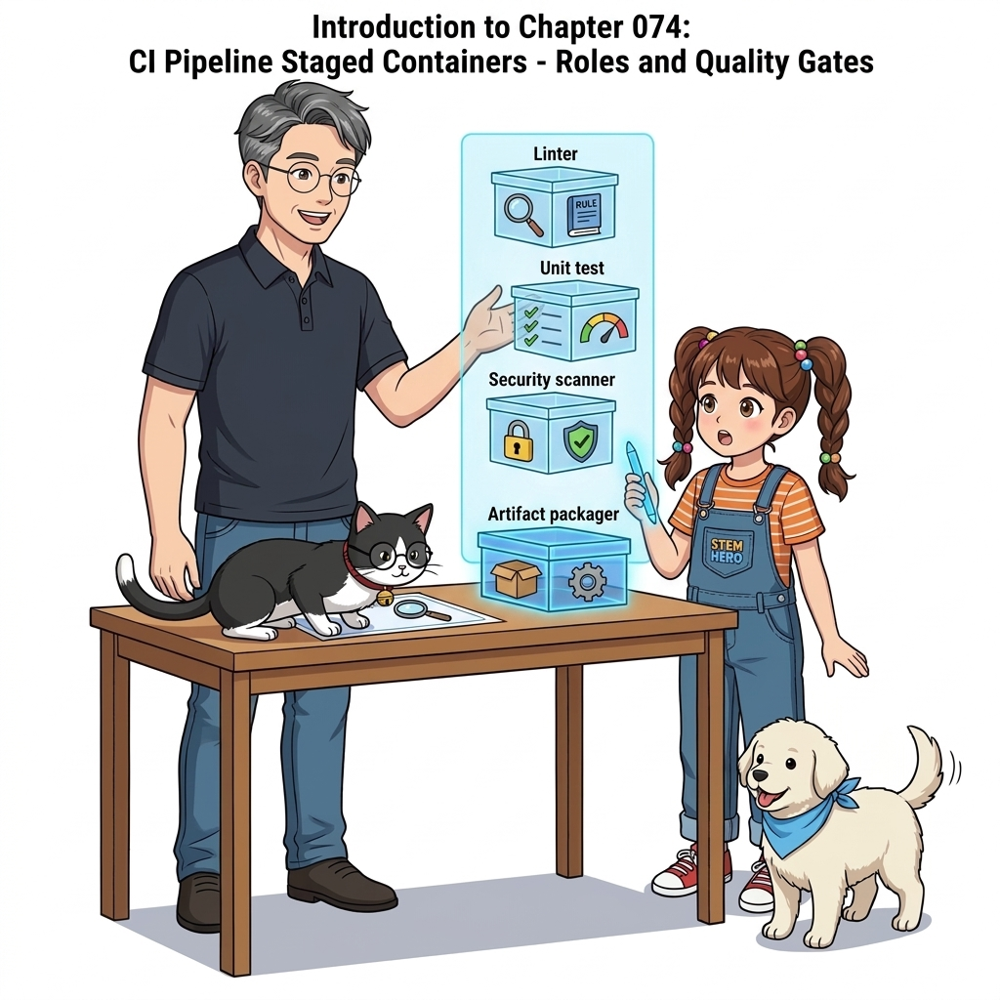
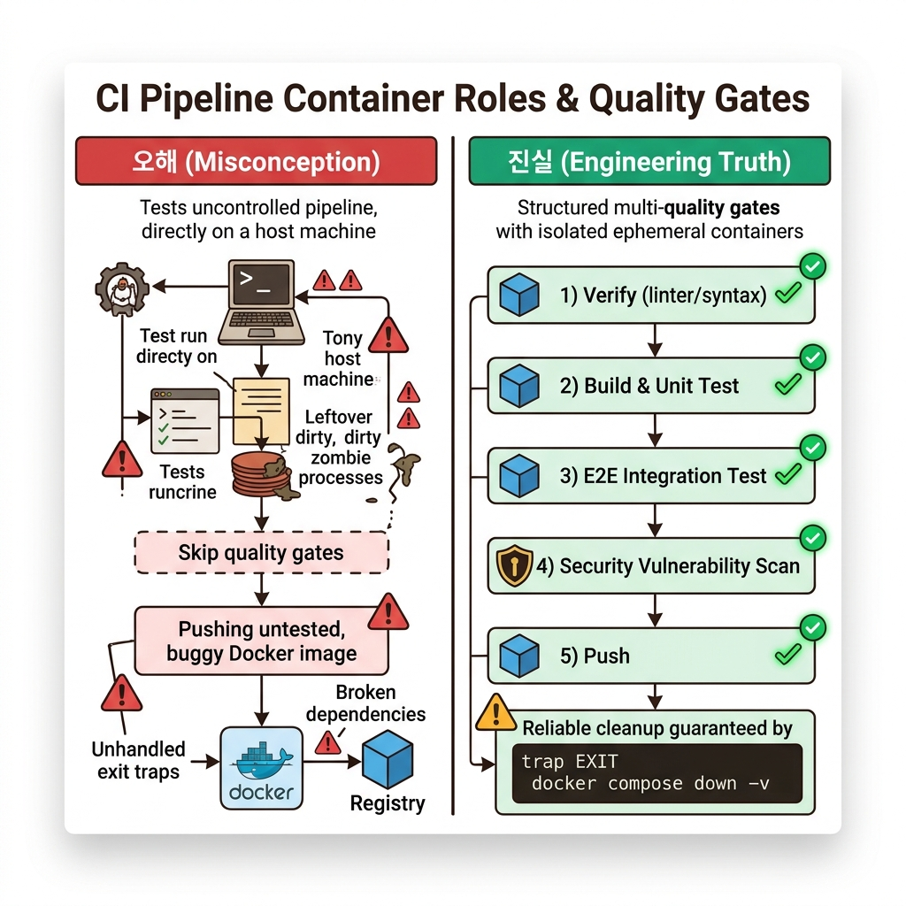
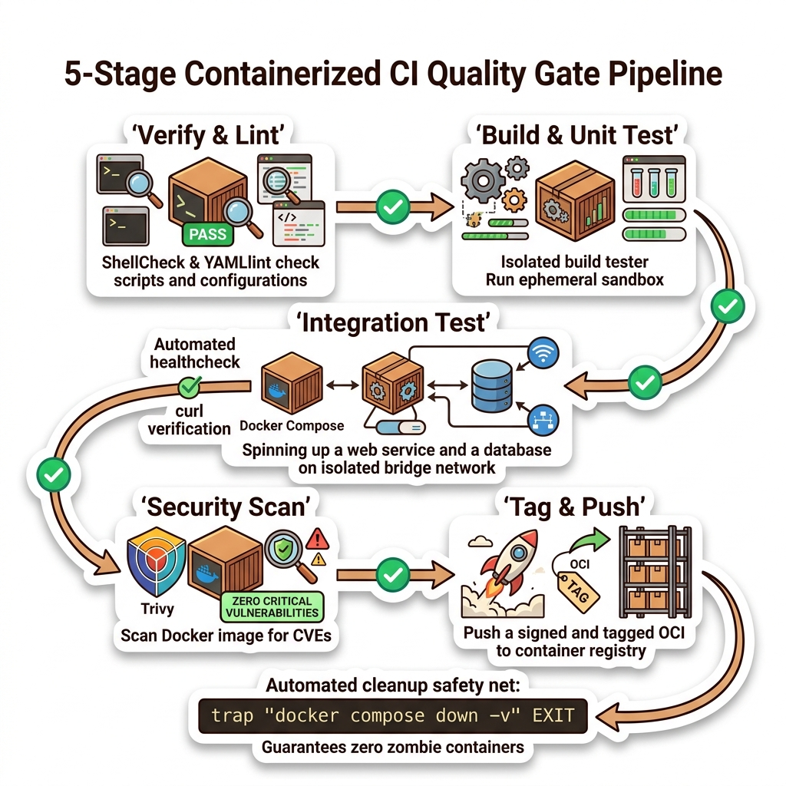
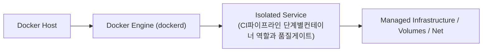
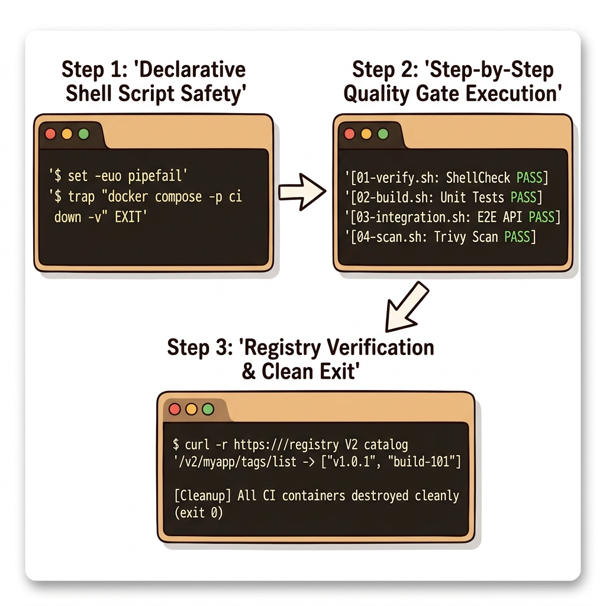
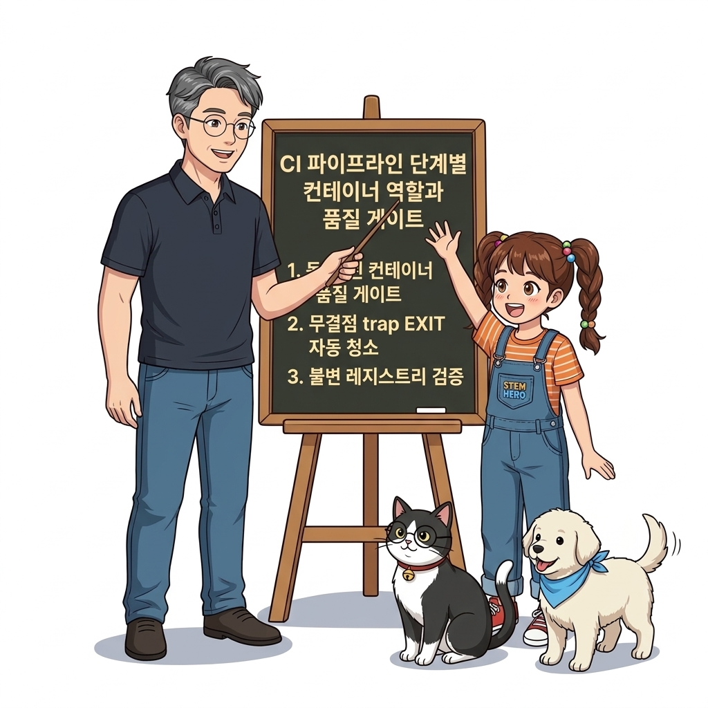
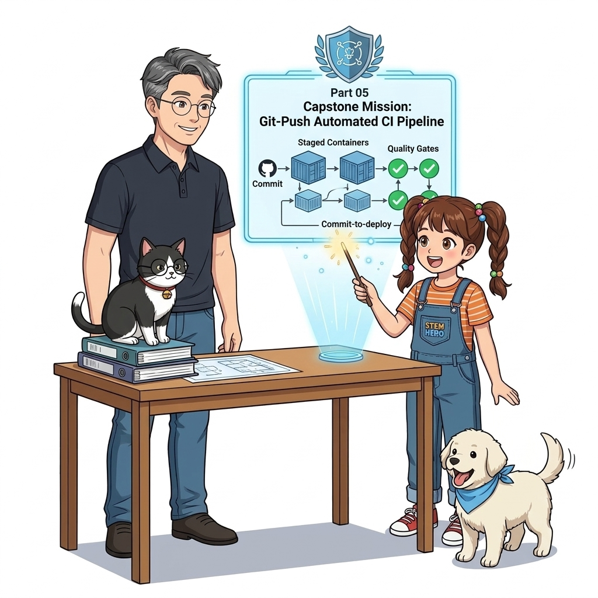

# 074. CI파이프라인 단계별컨테이너 역할과 품질게이트

완성도 높은 컨테이너 CI 파이프라인을 구성하는 5단계(**Verify ➔ Build & Unit Test ➔ E2E Integration Test ➔ Security Scan ➔ Tag & Push**)의 전체 흐름을 아키텍처 다이어그램으로 정립합니다.


**그림 05-13-1** CI파이프라인 단계별컨테이너 역할과 품질게이트의 필요성과 현대 클라우드 아키텍처 관점의 개요

---

### 074.1 왜 CI파이프라인 단계별컨테이너 역할과 품질게이트이(가) 필요한가? (문제 정의와 현실적 배경)

소프트웨어 시스템이 복잡해질수록 설정을 다루는 방식은 전체 인프라의 신뢰성을 결정짓는 핵심 척도가 됩니다. **CI파이프라인 단계별컨테이너 역할과 품질게이트**이(가) 부재하거나 잘못 다루어질 때 현장에서는 다음과 같은 대표적인 병목과 장애가 발생합니다:

1. **하드코딩된 설정과 환경 불일치로 인한 유연성 상실**: 환경이 바뀔 때마다 코드를 다시 빌드해야 하므로 배포 주기가 지연되고 이미지 수가 기하급수적으로 폭증합니다.
2. **보안 민감 데이터의 무분별한 노출**: 비밀번호, 데이터베이스 토큰, 암호화 키가 이미지 레이어에 영구 박제되어 형상관리 시스템이나 외부에 유출될 위험이 커집니다.
3. **재현 불가능한 구성 드리프트**: 스테이징 환경과 프로덕션 환경의 미세한 설정 차이가 예기치 못한 서비스 중단 사고로 직결됩니다.


**그림 05-13-2** CI파이프라인 단계별컨테이너 역할과 품질게이트에 대한 대표적인 오해와 실제 프로덕션 현장의 엔지니어링 진실

---

### 074.2 핵심 아키텍처와 엔지니어링 메커니즘

중간 단계에서 실패가 발생했을 때 테스트용으로 띄웠던 임시 컨테이너와 네트워크를 `trap ... EXIT` 또는 `always { docker compose down }` 블록으로 누수 없이 깔끔하게 청소하는 실무 노하우를 배웁니다.


**그림 05-13-3** CI파이프라인 단계별컨테이너 역할과 품질게이트의 내부 아키텍처 및 데이터 흐름

#### 📊 핵심 비교 및 엔지니어링 표준 분석

| 구분 / 핵심 원리 | 상세 설명 및 동작 메커니즘 | 실무 적용 시 주의점 및 베스트 프랙티스 |
| :--- | :--- | :--- |
| **`set -euo pipefail`** | 배시 스크립트에서 명령어 하나라도 실패(`-e`)하거나 미정의 변수(`-u`), 파이프 중간 에러(`pipefail`) 발생 시 즉시 스크립트를 중단하고 실패 반환 | CI 빌드 스크립트 첫 줄에 반드시 넣어야 하는 안전장치 |
| **`trap '...' EXIT` 정리 보장** | 테스트 도중 에러가 나거나 강제 취소되더라도 스크립트 종료 시점에 무조건 `docker compose down -v`가 실행되어 좀비 컨테이너 방지 | Jenkins의 `post { always { ... } }` 또는 GitHub Actions의 `if: always()`와 동일한 역할 |
| **레지스트리 카탈로그 최종 확인** | `docker compose push` 후 레지스트리 V2 API(`/v2/<repo>/tags/list`)를 호출해 새 빌드 번호 태그가 정상 등록되었는지 확인함으로써 파이프라인 완료 | Part 07에서 여기에 원격 클러스터 자동 배포(CD)를 연결하면 완결형 CI/CD 완성! |

---

### 074.3 선언적 실습 및 아키텍처 다이어그램

본 실습은 외부 비공개 패키지에 의존하지 않고, 공식 표준 이미지를 기반으로 즉시 재현 가능한 살아있는 코드로 구성되어 있습니다.

```bash
# 에러가 발생해도 항상 테스트 컨테이너를 깔끔하게 정리(trap EXIT)하는 무결점 CI 셸 스크립트 패턴
set -euo pipefail
trap 'echo "[Cleanup] Removing CI test containers..."; docker compose -p ci-job-101 down -v 2>/dev/null || true' EXIT

echo "[Step 1] Building & Running Unit Tests..."
echo "[Step 2] Running Integration Tests..."
echo "[Step 3] All Quality Gates Passed! Ready to Push." 
```

#### 🔍 아키텍처 흐름도 (Mermaid Diagram)




**그림 05-13-4** 선언적 인프라 명세를 통한 CI파이프라인 단계별컨테이너 역할과 품질게이트 검증 파이프라인

---

### 074.4 핵심 정리: 캐릭터 대화와 3대 교훈

> 👧 **도로시**: "교수님! **CI파이프라인 단계별컨테이너 역할과 품질게이트**의 원리를 배우니까, 복잡하게 얽혀 있던 인프라 설정이 레고 블록처럼 질서정연하게 제자리를 찾는 게 보여요!"
> 
> 🐱 **조교 지니**: "야옹~ 맞습니다! 특히 런타임 환경과 불변 인프라의 경계를 명확히 지키는 것이 대규모 클라우드 운영의 제1원칙이랍니다!"
> 
> 🐶 **토토**: "멍멍! 선언적 코드로 한 번 적어두면 언제든 똑같이 복원되니까 정말 든든해요!"
> 
> 👨‍🏫 **이호진 교수님**: "훌륭하구나. 원리를 깊이 이해하고 실습을 통해 손에 익히는 것이 훌륭한 클라우드 엔지니어로 성장하는 가장 빠른 지름길이란다."


**그림 05-13-5** CI파이프라인 단계별컨테이너 역할과 품질게이트 마스터를 위한 3대 핵심 교훈

1. **설정과 실행의 명확한 분리**:
   * 애플리케이션 코드는 불변으로 유지하고, 가변적인 설정값은 외부에서 주입하여 이식성을 극대화합니다.
2. **선언적 재현성 확보**:
   * 사람이 수작업으로 변경하지 않고 코드 명세를 통해 언제 어디서나 100% 동일한 실행 결과를 보장합니다.
3. **최소 권한 및 보안 모범 사례 준수**:
   * 불필요한 권한과 포트 노출을 최소화하고 민감 데이터를 암호화하여 프로덕션 안정성을 담보합니다.

---

### 074.5 랩노트 피날레와 다음 강의 예고


**그림 05-13-6** 연구실에서 다음 마일스톤인 [Part05 실전미션 Git푸시로 동작하는 완전자동화 CI파이프라인구축] 실습을 예고하는 교수님과 토토

> 💡 **다음 강의 안내**:
> [Part05 실전미션 Git푸시로 동작하는 완전자동화 CI파이프라인구축](../075_Part05_실전미션_Git푸시로_동작하는_완전자동화_CI파이프라인구축/)에서는 더욱 심화된 실전 엔지니어링 실습과 아키텍처를 다룹니다!

---

## 🧭 강의 네비게이션
* [◀️ 이전 강의: 073_이미지메타데이터_OCI표준레이블과_감사추적성_확보](../073_이미지메타데이터_OCI표준레이블과_감사추적성_확보/)
* [📋 Part 05. 다중 환경 구성(Dev/Test/Prod)과 컨테이너 기반 CI/CD 파이프라인 (062 ~ 075) 목차로 돌아가기](../)
* [▶️ 다음 강의: 075_Part05_실전미션_Git푸시로_동작하는_완전자동화_CI파이프라인구축](../075_Part05_실전미션_Git푸시로_동작하는_완전자동화_CI파이프라인구축/)
