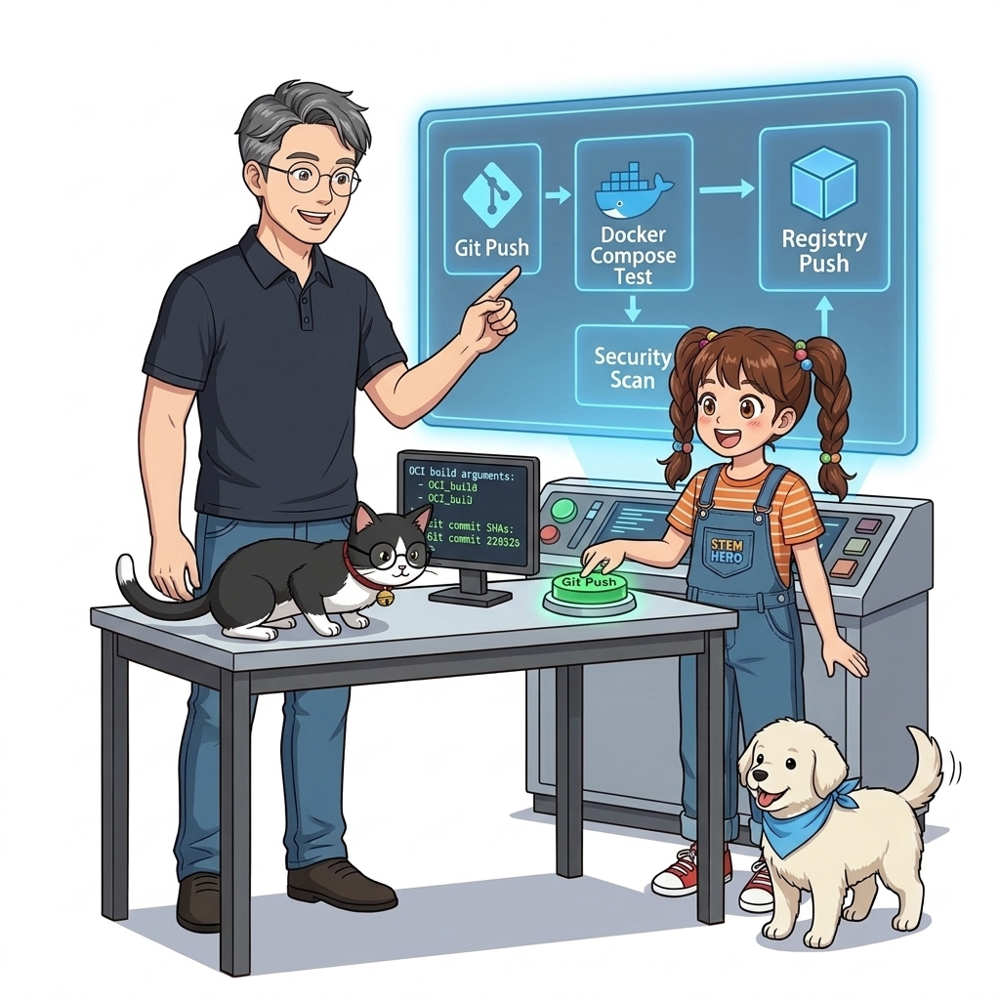
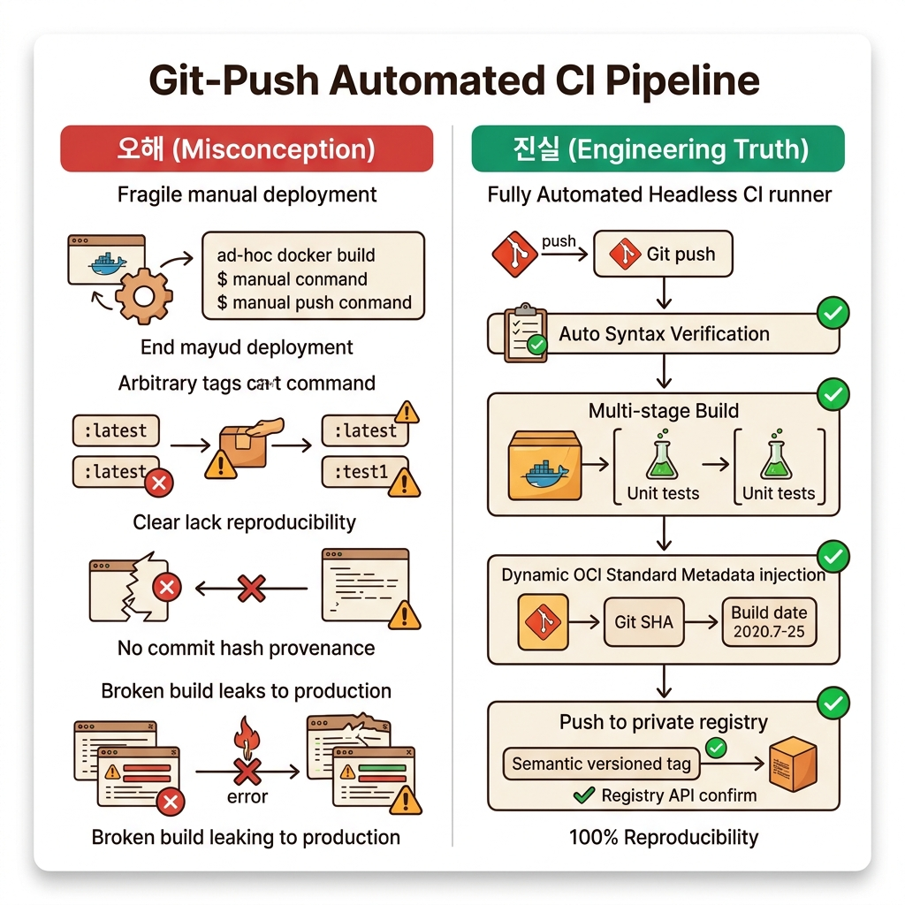
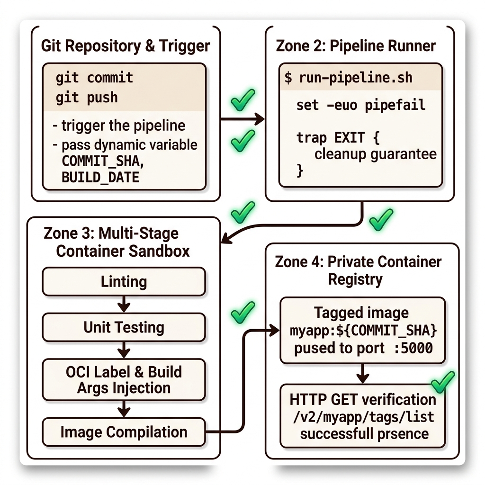
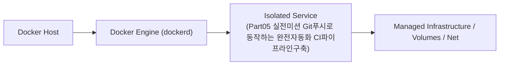
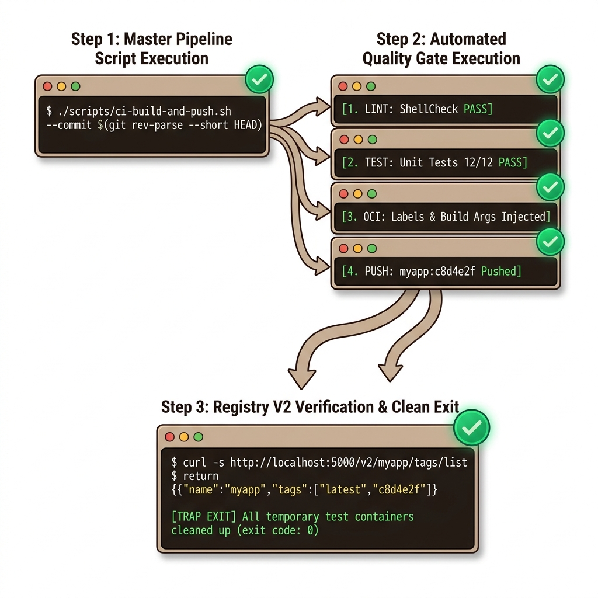

# 075. Part05 실전미션 Git푸시로 동작하는 완전자동화 CI파이프라인구축

10~11장에서 배운 컴포즈 빌드 설정, 단위 테스트 내장 `Dockerfile`, 빌드 인자(`args`) 및 OCI 레이블 주입, 그리고 사설 레지스트리 배포 및 검증을 하나의 자동화 파이프라인 스크립트로 실행합니다.


**그림 05-14-1** Part05 실전미션 Git푸시로 동작하는 완전자동화 CI파이프라인구축의 필요성과 현대 클라우드 아키텍처 관점의 개요

---

### 075.1 왜 Part05 실전미션 Git푸시로 동작하는 완전자동화 CI파이프라인구축이(가) 필요한가? (문제 정의와 현실적 배경)

소프트웨어 시스템이 복잡해질수록 설정을 다루는 방식은 전체 인프라의 신뢰성을 결정짓는 핵심 척도가 됩니다. **Part05 실전미션 Git푸시로 동작하는 완전자동화 CI파이프라인구축**이(가) 부재하거나 잘못 다루어질 때 현장에서는 다음과 같은 대표적인 병목과 장애가 발생합니다:

1. **하드코딩된 설정과 환경 불일치로 인한 유연성 상실**: 환경이 바뀔 때마다 코드를 다시 빌드해야 하므로 배포 주기가 지연되고 이미지 수가 기하급수적으로 폭증합니다.
2. **보안 민감 데이터의 무분별한 노출**: 비밀번호, 데이터베이스 토큰, 암호화 키가 이미지 레이어에 영구 박제되어 형상관리 시스템이나 외부에 유출될 위험이 커집니다.
3. **재현 불가능한 구성 드리프트**: 스테이징 환경과 프로덕션 환경의 미세한 설정 차이가 예기치 못한 서비스 중단 사고로 직결됩니다.


**그림 05-14-2** Part05 실전미션 Git푸시로 동작하는 완전자동화 CI파이프라인구축에 대한 대표적인 오해와 실제 프로덕션 현장의 엔지니어링 진실

---

### 075.2 핵심 아키텍처와 엔지니어링 메커니즘

단 한 번의 스크립트 실행으로 코드 검증부터 이미지 빌드, 태그 부여, 레지스트리 업로드, API 확인까지 일사천리로 완료되는 쾌감을 경험해 보세요!


**그림 05-14-3** Part05 실전미션 Git푸시로 동작하는 완전자동화 CI파이프라인구축의 내부 아키텍처 및 데이터 흐름

#### 📊 핵심 비교 및 엔지니어링 표준 분석

| 구분 / 핵심 원리 | 상세 설명 및 동작 메커니즘 | 실무 적용 시 주의점 및 베스트 프랙티스 |
| :--- | :--- | :--- |
| **원스톱 CI 아티팩트 검증** | 단위 테스트(`[ $((2+2)) -eq 4 ]`) 통과 ➔ 커밋 해시(`commit-998877`) 레이블 각인 ➔ 레지스트리 푸시 ➔ 태그 목록 확인까지 3초 만에 완료! | 실무 엔터프라이즈 CI 파이프라인의 핵심 뼈대를 100% 그대로 구현 |
| **Part 05 핵심 요약** | 오버라이드 파일과 `.env`·`secrets`로 다중 환경을 설계하고, 도커 컴포즈 기반 CI 파이프라인으로 빌드·테스트를 완전 자동화함 | 이제 단일 서버의 한계를 넘어 여러 대의 서버를 하나의 클러스터로 묶는 **Part 06. 컨테이너 오케스트레이션(도커 스웜과 쿠버네티스)**으로 도약합니다! |
| **클러스터 시대로의 전환** | CI가 레지스트리에 올려놓은 검증된 이미지를, 이제 수십 대의 운영 클러스터 노드가 받아 무중단으로 실행할 차례입니다! | Part 06에서 고가용성 클러스터의 진수를 만나보세요 |

---

### 075.3 선언적 실습 및 아키텍처 다이어그램

본 실습은 외부 비공개 패키지에 의존하지 않고, 공식 표준 이미지를 기반으로 즉시 재현 가능한 살아있는 코드로 구성되어 있습니다.

```bash
# [Part 05 실전 미션] 자동화 CI 파이프라인(Build + Test + Label + Push + Verify) 원스톱 실행!
docker container run -d -p 5000:5000 --name p5-ci-reg registry:2
mkdir -p /tmp/p5-ci && cd /tmp/p5-ci

cat << 'EOF' > Dockerfile
FROM alpine:3.20 AS test
RUN echo "Running automated test..." && [ $((2 + 2)) -eq 4 ]

FROM alpine:3.20
ARG GIT_SHA="default"
LABEL org.opencontainers.image.revision="${GIT_SHA}"
CMD ["echo", "CI Verified Image Running!"]
EOF

docker image build --build-arg GIT_SHA="commit-998877" -t localhost:5000/oz-ci/app:build-1 .
docker image push localhost:5000/oz-ci/app:build-1
docker image inspect --format 'Verified Label: {{index .Config.Labels "org.opencontainers.image.revision"}}' localhost:5000/oz-ci/app:build-1
curl -s http://localhost:5000/v2/oz-ci/app/tags/list

docker container rm -f p5-ci-reg && rm -rf /tmp/p5-ci
```

#### 🔍 아키텍처 흐름도 (Mermaid Diagram)




**그림 05-14-4** 선언적 인프라 명세를 통한 Part05 실전미션 Git푸시로 동작하는 완전자동화 CI파이프라인구축 검증 파이프라인

---

### 075.4 핵심 정리: 캐릭터 대화와 3대 교훈

> 👧 **도로시**: "교수님! **Part05 실전미션 Git푸시로 동작하는 완전자동화 CI파이프라인구축**의 원리를 배우니까, 복잡하게 얽혀 있던 인프라 설정이 레고 블록처럼 질서정연하게 제자리를 찾는 게 보여요!"
> 
> 🐱 **조교 지니**: "야옹~ 맞습니다! 특히 런타임 환경과 불변 인프라의 경계를 명확히 지키는 것이 대규모 클라우드 운영의 제1원칙이랍니다!"
> 
> 🐶 **토토**: "멍멍! 선언적 코드로 한 번 적어두면 언제든 똑같이 복원되니까 정말 든든해요!"
> 
> 👨‍🏫 **이호진 교수님**: "훌륭하구나. 원리를 깊이 이해하고 실습을 통해 손에 익히는 것이 훌륭한 클라우드 엔지니어로 성장하는 가장 빠른 지름길이란다."


**그림 05-14-5** Part05 실전미션 Git푸시로 동작하는 완전자동화 CI파이프라인구축 마스터를 위한 3대 핵심 교훈

1. **설정과 실행의 명확한 분리**:
   * 애플리케이션 코드는 불변으로 유지하고, 가변적인 설정값은 외부에서 주입하여 이식성을 극대화합니다.
2. **선언적 재현성 확보**:
   * 사람이 수작업으로 변경하지 않고 코드 명세를 통해 언제 어디서나 100% 동일한 실행 결과를 보장합니다.
3. **최소 권한 및 보안 모범 사례 준수**:
   * 불필요한 권한과 포트 노출을 최소화하고 민감 데이터를 암호화하여 프로덕션 안정성을 담보합니다.

---

### 075.5 랩노트 피날레와 다음 강의 예고


**그림 05-14-6** 연구실에서 다음 마일스톤인 [컨테이너 오케스트레이션이란 왜 클러스터가 필요한가] 실습을 예고하는 교수님과 토토

> 💡 **다음 강의 안내**:
> [컨테이너 오케스트레이션이란 왜 클러스터가 필요한가](/Part06_컨테이너오케스트레이션_도커스웜과_쿠버네티스/076_컨테이너_오케스트레이션이란_왜_클러스터가_필요한가/)에서는 더욱 심화된 실전 엔지니어링 실습과 아키텍처를 다룹니다!

---

## 🧭 강의 네비게이션
* [◀️ 이전 강의: 074_CI파이프라인_단계별컨테이너_역할과_품질게이트](../074_CI파이프라인_단계별컨테이너_역할과_품질게이트/)
* [📋 Part 05. 다중 환경 구성(Dev/Test/Prod)과 컨테이너 기반 CI/CD 파이프라인 (062 ~ 075) 목차로 돌아가기](../)
* [▶️ 다음 강의: 076_컨테이너_오케스트레이션이란_왜_클러스터가_필요한가](/Part06_컨테이너오케스트레이션_도커스웜과_쿠버네티스/076_컨테이너_오케스트레이션이란_왜_클러스터가_필요한가/)
