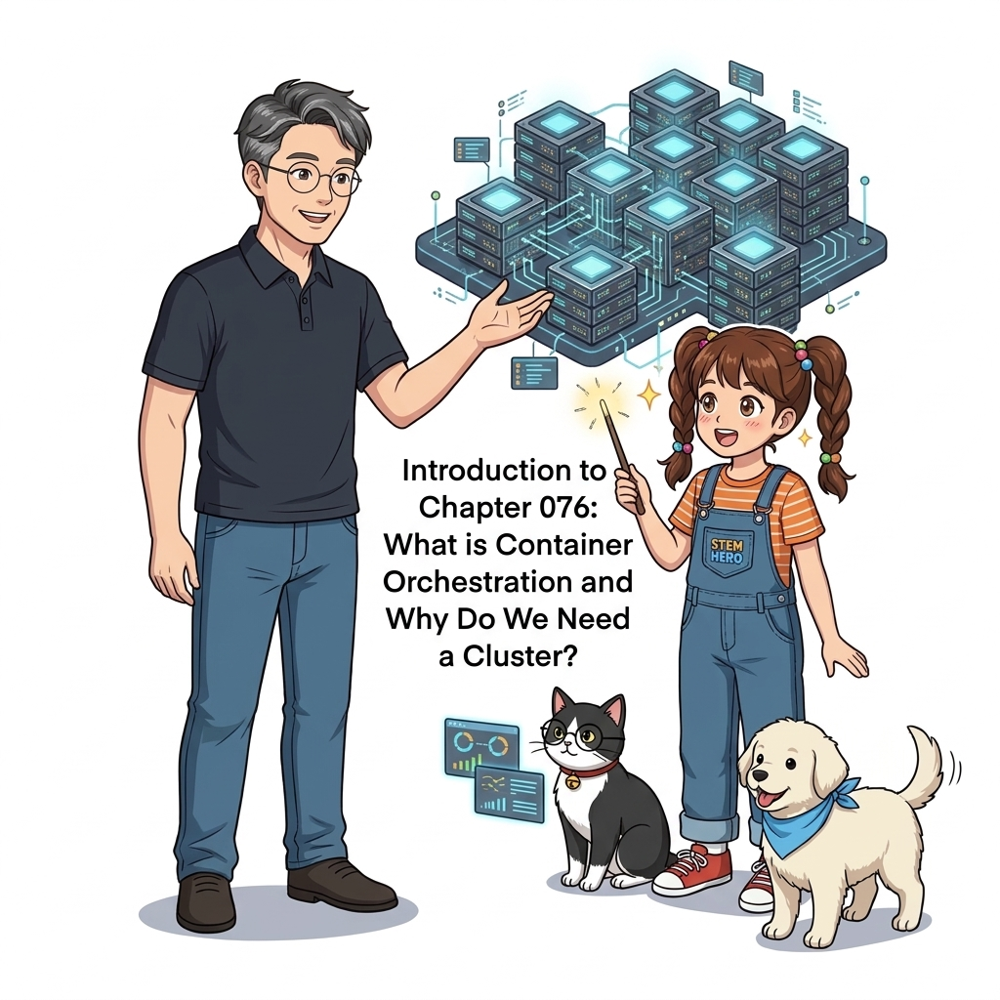
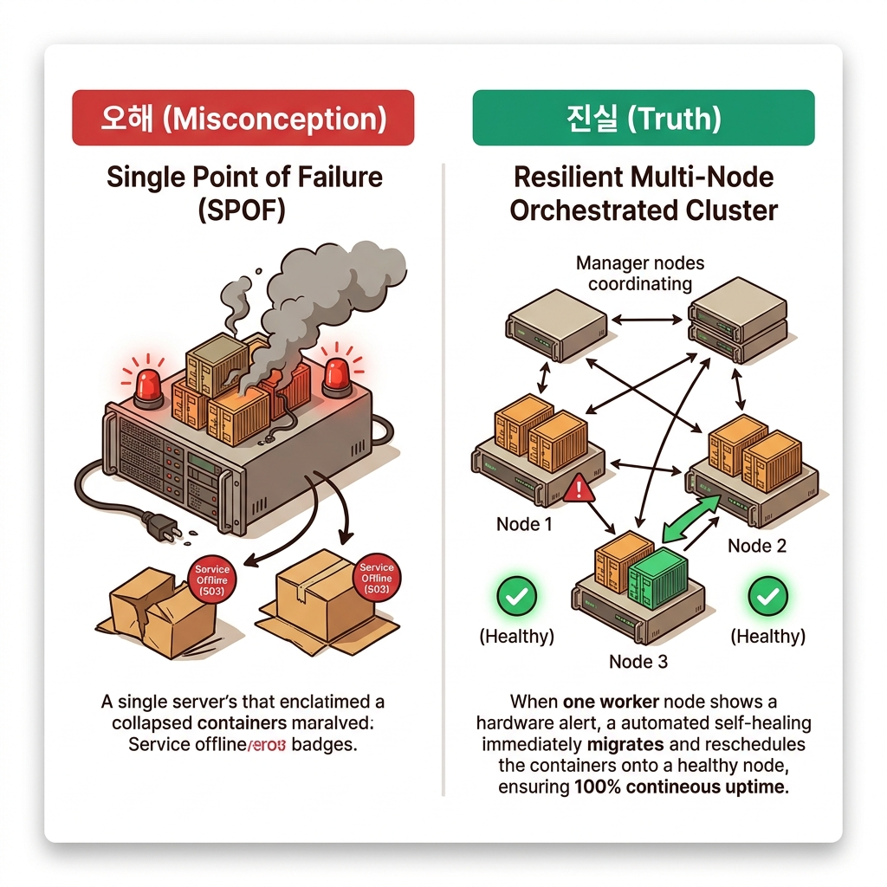
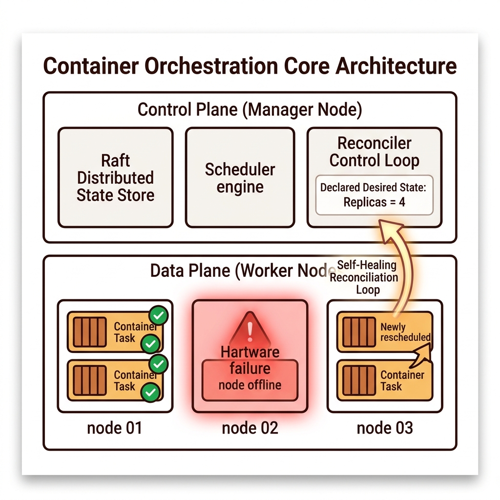
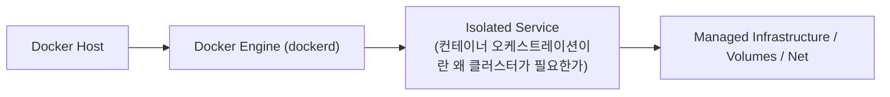
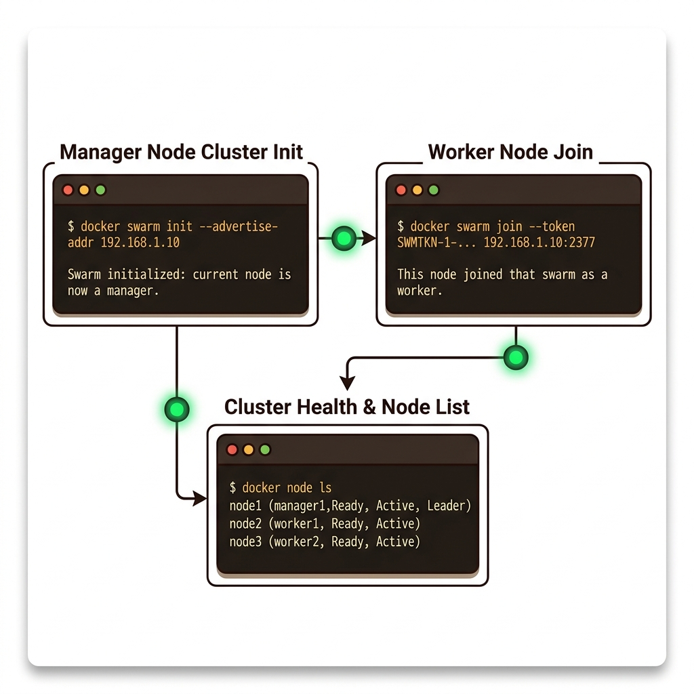

# 076. 컨테이너 오케스트레이션이란 왜 클러스터가 필요한가

단일 서버(Single Host)에서 도커 컴포즈로 컨테이너를 운영하는 방식은 해당 서버의 하드웨어나 OS에 장애가 발생하는 순간 전체 서비스가 중단(Single Point of Failure)되는 치명적 한계가 있습니다.


**그림 06-1-1** 컨테이너 오케스트레이션이란 왜 클러스터가 필요한가의 필요성과 현대 클라우드 아키텍처 관점의 개요

---

### 076.1 왜 컨테이너 오케스트레이션이란 왜 클러스터가 필요한가이(가) 필요한가? (문제 정의와 현실적 배경)

소프트웨어 시스템이 복잡해질수록 설정을 다루는 방식은 전체 인프라의 신뢰성을 결정짓는 핵심 척도가 됩니다. **컨테이너 오케스트레이션이란 왜 클러스터가 필요한가**이(가) 부재하거나 잘못 다루어질 때 현장에서는 다음과 같은 대표적인 병목과 장애가 발생합니다:

1. **하드코딩된 설정과 환경 불일치로 인한 유연성 상실**: 환경이 바뀔 때마다 코드를 다시 빌드해야 하므로 배포 주기가 지연되고 이미지 수가 기하급수적으로 폭증합니다.
2. **보안 민감 데이터의 무분별한 노출**: 비밀번호, 데이터베이스 토큰, 암호화 키가 이미지 레이어에 영구 박제되어 형상관리 시스템이나 외부에 유출될 위험이 커집니다.
3. **재현 불가능한 구성 드리프트**: 스테이징 환경과 프로덕션 환경의 미세한 설정 차이가 예기치 못한 서비스 중단 사고로 직결됩니다.


**그림 06-1-2** 컨테이너 오케스트레이션이란 왜 클러스터가 필요한가에 대한 대표적인 오해와 실제 프로덕션 현장의 엔지니어링 진실

---

### 076.2 핵심 아키텍처와 엔지니어링 메커니즘

여러 대의 물리/가상 서버들을 묶어 하나의 거대한 리소스 풀(Cluster)로 만들고, **컨테이너 배치(Scheduling), 스케일링, 로드 밸런싱, 그리고 노드 장애 시 다른 정상 노드로 컨테이너를 즉시 재실행(Self-Healing)해 주는 컨테이너 오케스트레이터(Container Orchestrator)**의 핵심 개념을 배웁니다.


**그림 06-1-3** 컨테이너 오케스트레이션이란 왜 클러스터가 필요한가의 내부 아키텍처 및 데이터 흐름

#### 📊 핵심 비교 및 엔지니어링 표준 분석

| 구분 / 핵심 원리 | 상세 설명 및 동작 메커니즘 | 실무 적용 시 주의점 및 베스트 프랙티스 |
| :--- | :--- | :--- |
| **컨트롤 플레인 (매니저 노드)** | 클러스터의 두뇌 역할! 클러스터 데이터베이스(원하는 상태)를 유지하고, 컨테이너를 어느 노드에 띄울지 스케줄링하며 상태를 24시간 감시 | 매니저 노드 자체도 3대 또는 5대로 다중화하여 매니저 1대가 죽어도 클러스터 관리가 멈추지 않음 |
| **데이터 플레인 (워커 노드)** | 클러스터의 근육 역할! 매니저가 배정한 컨테이너(태스크)를 실제로 내려받아 실행하고 상태와 헬스 체크 결과를 매니저에게 보고 | 트래픽이 늘어나면 워커 노드 서버만 클러스터에 추가(`join`)하여 무한 확장(Scale-out) 가능! |
| **선언적 상태 유지 (Control Loop)** | 사용자가 '웹 컨테이너 6개를 유지해 줘'라고 선언하면, 워커 노드 1대가 불타서 2개가 죽더라도 매니저가 즉시 남은 노드에 2개를 새로 띄워 6개를 맞춤! | 밤잠을 설치던 인프라 당직 엔지니어를 구원한 기술 |

---

### 076.3 선언적 실습 및 아키텍처 다이어그램

본 실습은 외부 비공개 패키지에 의존하지 않고, 공식 표준 이미지를 기반으로 즉시 재현 가능한 살아있는 코드로 구성되어 있습니다.

```bash
# 단일 호스트 도커 엔진과 오케스트레이션 클러스터(Swarm Mode) 상태 비교 확인
docker info --format 'Swarm Cluster State: {{.Swarm.LocalNodeState}} | Control Available: {{.Swarm.ControlAvailable}}'
```

#### 🔍 아키텍처 흐름도 (Mermaid Diagram)




**그림 06-1-4** 선언적 인프라 명세를 통한 컨테이너 오케스트레이션이란 왜 클러스터가 필요한가 검증 파이프라인

---

### 076.4 핵심 정리: 캐릭터 대화와 3대 교훈

> 👧 **도로시**: "교수님! **컨테이너 오케스트레이션이란 왜 클러스터가 필요한가**의 원리를 배우니까, 복잡하게 얽혀 있던 인프라 설정이 레고 블록처럼 질서정연하게 제자리를 찾는 게 보여요!"
> 
> 🐱 **조교 지니**: "야옹~ 맞습니다! 특히 런타임 환경과 불변 인프라의 경계를 명확히 지키는 것이 대규모 클라우드 운영의 제1원칙이랍니다!"
> 
> 🐶 **토토**: "멍멍! 선언적 코드로 한 번 적어두면 언제든 똑같이 복원되니까 정말 든든해요!"
> 
> 👨‍🏫 **이호진 교수님**: "훌륭하구나. 원리를 깊이 이해하고 실습을 통해 손에 익히는 것이 훌륭한 클라우드 엔지니어로 성장하는 가장 빠른 지름길이란다."


**그림 06-1-5** 컨테이너 오케스트레이션이란 왜 클러스터가 필요한가 마스터를 위한 3대 핵심 교훈

1. **설정과 실행의 명확한 분리**:
   * 애플리케이션 코드는 불변으로 유지하고, 가변적인 설정값은 외부에서 주입하여 이식성을 극대화합니다.
2. **선언적 재현성 확보**:
   * 사람이 수작업으로 변경하지 않고 코드 명세를 통해 언제 어디서나 100% 동일한 실행 결과를 보장합니다.
3. **최소 권한 및 보안 모범 사례 준수**:
   * 불필요한 권한과 포트 노출을 최소화하고 민감 데이터를 암호화하여 프로덕션 안정성을 담보합니다.

---

### 076.5 랩노트 피날레와 다음 강의 예고


**그림 06-1-6** 연구실에서 다음 마일스톤인 [도커스웜 클러스터구축 매니저노드와 워커노드] 실습을 예고하는 교수님과 토토

> 💡 **다음 강의 안내**:
> [도커스웜 클러스터구축 매니저노드와 워커노드](../077_도커스웜_클러스터구축_매니저노드와_워커노드/)에서는 더욱 심화된 실전 엔지니어링 실습과 아키텍처를 다룹니다!

---

## 🧭 강의 네비게이션
* [◀️ 이전 강의: 075_Part05_실전미션_Git푸시로_동작하는_완전자동화_CI파이프라인구축](/Part05_다중환경설계와_컨테이너기반_CICD파이프라인/075_Part05_실전미션_Git푸시로_동작하는_완전자동화_CI파이프라인구축/)
* [📋 Part 06. 컨테이너 오케스트레이션: 도커 스웜(Swarm) 클러스터, 스택 배포, 무중단 롤링 업데이트 & 쿠버네티스 (076 ~ 095) 목차로 돌아가기](../)
* [▶️ 다음 강의: 077_도커스웜_클러스터구축_매니저노드와_워커노드](../077_도커스웜_클러스터구축_매니저노드와_워커노드/)
