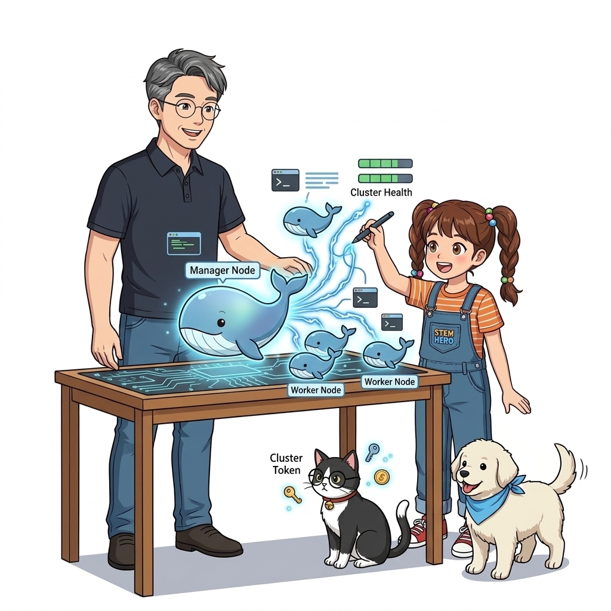
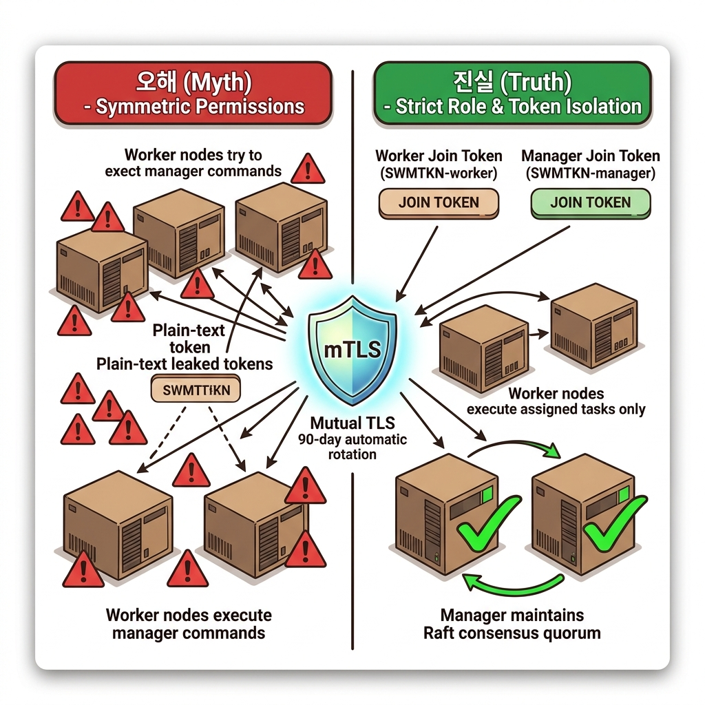
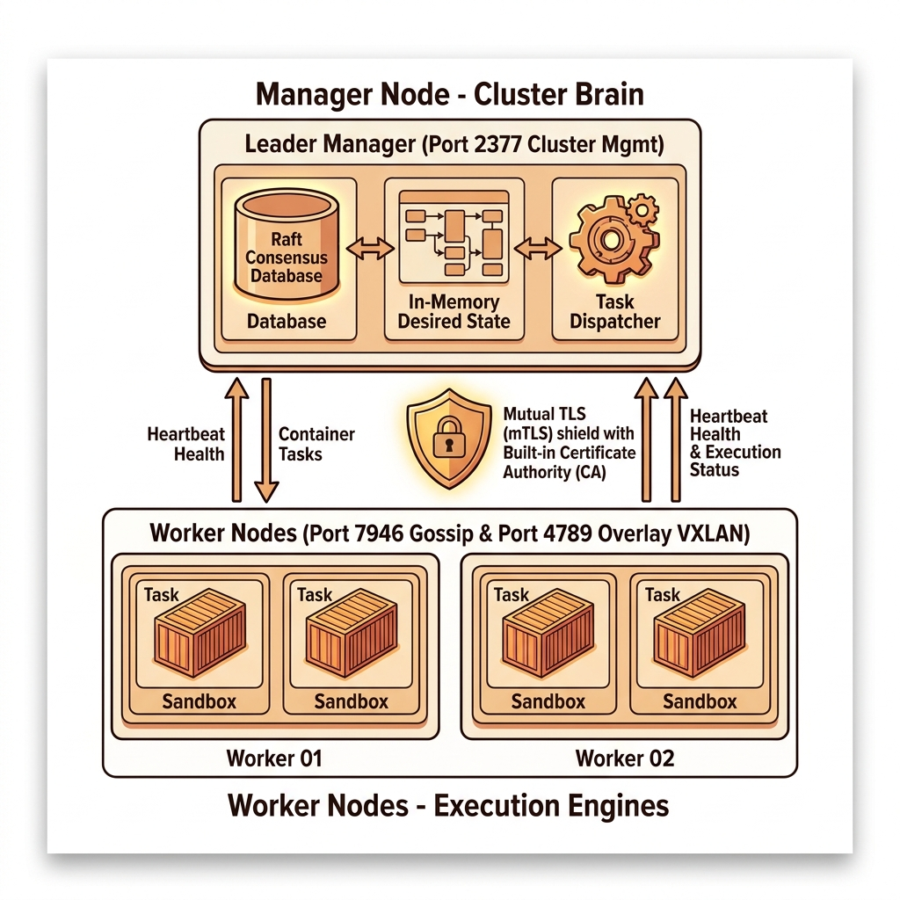
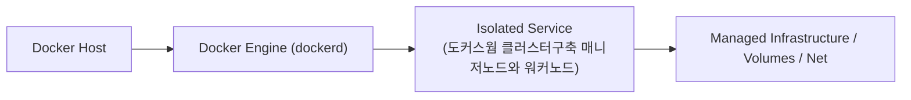
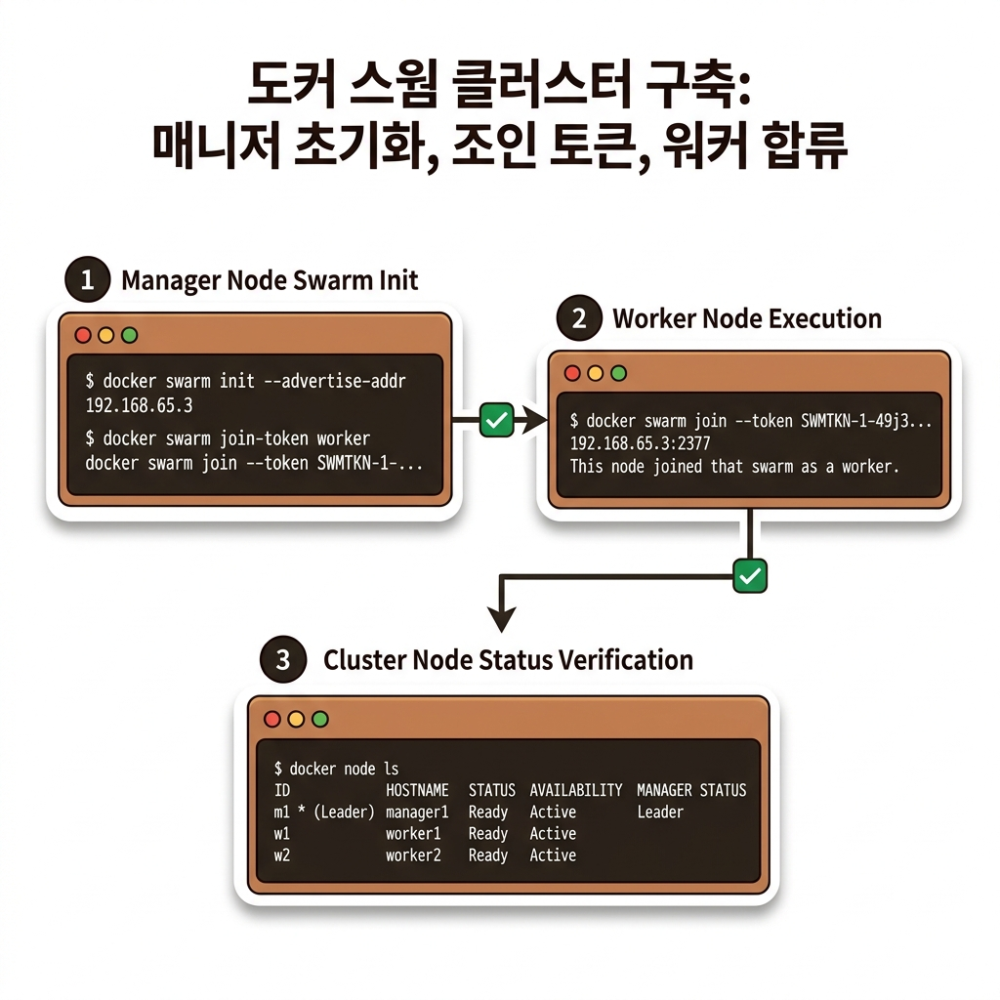
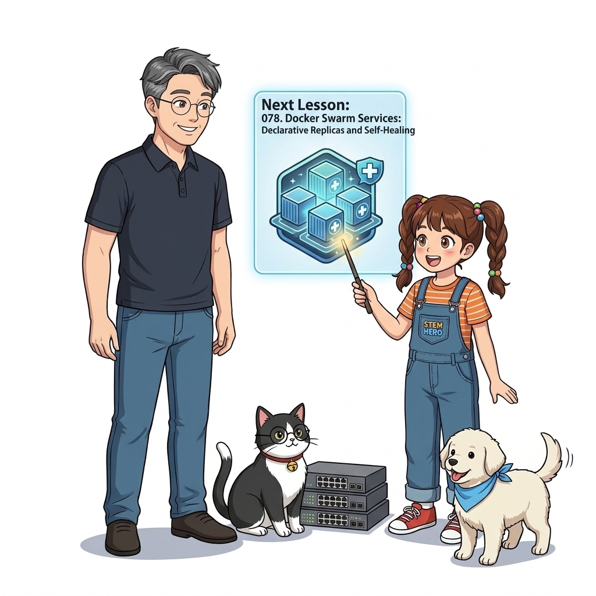
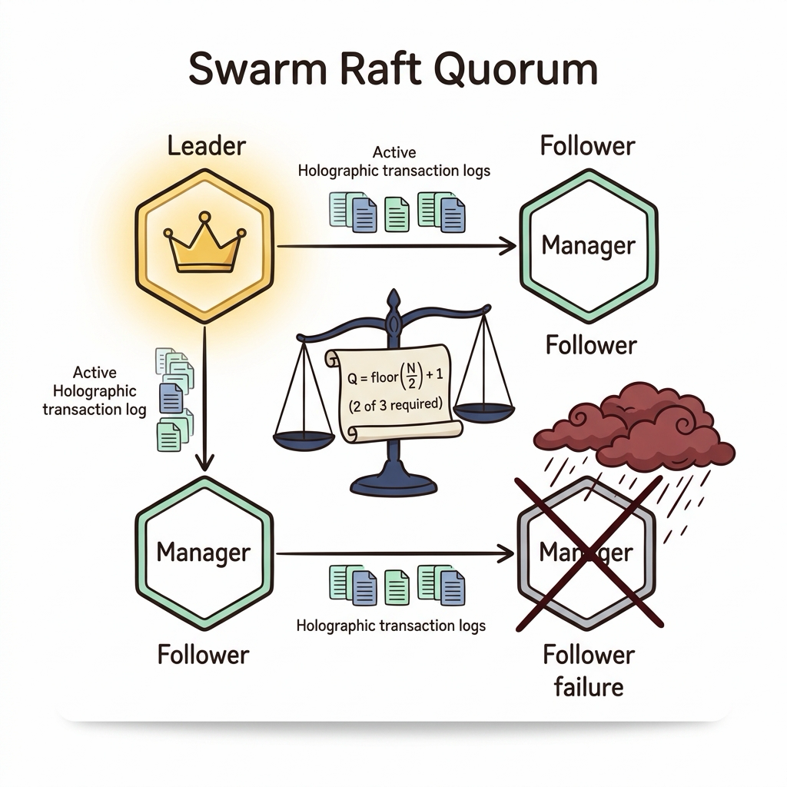

# 077. 도커스웜 클러스터구축 매니저노드와 워커노드

도커 엔진에는 처음부터 강력한 컨테이너 오케스트레이션 기능인 **도커 스웜 모드(Docker Swarm Mode)**가 기본 내장되어 있습니다.


**그림 06-2-1** 도커스웜 클러스터구축 매니저노드와 워커노드의 필요성과 현대 클라우드 아키텍처 관점의 개요

---

### 077.1 왜 도커스웜 클러스터구축 매니저노드와 워커노드이(가) 필요한가? (문제 정의와 현실적 배경)

소프트웨어 시스템이 복잡해질수록 설정을 다루는 방식은 전체 인프라의 신뢰성을 결정짓는 핵심 척도가 됩니다. **도커스웜 클러스터구축 매니저노드와 워커노드**이(가) 부재하거나 잘못 다루어질 때 현장에서는 다음과 같은 대표적인 병목과 장애가 발생합니다:

1. **하드코딩된 설정과 환경 불일치로 인한 유연성 상실**: 환경이 바뀔 때마다 코드를 다시 빌드해야 하므로 배포 주기가 지연되고 이미지 수가 기하급수적으로 폭증합니다.
2. **보안 민감 데이터의 무분별한 노출**: 비밀번호, 데이터베이스 토큰, 암호화 키가 이미지 레이어에 영구 박제되어 형상관리 시스템이나 외부에 유출될 위험이 커집니다.
3. **재현 불가능한 구성 드리프트**: 스테이징 환경과 프로덕션 환경의 미세한 설정 차이가 예기치 못한 서비스 중단 사고로 직결됩니다.


**그림 06-2-2** 도커스웜 클러스터구축 매니저노드와 워커노드에 대한 대표적인 오해와 실제 프로덕션 현장의 엔지니어링 진실

---

### 077.2 핵심 아키텍처와 엔지니어링 메커니즘

`docker swarm init`으로 첫 번째 매니저 노드를 초기화하고, 발급된 보안 조인 토큰(`docker swarm join-token worker/manager`)으로 새 노드들을 클러스터에 합류시키며, `docker node ls`와 `inspect`로 클러스터 노드를 관리하는 방법을 실습합니다!


**그림 06-2-3** 도커스웜 클러스터구축 매니저노드와 워커노드의 내부 아키텍처 및 데이터 흐름

#### 📊 핵심 비교 및 엔지니어링 표준 분석

| 구분 / 핵심 원리 | 상세 설명 및 동작 메커니즘 | 실무 적용 시 주의점 및 베스트 프랙티스 |
| :--- | :--- | :--- |
| **`docker swarm init`** | 현재 도커 엔진을 스웜 클러스터의 리더 매니저 노드로 전환하고 내부 암호화(mTLS) 통신 및 Raft 합의 저장소를 자동 생성 | 여러 개의 네트워크 카드가 있는 서버에서는 `--advertise-addr <IP주소>`로 클러스터 통신 IP를 지정 |
| **`docker swarm join-token`** | 외부 아무 서버나 클러스터에 침투하지 못하도록 암호화된 워커용(`worker`) 및 매니저용(`manager`) 가입 토큰과 명령어를 출력 | 출력된 `docker swarm join --token SWMTKN-1-... <매니저IP>:2377`을 다른 서버에 붙여넣기만 하면 1초 만에 클러스터 합류 완료! |
| **단일 노드 스웜도 강력하다!** | 서버가 1대뿐인 환경에서도 스웜 모드를 켜면 매니저가 곧 워커 역할을 겸하며 **무중단 롤링 업데이트, 자동 롤백, 암호화 시크릿, 자가 치유 서비스**를 모두 쓸 수 있음! | 내 노트북 Docker Desktop에서 모든 스웜 기능을 완벽히 실습할 수 있는 이유 |

---

### 077.3 선언적 실습 및 아키텍처 다이어그램

본 실습은 외부 비공개 패키지에 의존하지 않고, 공식 표준 이미지를 기반으로 즉시 재현 가능한 살아있는 코드로 구성되어 있습니다.

```bash
# 도커 스웜 클러스터 초기화, 워커 조인 토큰 확인 및 노드 목록 조회 (단일 노드 실습 환경에서도 100% 동작!)
docker swarm init 2>/dev/null || true
docker node ls
docker swarm join-token worker | grep "docker swarm join" | head -c 60 && echo "..." 
```

#### 🔍 아키텍처 흐름도 (Mermaid Diagram)




**그림 06-2-4** 선언적 인프라 명세를 통한 도커스웜 클러스터구축 매니저노드와 워커노드 검증 파이프라인

---

<!-- BIBLE_INTEGRATION_book9_swarmkit_raft_consensus -->
---

### 077.B 📚 도커 바이블 심화: SwarmKit Raft 분산 합의 알고리즘: 홀수 매니저 노드 쿼럼(Quorum)과 Split-Brain 방지
*출처 도서: 『시작하세요! 도커/쿠버네티스』 핵심 분석*

도커 스웜(SwarmKit)의 클러스터 제어평면은 별도의 외부 데이터베이스(etcd나 Consul) 없이도 자체적으로 완벽한 고가용성(HA)을 보장합니다. 그 심장에는 분산 시스템의 황금 표준인 **Raft 컨센서스 알고리즘**이 탑재되어 있습니다.

#### Raft 합의 알고리즘과 쿼럼(Quorum)의 수학적 원리:
1. **과반수 쿼럼 공식**:
   * 클러스터가 정상적으로 새로운 서비스를 생성하거나 노드 상태를 변경하려면 항상 **과반수(Quorum)**의 동의가 필요합니다.
   * 쿼럼 계산식: $$Q = \lfloor \frac{N}{2} \rfloor + 1$$
   * 매니저가 3대일 때: 쿼럼은 2대 (최대 1대 장애 허용)
   * 매니저가 5대일 때: 쿼럼은 3대 (최대 2대 장애 허용)
2. **왜 매니저는 반드시 홀수(3, 5, 7)여야 하는가?**:
   * 매니저가 4대일 때의 쿼럼은 3대입니다. 2대가 죽으면 남은 2대는 과반수(3)에 미달하여 클러스터가 멈춥니다. 즉, 4대는 3대와 똑같이 '1대 장애'만 허용하면서 통신 비용만 늘어납니다.
3. **스플릿 브레인(Split-Brain) 방지**:
   * 네트워크 단절로 클러스터가 2개로 쪼개졌을 때, 과반수를 확보하지 못한 소수파 진영은 즉시 쓰기 작업을 거부하여 양쪽이 서로 다른 상태로 갈라지는 데이터 오염을 원천 차단합니다.


**그림 077-B-1** 3대의 스웜 매니저 노드가 Raft 분산 합의로 단 하나의 리더를 선출하고 쿼럼을 유지하는 모습

```bash
# [실습] 도커 스웜 매니저 상태 및 Raft 리더십 확인
# 현재 스웜 클러스터의 매니저 노드 및 Raft Leader 상태 확인
docker node ls --filter "role=manager"

# 매니저 노드 장애 시 쿼럼 상태 확인
# docker node inspect <node-id> --format '{{.ManagerStatus.Leader}}'
```

> 👨‍🏫 **이호진 교수님의 바이블 멘토링 노트**:
> "분산 시스템에서 가장 무서운 것은 서버가 꺼지는 것이 아니라, 네트워크가 잠깐 끊겼을 때 양쪽이 서로 자기가 진짜 리더라고 주장하며 데이터를 제각각 덮어쓰는 스플릿 브레인 현상입니다. Raft 쿼럼은 이를 방지하는 가장 완벽한 수학적 방패입니다."
>
> 👧 **도로시의 깨달음**:
> "투표할 때 짝수로 하면 2대 2 동점이 나서 결정이 안 되니까, 항상 홀수로 모여서 과반수 다수결로 결정을 내리는 거군요!"
>
> 🐱 **조교 지니의 아키텍처 체크포인트**:
> "스웜 매니저가 쿼럼을 잃더라도 이미 돌고 있던 워커 노드의 컨테이너들은 죽지 않고 정상 서비스됩니다. 다만 새 서비스를 띄우거나 노드를 교체하는 제어 명령만 일시 정지될 뿐이랍니다."


### 077.4 핵심 정리: 캐릭터 대화와 3대 교훈

> 👧 **도로시**: "교수님! **도커스웜 클러스터구축 매니저노드와 워커노드**의 원리를 배우니까, 복잡하게 얽혀 있던 인프라 설정이 레고 블록처럼 질서정연하게 제자리를 찾는 게 보여요!"
> 
> 🐱 **조교 지니**: "야옹~ 맞습니다! 특히 런타임 환경과 불변 인프라의 경계를 명확히 지키는 것이 대규모 클라우드 운영의 제1원칙이랍니다!"
> 
> 🐶 **토토**: "멍멍! 선언적 코드로 한 번 적어두면 언제든 똑같이 복원되니까 정말 든든해요!"
> 
> 👨‍🏫 **이호진 교수님**: "훌륭하구나. 원리를 깊이 이해하고 실습을 통해 손에 익히는 것이 훌륭한 클라우드 엔지니어로 성장하는 가장 빠른 지름길이란다."


**그림 06-2-5** 도커스웜 클러스터구축 매니저노드와 워커노드 마스터를 위한 3대 핵심 교훈

1. **설정과 실행의 명확한 분리**:
   * 애플리케이션 코드는 불변으로 유지하고, 가변적인 설정값은 외부에서 주입하여 이식성을 극대화합니다.
2. **선언적 재현성 확보**:
   * 사람이 수작업으로 변경하지 않고 코드 명세를 통해 언제 어디서나 100% 동일한 실행 결과를 보장합니다.
3. **최소 권한 및 보안 모범 사례 준수**:
   * 불필요한 권한과 포트 노출을 최소화하고 민감 데이터를 암호화하여 프로덕션 안정성을 담보합니다.

---

### 077.5 랩노트 피날레와 다음 강의 예고


**그림 06-2-6** 연구실에서 다음 마일스톤인 [도커스웜 서비스생성 선언적레플리카와 자동자가치유] 실습을 예고하는 교수님과 토토

> 💡 **다음 강의 안내**:
> [도커스웜 서비스생성 선언적레플리카와 자동자가치유](../078_도커스웜_서비스생성_선언적레플리카와_자동자가치유/)에서는 더욱 심화된 실전 엔지니어링 실습과 아키텍처를 다룹니다!

---

## 🧭 강의 네비게이션
* [◀️ 이전 강의: 076_컨테이너_오케스트레이션이란_왜_클러스터가_필요한가](../076_컨테이너_오케스트레이션이란_왜_클러스터가_필요한가/)
* [📋 Part 06. 컨테이너 오케스트레이션: 도커 스웜(Swarm) 클러스터, 스택 배포, 무중단 롤링 업데이트 & 쿠버네티스 (076 ~ 095) 목차로 돌아가기](../)
* [▶️ 다음 강의: 078_도커스웜_서비스생성_선언적레플리카와_자동자가치유](../078_도커스웜_서비스생성_선언적레플리카와_자동자가치유/)


<!-- BIBLE_INTEGRATION_book9_deep_077 -->
---

### 077.C 📚 도커 바이블 심화: SwarmKit의 심장 Raft 합의 알고리즘과 매니저 쿼럼(Quorum) 수식 계산
> **출처 및 학술적 배경**: 시작하세요! 도커/쿠버네티스 제3장 (도커 스웜)  
> **핵심 주제**: 대규모 클러스터 오케스트레이션, 분산 합의 알고리즘(Raft), 오버레이 네트워킹 및 프로덕션 데몬 튜닝을 심층 학습합니다.

#### 1. 아키텍처 및 내부 메커니즘 분석
도커 스웜 클러스터의 두뇌인 매니저 노드들은 분산 상태를 완벽히 일치시키고 리더 장애 시 즉각 복구하기 위해 **Raft Consensus 알고리즘**을 사용합니다.

#### Raft 합의 알고리즘과 과반수 쿼럼 원리:
1. **스플릿 브레인(Split-Brain) 방지**:
   * 네트워크 장애로 클러스터가 두 개로 쪼개졌을 때 양쪽에서 서로 다른 결정을 내리는 데이터 오염을 막기 위해 반드시 과반수의 동의를 얻어야 합니다.
2. **과반수 쿼럼(Quorum) 수식**:
   $$\text{Quorum} = \lfloor N / 2 \rfloor + 1$$
   * **3대 매니저**: 쿼럼은 2대이며, 허용 가능한 최대 장애 노드는 $3 - 2 = 1$대입니다.
   * **5대 매니저**: 쿼럼은 3대이며, 허용 가능한 최대 장애 노드는 $5 - 3 = 2$대입니다.
   * **짝수(4대) 매니저의 위험성**: 쿼럼은 3대이며 허용 장애 노드는 여전히 1대이므로, 3대와 비교해 내결함성은 늘지 않고 통신 오버헤드만 증가하므로 **매니저는 반드시 홀수(3, 5, 7)로 구성**해야 합니다.
3. **스웜 클러스터 필수 방화벽 포트 3선**:
   * `2377/tcp`: 클러스터 관리 및 Raft 상태 복제 통신
   * `7946/tcp,udp`: 노드 간 노드 검색 및 상태 전파 (Gossip 프로토콜)
   * `4789/udp`: 오버레이 네트워크 데이터 트래픽 (VXLAN 데이터 플레인)



#### 2. 엔터프라이즈 실전 검증 실습
```bash
# [실습] 고가용성 도커 스웜 매니저 클러스터 구축
# 1. 첫 번째 매니저 노드 초기화 및 수신 IP 지정
docker swarm init --advertise-addr 192.168.1.10

# 2. 고가용성(HA)을 위한 추가 매니저 노드 조인 토큰 확인
docker swarm join-token manager

# 3. 매니저 클러스터의 노드 상태, 가용성, 리더 확인
docker node ls
```

#### 3. 프로덕션 운영을 위한 핵심 멘토링
> 👨‍🏫 **이호진 교수님의 심화 지도**:
> "프로덕션 스웜 클러스터는 반드시 3대 또는 5대의 홀수 매니저 노드를 서로 다른 가용 영역(AZ)에 분산 배치해야 고가용성이 보장됩니다."
>
> 👧 **도로시의 깨달음**:
> "3총사 중에서 1명이 감기에 걸려 누워도 2명이 손을 맞잡고 투표(과반수)할 수 있으니까 모험이 중단되지 않는 거군요!"
>
> 🐱 **조교 지니의 프로덕션 체크리스트**:
> * 워커 노드는 Raft 쿼럼에 참여하지 않으므로 수십, 수백 대로 유연하게 스케일 아웃할 수 있습니다.
