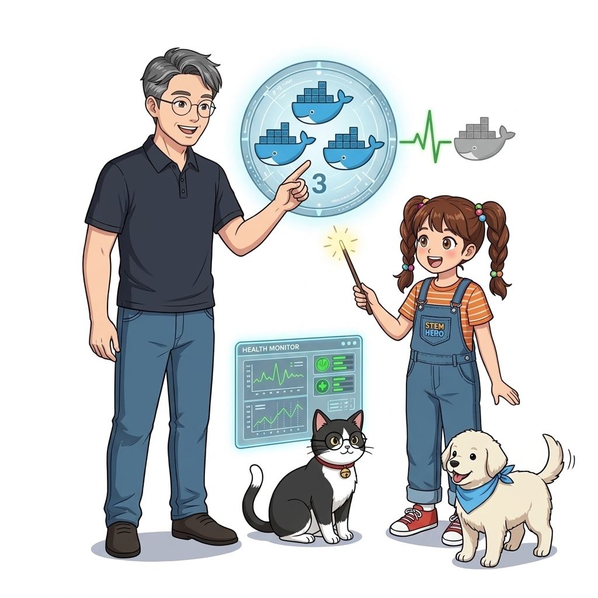
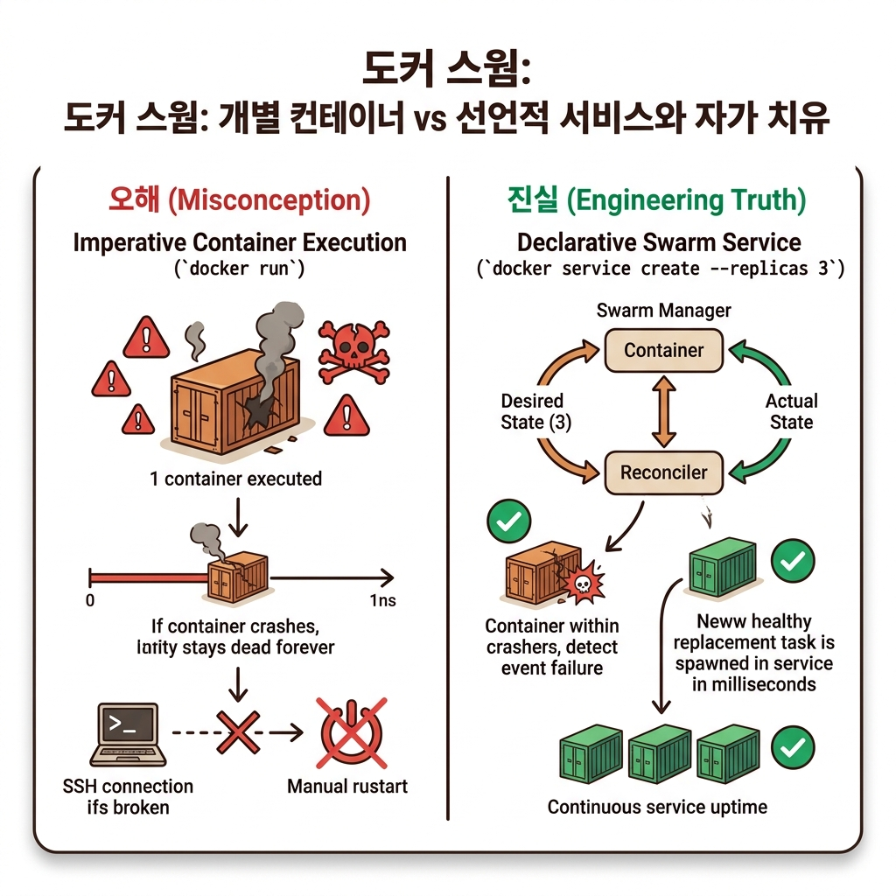
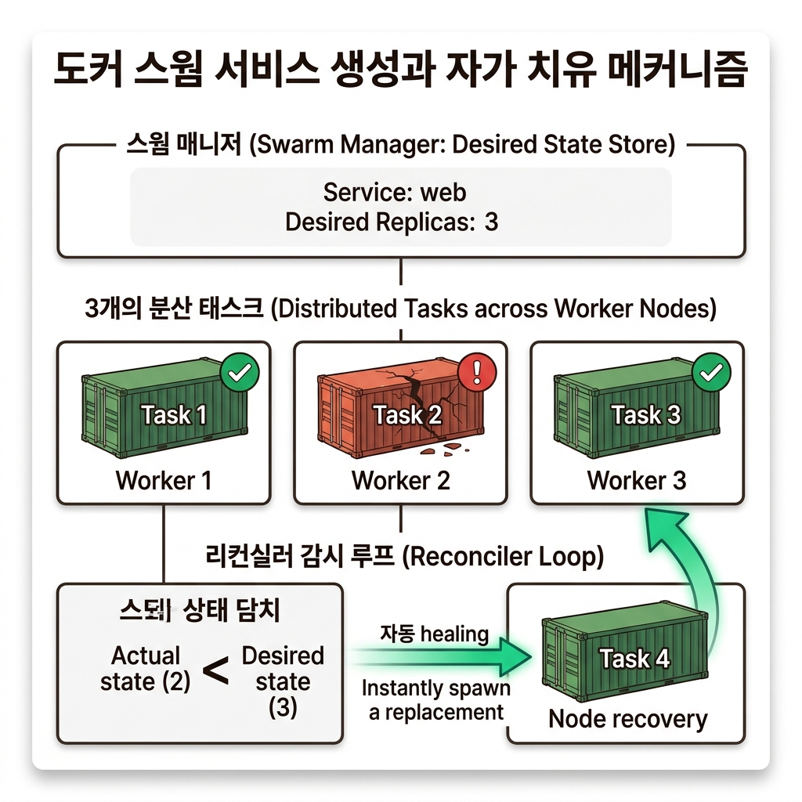
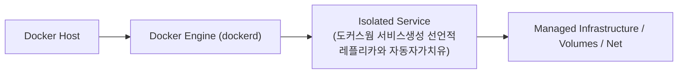
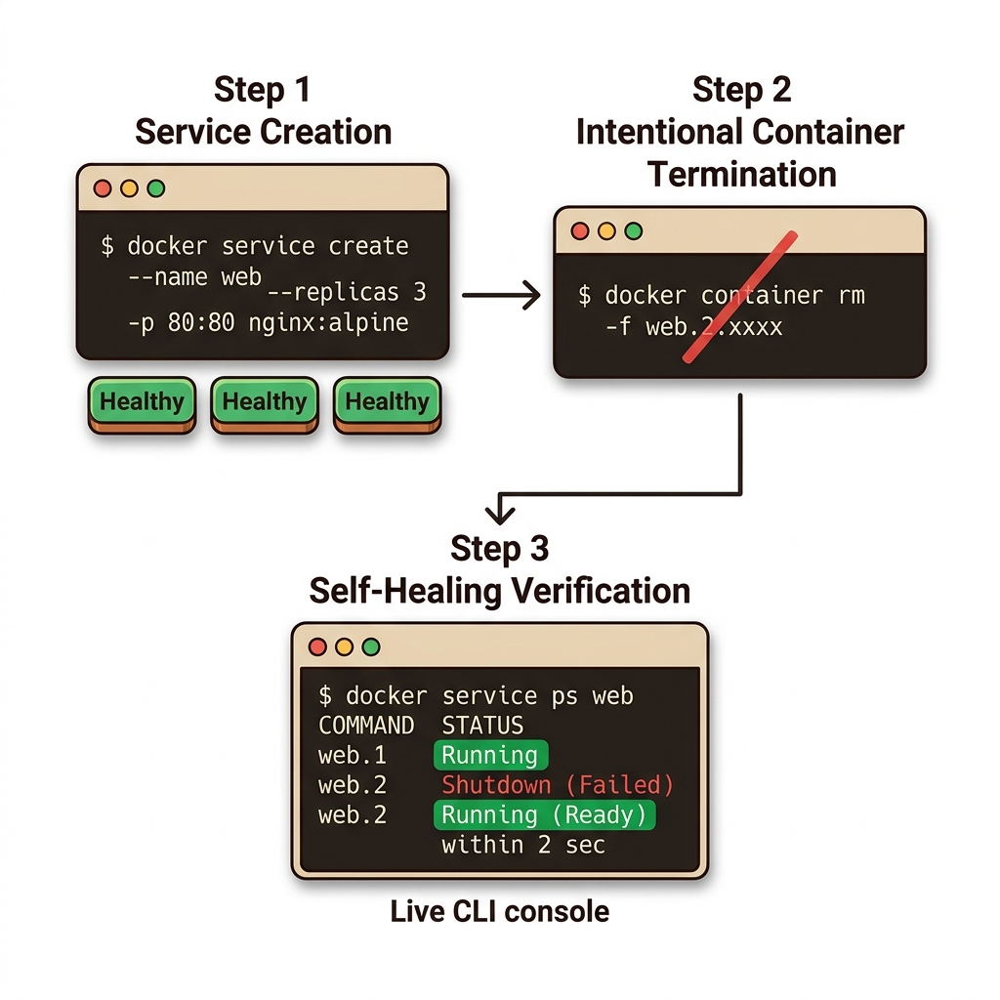
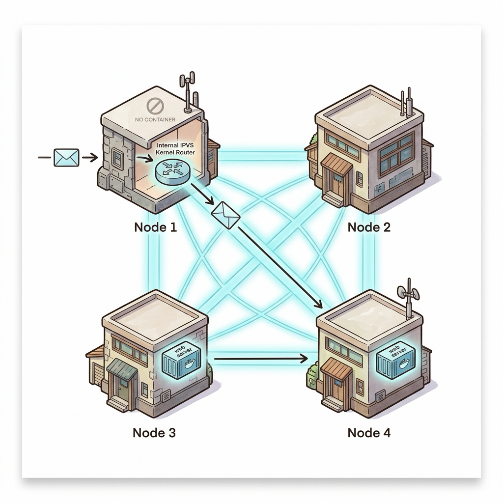
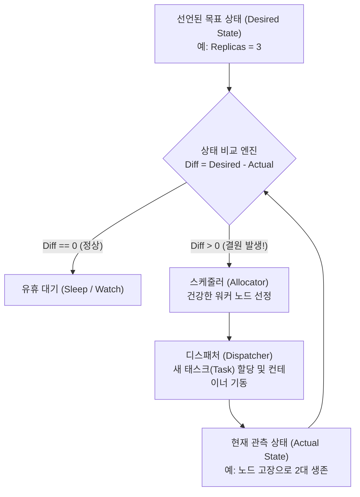

# 078. 도커스웜 서비스생성 선언적레플리카와 자동자가치유

스웜 클러스터에서는 개별 컨테이너(`docker container run`)를 직접 띄우지 않고, 클러스터가 관리하는 단위인 **서비스(`docker service create`)**를 생성합니다.


**그림 06-3-1** 도커스웜 서비스생성 선언적레플리카와 자동자가치유의 필요성과 현대 클라우드 아키텍처 관점의 개요

---

### 078.1 왜 도커스웜 서비스생성 선언적레플리카와 자동자가치유이(가) 필요한가? (문제 정의와 현실적 배경)

소프트웨어 시스템이 복잡해질수록 설정을 다루는 방식은 전체 인프라의 신뢰성을 결정짓는 핵심 척도가 됩니다. **도커스웜 서비스생성 선언적레플리카와 자동자가치유**이(가) 부재하거나 잘못 다루어질 때 현장에서는 다음과 같은 대표적인 병목과 장애가 발생합니다:

1. **하드코딩된 설정과 환경 불일치로 인한 유연성 상실**: 환경이 바뀔 때마다 코드를 다시 빌드해야 하므로 배포 주기가 지연되고 이미지 수가 기하급수적으로 폭증합니다.
2. **보안 민감 데이터의 무분별한 노출**: 비밀번호, 데이터베이스 토큰, 암호화 키가 이미지 레이어에 영구 박제되어 형상관리 시스템이나 외부에 유출될 위험이 커집니다.
3. **재현 불가능한 구성 드리프트**: 스테이징 환경과 프로덕션 환경의 미세한 설정 차이가 예기치 못한 서비스 중단 사고로 직결됩니다.


**그림 06-3-2** 도커스웜 서비스생성 선언적레플리카와 자동자가치유에 대한 대표적인 오해와 실제 프로덕션 현장의 엔지니어링 진실

---

### 078.2 핵심 아키텍처와 엔지니어링 메커니즘

레플리카(`--replicas 3`)를 지정해 서비스를 배포하고, `docker service ps`로 태스크 목록을 확인한 뒤, **고의로 컨테이너 하나를 삭제했을 때 스웜 매니저가 즉시 결원을 감지하고 새로운 컨테이너를 자동 생성해 개수(3개)를 복구하는 자가 치유(Self-Healing)** 과정을 눈으로 확인합니다!


**그림 06-3-3** 도커스웜 서비스생성 선언적레플리카와 자동자가치유의 내부 아키텍처 및 데이터 흐름

#### 📊 핵심 비교 및 엔지니어링 표준 분석

| 구분 / 핵심 원리 | 상세 설명 및 동작 메커니즘 | 실무 적용 시 주의점 및 베스트 프랙티스 |
| :--- | :--- | :--- |
| **서비스(Service) vs 태스크(Task)** | 서비스는 '어떤 이미지를 몇 개 실행할지'에 대한 클러스터 선언 명세 / 태스크(Task)는 그 서비스를 위해 각 노드에 할당된 개별 컨테이너 실행 슬롯 | `docker service ls`는 전체 서비스 요약(`2/2 replicas`)을, `docker service ps <서비스명>`은 개별 레플리카 상태와 이력을 표시 |
| **즉각적인 자가 치유 (Self-Healing)** | 컨테이너 프로세스가 크래시되거나 누군가 실수로 `docker rm -f`를 쳐도, 스웜 컨트롤 루프가 목표 개수(`2개`)와 현재 개수(`1개`)의 차이를 감지해 1초 안에 새 컨테이너를 생성! | `docker service logs`를 쓰면 모든 레플리카 컨테이너들의 로그를 한꺼번에 모아서 확인 가능 |
| **`docker service scale`과 `update`** | `docker service scale oz-ha-web=5`로 즉시 확장하거나, `docker service update --image ...`로 무중단 이미지 교체 및 `--rollback` 지원 | 단일 명령어로 수십 개의 컨테이너를 지휘하는 오케스트레이션의 위력 |

---

### 078.3 선언적 실습 및 아키텍처 다이어그램

본 실습은 외부 비공개 패키지에 의존하지 않고, 공식 표준 이미지를 기반으로 즉시 재현 가능한 살아있는 코드로 구성되어 있습니다.

```bash
# 레플리카 2개인 스웜 서비스를 만들고, 강제로 컨테이너 1개를 삭제해 스웜이 즉시 자동 복구하는지 실험!
docker swarm init 2>/dev/null || true
docker service create --name oz-ha-web --replicas 2 -p 8093:80 nginx:1.27-alpine
docker service ps oz-ha-web

# 실행 중인 레플리카 컨테이너 1개를 강제로 삭제(장애 유발)!
TARGET_CID=$(docker container ls --filter "name=oz-ha-web" -q | head -n 1)
docker container rm -f $TARGET_CID

# 2초 후 스웜이 죽은 태스크(Shutdown/Failed)를 대신해 새 컨테이너(Running)를 즉시 띄웠는지 확인!
sleep 2
docker service ps oz-ha-web
docker service rm oz-ha-web
```

#### 🔍 아키텍처 흐름도 (Mermaid Diagram)




**그림 06-3-4** 선언적 인프라 명세를 통한 도커스웜 서비스생성 선언적레플리카와 자동자가치유 검증 파이프라인

---

<!-- BIBLE_INTEGRATION_book9_ingress_routing_mesh_ipvs -->
---

### 078.B 📚 도커 바이블 심화: 도커 스웜 인그레스 라우팅 메시(Ingress Routing Mesh)와 IPVS 커널 로드밸런싱
*출처 도서: 『시작하세요! 도커/쿠버네티스』 핵심 분석*

도커 스웜의 가장 경이로운 기능 중 하나는 바로 **인그레스 라우팅 메시(Ingress Routing Mesh)**입니다.

* **동작 원리**:
  * 10대의 노드로 구성된 스웜 클러스터에 웹 서비스 컨테이너를 단 2개만 띄웠다고 가정해 봅시다.
  * 외부 사용자가 컨테이너가 전혀 돌고 있지 않은 7번째 노드의 공인 IP(`노드7_IP:8080`)로 접속하더라도, 웹페이지가 정상적으로 열립니다!
* **내부 아키텍처 (IPVS & 오버레이 네트워크)**:
  * 스웜은 클러스터 초기화 시 내부적으로 `ingress`라는 특수한 오버레이 네트워크를 자동 생성합니다.
  * 모든 스웜 노드는 공개된 포트(8080)로 패킷이 들어오면, 리눅스 커널의 고속 **IPVS(IP Virtual Server)** 모듈을 호출하여 실제로 해당 컨테이너가 실행 중인 다른 노드로 패킷을 VXLAN 터널을 통해 투명하게 라우팅해 줍니다.
  * 외부 L4 로드밸런서(AWS NLB 등)는 클러스터 내 임의의 노드 IP만 바라보고 있으면 되므로 인프라 구성이 극도로 단순해집니다.


**그림 078-B-1** 컨테이너가 없는 노드로 들어온 요청도 IPVS 오버레이 그물망을 타고 실제 컨테이너로 전달되는 도식

```bash
# [실습] 인그레스 라우팅 메시 동작 검증
# 1. 2개의 레플리카를 갖는 Nginx 서비스 생성 (포트 8080 개방)
docker service create --name mesh-web --replicas 2 -p 8080:80 nginx:alpine

# 2. 서비스가 어느 노드에 배치되었는지 확인
docker service ps mesh-web

# 3. 컨테이너가 없는 노드를 포함하여 클러스터 내 모든 노드의 8080 포트로 curl 접속 테스트
# curl http://localhost:8080
```

> 👨‍🏫 **이호진 교수님의 바이블 멘토링 노트**:
> "인그레스 라우팅 메시는 도커 스웜의 백미입니다. 어떤 노드의 문을 두드려도 클러스터 내부의 그물망(Mesh)이 알아서 컨테이너를 찾아 손님을 모셔다 줍니다. 쿠버네티스의 NodePort 서비스와 완벽히 동일한 원리입니다."
>
> 👧 **도로시의 깨달음**:
> "은행의 1번 창구에 갔는데 담당 직원이 없어도, 1번 창구 직원분이 지하 비밀 통로(오버레이)를 통해 3번 창구의 담당자에게 서류를 바로 넘겨주는 것과 같네요!"
>
> 🐱 **조교 지니의 아키텍처 체크포인트**:
> "IPVS는 커널 레벨에서 L4 로드밸런싱을 수행하므로 사용자 영역 프록시(userland proxy)에 비해 CPU 오버헤드가 거의 없고 초당 수십만 개의 패킷을 거뜬히 처리합니다."

---

### 078.C 📚 도커 바이블 심화: 스웜 매니저 상태 수렴 루프(Reconciliation Loop)와 모니터링 데몬 전용 Global 서비스 모드

> 📖 **참고 도서 심층 연계**:
> * 《시작하세요! 도커/쿠버네티스》 제3장 (스웜킷 상태 전이 엔진과 서비스 태스크 스케줄러)
> * 《도커 교과서》 제13장 (오케스트레이터의 지속적 상태 감시와 데몬 서비스 배포)

도커 스웜이 제공하는 자가 치유(Self-Healing)의 본질은 쿠버네티스의 컨트롤러 루프와 완전히 일치하는 **상태 수렴 루프(Reconciliation Loop, 조정 루프)**입니다.

#### 1. 스웜 매니저의 목표 상태(Desired) vs 관측 상태(Actual) 수렴 메커니즘

스웜 매니저 내부의 스웜킷(SwarmKit) 엔진은 지속적으로 다음 루프를 수 밀리초 단위로 실행합니다:



* **스케줄링 전략**: 결원이 감지되면 매니저는 노드의 가용 메모리, CPU, 현재 실행 중인 태스크 수를 계산하여 가장 여유가 있는 최적의 워커 노드에 새 태스크를 자동 배치합니다.

#### 2. Replicated 모드 vs Global 모드 심층 비교

| 서비스 모드 | 동작 방식 | 신규 노드 추가 시 동작 | 대표 활용 사례 |
| :--- | :--- | :--- | :--- |
| **`--mode replicated` (기본값)** | 지정한 개수(`--replicas N`)만큼의 태스크를 클러스터 노드들에 분산 배치 | 전체 레플리카 수는 유지되며, 필요 시 수동/오토스케일링으로 개수 조절 | 웹 서버, API 게이트웨이, 일반 비즈니스 마이크로서비스 |
| **`--mode global`** | 클러스터 내의 **모든 활성 노드마다 정확히 1개씩**의 태스크를 강제 실행 | 새로운 노드가 스웜에 가입하는 즉시 **0초 만에 해당 노드에 컨테이너 자동 프로비저닝** | 노드 모니터링 에이전트(Prometheus Node Exporter), 로그 수집기(Fluentd), 스토리지 데몬 |

```bash
# [실습] 모든 노드에 1개씩 자동 상주하는 Global 모니터링 서비스 배포
docker service create \
  --name cluster-monitor \
  --mode global \
  --mount type=bind,source=/proc,target=/host/proc,readonly \
  prom/node-exporter:v1.7.0
```

> 👧 **도로시**: "와! `--mode global`로 띄워두면, 내일 새 컴퓨터 10대가 스웜에 들어와도 내가 일일이 명령어를 칠 필요 없이 알아서 모니터링 프로그램이 깔리는 거네요!"
> 
> 👨‍🏫 **이호진 교수님**: "그렇단다. 이것이 쿠버네티스의 데몬셋(DaemonSet)과 완벽히 대응되는 스웜의 글로벌 서비스 모드란다. 오케스트레이터의 선언적 관리 철학을 가장 잘 보여주는 예시지."
> 
> 🐶 **토토**: "멍멍! 선언된 개수와 실제 개수를 끊임없이 비교하며 스스로 고치는 수렴 루프 덕분에 새벽에 서버가 죽어도 발 뻗고 잘 수 있어!"


### 078.4 핵심 정리: 캐릭터 대화와 3대 교훈

> 👧 **도로시**: "교수님! **도커스웜 서비스생성 선언적레플리카와 자동자가치유**의 원리를 배우니까, 복잡하게 얽혀 있던 인프라 설정이 레고 블록처럼 질서정연하게 제자리를 찾는 게 보여요!"
> 
> 🐱 **조교 지니**: "야옹~ 맞습니다! 특히 런타임 환경과 불변 인프라의 경계를 명확히 지키는 것이 대규모 클라우드 운영의 제1원칙이랍니다!"
> 
> 🐶 **토토**: "멍멍! 선언적 코드로 한 번 적어두면 언제든 똑같이 복원되니까 정말 든든해요!"
> 
> 👨‍🏫 **이호진 교수님**: "훌륭하구나. 원리를 깊이 이해하고 실습을 통해 손에 익히는 것이 훌륭한 클라우드 엔지니어로 성장하는 가장 빠른 지름길이란다."


**그림 06-3-5** 도커스웜 서비스생성 선언적레플리카와 자동자가치유 마스터를 위한 3대 핵심 교훈

1. **설정과 실행의 명확한 분리**:
   * 애플리케이션 코드는 불변으로 유지하고, 가변적인 설정값은 외부에서 주입하여 이식성을 극대화합니다.
2. **선언적 재현성 확보**:
   * 사람이 수작업으로 변경하지 않고 코드 명세를 통해 언제 어디서나 100% 동일한 실행 결과를 보장합니다.
3. **최소 권한 및 보안 모범 사례 준수**:
   * 불필요한 권한과 포트 노출을 최소화하고 민감 데이터를 암호화하여 프로덕션 안정성을 담보합니다.

---

### 078.5 랩노트 피날레와 다음 강의 예고


**그림 06-3-6** 연구실에서 다음 마일스톤인 [클러스터 오버레이네트워크와 인그레스 라우팅메시] 실습을 예고하는 교수님과 토토

> 💡 **다음 강의 안내**:
> [클러스터 오버레이네트워크와 인그레스 라우팅메시](../079_클러스터_오버레이네트워크와_인그레스_라우팅메시/)에서는 더욱 심화된 실전 엔지니어링 실습과 아키텍처를 다룹니다!

---

## 🧭 강의 네비게이션
* [◀️ 이전 강의: 077_도커스웜_클러스터구축_매니저노드와_워커노드](../077_도커스웜_클러스터구축_매니저노드와_워커노드/)
* [📋 Part 06. 컨테이너 오케스트레이션: 도커 스웜(Swarm) 클러스터, 스택 배포, 무중단 롤링 업데이트 & 쿠버네티스 (076 ~ 095) 목차로 돌아가기](../)
* [▶️ 다음 강의: 079_클러스터_오버레이네트워크와_인그레스_라우팅메시](../079_클러스터_오버레이네트워크와_인그레스_라우팅메시/)
