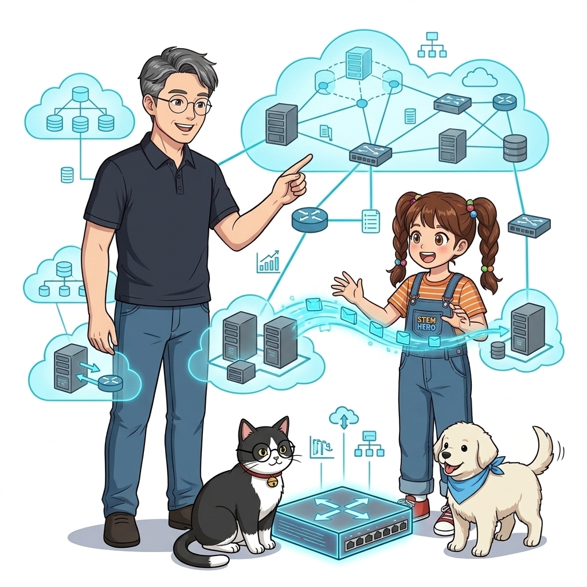
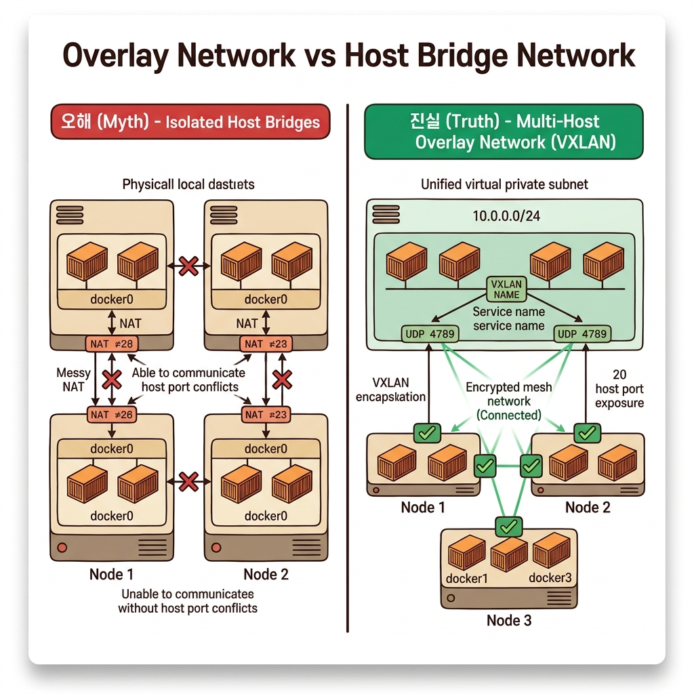
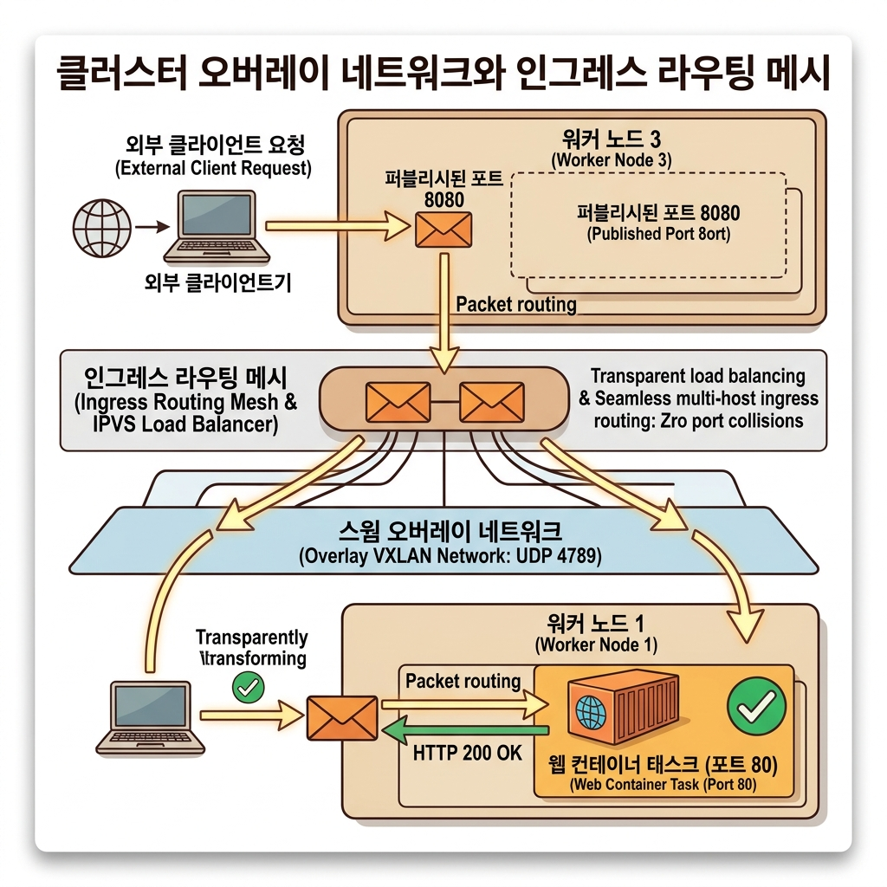
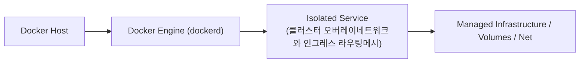
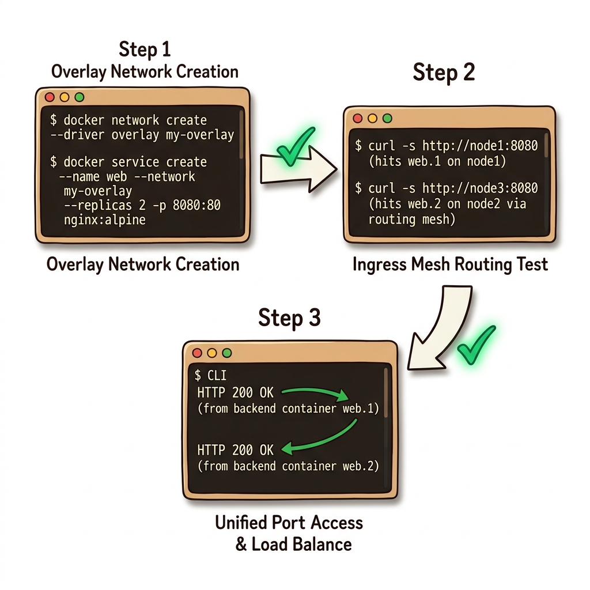
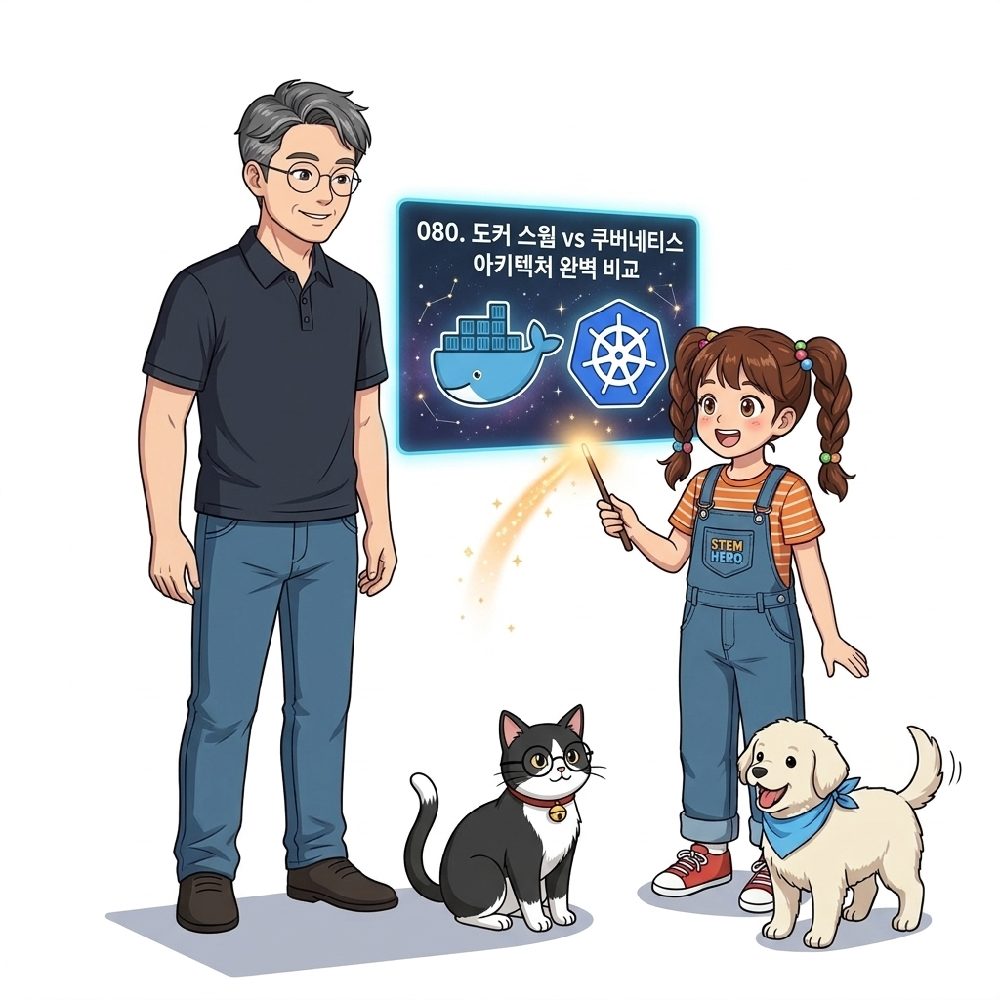
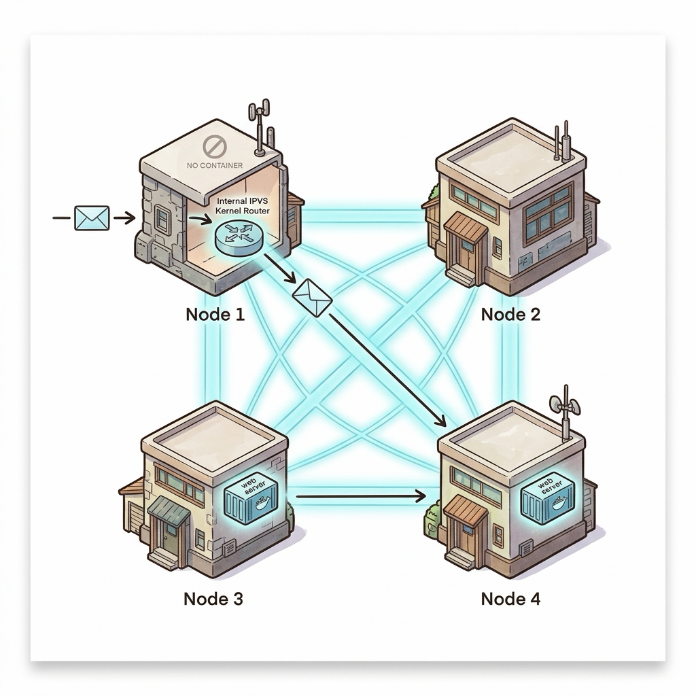

# 079. 클러스터 오버레이네트워크와 인그레스 라우팅메시

단일 서버 안을 연결하던 `bridge` 네트워크를 넘어, 물리적으로 떨어진 여러 대의 스웜 노드들을 하나의 가상 LAN으로 묶어주는 **오버레이 네트워크(`docker network create --driver overlay`)**의 VXLAN 터널링 원리를 배웁니다.


**그림 06-4-1** 클러스터 오버레이네트워크와 인그레스 라우팅메시의 필요성과 현대 클라우드 아키텍처 관점의 개요

---

### 079.1 왜 클러스터 오버레이네트워크와 인그레스 라우팅메시이(가) 필요한가? (문제 정의와 현실적 배경)

소프트웨어 시스템이 복잡해질수록 설정을 다루는 방식은 전체 인프라의 신뢰성을 결정짓는 핵심 척도가 됩니다. **클러스터 오버레이네트워크와 인그레스 라우팅메시**이(가) 부재하거나 잘못 다루어질 때 현장에서는 다음과 같은 대표적인 병목과 장애가 발생합니다:

1. **하드코딩된 설정과 환경 불일치로 인한 유연성 상실**: 환경이 바뀔 때마다 코드를 다시 빌드해야 하므로 배포 주기가 지연되고 이미지 수가 기하급수적으로 폭증합니다.
2. **보안 민감 데이터의 무분별한 노출**: 비밀번호, 데이터베이스 토큰, 암호화 키가 이미지 레이어에 영구 박제되어 형상관리 시스템이나 외부에 유출될 위험이 커집니다.
3. **재현 불가능한 구성 드리프트**: 스테이징 환경과 프로덕션 환경의 미세한 설정 차이가 예기치 못한 서비스 중단 사고로 직결됩니다.


**그림 06-4-2** 클러스터 오버레이네트워크와 인그레스 라우팅메시에 대한 대표적인 오해와 실제 프로덕션 현장의 엔지니어링 진실

---

### 079.2 핵심 아키텍처와 엔지니어링 메커니즘

또한 클러스터의 **어느 노드 IP(심지어 해당 컨테이너가 실행 중이지 않은 빈 워커 노드의 IP)로 접속하더라도 스웜이 자동으로 실행 중인 컨테이너들을 찾아 부하 분산 연결해 주는 인그레스 라우팅 메시(Ingress Routing Mesh)**와 내부 VIP(가상 IP) 로드 밸런싱을 마스터합니다!


**그림 06-4-3** 클러스터 오버레이네트워크와 인그레스 라우팅메시의 내부 아키텍처 및 데이터 흐름

#### 📊 핵심 비교 및 엔지니어링 표준 분석

| 구분 / 핵심 원리 | 상세 설명 및 동작 메커니즘 | 실무 적용 시 주의점 및 베스트 프랙티스 |
| :--- | :--- | :--- |
| **오버레이 네트워크 (`--driver overlay`)** | 여러 호스트 서버에 걸쳐 있는 컨테이너들이 마치 한 컴퓨터 안에 있는 것처럼 사설 IP(`10.0.x.x`)와 서비스 이름으로 자유롭게 통신 | `--opt encrypted` 옵션을 추가하면 노드 간 오가는 모든 네트워크 패킷을 IPSEC으로 자동 암호화! |
| **내장 VIP (Virtual IP) 로드 밸런싱** | 도커 컴포즈의 DNS 라운드 로빈(클라이언트가 캐싱하면 편중 발생)과 달리, 스웜은 서비스마다 **고정된 단일 가상 IP(VIP)**를 부여하고 커널 IPVS가 모든 레플리카로 패킷을 균등 분배! | 클라이언트가 DNS를 캐싱하더라도 100% 완벽한 균등 로드 밸런싱 보장 |
| **인그레스 라우팅 메시 (Ingress Mesh)** | `-p 8080:80`으로 포트를 공개하면 스웜 클러스터의 **모든 노드(1번~10번 서버 전체)**에서 8080 포트가 열리고 내부 컨테이너로 자동 포워딩됨 | 앞단 로드밸런서에 모든 노드 IP를 등록해 두면 특정 서버가 다운되어도 무중단 트래픽 처리 가능! |

---

### 079.3 선언적 실습 및 아키텍처 다이어그램

본 실습은 외부 비공개 패키지에 의존하지 않고, 공식 표준 이미지를 기반으로 즉시 재현 가능한 살아있는 코드로 구성되어 있습니다.

```bash
# 클러스터의 여러 노드를 하나로 잇는 오버레이(overlay) 가상 네트워크 생성 및 스웜 서비스 연동 실습
docker swarm init 2>/dev/null || true
docker network create --driver overlay oz-swarm-net
docker service create --name internal-api --network oz-swarm-net --replicas 2 nginx:1.27-alpine

# 오버레이 네트워크 내부의 가상 IP(VIP) 확인
docker service inspect --format 'Virtual IPs: {{json .Endpoint.VirtualIPs}}' internal-api
docker service rm internal-api && docker network rm oz-swarm-net
```

#### 🔍 아키텍처 흐름도 (Mermaid Diagram)




**그림 06-4-4** 선언적 인프라 명세를 통한 클러스터 오버레이네트워크와 인그레스 라우팅메시 검증 파이프라인

---

### 079.4 핵심 정리: 캐릭터 대화와 3대 교훈

> 👧 **도로시**: "교수님! **클러스터 오버레이네트워크와 인그레스 라우팅메시**의 원리를 배우니까, 복잡하게 얽혀 있던 인프라 설정이 레고 블록처럼 질서정연하게 제자리를 찾는 게 보여요!"
> 
> 🐱 **조교 지니**: "야옹~ 맞습니다! 특히 런타임 환경과 불변 인프라의 경계를 명확히 지키는 것이 대규모 클라우드 운영의 제1원칙이랍니다!"
> 
> 🐶 **토토**: "멍멍! 선언적 코드로 한 번 적어두면 언제든 똑같이 복원되니까 정말 든든해요!"
> 
> 👨‍🏫 **이호진 교수님**: "훌륭하구나. 원리를 깊이 이해하고 실습을 통해 손에 익히는 것이 훌륭한 클라우드 엔지니어로 성장하는 가장 빠른 지름길이란다."


**그림 06-4-5** 클러스터 오버레이네트워크와 인그레스 라우팅메시 마스터를 위한 3대 핵심 교훈

1. **설정과 실행의 명확한 분리**:
   * 애플리케이션 코드는 불변으로 유지하고, 가변적인 설정값은 외부에서 주입하여 이식성을 극대화합니다.
2. **선언적 재현성 확보**:
   * 사람이 수작업으로 변경하지 않고 코드 명세를 통해 언제 어디서나 100% 동일한 실행 결과를 보장합니다.
3. **최소 권한 및 보안 모범 사례 준수**:
   * 불필요한 권한과 포트 노출을 최소화하고 민감 데이터를 암호화하여 프로덕션 안정성을 담보합니다.

---

### 079.5 랩노트 피날레와 다음 강의 예고


**그림 06-4-6** 연구실에서 다음 마일스톤인 [도커스웜 vs 쿠버네티스 Kubernetes 아키텍처완벽비교] 실습을 예고하는 교수님과 토토

> 💡 **다음 강의 안내**:
> [도커스웜 vs 쿠버네티스 Kubernetes 아키텍처완벽비교](../080_도커스웜_vs_쿠버네티스_Kubernetes_아키텍처완벽비교/)에서는 더욱 심화된 실전 엔지니어링 실습과 아키텍처를 다룹니다!

---

## 🧭 강의 네비게이션
* [◀️ 이전 강의: 078_도커스웜_서비스생성_선언적레플리카와_자동자가치유](../078_도커스웜_서비스생성_선언적레플리카와_자동자가치유/)
* [📋 Part 06. 컨테이너 오케스트레이션: 도커 스웜(Swarm) 클러스터, 스택 배포, 무중단 롤링 업데이트 & 쿠버네티스 (076 ~ 095) 목차로 돌아가기](../)
* [▶️ 다음 강의: 080_도커스웜_vs_쿠버네티스_Kubernetes_아키텍처완벽비교](../080_도커스웜_vs_쿠버네티스_Kubernetes_아키텍처완벽비교/)


<!-- BIBLE_INTEGRATION_book9_deep_079 -->
---

### 079.C 📚 도커 바이블 심화: 인그레스 라우팅 메시(Routing Mesh)와 IPVS 커널 L4 부하 분산 심층 분석
> **출처 및 학술적 배경**: 시작하세요! 도커/쿠버네티스 제3장 (도커 스웜 - 서비스와 네트워크)  
> **핵심 주제**: 대규모 클러스터 오케스트레이션, 분산 합의 알고리즘(Raft), 오버레이 네트워킹 및 프로덕션 데몬 튜닝을 심층 학습합니다.

#### 1. 아키텍처 및 내부 메커니즘 분석
도커 스웜의 가장 강력한 기능 중 하나는 사용자가 **클러스터 내의 어느 노드로 요청을 보내더라도(심지어 해당 컨테이너가 실행되지 않는 노드라도)** 서비스 컨테이너로 정확히 도달한다는 점입니다.
이것이 바로 **인그레스 라우팅 메시(Ingress Routing Mesh)**입니다.

#### 라우팅 메시의 3대 핵심 아키텍처:
1. **오버레이 네트워크와 VXLAN (Virtual Extensible LAN)**:
   * 서로 다른 물리 호스트의 컨테이너들을 가상 L2 스위치로 연결하기 위해 원본 이더넷 프레임을 UDP 포트 4789 패킷 내부에 캡슐화하여 전송합니다.
2. **IPVS (IP Virtual Server) 커널 모듈**:
   * 호스트의 공용 포트로 패킷이 들어오면 리눅스 커널의 IPVS 가상 서버가 서비스 VIP(Virtual IP)를 참조하여 백엔드 컨테이너 태스크로 패킷을 고속 로드밸런싱합니다.
3. **`docker_gwbridge`**:
   * 각 컨테이너가 오버레이 네트워크를 통해 서로 통신하면서도, 외부 인터넷으로 아웃바운드 트래픽을 보낼 수 있도록 지원하는 호스트 게이트웨이 브리지입니다.



#### 2. 엔터프라이즈 실전 검증 실습
```bash
# [실습] 라우팅 메시를 활용한 3-레플리카 웹 서비스 생성 및 네트워크 진단
# 1. 라우팅 메시 기반 3개 레플리카 서비스 생성
docker service create --name web-cluster \
  --replicas 3 \
  -p 8080:80 \
  nginx:alpine

# 2. 클러스터의 ingress 오버레이 네트워크 및 VIP 조회
docker network inspect ingress

# 3. 서비스 동작 태스크 위치 및 노드별 분산 상태 점검
docker service ps web-cluster
```

#### 3. 프로덕션 운영을 위한 핵심 멘토링
> 👨‍🏫 **이호진 교수님의 심화 지도**:
> "스웜의 라우팅 메시는 편리하지만 소스 IP가 매니저/워커 내부 가상 IP로 치환되는 SNAT 현상이 발생하므로, 클라이언트 원본 IP 보존이 필요한 고성능 웹 서비스는 mode=host 포트 게시를 고려해야 합니다."
>
> 👧 **도로시의 깨달음**:
> "클러스터 어느 대문으로 들어가든 친절한 안내원(IPVS)이 진짜 일하고 있는 방으로 마법 포털(VXLAN)을 통해 순간이동 시켜주는 거네요!"
>
> 🐱 **조교 지니의 프로덕션 체크리스트**:
> * 인그레스 네트워크의 MTU는 기본 1450바이트로 설정되어 VXLAN 50바이트 헤더 오버헤드를 보상합니다.
