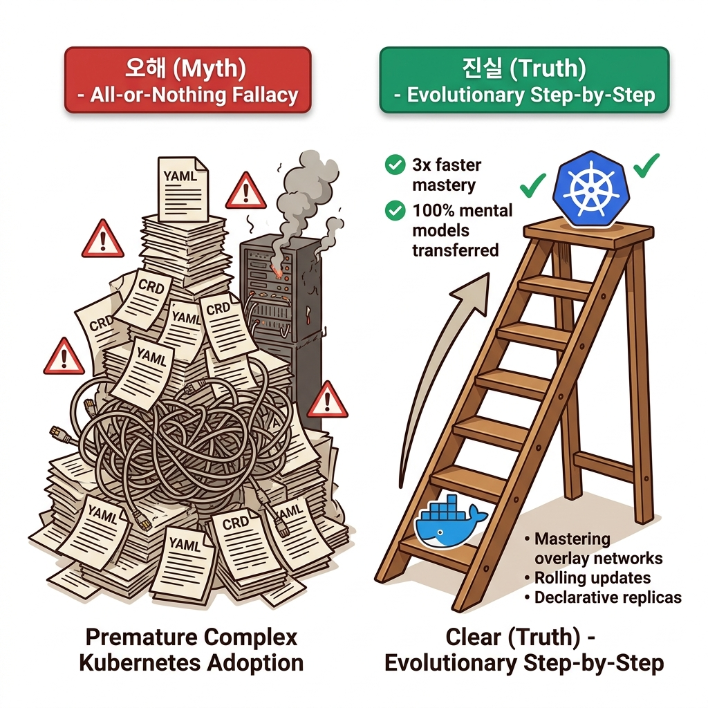
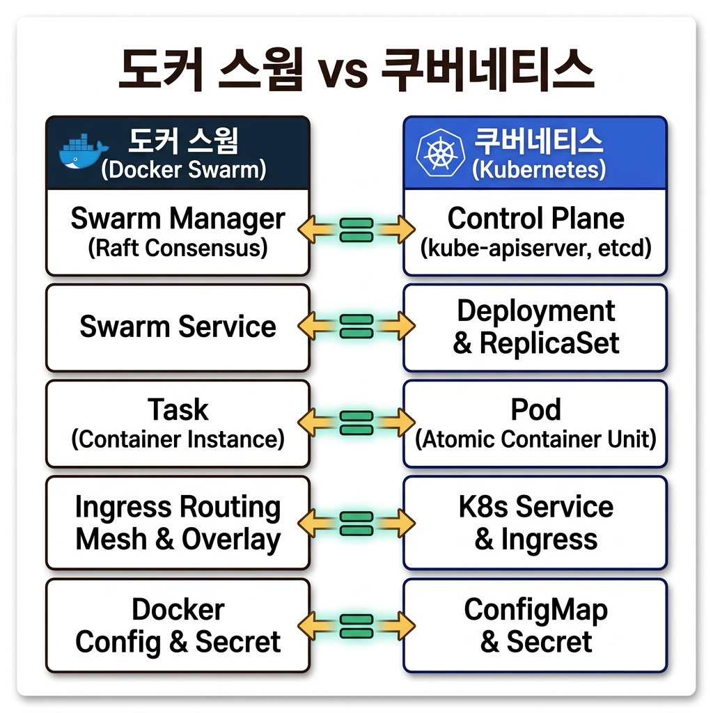
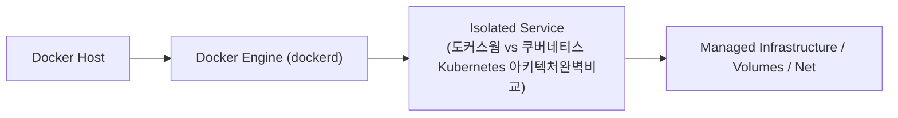
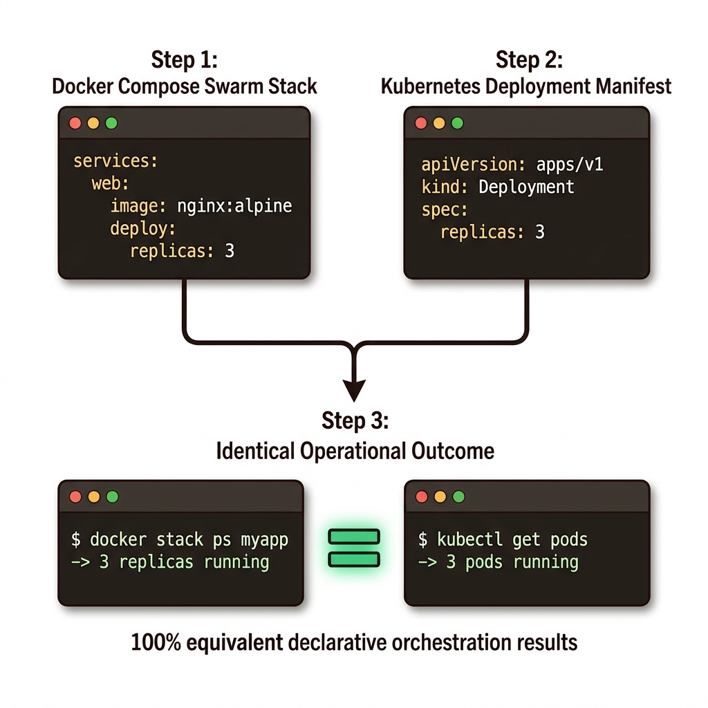
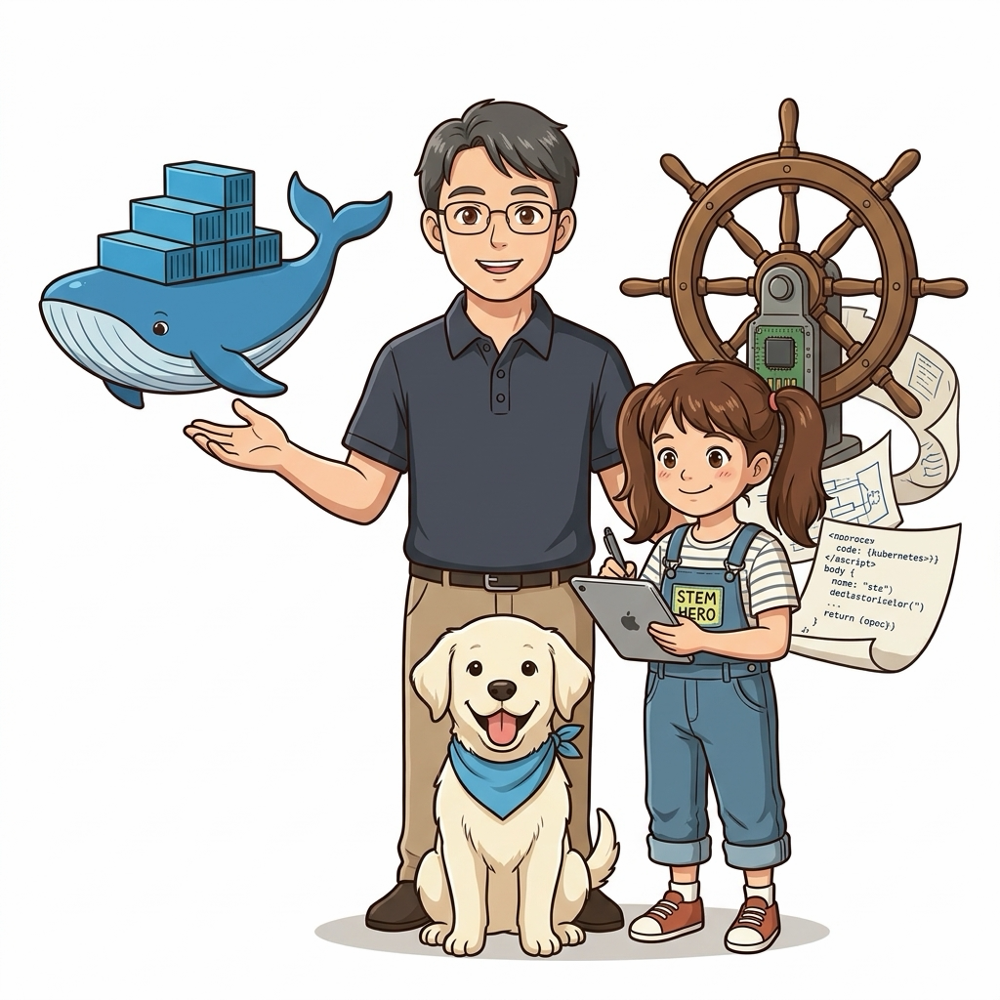
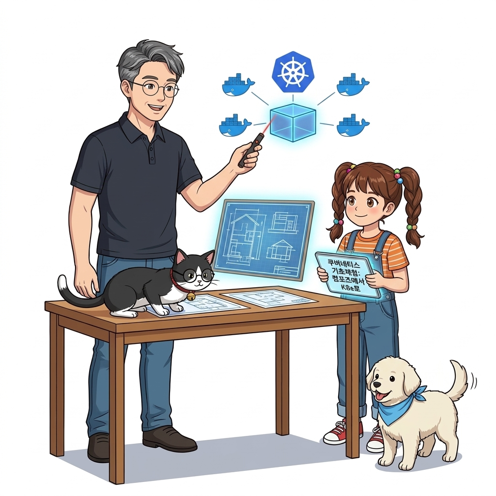

# 080. 도커스웜 vs 쿠버네티스 Kubernetes 아키텍처완벽비교

양대 컨테이너 오케스트레이터인 **도커 스웜(Docker Swarm)**과 **쿠버네티스(Kubernetes, K8s)**의 아키텍처, 리소스 객체 매핑, 학습 곡선, 운영 복잡도를 객관적으로 비교합니다.


**그림 06-5-1** 도커스웜 vs 쿠버네티스 Kubernetes 아키텍처완벽비교의 필요성과 현대 클라우드 아키텍처 관점의 개요

---

### 080.1 왜 도커스웜 vs 쿠버네티스 Kubernetes 아키텍처완벽비교이(가) 필요한가? (문제 정의와 현실적 배경)

소프트웨어 시스템이 복잡해질수록 설정을 다루는 방식은 전체 인프라의 신뢰성을 결정짓는 핵심 척도가 됩니다. **도커스웜 vs 쿠버네티스 Kubernetes 아키텍처완벽비교**이(가) 부재하거나 잘못 다루어질 때 현장에서는 다음과 같은 대표적인 병목과 장애가 발생합니다:

1. **하드코딩된 설정과 환경 불일치로 인한 유연성 상실**: 환경이 바뀔 때마다 코드를 다시 빌드해야 하므로 배포 주기가 지연되고 이미지 수가 기하급수적으로 폭증합니다.
2. **보안 민감 데이터의 무분별한 노출**: 비밀번호, 데이터베이스 토큰, 암호화 키가 이미지 레이어에 영구 박제되어 형상관리 시스템이나 외부에 유출될 위험이 커집니다.
3. **재현 불가능한 구성 드리프트**: 스테이징 환경과 프로덕션 환경의 미세한 설정 차이가 예기치 못한 서비스 중단 사고로 직결됩니다.


**그림 06-5-2** 도커스웜 vs 쿠버네티스 Kubernetes 아키텍처완벽비교에 대한 대표적인 오해와 실제 프로덕션 현장의 엔지니어링 진실

---

### 080.2 핵심 아키텍처와 엔지니어링 메커니즘

왜 도커 컴포즈와 도커 스웜으로 컨테이너 오케스트레이션의 핵심 개념(선언적 배포, 서비스 디스커버리, 컨피그/시크릿, 롤링 업데이트, 헬스 체크)을 먼저 익히면 쿠버네티스까지 3배 빠르게 정복할 수 있는지 1:1 개념 매핑표를 통해 확인합니다!


**그림 06-5-3** 도커스웜 vs 쿠버네티스 Kubernetes 아키텍처완벽비교의 내부 아키텍처 및 데이터 흐름

#### 📊 핵심 비교 및 엔지니어링 표준 분석

| 구분 / 핵심 원리 | 상세 설명 및 동작 메커니즘 | 실무 적용 시 주의점 및 베스트 프랙티스 |
| :--- | :--- | :--- |
| **도커 스웜 (Docker Swarm)의 강점** | 도커 엔진에 기본 내장(설치 0초), 기존 `compose.yaml` 문법을 그대로 사용, 컨트롤 플레인 메모리 소모 극소화 | 중소규모 클러스터, 에지 컴퓨팅(라즈베리 파이 클러스터), 전담 K8s 인프라 팀이 없는 조직에서 최고의 가성비 발휘! |
| **쿠버네티스 (Kubernetes)의 강점** | CNCF 클라우드 네이티브 생태계의 사실상 표준, 세밀한 네트워크/스토리지/오토스케일링(HPA) 제어, 모든 퍼블릭 클라우드(EKS/GKE/AKS) 관리형 서비스 제공 | 대규모 엔터프라이즈 마이크로서비스 및 멀티 클라우드 표준 플랫폼 |
| **공통된 컨테이너 설계 원칙** | 이미지 최적화, 멀티 스테이지 빌드, `stdout` 로깅, `/metrics` 노출, 헬스/디펜던시 체크, 12-Factor 설정 관리는 **스웜이든 쿠버네티스든 100% 똑같이 적용되는 불변의 핵심 기술**! | 좋은 컨테이너 이미지를 만들 줄 아는 엔지니어가 어느 오케스트레이터에서나 승리함 |

---

### 080.3 선언적 실습 및 아키텍처 다이어그램

본 실습은 외부 비공개 패키지에 의존하지 않고, 공식 표준 이미지를 기반으로 즉시 재현 가능한 살아있는 코드로 구성되어 있습니다.

```bash
# 도커 스웜(Swarm) 개념과 쿠버네티스(Kubernetes) 핵심 리소스 1:1 매핑 요약표 출력
cat << 'EOF'
[Docker Compose / Swarm]        <===>  [Kubernetes (K8s)]
1. Service (Replicas)           <===>  Deployment / ReplicaSet + Pod
2. Service (Global mode)        <===>  DaemonSet
3. Overlay Network + VIP        <===>  ClusterIP / NodePort / LoadBalancer Service
4. Docker Config / Secret       <===>  ConfigMap / Secret
5. Stack (compose.yaml)         <===>  Namespace + Helm Chart / Kustomize YAML
EOF
```

#### 🔍 아키텍처 흐름도 (Mermaid Diagram)




**그림 06-5-4** 선언적 인프라 명세를 통한 도커스웜 vs 쿠버네티스 Kubernetes 아키텍처완벽비교 검증 파이프라인

---

<!-- BIBLE_INTEGRATION_book1_swarm_vs_k8s_cri -->
---

### 080.B 📚 도커 바이블 심화: 스웜 서비스 vs 쿠버네티스 파드(Pod)와 4대 워크로드 컨트롤러 심층 해부
> **출처 및 학술적 배경**: 『15단계로 배우는 도커와 쿠버네티스』 제1장 (1.21 쿠버네티스의 기본 ~ 1.45 배치 처리 / 시스템 운영 처리)  
> **핵심 주제**: 단일 컨테이너 단위의 스웜 서비스와 복합 컨테이너 단위의 쿠버네티스 파드(Pod) 내부 구조(Pause 컨테이너), 그레이스풀 셧다운 파이프라인(30초), 그리고 워크로드 목적별 4대 컨트롤러(Deployment, StatefulSet, DaemonSet, Job) 비교.

#### 1. 스웜 Service vs 쿠버네티스 Pod의 본질적 차이
* **도커 스웜 (단일 컨테이너 중심)**:
  * 스웜에서 태스크(Task)는 하나의 독립된 컨테이너입니다. 두 개의 컨테이너가 긴밀하게 통신하려면 오버레이 네트워크를 거쳐 가상 IP로 패킷을 주고받아야 합니다.
* **쿠버네티스 (파드 Pod 중심)**:
  * 쿠버네티스의 최소 배포 단위는 컨테이너가 아니라 **파드(Pod)**입니다.
  * 파드는 내부적으로 **`Pause` 컨테이너**를 부모로 두어 동일한 리눅스 Network/IPC 네임스페이스와 볼륨을 공유합니다.
  * 따라서 파드 안에 함께 묶인 컨테이너들(예: 웹 서버와 로그 수집기 사이드카)은 네트워크 오버헤드 없이 **`localhost` 루프백 인터페이스**로 고속 통신합니다.

#### 2. 워크로드 컨트롤러 아키텍처 비교: 스웜의 단일 모델 vs 쿠버네티스의 4대 전문화
도커 스웜은 모든 컨테이너를 단 하나의 `docker service` 명령으로 다루지만, 쿠버네티스는 워크로드의 특성에 따라 다음과 같이 정교하게 분리된 컨트롤러 루프를 제공합니다:

| 엔터프라이즈 워크로드 유형 | 도커 스웜 대응 방식 | 쿠버네티스 전문 컨트롤러 | 핵심 메커니즘 및 실무 적용처 |
| :--- | :--- | :--- | :--- |
| **무상태 웹 애플리케이션** | `docker service create --replicas N` | **`Deployment` / `ReplicaSet`** | 선언적 롤링 업데이트, 롤백, 수평 자동 확장(HPA) |
| **상태 저장 데이터베이스** | 지원 한계 (단일 호스트 볼륨 바인딩) | **`StatefulSet`** | 순차적 생성/삭제(`pod-0, pod-1`), 고유 PVC 영속 볼륨 보장 |
| **호스트별 시스템 에이전트** | `docker service create --mode global` | **`DaemonSet`** | 모든 노드에 1개씩 강제 상주 (Fluentd, Prometheus 노드 익스포터) |
| **1회성 배치 및 정기 스케줄링** | 별도 cron이나 호스트 스케줄러 필요 | **`Job` & `CronJob`** | 성공 종료(Exit 0) 시 파드 자동 완료 처리, 정기 데이터 백업 |

#### 3. 파드 그레이스풀 셧다운(Graceful Shutdown) 4단계 파이프라인
프로덕션 무중단 서비스를 보장하기 위한 파드의 종료 처리는 리눅스 시그널과 네트워크 라우팅이 정밀하게 맞물려 동작합니다:
1. **서비스 엔드포인트 제거**: 파드가 삭제되면 즉시 쿠버네티스 서비스(kube-proxy/iptables)의 부하분산 목록에서 파드 IP가 제외되어 신규 트래픽 유입이 차단됩니다.
2. **`preStop` 훅 비동기 실행**: 설정된 경우 컨테이너 종료 직전 알림 스크립트나 커넥션 드레이닝 명령이 선행됩니다.
3. **`SIGTERM` 전달 및 그레이스 피리어드 대기**: 컨테이너의 PID 1 프로세스에 정상 종료 시그널(`SIGTERM`)이 전달되며, 쿠버네티스는 기본 **30초(`terminationGracePeriodSeconds: 30`)** 동안 애플리케이션이 진행 중인 트랜잭션을 안전하게 마무리하기를 기다립니다.
4. **`SIGKILL` 강제 사살**: 30초 내에 스스로 종료되지 않으면 리눅스 커널 수준에서 `SIGKILL` 시그널을 날려 프로세스를 강제 종료하고 리소스를 회수합니다.


**그림 080-B-1** 도커 스웜의 경량 내장 클러스터와 쿠버네티스의 풍부한 제어 평면을 직관적으로 대조하는 비교 삽화

```bash
# [실습] 도커 스웜 클러스터 초기화 및 글로벌 모드 서비스 실습
# 1. 스웜 클러스터 초기화
docker swarm init --advertise-addr 127.0.0.1

# 2. 쿠버네티스 DaemonSet에 대응하는 스웜 글로벌(Global) 시스템 서비스 배포
# (모든 워커 노드마다 정확히 1개씩 백그라운드 에이전트 자동 배치)
docker service create --name host-monitor --mode global alpine sleep 3600

# 3. 쿠버네티스 Deployment에 대응하는 스웜 레플리카 서비스 배포
docker service create --name web-cluster --replicas 3 -p 8080:80 nginx:alpine

# 4. 서비스 및 컨테이너 태스크 배치 상태 점검
docker service ls
docker service ps web-cluster
```

> 👨‍🏫 **이호진 교수님의 바이블 멘토링 노트**:
> "오케스트레이터를 선택할 때는 무조건 '대세'를 따르는 것이 아니라 팀의 운영 역량과 서비스 규모를 정직하게 평가해야 합니다. 스웜은 별도의 복잡한 마스터 제어 평면 없이 도커 엔진 하나로 수 분 만에 엔터프라이즈 HA를 구축할 수 있는 뛰어난 솔루션이며, 쿠버네티스는 StatefulSet이나 DaemonSet처럼 고도화된 워크로드 분기 제어가 필요할 때 빛을 발합니다."
>
> 👧 **도로시의 깨달음**:
> "스웜이 모든 짐을 한 바구니(Service)에 담아 가볍게 달리는 자전거라면, 쿠버네티스는 짐칸(StatefulSet), 청소차(DaemonSet), 1회용 배달부(Job)가 따로 준비된 커다란 첨단 화물 열차군요!"
>
> 🐱 **조교 지니의 아키텍처 체크포인트**:
> * 파드 종료 시 30초 그레이스 피리어드 동안 애플리케이션이 `SIGTERM`을 정상 수신하려면, Dockerfile에서 `CMD ["node", "app.js"]`와 같이 Exec 형태를 사용하여 Node나 Python이 PID 1번을 점유해야 합니다.
> * 스웜의 `mode: global`은 쿠버네티스의 `DaemonSet`과 100% 동일한 기능을 수행합니다.


### 080.4 핵심 정리: 캐릭터 대화와 3대 교훈

> 👧 **도로시**: "교수님! **도커스웜 vs 쿠버네티스 Kubernetes 아키텍처완벽비교**의 원리를 배우니까, 복잡하게 얽혀 있던 인프라 설정이 레고 블록처럼 질서정연하게 제자리를 찾는 게 보여요!"
> 
> 🐱 **조교 지니**: "야옹~ 맞습니다! 특히 런타임 환경과 불변 인프라의 경계를 명확히 지키는 것이 대규모 클라우드 운영의 제1원칙이랍니다!"
> 
> 🐶 **토토**: "멍멍! 선언적 코드로 한 번 적어두면 언제든 똑같이 복원되니까 정말 든든해요!"
> 
> 👨‍🏫 **이호진 교수님**: "훌륭하구나. 원리를 깊이 이해하고 실습을 통해 손에 익히는 것이 훌륭한 클라우드 엔지니어로 성장하는 가장 빠른 지름길이란다."


**그림 06-5-5** 도커스웜 vs 쿠버네티스 Kubernetes 아키텍처완벽비교 마스터를 위한 3대 핵심 교훈

1. **설정과 실행의 명확한 분리**:
   * 애플리케이션 코드는 불변으로 유지하고, 가변적인 설정값은 외부에서 주입하여 이식성을 극대화합니다.
2. **선언적 재현성 확보**:
   * 사람이 수작업으로 변경하지 않고 코드 명세를 통해 언제 어디서나 100% 동일한 실행 결과를 보장합니다.
3. **최소 권한 및 보안 모범 사례 준수**:
   * 불필요한 권한과 포트 노출을 최소화하고 민감 데이터를 암호화하여 프로덕션 안정성을 담보합니다.

---

### 080.5 랩노트 피날레와 다음 강의 예고


**그림 06-5-6** 연구실에서 다음 마일스톤인 [쿠버네티스 기초체험 컴포즈에서 K8s매니페스트로] 실습을 예고하는 교수님과 토토

> 💡 **다음 강의 안내**:
> [쿠버네티스 기초체험 컴포즈에서 K8s매니페스트로](../081_쿠버네티스_기초체험_컴포즈에서_K8s매니페스트로/)에서는 더욱 심화된 실전 엔지니어링 실습과 아키텍처를 다룹니다!

---

## 🧭 강의 네비게이션
* [◀️ 이전 강의: 079_클러스터_오버레이네트워크와_인그레스_라우팅메시](../079_클러스터_오버레이네트워크와_인그레스_라우팅메시/)
* [📋 Part 06. 컨테이너 오케스트레이션: 도커 스웜(Swarm) 클러스터, 스택 배포, 무중단 롤링 업데이트 & 쿠버네티스 (076 ~ 095) 목차로 돌아가기](../)
* [▶️ 다음 강의: 081_쿠버네티스_기초체험_컴포즈에서_K8s매니페스트로](../081_쿠버네티스_기초체험_컴포즈에서_K8s매니페스트로/)
