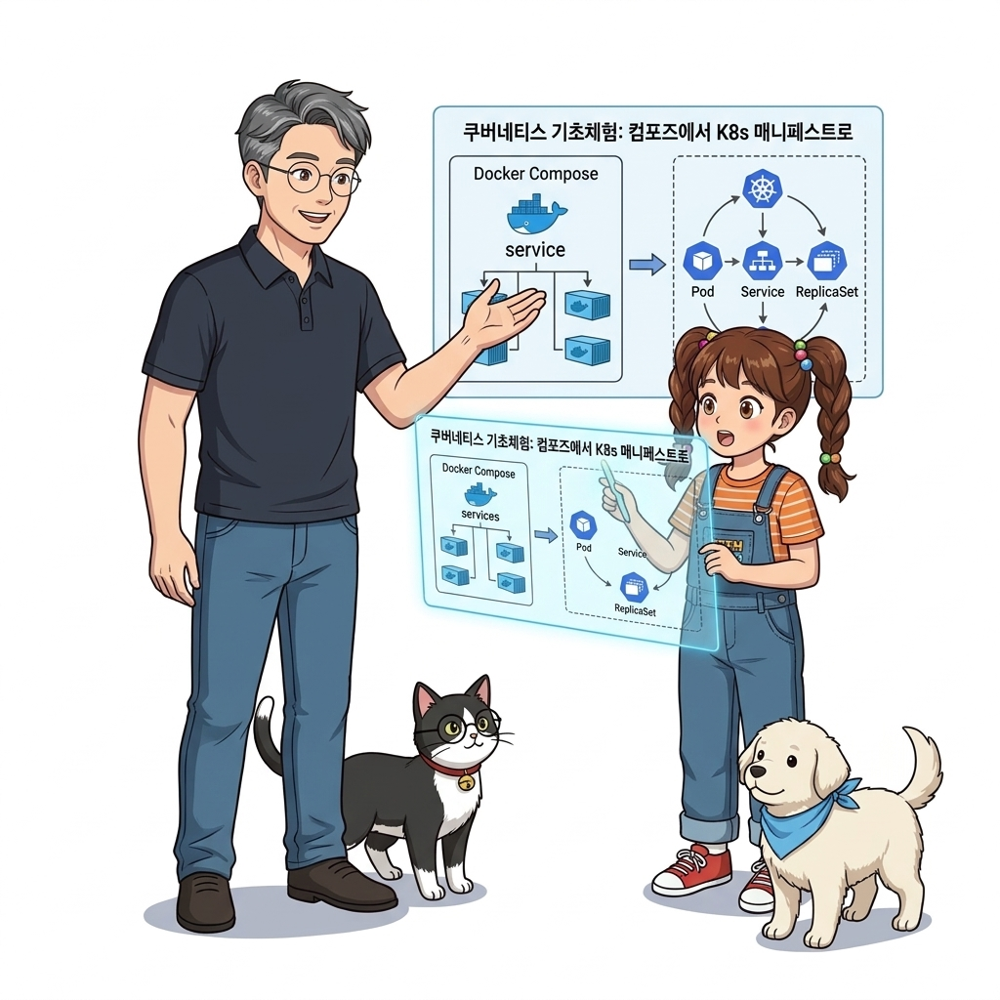
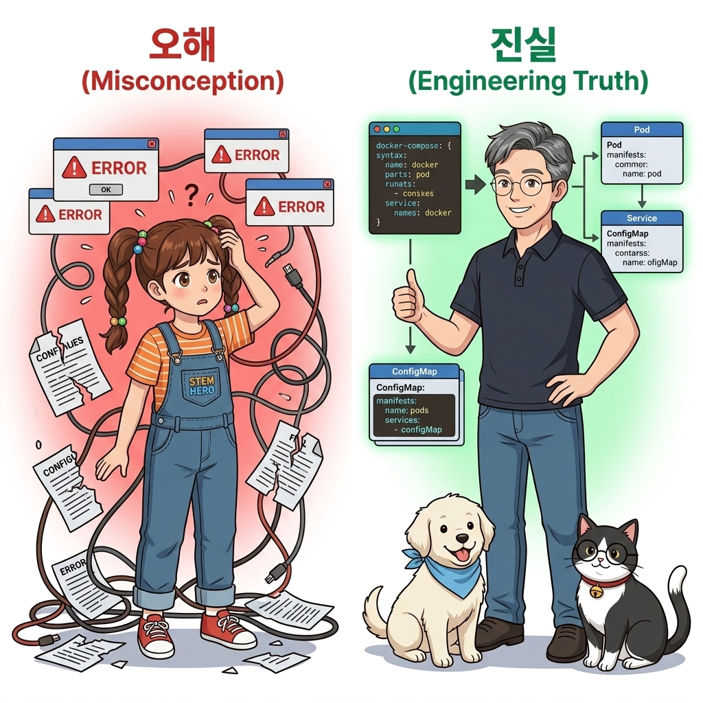
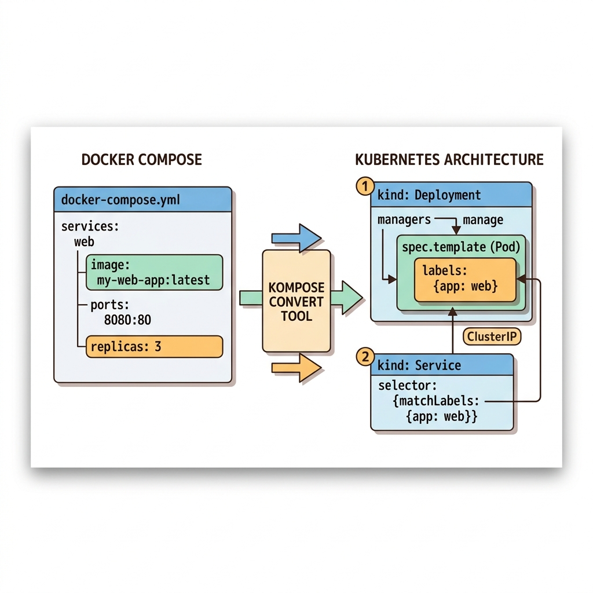
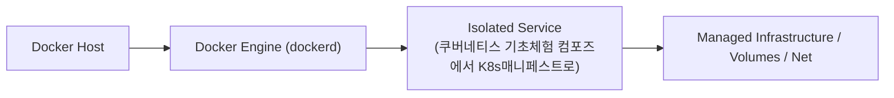
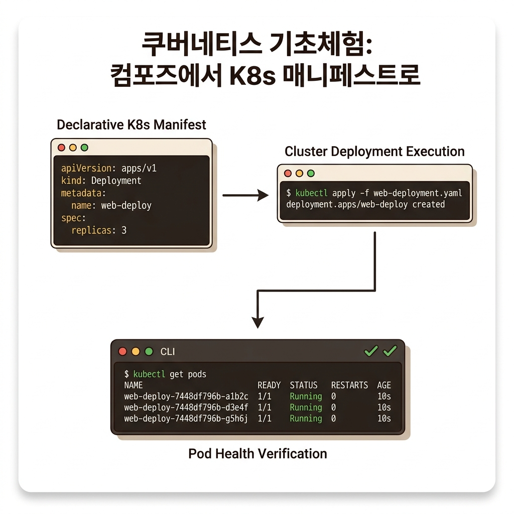
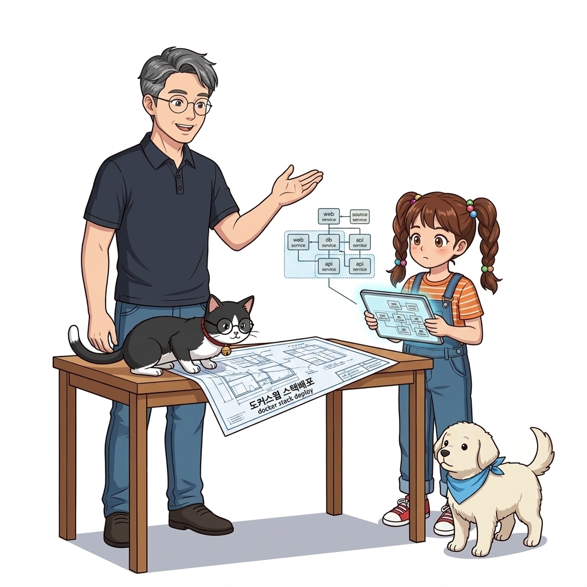

# 081. 쿠버네티스 기초체험 컴포즈에서 K8s매니페스트로

도커 스웜에서 배포했던 웹 서비스를 쿠버네티스 표준 매니페스트(`apiVersion`, `kind: Deployment`, `kind: Service`, `selector`, `template`)로 작성하면 어떤 모습이 되는지 직접 비교합니다.


**그림 06-6-1** 쿠버네티스 기초체험 컴포즈에서 K8s매니페스트로의 필요성과 현대 클라우드 아키텍처 관점의 개요

---

### 081.1 왜 쿠버네티스 기초체험 컴포즈에서 K8s매니페스트로이(가) 필요한가? (문제 정의와 현실적 배경)

소프트웨어 시스템이 복잡해질수록 설정을 다루는 방식은 전체 인프라의 신뢰성을 결정짓는 핵심 척도가 됩니다. **쿠버네티스 기초체험 컴포즈에서 K8s매니페스트로**이(가) 부재하거나 잘못 다루어질 때 현장에서는 다음과 같은 대표적인 병목과 장애가 발생합니다:

1. **하드코딩된 설정과 환경 불일치로 인한 유연성 상실**: 환경이 바뀔 때마다 코드를 다시 빌드해야 하므로 배포 주기가 지연되고 이미지 수가 기하급수적으로 폭증합니다.
2. **보안 민감 데이터의 무분별한 노출**: 비밀번호, 데이터베이스 토큰, 암호화 키가 이미지 레이어에 영구 박제되어 형상관리 시스템이나 외부에 유출될 위험이 커집니다.
3. **재현 불가능한 구성 드리프트**: 스테이징 환경과 프로덕션 환경의 미세한 설정 차이가 예기치 못한 서비스 중단 사고로 직결됩니다.


**그림 06-6-2** 쿠버네티스 기초체험 컴포즈에서 K8s매니페스트로에 대한 대표적인 오해와 실제 프로덕션 현장의 엔지니어링 진실

---

### 081.2 핵심 아키텍처와 엔지니어링 메커니즘

Docker Desktop의 내장 Kubernetes 기능이나 초경량 K3s / kind(Kubernetes IN Docker)를 활용할 때 동일한 도커 이미지가 수정 없이 그대로 Pod로 실행됨을 이해합니다.


**그림 06-6-3** 쿠버네티스 기초체험 컴포즈에서 K8s매니페스트로의 내부 아키텍처 및 데이터 흐름

#### 📊 핵심 비교 및 엔지니어링 표준 분석

| 구분 / 핵심 원리 | 상세 설명 및 동작 메커니즘 | 실무 적용 시 주의점 및 베스트 프랙티스 |
| :--- | :--- | :--- |
| **파드 (Pod)** | 쿠버네티스에서 스케줄링되는 최소 단위로, 1개 이상의 밀접하게 결합된 컨테이너(메인 앱 + 사이드카 컨테이너)가 네트워크 IP와 볼륨을 공유하는 캡슐 | 도커 스웜의 태스크(Task)에 대응하되 사이드카 패턴을 네이티브로 지원 |
| **레이블(`labels`)과 셀렉터(`selector`)** | 도커 컴포즈/스웜은 서비스 이름으로 자동 연결하지만, 쿠버네티스는 느슨한 결합을 위해 `labels: {app: oz-web}`과 `matchLabels`로 Deployment·Pod·Service를 연결함 | YAML은 조금 더 길어지지만 세밀한 카나리 배포와 트래픽 분기가 가능해지는 이유 |
| **K8s로의 부드러운 전환** | 도커 컴포즈 파일을 쿠버네티스 YAML로 자동 변환해 주는 공식 오픈소스 도구 `kompose`(`kompose convert`)도 존재 | 먼저 도커 스웜 스택(13~14장)으로 클러스터 운영 감각을 완벽히 익히는 것이 가장 빠른 지름길! |

---

### 081.3 선언적 실습 및 아키텍처 다이어그램

본 실습은 외부 비공개 패키지에 의존하지 않고, 공식 표준 이미지를 기반으로 즉시 재현 가능한 살아있는 코드로 구성되어 있습니다.

```yaml
# 도커 컴포즈의 web 서비스를 쿠버네티스(Kubernetes) Deployment & Service YAML로 표현한 구조
apiVersion: apps/v1
kind: Deployment
metadata:
  name: oz-web-deploy
spec:
  replicas: 3
  selector:
    matchLabels:
      app: oz-web
  template:
    metadata:
      labels:
        app: oz-web
    spec:
      containers:
        - name: web
          image: nginx:1.27-alpine
          ports:
            - containerPort: 80
```

#### 🔍 아키텍처 흐름도 (Mermaid Diagram)




**그림 06-6-4** 선언적 인프라 명세를 통한 쿠버네티스 기초체험 컴포즈에서 K8s매니페스트로 검증 파이프라인

---

### 081.4 핵심 정리: 캐릭터 대화와 3대 교훈

> 👧 **도로시**: "교수님! **쿠버네티스 기초체험 컴포즈에서 K8s매니페스트로**의 원리를 배우니까, 복잡하게 얽혀 있던 인프라 설정이 레고 블록처럼 질서정연하게 제자리를 찾는 게 보여요!"
> 
> 🐱 **조교 지니**: "야옹~ 맞습니다! 특히 런타임 환경과 불변 인프라의 경계를 명확히 지키는 것이 대규모 클라우드 운영의 제1원칙이랍니다!"
> 
> 🐶 **토토**: "멍멍! 선언적 코드로 한 번 적어두면 언제든 똑같이 복원되니까 정말 든든해요!"
> 
> 👨‍🏫 **이호진 교수님**: "훌륭하구나. 원리를 깊이 이해하고 실습을 통해 손에 익히는 것이 훌륭한 클라우드 엔지니어로 성장하는 가장 빠른 지름길이란다."


**그림 06-6-5** 쿠버네티스 기초체험 컴포즈에서 K8s매니페스트로 마스터를 위한 3대 핵심 교훈

1. **설정과 실행의 명확한 분리**:
   * 애플리케이션 코드는 불변으로 유지하고, 가변적인 설정값은 외부에서 주입하여 이식성을 극대화합니다.
2. **선언적 재현성 확보**:
   * 사람이 수작업으로 변경하지 않고 코드 명세를 통해 언제 어디서나 100% 동일한 실행 결과를 보장합니다.
3. **최소 권한 및 보안 모범 사례 준수**:
   * 불필요한 권한과 포트 노출을 최소화하고 민감 데이터를 암호화하여 프로덕션 안정성을 담보합니다.

---

### 081.5 랩노트 피날레와 다음 강의 예고


**그림 06-6-6** 연구실에서 다음 마일스톤인 [도커스웜 스택배포 docker stack deploy와 운영컴포즈] 실습을 예고하는 교수님과 토토

> 💡 **다음 강의 안내**:
> [도커스웜 스택배포 docker stack deploy와 운영컴포즈](../082_도커스웜_스택배포_docker_stack_deploy와_운영컴포즈/)에서는 더욱 심화된 실전 엔지니어링 실습과 아키텍처를 다룹니다!

---

## 🧭 강의 네비게이션
* [◀️ 이전 강의: 080_도커스웜_vs_쿠버네티스_Kubernetes_아키텍처완벽비교](../080_도커스웜_vs_쿠버네티스_Kubernetes_아키텍처완벽비교/)
* [📋 Part 06. 컨테이너 오케스트레이션: 도커 스웜(Swarm) 클러스터, 스택 배포, 무중단 롤링 업데이트 & 쿠버네티스 (076 ~ 095) 목차로 돌아가기](../)
* [▶️ 다음 강의: 082_도커스웜_스택배포_docker_stack_deploy와_운영컴포즈](../082_도커스웜_스택배포_docker_stack_deploy와_운영컴포즈/)
