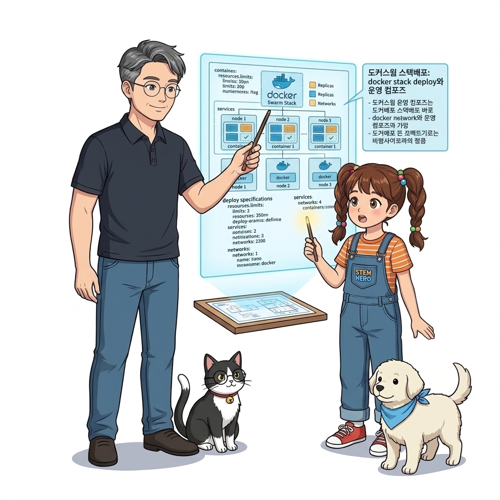
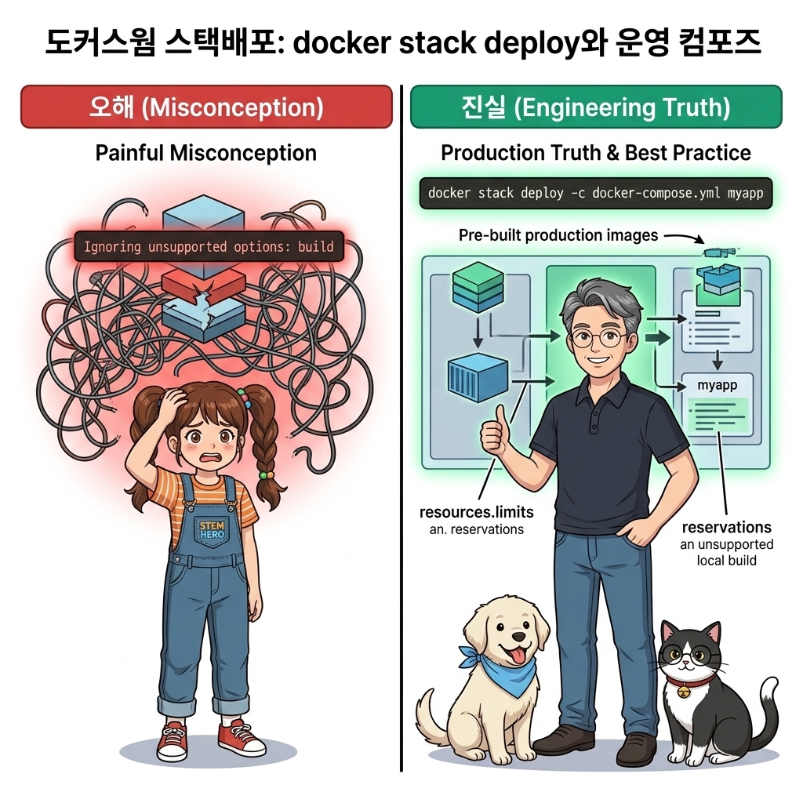
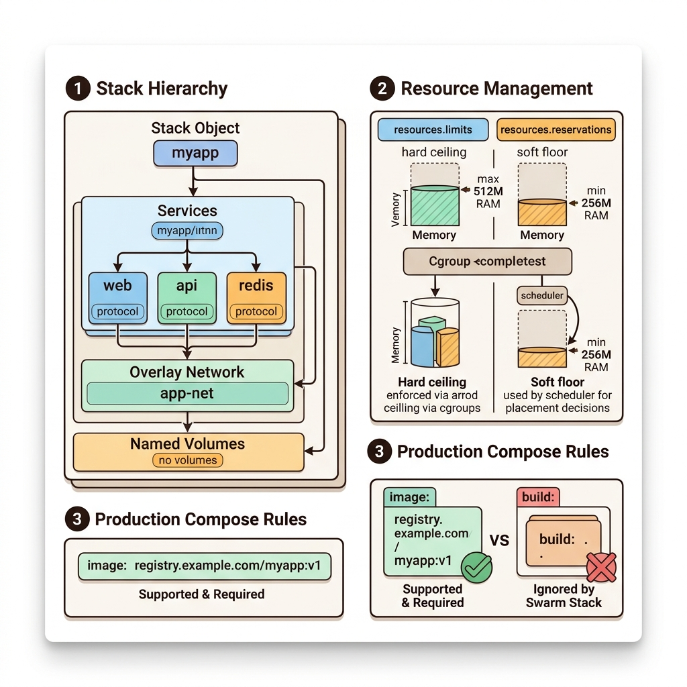
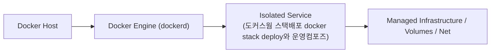
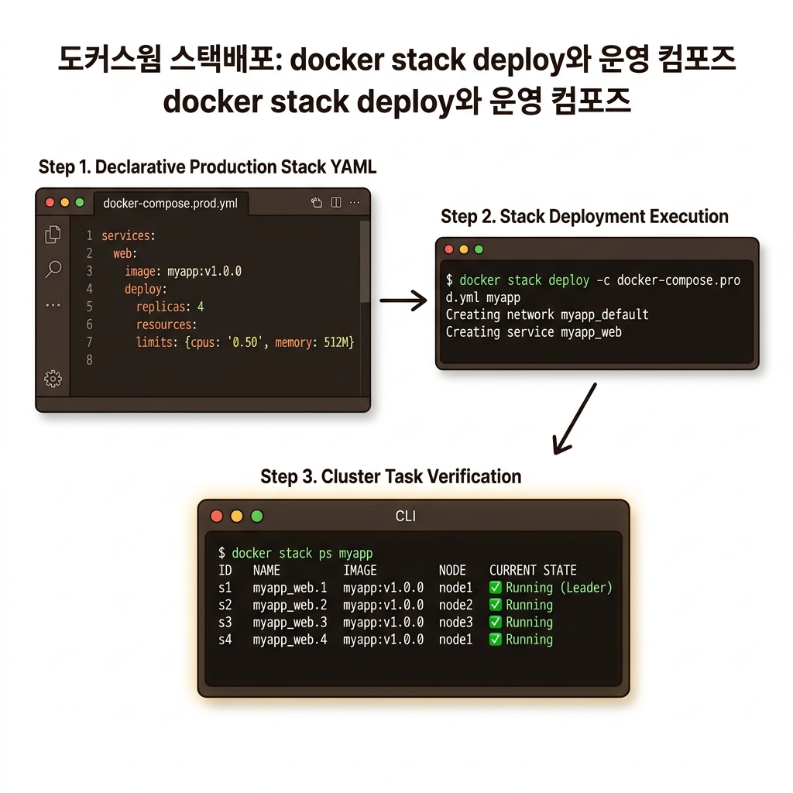
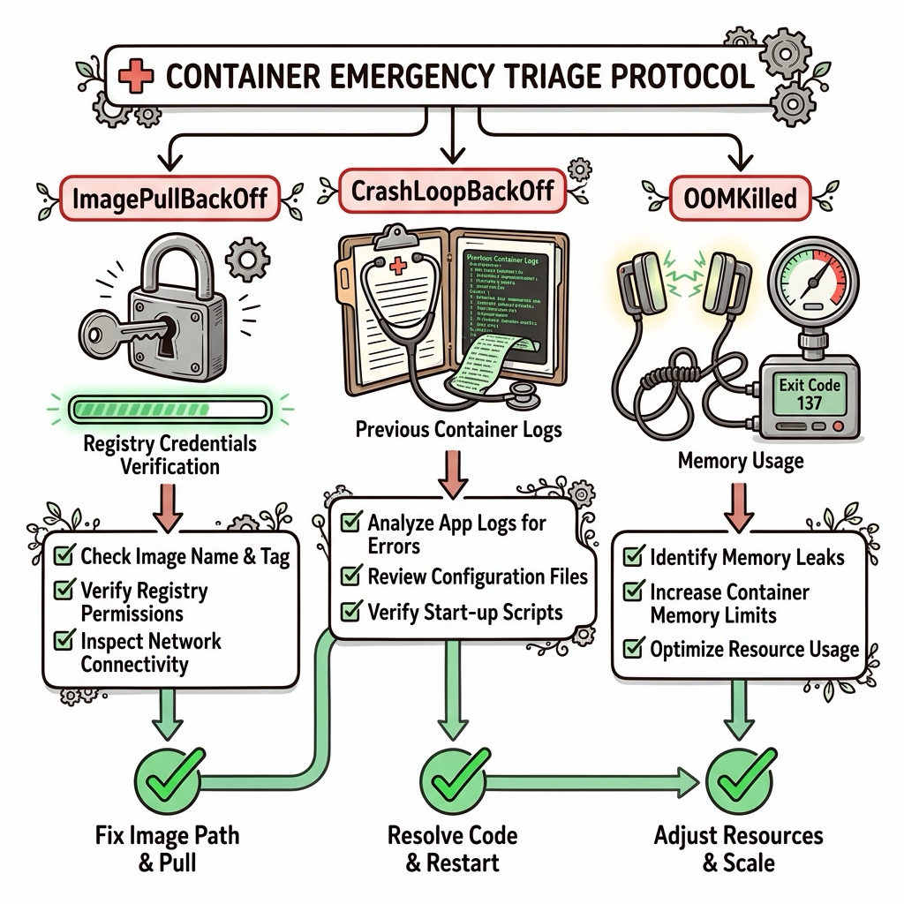

# 082. 도커스웜 스택배포 docker stack deploy와 운영컴포즈

단일 서버에서 `docker compose up`으로 분산 앱을 띄웠던 것처럼, 스웜 클러스터에서는 동일한 `compose.yaml` 파일에 클러스터 전용 **`deploy:` 블록**을 추가하여 **`docker stack deploy -c compose.yaml 스택이름`**으로 배포합니다.


**그림 06-7-1** 도커스웜 스택배포 docker stack deploy와 운영컴포즈의 필요성과 현대 클라우드 아키텍처 관점의 개요

---

### 082.1 왜 도커스웜 스택배포 docker stack deploy와 운영컴포즈이(가) 필요한가? (문제 정의와 현실적 배경)

소프트웨어 시스템이 복잡해질수록 설정을 다루는 방식은 전체 인프라의 신뢰성을 결정짓는 핵심 척도가 됩니다. **도커스웜 스택배포 docker stack deploy와 운영컴포즈**이(가) 부재하거나 잘못 다루어질 때 현장에서는 다음과 같은 대표적인 병목과 장애가 발생합니다:

1. **하드코딩된 설정과 환경 불일치로 인한 유연성 상실**: 환경이 바뀔 때마다 코드를 다시 빌드해야 하므로 배포 주기가 지연되고 이미지 수가 기하급수적으로 폭증합니다.
2. **보안 민감 데이터의 무분별한 노출**: 비밀번호, 데이터베이스 토큰, 암호화 키가 이미지 레이어에 영구 박제되어 형상관리 시스템이나 외부에 유출될 위험이 커집니다.
3. **재현 불가능한 구성 드리프트**: 스테이징 환경과 프로덕션 환경의 미세한 설정 차이가 예기치 못한 서비스 중단 사고로 직결됩니다.


**그림 06-7-2** 도커스웜 스택배포 docker stack deploy와 운영컴포즈에 대한 대표적인 오해와 실제 프로덕션 현장의 엔지니어링 진실

---

### 082.2 핵심 아키텍처와 엔지니어링 메커니즘

레플리카 개수(`replicas`)뿐만 아니라 각 컨테이너가 사용할 수 있는 **최대 CPU와 메모리 상한선(`resources.limits`) 및 최소 보장량(`reservations`)**을 지정해 클러스터 자원 고갈을 방지하는 운영 설계를 실습합니다!


**그림 06-7-3** 도커스웜 스택배포 docker stack deploy와 운영컴포즈의 내부 아키텍처 및 데이터 흐름

#### 📊 핵심 비교 및 엔지니어링 표준 분석

| 구분 / 핵심 원리 | 상세 설명 및 동작 메커니즘 | 실무 적용 시 주의점 및 베스트 프랙티스 |
| :--- | :--- | :--- |
| **스웜 스택 (Stack)** | 여러 개의 스웜 서비스, 오버레이 네트워크, 볼륨, 컨피그, 시크릿을 하나의 논리적 애플리케이션 단위로 묶은 그룹 | `docker stack ls`, `docker stack services <스택명>`, `docker stack ps <스택명>`, `docker stack rm <스택명>`으로 일괄 제어 |
| **`resources.limits` vs `reservations`** | `limits`는 컨테이너가 절대 넘을 수 없는 최대 CPU/메모리 상한선(cgroups 강제) / `reservations`는 스케줄러가 노드를 고를 때 확인하는 최소 여유 자원 요구량 | 메모리 4GB 노드에 `reservations: 1G`인 컨테이너는 최대 4개까지만 배치되어 노드 과부하를 사전에 예방! |
| **`docker stack deploy`의 주의점** | 스웜 스택 배포는 오직 **이미 빌드되어 레지스트리에 올라가 있는 이미지(`image:`)**만 실행하며 `build:` 섹션은 무시함! | 운영 클러스터에서는 절대 소스 코드를 직접 빌드하지 않고, CI 파이프라인이 검증해 레지스트리에 올린 불변 이미지만 배포하기 때문 |

---

### 082.3 선언적 실습 및 아키텍처 다이어그램

본 실습은 외부 비공개 패키지에 의존하지 않고, 공식 표준 이미지를 기반으로 즉시 재현 가능한 살아있는 코드로 구성되어 있습니다.

```bash
# deploy 블록(레플리카 수 및 CPU/RAM 리소스 제한)이 포함된 스웜 스택(oz-stack) 배포 및 확인 실습!
docker swarm init 2>/dev/null || true
mkdir -p /tmp/oz-stack && cd /tmp/oz-stack
cat << 'EOF' > stack.yaml
services:
  web:
    image: nginx:1.27-alpine
    ports: ["8094:80"]
    deploy:
      replicas: 2
      resources:
        limits:
          cpus: "0.50"
          memory: 64M
        reservations:
          cpus: "0.10"
          memory: 16M
EOF

docker stack deploy -c stack.yaml oz-prod
docker stack services oz-prod
docker stack rm oz-prod && rm -rf /tmp/oz-stack
```

#### 🔍 아키텍처 흐름도 (Mermaid Diagram)




**그림 06-7-4** 선언적 인프라 명세를 통한 도커스웜 스택배포 docker stack deploy와 운영컴포즈 검증 파이프라인

---

<!-- BIBLE_INTEGRATION_book6_deep_082 -->
---

### 082.C 📚 도커 바이블 심화: 트러블슈팅: 컨테이너 3대 응급 장애 진단 순서도(CrashLoopBackOff, ImagePullBackOff, OOMKilled)
*출처 도서: 『트러블 슈팅 도커』 핵심 분석 (트러블 슈팅 도커 제1장 (1.190~1.200 컨테이너 및 쿠버네티스 디버깅))*

실제 프로덕션 환경에서 엔지니어를 가장 공포에 떨게 만드는 컨테이너 3대 응급 장애 상태와 이에 대한 **골든 타임 3단계 진단 순서도**입니다:

#### 1. `CrashLoopBackOff` (프로세스 크래시 루프):
* **증상**: 컨테이너가 켜지자마자 꺼지고(Exit 1, 137 등) 쿠버네티스나 도커가 지수 백오프(Backoff)로 계속 재시작을 시도함.
* **진단법**:
  1. `docker logs --tail 50 <id>` 또는 `kubectl logs <pod> --previous` (직전 크래시 직전의 로그 확인!)
  2. 설정 파일 파싱 에러, 환경 변수 누락, DB 포트 연결 거부(ECONNREFUSED) 확인.

#### 2. `ImagePullBackOff` / `ErrImagePull`:
* **증상**: 이미지를 레지스트리에서 다운로드하지 못해 파드가 기동조차 못함.
* **진단법**:
  1. 오타 검사: 이미지 이름이나 태그에 철자 오타가 없는지 확인 (`nginx:alpin` 등).
  2. 인증 검사: 사설 레지스트리 비밀번호 만료 및 `imagePullSecrets` 누락 여부 확인.

#### 3. `OOMKilled` (Exit Code 137, Out of Memory):
* **증상**: 컨테이너가 아무런 애플리케이션 에러 로그 없이 갑자기 뚝 끊기며 죽음.
* **진단법**:
  1. `docker inspect <id> --format '{{.State.OOMKilled}}'` 확인 -> `true`라면 커널 OOM 킬러 발동!
  2. `dmesg -T | grep -i oom`으로 호스트 커널 메시지 확인. 컨테이너 메모리 제한(`--memory`)을 상향하거나 자바 힙 메모리(`-XX:MaxRAMPercentage`) 비율 튜닝.


**그림 082-B-2** 컨테이너 3대 응급 장애(CrashLoopBackOff, ImagePullBackOff, OOMKilled)의 체계적 진단 순서도

```bash
# [실습] 3대 장애 원터치 긴급 진단 스크립트
# 1. 직전 크래시된 컨테이너의 마지막 유언(로그) 확인
docker container logs --tail 30 my-crashing-app

# 2. OOMKilled 발생 여부 및 종료 코드 즉시 확인
docker container inspect my-crashing-app --format 'ExitCode: {{.State.ExitCode}}, OOMKilled: {{.State.OOMKilled}}'

# 3. 호스트 커널 레벨의 OOM 킬러 사살 기록 추적
sudo dmesg -T | grep -E -i "(killed process|out of memory)" | tail -n 5
```

> 👨‍🏫 **이호진 교수님의 바이블 멘토링 노트**:
> "종료 코드 137은 128 + 9(SIGKILL)을 의미합니다. 즉, 프로세스가 스스로 죽은 게 아니라 리눅스 커널이 '메모리 한도를 초과했다'고 판단하여 뒤통수에 SIGKILL 총알을 박은 것입니다. 137이 보이면 무조건 메모리부터 늘리세요."
>
> 👧 **도로시의 깨달음**:
> "에러 번호 137의 비밀이 128 더하기 9(강제 종료 시그널)였다니, 마치 형사처럼 범인의 암호를 풀어낸 기분이에요!"
>
> 🐱 **조교 지니의 아키텍처 체크포인트**:
> "Java 스프링 부트 앱은 컨테이너 메모리 한도를 인식하지 못하고 호스트 전체 RAM 기준으로 힙을 잡다가 OOMKilled 당하는 경우가 많으므로 `JAVA_TOOL_OPTIONS=-XX:MaxRAMPercentage=75.0`을 반드시 주어야 합니다."


### 082.4 핵심 정리: 캐릭터 대화와 3대 교훈

> 👧 **도로시**: "교수님! **도커스웜 스택배포 docker stack deploy와 운영컴포즈**의 원리를 배우니까, 복잡하게 얽혀 있던 인프라 설정이 레고 블록처럼 질서정연하게 제자리를 찾는 게 보여요!"
> 
> 🐱 **조교 지니**: "야옹~ 맞습니다! 특히 런타임 환경과 불변 인프라의 경계를 명확히 지키는 것이 대규모 클라우드 운영의 제1원칙이랍니다!"
> 
> 🐶 **토토**: "멍멍! 선언적 코드로 한 번 적어두면 언제든 똑같이 복원되니까 정말 든든해요!"
> 
> 👨‍🏫 **이호진 교수님**: "훌륭하구나. 원리를 깊이 이해하고 실습을 통해 손에 익히는 것이 훌륭한 클라우드 엔지니어로 성장하는 가장 빠른 지름길이란다."


**그림 06-7-5** 도커스웜 스택배포 docker stack deploy와 운영컴포즈 마스터를 위한 3대 핵심 교훈

1. **설정과 실행의 명확한 분리**:
   * 애플리케이션 코드는 불변으로 유지하고, 가변적인 설정값은 외부에서 주입하여 이식성을 극대화합니다.
2. **선언적 재현성 확보**:
   * 사람이 수작업으로 변경하지 않고 코드 명세를 통해 언제 어디서나 100% 동일한 실행 결과를 보장합니다.
3. **최소 권한 및 보안 모범 사례 준수**:
   * 불필요한 권한과 포트 노출을 최소화하고 민감 데이터를 암호화하여 프로덕션 안정성을 담보합니다.

---

### 082.5 랩노트 피날레와 다음 강의 예고


**그림 06-7-6** 연구실에서 다음 마일스톤인 [스웜 컨피그객체 docker config를 이용한 중앙설정관리] 실습을 예고하는 교수님과 토토

> 💡 **다음 강의 안내**:
> [스웜 컨피그객체 docker config를 이용한 중앙설정관리](../083_스웜_컨피그객체_docker_config를_이용한_중앙설정관리/)에서는 더욱 심화된 실전 엔지니어링 실습과 아키텍처를 다룹니다!

---

## 🧭 강의 네비게이션
* [◀️ 이전 강의: 081_쿠버네티스_기초체험_컴포즈에서_K8s매니페스트로](../081_쿠버네티스_기초체험_컴포즈에서_K8s매니페스트로/)
* [📋 Part 06. 컨테이너 오케스트레이션: 도커 스웜(Swarm) 클러스터, 스택 배포, 무중단 롤링 업데이트 & 쿠버네티스 (076 ~ 095) 목차로 돌아가기](../)
* [▶️ 다음 강의: 083_스웜_컨피그객체_docker_config를_이용한_중앙설정관리](../083_스웜_컨피그객체_docker_config를_이용한_중앙설정관리/)
