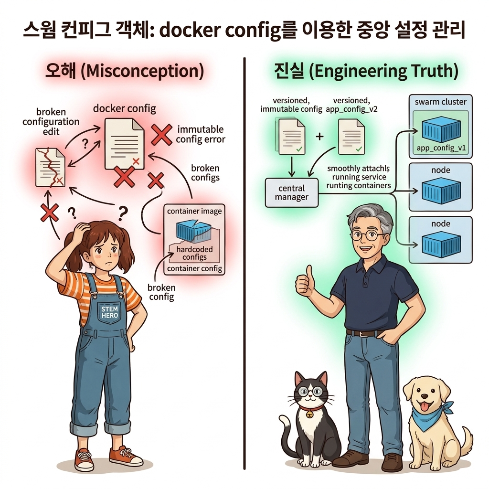
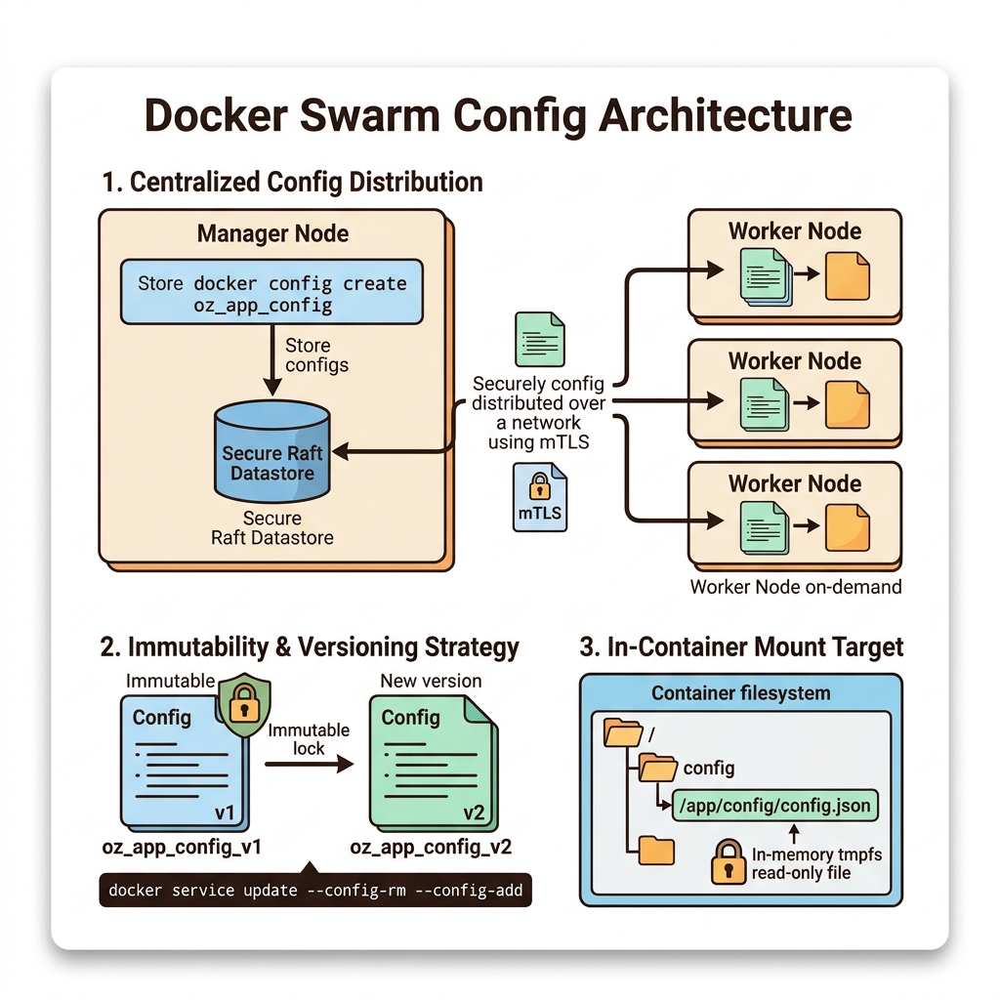
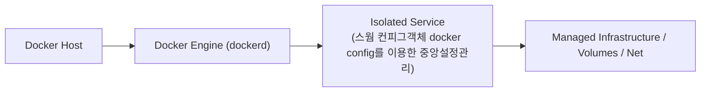
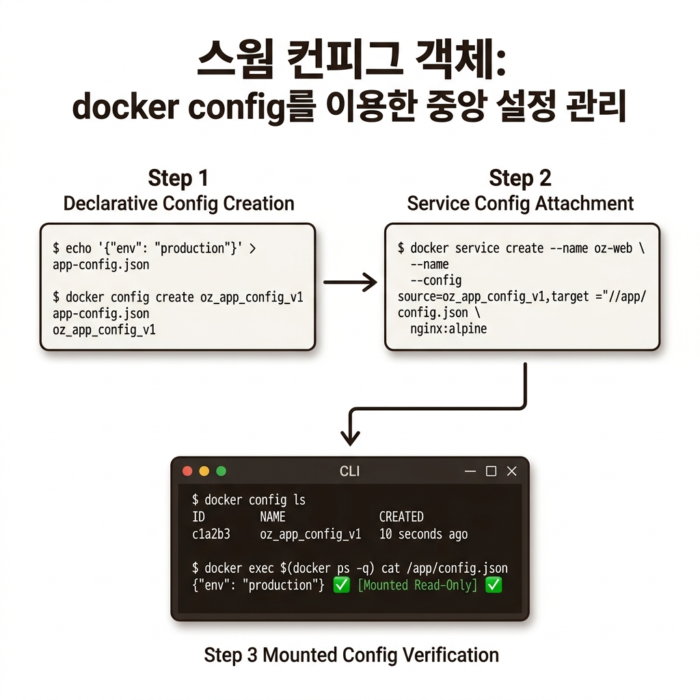
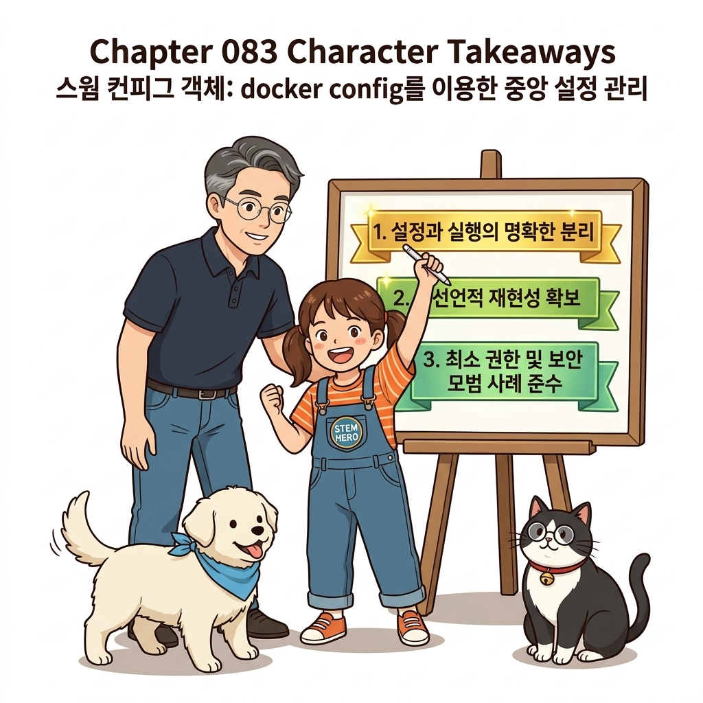

# 083. 스웜 컨피그객체 docker config를 이용한 중앙설정관리

단일 서버에서는 호스트 파일을 바인드 마운트하면 끝났지만, 컨테이너가 20대의 워커 노드 중 어디에 스케줄링될지 모르는 클러스터 환경에서는 로컬 바인드 마운트를 쓸 수 없습니다.


**그림 06-8-1** 스웜 컨피그객체 docker config를 이용한 중앙설정관리의 필요성과 현대 클라우드 아키텍처 관점의 개요

---

### 083.1 왜 스웜 컨피그객체 docker config를 이용한 중앙설정관리이(가) 필요한가? (문제 정의와 현실적 배경)

소프트웨어 시스템이 복잡해질수록 설정을 다루는 방식은 전체 인프라의 신뢰성을 결정짓는 핵심 척도가 됩니다. **스웜 컨피그객체 docker config를 이용한 중앙설정관리**이(가) 부재하거나 잘못 다루어질 때 현장에서는 다음과 같은 대표적인 병목과 장애가 발생합니다:

1. **하드코딩된 설정과 환경 불일치로 인한 유연성 상실**: 환경이 바뀔 때마다 코드를 다시 빌드해야 하므로 배포 주기가 지연되고 이미지 수가 기하급수적으로 폭증합니다.
2. **보안 민감 데이터의 무분별한 노출**: 비밀번호, 데이터베이스 토큰, 암호화 키가 이미지 레이어에 영구 박제되어 형상관리 시스템이나 외부에 유출될 위험이 커집니다.
3. **재현 불가능한 구성 드리프트**: 스테이징 환경과 프로덕션 환경의 미세한 설정 차이가 예기치 못한 서비스 중단 사고로 직결됩니다.


**그림 06-8-2** 스웜 컨피그객체 docker config를 이용한 중앙설정관리에 대한 대표적인 오해와 실제 프로덕션 현장의 엔지니어링 진실

---

### 083.2 핵심 아키텍처와 엔지니어링 메커니즘

설정 파일을 스웜 클러스터의 중앙 Raft 데이터베이스에 **`docker config` 객체**로 등록해 두면, 컨테이너가 어느 노드에서 실행되든 원하는 내부 파일 경로(예: `/etc/nginx/conf.d/default.conf`)로 즉시 주입해 주는 클러스터 설정 관리를 실습합니다!


**그림 06-8-3** 스웜 컨피그객체 docker config를 이용한 중앙설정관리의 내부 아키텍처 및 데이터 흐름

#### 📊 핵심 비교 및 엔지니어링 표준 분석

| 구분 / 핵심 원리 | 상세 설명 및 동작 메커니즘 | 실무 적용 시 주의점 및 베스트 프랙티스 |
| :--- | :--- | :--- |
| **클러스터 중앙 설정 배포** | 매니저 노드에 단 한 번 `docker config create`를 실행하면 클러스터 내 어느 워커 노드에서 컨테이너가 켜지든 해당 설정 파일이 자동 전달됨 | 워커 노드 서버들에 SSH로 접속해 설정 파일을 동기화할 필요가 0% |
| **불변성(Immutability)과 버전 네이밍** | 한 번 생성된 `docker config` 객체는 내용을 직접 수정할 수 없음! 설정을 변경할 때는 `oz_app_config_v2`처럼 새 이름으로 만들고 스택 YAML을 업데이트 | 덕분에 설정 변경으로 장애가 났을 때 이전 설정(`v1`)으로 1초 만에 완벽한 롤백이 가능해짐! |
| **일반 설정 전용** | `docker config`는 평문(Base64 인코딩)으로 조회(`inspect --pretty`)가 가능하므로 일반 환경 설정 파일(`json`, `yaml`, `conf`, `xml`)에만 사용 | 비밀번호나 인증서 개인키는 다음 강의의 암호화 객체인 `docker secret`을 사용해야 함 |

---

### 083.3 선언적 실습 및 아키텍처 다이어그램

본 실습은 외부 비공개 패키지에 의존하지 않고, 공식 표준 이미지를 기반으로 즉시 재현 가능한 살아있는 코드로 구성되어 있습니다.

```bash
# 로컬 설정 파일로 스웜 클러스터 중앙 Config 객체를 생성하고 서비스 컨테이너 내부에 주입하기!
docker swarm init 2>/dev/null || true
echo '{"env": "production", "max_connections": 500}' > /tmp/app-config.json

docker config create oz_app_config_v1 /tmp/app-config.json
docker config ls
docker config inspect --pretty oz_app_config_v1

# 어느 워커 노드에 뜨든 /app/config.json 경로로 설정 파일이 자동 마운트됨!
docker service create --name cfg-test --config source=oz_app_config_v1,target=/app/config.json   alpine:3.20 sh -c "cat /app/config.json && sleep 30"
sleep 2
docker service logs cfg-test
docker service rm cfg-test && docker config rm oz_app_config_v1 && rm -f /tmp/app-config.json
```

#### 🔍 아키텍처 흐름도 (Mermaid Diagram)




**그림 06-8-4** 선언적 인프라 명세를 통한 스웜 컨피그객체 docker config를 이용한 중앙설정관리 검증 파이프라인

---

### 083.4 핵심 정리: 캐릭터 대화와 3대 교훈

> 👧 **도로시**: "교수님! **스웜 컨피그객체 docker config를 이용한 중앙설정관리**의 원리를 배우니까, 복잡하게 얽혀 있던 인프라 설정이 레고 블록처럼 질서정연하게 제자리를 찾는 게 보여요!"
> 
> 🐱 **조교 지니**: "야옹~ 맞습니다! 특히 런타임 환경과 불변 인프라의 경계를 명확히 지키는 것이 대규모 클라우드 운영의 제1원칙이랍니다!"
> 
> 🐶 **토토**: "멍멍! 선언적 코드로 한 번 적어두면 언제든 똑같이 복원되니까 정말 든든해요!"
> 
> 👨‍🏫 **이호진 교수님**: "훌륭하구나. 원리를 깊이 이해하고 실습을 통해 손에 익히는 것이 훌륭한 클라우드 엔지니어로 성장하는 가장 빠른 지름길이란다."


**그림 06-8-5** 스웜 컨피그객체 docker config를 이용한 중앙설정관리 마스터를 위한 3대 핵심 교훈

1. **설정과 실행의 명확한 분리**:
   * 애플리케이션 코드는 불변으로 유지하고, 가변적인 설정값은 외부에서 주입하여 이식성을 극대화합니다.
2. **선언적 재현성 확보**:
   * 사람이 수작업으로 변경하지 않고 코드 명세를 통해 언제 어디서나 100% 동일한 실행 결과를 보장합니다.
3. **최소 권한 및 보안 모범 사례 준수**:
   * 불필요한 권한과 포트 노출을 최소화하고 민감 데이터를 암호화하여 프로덕션 안정성을 담보합니다.

---

### 083.5 랩노트 피날레와 다음 강의 예고


**그림 06-8-6** 연구실에서 다음 마일스톤인 [스웜 비밀값 docker secret 암호화저장소와 보안주입] 실습을 예고하는 교수님과 토토

> 💡 **다음 강의 안내**:
> [스웜 비밀값 docker secret 암호화저장소와 보안주입](../084_스웜_비밀값_docker_secret_암호화저장소와_보안주입/)에서는 더욱 심화된 실전 엔지니어링 실습과 아키텍처를 다룹니다!

---

## 🧭 강의 네비게이션
* [◀️ 이전 강의: 082_도커스웜_스택배포_docker_stack_deploy와_운영컴포즈](../082_도커스웜_스택배포_docker_stack_deploy와_운영컴포즈/)
* [📋 Part 06. 컨테이너 오케스트레이션: 도커 스웜(Swarm) 클러스터, 스택 배포, 무중단 롤링 업데이트 & 쿠버네티스 (076 ~ 095) 목차로 돌아가기](../)
* [▶️ 다음 강의: 084_스웜_비밀값_docker_secret_암호화저장소와_보안주입](../084_스웜_비밀값_docker_secret_암호화저장소와_보안주입/)
