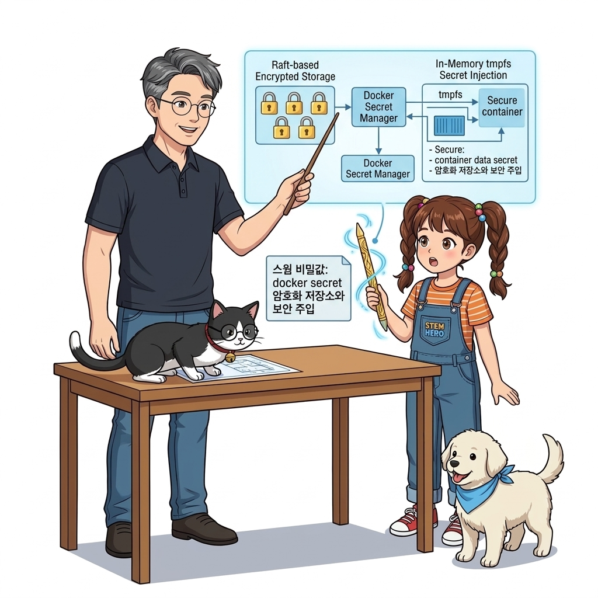
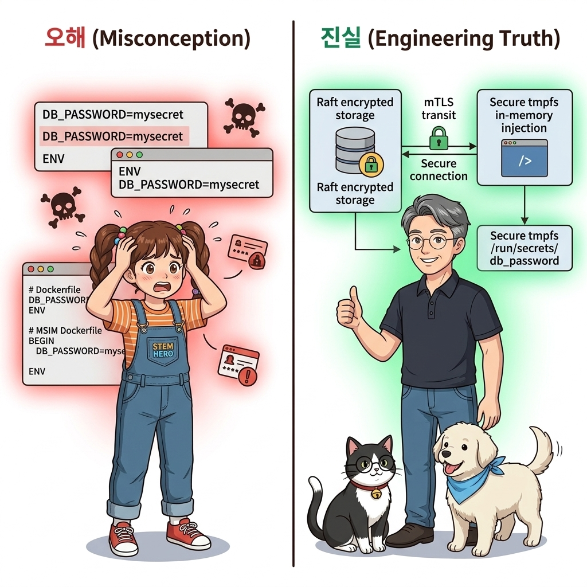
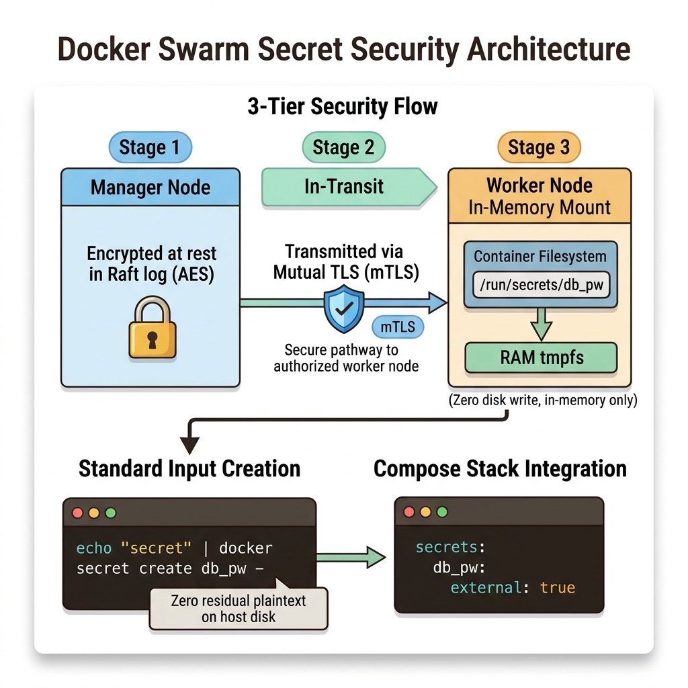
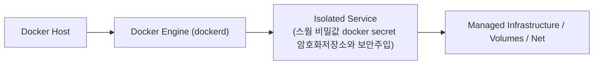
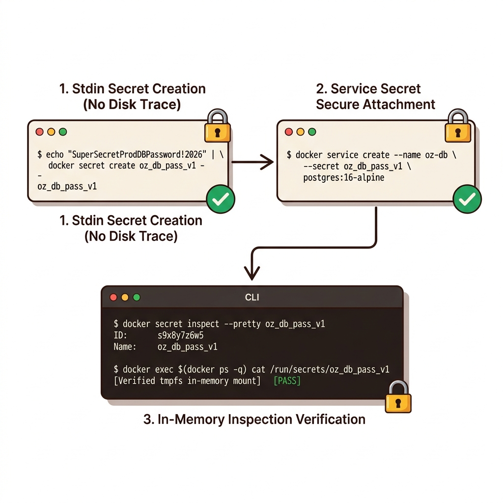
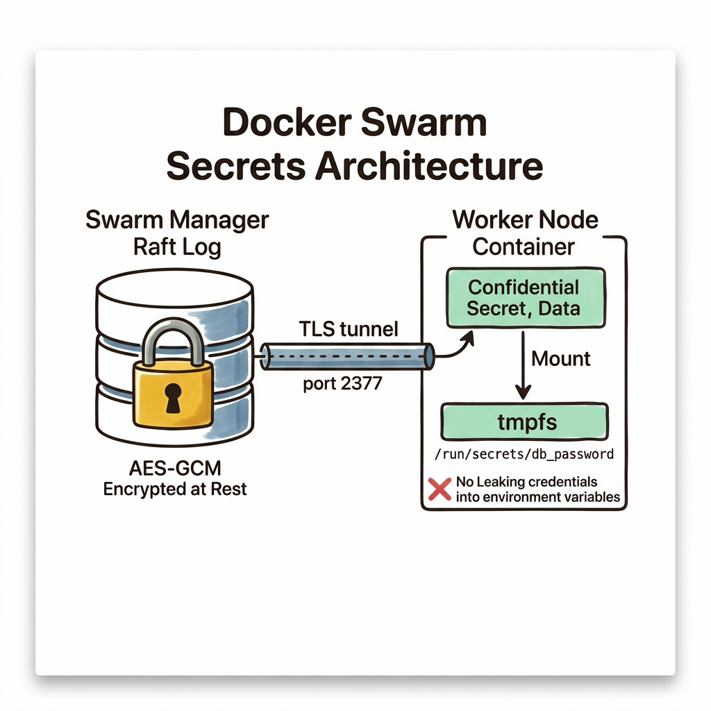

# 084. 스웜 비밀값 docker secret 암호화저장소와 보안주입

데이터베이스 암호, JWT 서명 키, TLS 개인키 같은 1급 기밀 정보를 클러스터에서 가장 안전하게 다루는 **`docker secret`**의 3중 보안 아키텍처를 배웁니다.


**그림 06-9-1** 스웜 비밀값 docker secret 암호화저장소와 보안주입의 필요성과 현대 클라우드 아키텍처 관점의 개요

---

### 084.1 왜 스웜 비밀값 docker secret 암호화저장소와 보안주입이(가) 필요한가? (문제 정의와 현실적 배경)

소프트웨어 시스템이 복잡해질수록 설정을 다루는 방식은 전체 인프라의 신뢰성을 결정짓는 핵심 척도가 됩니다. **스웜 비밀값 docker secret 암호화저장소와 보안주입**이(가) 부재하거나 잘못 다루어질 때 현장에서는 다음과 같은 대표적인 병목과 장애가 발생합니다:

1. **하드코딩된 설정과 환경 불일치로 인한 유연성 상실**: 환경이 바뀔 때마다 코드를 다시 빌드해야 하므로 배포 주기가 지연되고 이미지 수가 기하급수적으로 폭증합니다.
2. **보안 민감 데이터의 무분별한 노출**: 비밀번호, 데이터베이스 토큰, 암호화 키가 이미지 레이어에 영구 박제되어 형상관리 시스템이나 외부에 유출될 위험이 커집니다.
3. **재현 불가능한 구성 드리프트**: 스테이징 환경과 프로덕션 환경의 미세한 설정 차이가 예기치 못한 서비스 중단 사고로 직결됩니다.


**그림 06-9-2** 스웜 비밀값 docker secret 암호화저장소와 보안주입에 대한 대표적인 오해와 실제 프로덕션 현장의 엔지니어링 진실

---

### 084.2 핵심 아키텍처와 엔지니어링 메커니즘

`docker secret create`로 등록된 비밀값은 `inspect --pretty`를 쳐도 절대 내용이 보이지 않으며, 오직 해당 Secret 사용 권한을 부여받은 서비스 컨테이너의 인메모리 파일시스템(`/run/secrets/...`)에만 복호화되어 마운트되고 컨테이너 종료 즉시 메모리에서 증발합니다!


**그림 06-9-3** 스웜 비밀값 docker secret 암호화저장소와 보안주입의 내부 아키텍처 및 데이터 흐름

#### 📊 핵심 비교 및 엔지니어링 표준 분석

| 구분 / 핵심 원리 | 상세 설명 및 동작 메커니즘 | 실무 적용 시 주의점 및 베스트 프랙티스 |
| :--- | :--- | :--- |
| **3중 보안 아키텍처** | 1) 매니저 Raft 로그에 **암호화 저장(At-Rest)**, 2) 워커 노드로 **mTLS 암호화 전송(In-Transit)**, 3) 워커 노드의 디스크가 아닌 **메모리(`tmpfs`)에만 마운트** | 워커 노드 서버의 하드디스크를 통째로 도난당해도 시크릿 데이터는 단 1바이트도 유출되지 않음! |
| **표준 입력(`-`)을 통한 시크릿 생성** | 디스크에 비밀번호 텍스트 파일을 남기지 않고 `echo "암호" | docker secret create 이름 -`으로 파이프 전달 가능 | 생성된 시크릿은 `docker secret inspect`로도 원문을 다시 볼 수 없는 단방향 금고 |
| **컴포즈 스택과의 완벽한 호환** | Part 05에서 로컬 파일로 테스트했던 `/run/secrets/<이름>` 경로와 100% 동일하므로, 운영 스택 YAML에서는 `external: true`만 지정하면 코드 수정 없이 그대로 작동! | 로컬 개발부터 운영 클러스터까지 일관된 보안 코드 유지 |

---

### 084.3 선언적 실습 및 아키텍처 다이어그램

본 실습은 외부 비공개 패키지에 의존하지 않고, 공식 표준 이미지를 기반으로 즉시 재현 가능한 살아있는 코드로 구성되어 있습니다.

```bash
# 클러스터 암호화 Secret 객체를 생성하고, inspect로 볼 수 없으며 오직 승인된 컨테이너 내부에서만 읽히는지 검증!
docker swarm init 2>/dev/null || true
echo "SuperSecretProdDBPassword!2026" | docker secret create oz_db_pass_v1 -

# 매니저 노드에서 inspect를 실행해도 실제 비밀번호 데이터는 절대 노출되지 않음!
docker secret inspect --pretty oz_db_pass_v1

# 승인된 서비스 내부의 /run/secrets/oz_db_pass_v1 인메모리 경로에서만 읽기 가능!
docker service create --name sec-test --secret oz_db_pass_v1   alpine:3.20 sh -c "cat /run/secrets/oz_db_pass_v1 && sleep 30"
sleep 2
docker service logs sec-test
docker service rm sec-test && docker secret rm oz_db_pass_v1
```

#### 🔍 아키텍처 흐름도 (Mermaid Diagram)




**그림 06-9-4** 선언적 인프라 명세를 통한 스웜 비밀값 docker secret 암호화저장소와 보안주입 검증 파이프라인

---

<!-- BIBLE_INTEGRATION_book9_swarm_secrets_tmpfs -->
### 084.B 📚 도커 바이블 심화: Raft 암호화 저장소와 /run/secrets tmpfs 인메모리 보안 주입 메커니즘
> **출처 및 학술적 배경**: 『시작하세요! 도커/쿠버네티스』 제3장 (도커 스웜: 비밀값 관리)  
> **핵심 주제**: 환경 변수 평문 노출 취약점 극복, Swarm Raft 분산 저장소의 휴면 암호화(Encryption at Rest), 그리고 물리 디스크에 기록되지 않는 `tmpfs` 인메모리 마운트 보안 규격.

#### 1. 환경 변수(`-e DB_PASS=...`) 주입의 치명적 보안 결함
초보 엔지니어들은 데이터베이스 비밀번호나 API 토큰을 `docker run -e DB_PASSWORD=secret`과 같이 환경 변수로 주입합니다. 하지만 이는 엔터프라이즈 환경에서 매우 위험한 보안 취약점을 유발합니다:
* **`docker inspect` 평문 노출**: 호스트에서 `docker inspect` 명령을 실행하면 환경 변수 블록(`Config.Env`)에 비밀번호가 평문 텍스트로 고스란히 노출됩니다.
* **프로세스 테이블 탈취**: 컨테이너가 침해당했을 때 `/proc/<pid>/environ` 파일을 읽거나 충돌 덤프(Crash Dump)가 발생하면 메모리에 상주하는 모든 비밀값이 로그 시스템으로 전송되어 버립니다.

#### 2. `docker secret`의 종단간(End-to-End) 암호화 아키텍처
도커 스웜은 민감 정보를 다루기 위해 하드웨어 보안 모듈 수준의 3단계 암호화 파이프라인을 제공합니다:
1. **Raft 휴면 암호화 (Encryption at Rest)**: 매니저 노드에 비밀값이 생성되면, Raft 로그에 저장될 때 **AES-GCM 암호화 키**로 즉시 암호화되어 디스크에 기록됩니다.
2. **상호 TLS 전송 (mTLS)**: 매니저에서 해당 서비스를 실행할 워커 노드로 비밀값을 전달할 때 노드 인증서 기반의 암호화 터널(`2377/tcp`)을 통과합니다.
3. **물리 디스크 기록 차단 (`tmpfs` 마운트)**: 워커 노드는 비밀값을 수신한 뒤 물리 SSD/HDD에 쓰지 않고, 오직 리눅스 커널의 RAM 기반 가상 파일시스템인 **`tmpfs` 디렉터리(`/run/secrets/<secret_name>`)**에만 복호화하여 주입합니다.
4. **휘발성 안전성**: 컨테이너가 중지되거나 호스트 전원이 꺼지는 순간 RAM에서 데이터가 즉시 소멸하므로, 디스크 포렌식 복구 공격을 원천 무력화합니다.


**그림 084-B-1** Swarm Raft 암호화 저장소에서 워커 노드 /run/secrets tmpfs로 이어지는 안전한 보안 주입 파이프라인

```bash
# [실습] docker secret 생성 및 /run/secrets 무결성 검증
# 1. 표준 입력을 통해 암호화된 시크릿 생성 (호스트 셸 히스토리에 암호가 남지 않음)
echo "SuperSecretDBPassword2026!" | docker secret create db_root_password -

# 2. 생성된 시크릿 목록 및 메타데이터 확인 (값은 절대로 조회 불가능)
docker secret ls
docker secret inspect db_root_password

# 3. 서비스를 생성하며 시크릿 안전 주입
docker service create --name secure-backend \
  --secret db_root_password \
  alpine sleep 3600

# 4. 컨테이너 내부의 /run/secrets 경로 확인 (tmpfs 마운트 검증)
CONTAINER_ID=$(docker ps -q --filter label=com.docker.swarm.service.name=secure-backend | head -n 1)
docker exec $CONTAINER_ID df -h /run/secrets
docker exec $CONTAINER_ID cat /run/secrets/db_root_password

# 5. 실습 정리
docker service rm secure-backend
docker secret rm db_root_password
```

> 👨‍🏫 **이호진 교수님의 바이블 멘토링 노트**:
> "프로덕션 클라우드 환경에서는 '환경 변수에는 설정(Config)만 담고, 암호(Secret)는 반드시 파일 마운트(/run/secrets)로 분리한다'는 보안 제1원칙을 지켜야 합니다. 스웜의 tmpfs 주입 방식은 쿠버네티스의 Secret 메커니즘과도 완전히 동일합니다."
>
> 👧 **도로시의 깨달음**:
> "벽보(환경변수)에 비밀번호를 크게 써붙이는 대신, 얼음 상자(RAM tmpfs)에 비밀 편지를 넣어서 건네주고 일이 끝나면 얼음이 녹듯 흔적도 없이 사라지게 하는 거네요!"
>
> 🐱 **조교 지니의 아키텍처 체크포인트**:
> * `docker secret`은 한 번 생성되면 내용 수정이 불가능한 불변 객체입니다. 비밀번호를 교체하려면 `db_password_v2`를 새로 생성한 뒤 서비스 업데이트(`docker service update --secret-rm ... --secret-add ...`)로 롤링 교체해야 합니다.

---

### 084.4 핵심 정리: 캐릭터 대화와 3대 교훈

> 👧 **도로시**: "교수님! **스웜 비밀값 docker secret 암호화저장소와 보안주입**의 원리를 배우니까, 복잡하게 얽혀 있던 인프라 설정이 레고 블록처럼 질서정연하게 제자리를 찾는 게 보여요!"
> 
> 🐱 **조교 지니**: "야옹~ 맞습니다! 특히 런타임 환경과 불변 인프라의 경계를 명확히 지키는 것이 대규모 클라우드 운영의 제1원칙이랍니다!"
> 
> 🐶 **토토**: "멍멍! 선언적 코드로 한 번 적어두면 언제든 똑같이 복원되니까 정말 든든해요!"
> 
> 👨‍🏫 **이호진 교수님**: "훌륭하구나. 원리를 깊이 이해하고 실습을 통해 손에 익히는 것이 훌륭한 클라우드 엔지니어로 성장하는 가장 빠른 지름길이란다."


**그림 06-9-5** 스웜 비밀값 docker secret 암호화저장소와 보안주입 마스터를 위한 3대 핵심 교훈

1. **설정과 실행의 명확한 분리**:
   * 애플리케이션 코드는 불변으로 유지하고, 가변적인 설정값은 외부에서 주입하여 이식성을 극대화합니다.
2. **선언적 재현성 확보**:
   * 사람이 수작업으로 변경하지 않고 코드 명세를 통해 언제 어디서나 100% 동일한 실행 결과를 보장합니다.
3. **최소 권한 및 보안 모범 사례 준수**:
   * 불필요한 권한과 포트 노출을 최소화하고 민감 데이터를 암호화하여 프로덕션 안정성을 담보합니다.

---

### 084.5 랩노트 피날레와 다음 강의 예고


**그림 06-9-6** 연구실에서 다음 마일스톤인 [클러스터환경의 퍼시스턴트볼륨과 노드레이블 배치제약] 실습을 예고하는 교수님과 토토

> 💡 **다음 강의 안내**:
> [클러스터환경의 퍼시스턴트볼륨과 노드레이블 배치제약](../085_클러스터환경의_퍼시스턴트볼륨과_노드레이블_배치제약/)에서는 더욱 심화된 실전 엔지니어링 실습과 아키텍처를 다룹니다!

---

## 🧭 강의 네비게이션
* [◀️ 이전 강의: 083_스웜_컨피그객체_docker_config를_이용한_중앙설정관리](../083_스웜_컨피그객체_docker_config를_이용한_중앙설정관리/)
* [📋 Part 06. 컨테이너 오케스트레이션: 도커 스웜(Swarm) 클러스터, 스택 배포, 무중단 롤링 업데이트 & 쿠버네티스 (076 ~ 095) 목차로 돌아가기](../)
* [▶️ 다음 강의: 085_클러스터환경의_퍼시스턴트볼륨과_노드레이블_배치제약](../085_클러스터환경의_퍼시스턴트볼륨과_노드레이블_배치제약/)
