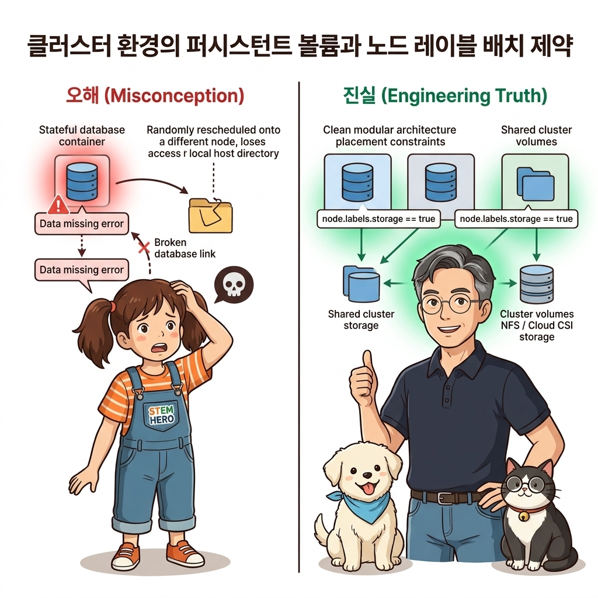
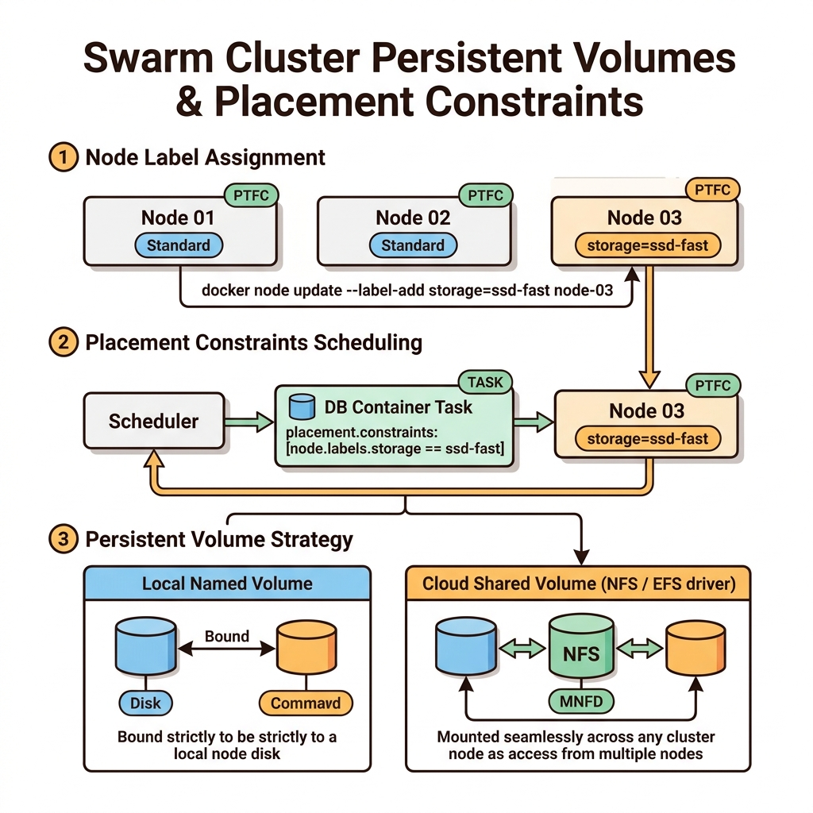
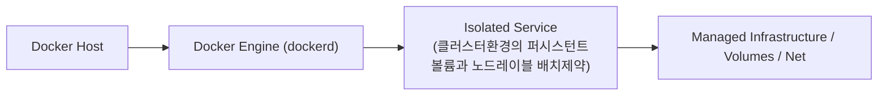
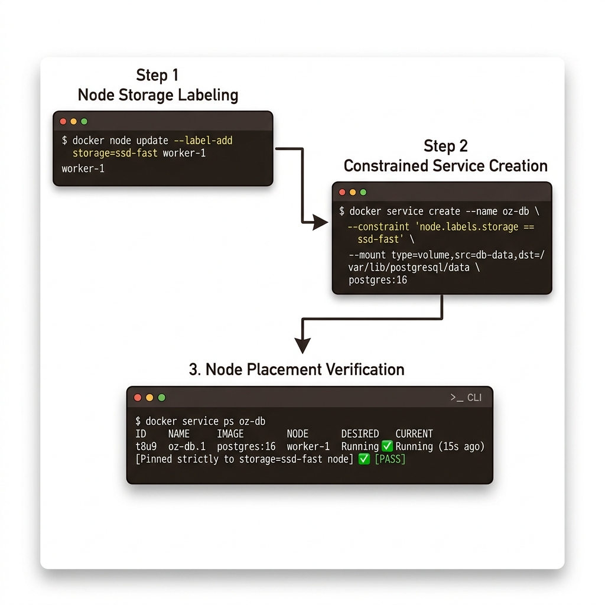

# 085. 클러스터환경의 퍼시스턴트볼륨과 노드레이블 배치제약

도커 스웜의 기본 볼륨은 각 노드의 로컬 디스크에 생성됩니다. 따라서 데이터베이스 컨테이너가 재시작될 때 다른 워커 노드로 스케줄링되면 기존 데이터를 찾지 못하고 빈 볼륨을 새로 만드는 문제가 생깁니다.


**그림 06-10-1** 클러스터환경의 퍼시스턴트볼륨과 노드레이블 배치제약의 필요성과 현대 클라우드 아키텍처 관점의 개요

---

### 085.1 왜 클러스터환경의 퍼시스턴트볼륨과 노드레이블 배치제약이(가) 필요한가? (문제 정의와 현실적 배경)

소프트웨어 시스템이 복잡해질수록 설정을 다루는 방식은 전체 인프라의 신뢰성을 결정짓는 핵심 척도가 됩니다. **클러스터환경의 퍼시스턴트볼륨과 노드레이블 배치제약**이(가) 부재하거나 잘못 다루어질 때 현장에서는 다음과 같은 대표적인 병목과 장애가 발생합니다:

1. **하드코딩된 설정과 환경 불일치로 인한 유연성 상실**: 환경이 바뀔 때마다 코드를 다시 빌드해야 하므로 배포 주기가 지연되고 이미지 수가 기하급수적으로 폭증합니다.
2. **보안 민감 데이터의 무분별한 노출**: 비밀번호, 데이터베이스 토큰, 암호화 키가 이미지 레이어에 영구 박제되어 형상관리 시스템이나 외부에 유출될 위험이 커집니다.
3. **재현 불가능한 구성 드리프트**: 스테이징 환경과 프로덕션 환경의 미세한 설정 차이가 예기치 못한 서비스 중단 사고로 직결됩니다.


**그림 06-10-2** 클러스터환경의 퍼시스턴트볼륨과 노드레이블 배치제약에 대한 대표적인 오해와 실제 프로덕션 현장의 엔지니어링 진실

---

### 085.2 핵심 아키텍처와 엔지니어링 메커니즘

특정 고성능 SSD 장착 노드에 **`docker node update --label-add disk=nvme-ssd 노드명`으로 커스텀 레이블을 붙이고, 스택 YAML의 `deploy.placement.constraints`로 DB 컨테이너가 항상 해당 노드로만 고정 배치(Pinning)되도록 제어**하는 실무 기법을 마스터합니다!


**그림 06-10-3** 클러스터환경의 퍼시스턴트볼륨과 노드레이블 배치제약의 내부 아키텍처 및 데이터 흐름

#### 📊 핵심 비교 및 엔지니어링 표준 분석

| 구분 / 핵심 원리 | 상세 설명 및 동작 메커니즘 | 실무 적용 시 주의점 및 베스트 프랙티스 |
| :--- | :--- | :--- |
| **노드 레이블 (`node.labels.*`)** | 클러스터 노드의 하드웨어 특성(`gpu=true`, `storage=ssd`), 리전(`zone=kr-seoul-a`), 보안 등급(`tier=pci-dss`)을 메타데이터로 태깅 | `docker node update --label-add 키=값 <노드명>`으로 클러스터 운영 중 언제든 동적 추가 가능 |
| **배치 제약 조건 (`placement.constraints`)** | `node.role == manager`(매니저 전용), `node.labels.storage == ssd`(특정 레이블 노드), `node.hostname != node3`(특정 노드 제외) 등 정교한 스케줄링 규칙 지정 | 조건을 만족하는 노드가 하나도 없으면 스웜은 무리하게 다른 노드에 띄우지 않고 `Pending` 상태로 안전하게 대기함! |
| **클라우드 공유 스토리지 플러그인** | 노드 고정 외에 다중 노드 간 볼륨 이동이 필요할 때는 AWS EFS, NFS, Ceph, GlusterFS 같은 네트워크 볼륨 드라이버 플러그인을 연동 | 워크로드의 IOPS 성능 요구사항(로컬 NVMe 고정 vs 네트워크 공유 스토리지)에 맞춰 아키텍처 선택 |

---

### 085.3 선언적 실습 및 아키텍처 다이어그램

본 실습은 외부 비공개 패키지에 의존하지 않고, 공식 표준 이미지를 기반으로 즉시 재현 가능한 살아있는 코드로 구성되어 있습니다.

```bash
# 현재 노드에 커스텀 레이블(storage=ssd-primary)을 부여하고, 해당 레이블이 있는 노드로만 서비스를 고정 배치(Pinning)하기!
docker swarm init 2>/dev/null || true
NODE_ID=$(docker node ls -q | head -n 1)
docker node update --label-add storage=ssd-primary $NODE_ID
docker node inspect --format 'Node Labels: {{json .Spec.Labels}}' $NODE_ID

docker service create --name pinned-db   --constraint 'node.labels.storage == ssd-primary'   alpine:3.20 sh -c "echo 'Running on SSD node!'; sleep 30"
docker service ps pinned-db
docker service rm pinned-db && docker node update --label-rm storage $NODE_ID
```

#### 🔍 아키텍처 흐름도 (Mermaid Diagram)




**그림 06-10-4** 선언적 인프라 명세를 통한 클러스터환경의 퍼시스턴트볼륨과 노드레이블 배치제약 검증 파이프라인

---

### 085.4 핵심 정리: 캐릭터 대화와 3대 교훈

> 👧 **도로시**: "교수님! **클러스터환경의 퍼시스턴트볼륨과 노드레이블 배치제약**의 원리를 배우니까, 복잡하게 얽혀 있던 인프라 설정이 레고 블록처럼 질서정연하게 제자리를 찾는 게 보여요!"
> 
> 🐱 **조교 지니**: "야옹~ 맞습니다! 특히 런타임 환경과 불변 인프라의 경계를 명확히 지키는 것이 대규모 클라우드 운영의 제1원칙이랍니다!"
> 
> 🐶 **토토**: "멍멍! 선언적 코드로 한 번 적어두면 언제든 똑같이 복원되니까 정말 든든해요!"
> 
> 👨‍🏫 **이호진 교수님**: "훌륭하구나. 원리를 깊이 이해하고 실습을 통해 손에 익히는 것이 훌륭한 클라우드 엔지니어로 성장하는 가장 빠른 지름길이란다."


**그림 06-10-5** 클러스터환경의 퍼시스턴트볼륨과 노드레이블 배치제약 마스터를 위한 3대 핵심 교훈

1. **설정과 실행의 명확한 분리**:
   * 애플리케이션 코드는 불변으로 유지하고, 가변적인 설정값은 외부에서 주입하여 이식성을 극대화합니다.
2. **선언적 재현성 확보**:
   * 사람이 수작업으로 변경하지 않고 코드 명세를 통해 언제 어디서나 100% 동일한 실행 결과를 보장합니다.
3. **최소 권한 및 보안 모범 사례 준수**:
   * 불필요한 권한과 포트 노출을 최소화하고 민감 데이터를 암호화하여 프로덕션 안정성을 담보합니다.

---

### 085.5 랩노트 피날레와 다음 강의 예고


**그림 06-10-6** 연구실에서 다음 마일스톤인 [스웜클러스터의 스택관리원리 서비스 태스크 복제와글로벌모드] 실습을 예고하는 교수님과 토토

> 💡 **다음 강의 안내**:
> [스웜클러스터의 스택관리원리 서비스 태스크 복제와글로벌모드](../086_스웜클러스터의_스택관리원리_서비스_태스크_복제와글로벌모드/)에서는 더욱 심화된 실전 엔지니어링 실습과 아키텍처를 다룹니다!

---

## 🧭 강의 네비게이션
* [◀️ 이전 강의: 084_스웜_비밀값_docker_secret_암호화저장소와_보안주입](../084_스웜_비밀값_docker_secret_암호화저장소와_보안주입/)
* [📋 Part 06. 컨테이너 오케스트레이션: 도커 스웜(Swarm) 클러스터, 스택 배포, 무중단 롤링 업데이트 & 쿠버네티스 (076 ~ 095) 목차로 돌아가기](../)
* [▶️ 다음 강의: 086_스웜클러스터의_스택관리원리_서비스_태스크_복제와글로벌모드](../086_스웜클러스터의_스택관리원리_서비스_태스크_복제와글로벌모드/)
