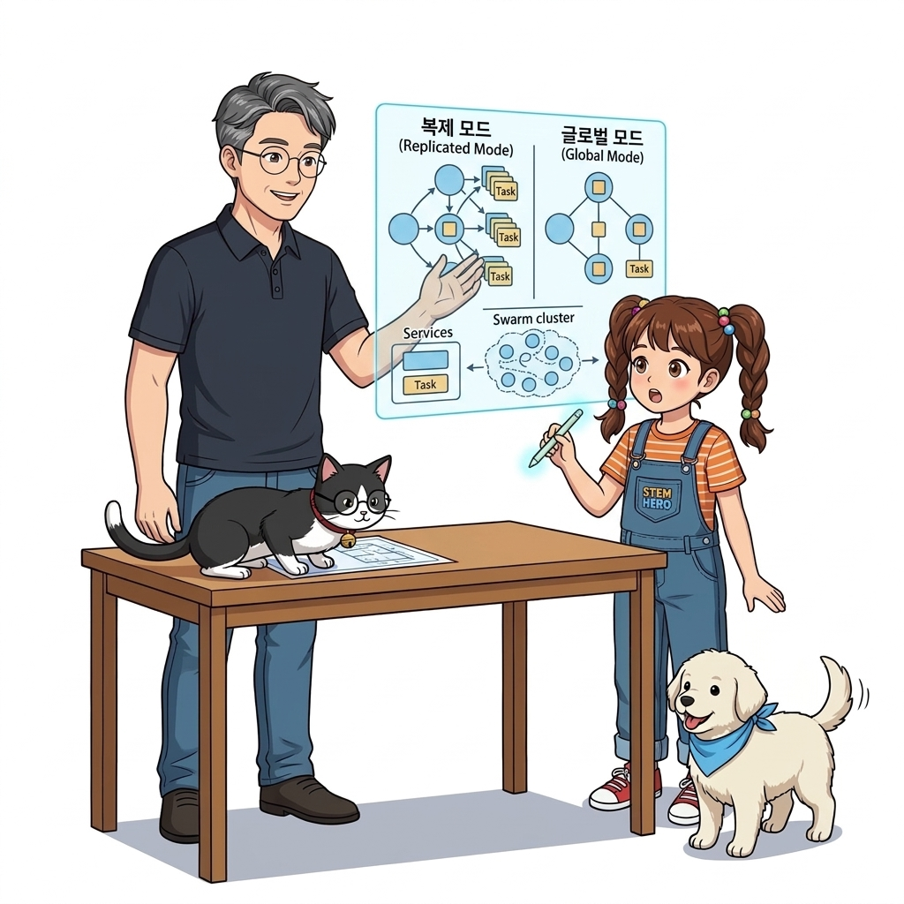
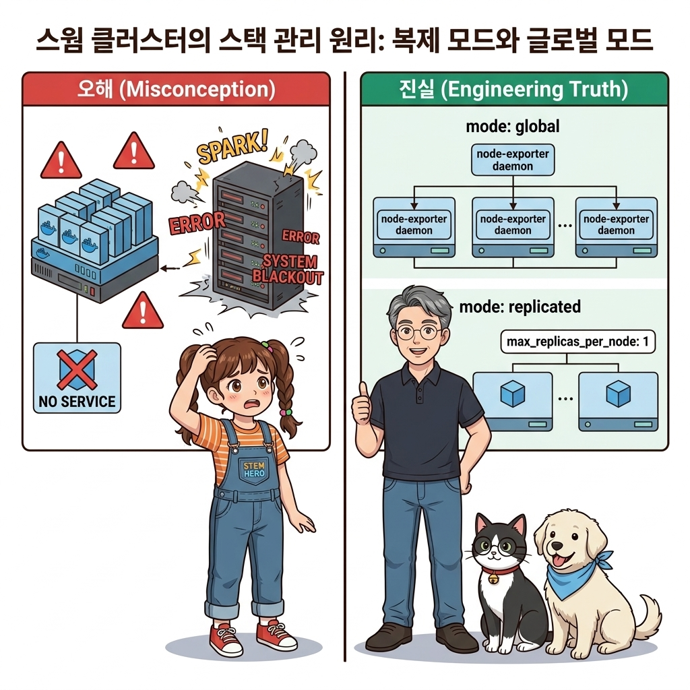
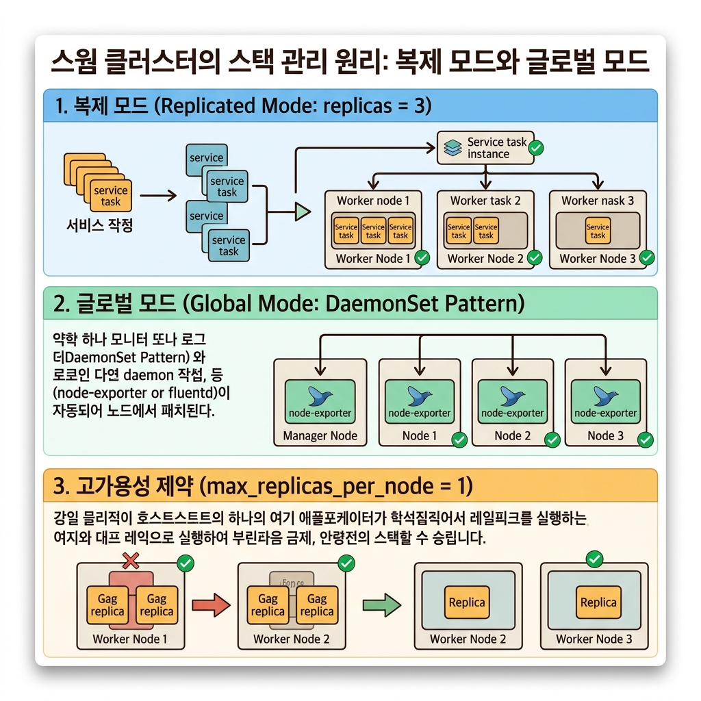
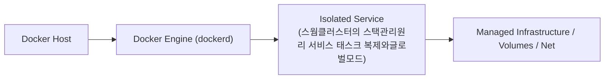
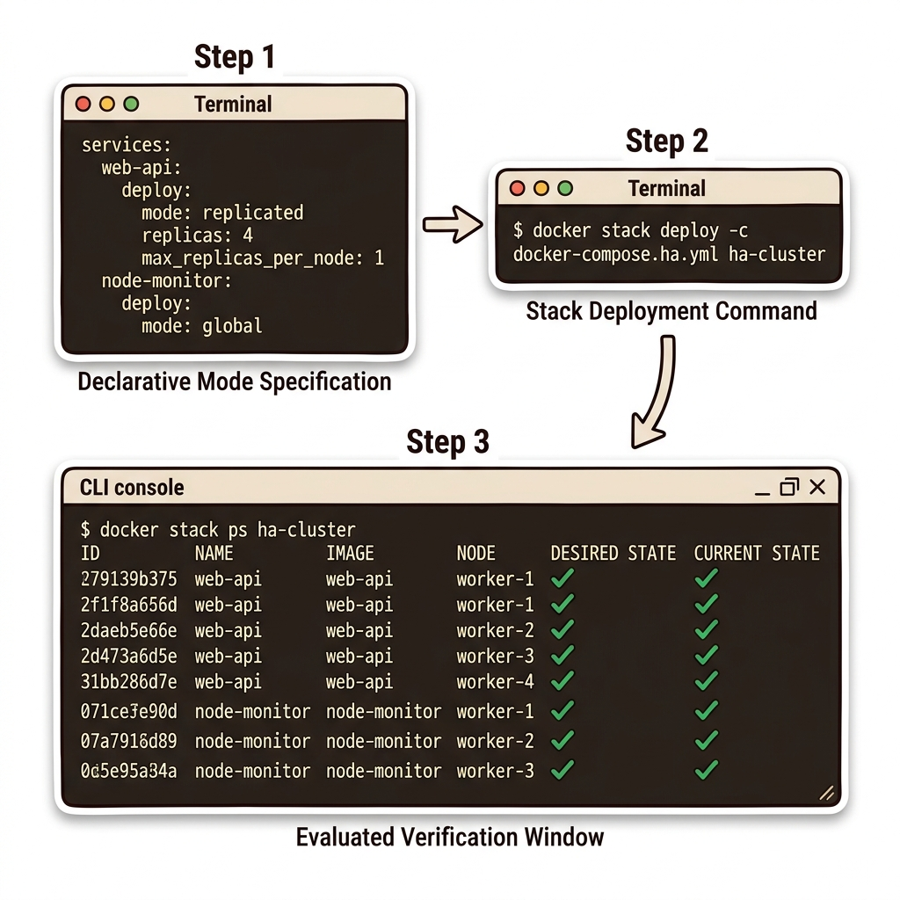
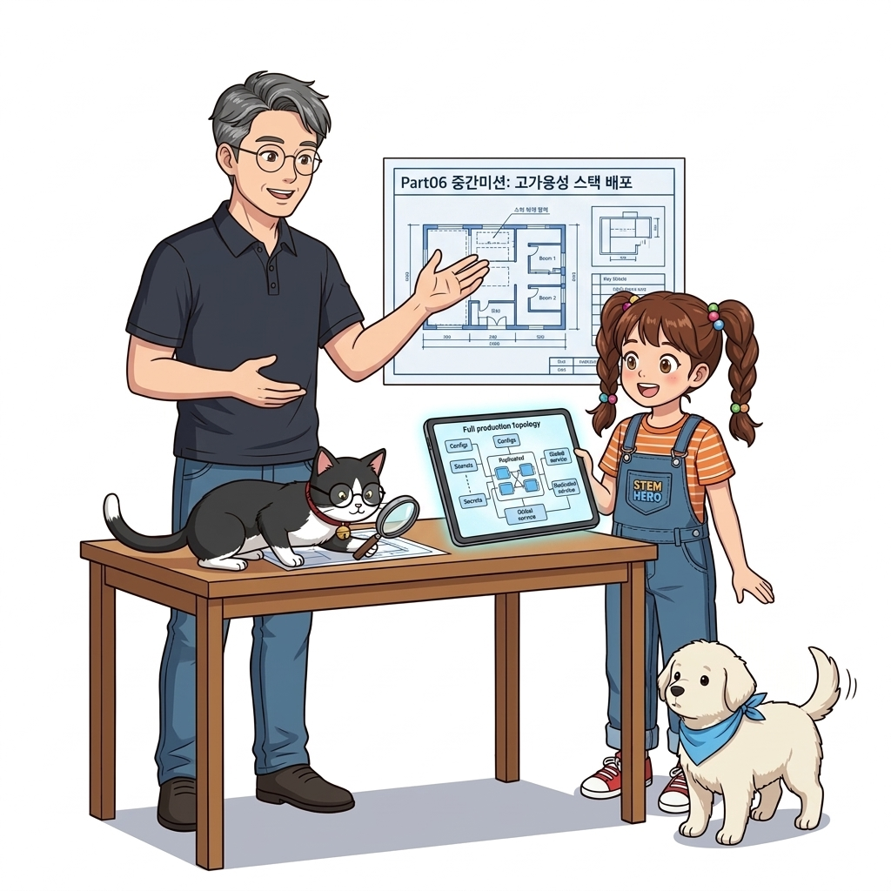

# 086. 스웜클러스터의 스택관리원리 서비스 태스크 복제와글로벌모드

스웜이 서비스를 배포하는 두 가지 스케줄링 모드인 **`mode: replicated`(지정한 총개수만큼 클러스터 전체에 분산 배치)**와 **`mode: global`(클러스터의 모든 노드에 정확히 1개씩 자동 배치)**의 차이를 이해합니다.


**그림 06-11-1** 스웜클러스터의 스택관리원리 서비스 태스크 복제와글로벌모드의 필요성과 현대 클라우드 아키텍처 관점의 개요

---

### 086.1 왜 스웜클러스터의 스택관리원리 서비스 태스크 복제와글로벌모드이(가) 필요한가? (문제 정의와 현실적 배경)

소프트웨어 시스템이 복잡해질수록 설정을 다루는 방식은 전체 인프라의 신뢰성을 결정짓는 핵심 척도가 됩니다. **스웜클러스터의 스택관리원리 서비스 태스크 복제와글로벌모드**이(가) 부재하거나 잘못 다루어질 때 현장에서는 다음과 같은 대표적인 병목과 장애가 발생합니다:

1. **하드코딩된 설정과 환경 불일치로 인한 유연성 상실**: 환경이 바뀔 때마다 코드를 다시 빌드해야 하므로 배포 주기가 지연되고 이미지 수가 기하급수적으로 폭증합니다.
2. **보안 민감 데이터의 무분별한 노출**: 비밀번호, 데이터베이스 토큰, 암호화 키가 이미지 레이어에 영구 박제되어 형상관리 시스템이나 외부에 유출될 위험이 커집니다.
3. **재현 불가능한 구성 드리프트**: 스테이징 환경과 프로덕션 환경의 미세한 설정 차이가 예기치 못한 서비스 중단 사고로 직결됩니다.


**그림 06-11-2** 스웜클러스터의 스택관리원리 서비스 태스크 복제와글로벌모드에 대한 대표적인 오해와 실제 프로덕션 현장의 엔지니어링 진실

---

### 086.2 핵심 아키텍처와 엔지니어링 메커니즘

또한 `max_replicas_per_node: 1` 옵션을 통해 레플리카들이 한 노드에 몰리지 않고 여러 노드에 골고루 퍼지도록(Anti-Affinity, 고가용성 분산) 강제하는 기법을 배웁니다.


**그림 06-11-3** 스웜클러스터의 스택관리원리 서비스 태스크 복제와글로벌모드의 내부 아키텍처 및 데이터 흐름

#### 📊 핵심 비교 및 엔지니어링 표준 분석

| 구분 / 핵심 원리 | 상세 설명 및 동작 메커니즘 | 실무 적용 시 주의점 및 베스트 프랙티스 |
| :--- | :--- | :--- |
| **`mode: replicated` (기본값)** | 클러스터에 노드가 몇 대이든 상관없이 사용자가 지정한 `replicas: N` 개수를 클러스터 전체에서 유지 | 웹 프론트엔드, REST API, 메시지 큐 워커 등 일반 비즈니스 애플리케이션의 표준 모드 |
| **`mode: global` (쿠버네티스의 DaemonSet)** | `replicas` 숫자를 적지 않으며, 클러스터에 참여 중인 **모든 노드마다 정확히 1개씩의 컨테이너**를 실행! | 노드 모니터링 수집기(cAdvisor, Node Exporter), 로그 수집기(Fluentd), 보안 백신 에이전트 배포에 필수! 새 서버가 `swarm join`하는 순간 자동으로 배포됨 |
| **`max_replicas_per_node: 1`** | 레플리카가 2개인데 우연히 둘 다 1번 노드에 배치되면 1번 노드 다운 시 서비스가 전멸함! 이를 막기 위해 노드당 최대 배치 개수를 제한 | 진정한 물리적 고가용성(HA)을 보장하는 핵심 배치 옵션 |

---

### 086.3 선언적 실습 및 아키텍처 다이어그램

본 실습은 외부 비공개 패키지에 의존하지 않고, 공식 표준 이미지를 기반으로 즉시 재현 가능한 살아있는 코드로 구성되어 있습니다.

```yaml
# [stack.yaml] 일반 웹 서비스(replicated + 노드당 1개 분산)와 노드 감시 에이전트(global 데몬셋) 비교!
services:
  web-api:
    image: nginx:1.27-alpine
    deploy:
      mode: replicated
      replicas: 4
      placement:
        max_replicas_per_node: 1

  node-exporter:
    image: prom/node-exporter:v1.8.1
    deploy:
      mode: global
```

#### 🔍 아키텍처 흐름도 (Mermaid Diagram)




**그림 06-11-4** 선언적 인프라 명세를 통한 스웜클러스터의 스택관리원리 서비스 태스크 복제와글로벌모드 검증 파이프라인

---

### 086.4 핵심 정리: 캐릭터 대화와 3대 교훈

> 👧 **도로시**: "교수님! **스웜클러스터의 스택관리원리 서비스 태스크 복제와글로벌모드**의 원리를 배우니까, 복잡하게 얽혀 있던 인프라 설정이 레고 블록처럼 질서정연하게 제자리를 찾는 게 보여요!"
> 
> 🐱 **조교 지니**: "야옹~ 맞습니다! 특히 런타임 환경과 불변 인프라의 경계를 명확히 지키는 것이 대규모 클라우드 운영의 제1원칙이랍니다!"
> 
> 🐶 **토토**: "멍멍! 선언적 코드로 한 번 적어두면 언제든 똑같이 복원되니까 정말 든든해요!"
> 
> 👨‍🏫 **이호진 교수님**: "훌륭하구나. 원리를 깊이 이해하고 실습을 통해 손에 익히는 것이 훌륭한 클라우드 엔지니어로 성장하는 가장 빠른 지름길이란다."


**그림 06-11-5** 스웜클러스터의 스택관리원리 서비스 태스크 복제와글로벌모드 마스터를 위한 3대 핵심 교훈

1. **설정과 실행의 명확한 분리**:
   * 애플리케이션 코드는 불변으로 유지하고, 가변적인 설정값은 외부에서 주입하여 이식성을 극대화합니다.
2. **선언적 재현성 확보**:
   * 사람이 수작업으로 변경하지 않고 코드 명세를 통해 언제 어디서나 100% 동일한 실행 결과를 보장합니다.
3. **최소 권한 및 보안 모범 사례 준수**:
   * 불필요한 권한과 포트 노출을 최소화하고 민감 데이터를 암호화하여 프로덕션 안정성을 담보합니다.

---

### 086.5 랩노트 피날레와 다음 강의 예고


**그림 06-11-6** 연구실에서 다음 마일스톤인 [Part06 중간미션 컨피그와 시크릿이 적용된 고가용성스택배포] 실습을 예고하는 교수님과 토토

> 💡 **다음 강의 안내**:
> [Part06 중간미션 컨피그와 시크릿이 적용된 고가용성스택배포](../087_Part06_중간미션_컨피그와_시크릿이_적용된_고가용성스택배포/)에서는 더욱 심화된 실전 엔지니어링 실습과 아키텍처를 다룹니다!

---

## 🧭 강의 네비게이션
* [◀️ 이전 강의: 085_클러스터환경의_퍼시스턴트볼륨과_노드레이블_배치제약](../085_클러스터환경의_퍼시스턴트볼륨과_노드레이블_배치제약/)
* [📋 Part 06. 컨테이너 오케스트레이션: 도커 스웜(Swarm) 클러스터, 스택 배포, 무중단 롤링 업데이트 & 쿠버네티스 (076 ~ 095) 목차로 돌아가기](../)
* [▶️ 다음 강의: 087_Part06_중간미션_컨피그와_시크릿이_적용된_고가용성스택배포](../087_Part06_중간미션_컨피그와_시크릿이_적용된_고가용성스택배포/)
