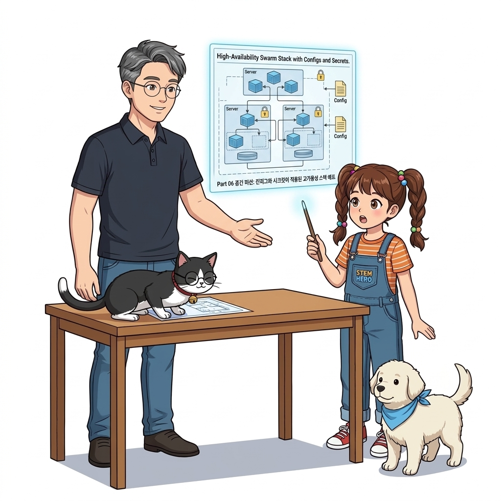
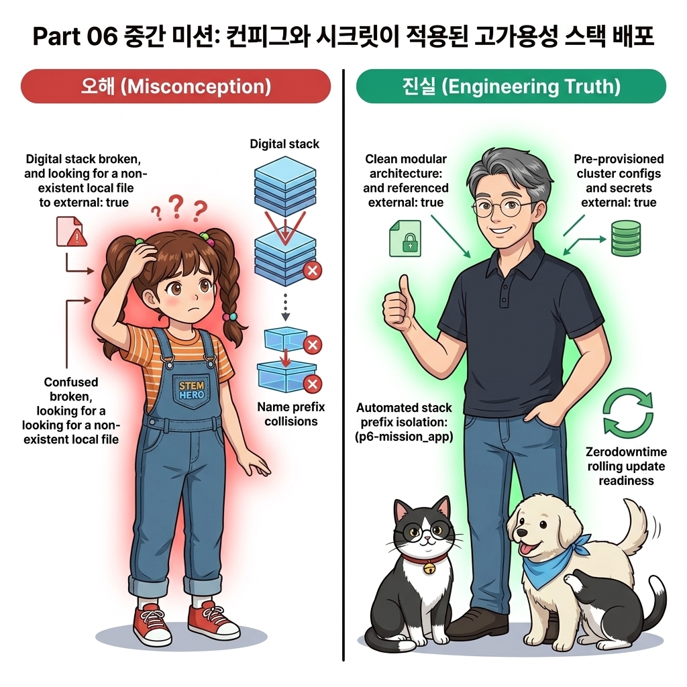
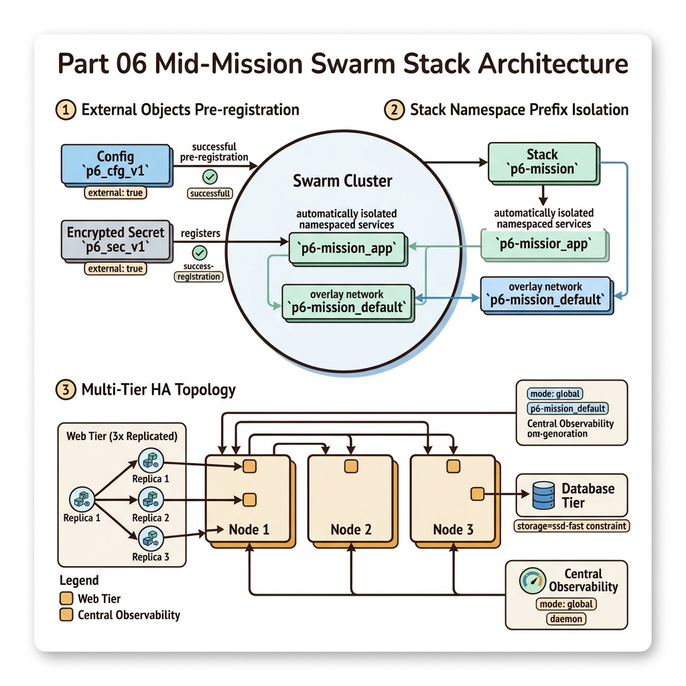
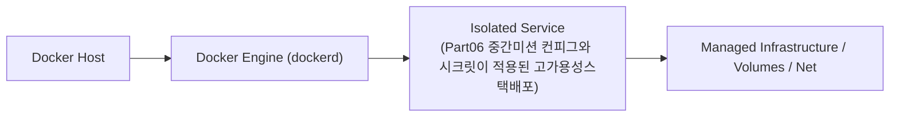
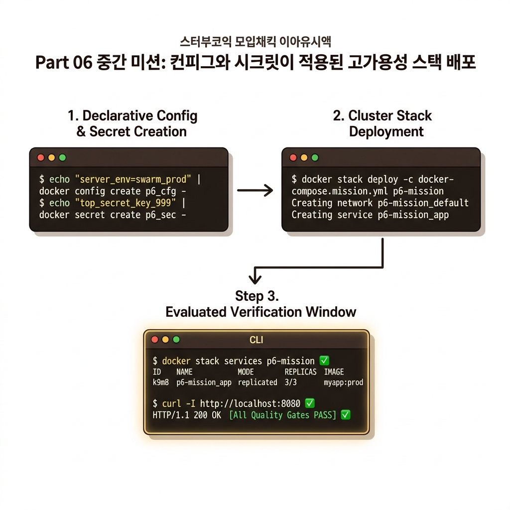

# 087. Part06 중간미션 컨피그와 시크릿이 적용된 고가용성스택배포

12~13장에서 배운 클러스터 컨피그, 암호화 시크릿, 오버레이 네트워크, 리소스 쿼터, 그리고 노드 레이블 제약을 하나의 `stack.yaml`로 통합하여 배포합니다.


**그림 06-12-1** Part06 중간미션 컨피그와 시크릿이 적용된 고가용성스택배포의 필요성과 현대 클라우드 아키텍처 관점의 개요

---

### 087.1 왜 Part06 중간미션 컨피그와 시크릿이 적용된 고가용성스택배포이(가) 필요한가? (문제 정의와 현실적 배경)

소프트웨어 시스템이 복잡해질수록 설정을 다루는 방식은 전체 인프라의 신뢰성을 결정짓는 핵심 척도가 됩니다. **Part06 중간미션 컨피그와 시크릿이 적용된 고가용성스택배포**이(가) 부재하거나 잘못 다루어질 때 현장에서는 다음과 같은 대표적인 병목과 장애가 발생합니다:

1. **하드코딩된 설정과 환경 불일치로 인한 유연성 상실**: 환경이 바뀔 때마다 코드를 다시 빌드해야 하므로 배포 주기가 지연되고 이미지 수가 기하급수적으로 폭증합니다.
2. **보안 민감 데이터의 무분별한 노출**: 비밀번호, 데이터베이스 토큰, 암호화 키가 이미지 레이어에 영구 박제되어 형상관리 시스템이나 외부에 유출될 위험이 커집니다.
3. **재현 불가능한 구성 드리프트**: 스테이징 환경과 프로덕션 환경의 미세한 설정 차이가 예기치 못한 서비스 중단 사고로 직결됩니다.


**그림 06-12-2** Part06 중간미션 컨피그와 시크릿이 적용된 고가용성스택배포에 대한 대표적인 오해와 실제 프로덕션 현장의 엔지니어링 진실

---

### 087.2 핵심 아키텍처와 엔지니어링 메커니즘

`docker stack deploy` 한 줄로 전체 클러스터 리소스가 생성되고 컨테이너 내부에서 컨피그와 시크릿이 정상적으로 읽히는지 검증합니다!


**그림 06-12-3** Part06 중간미션 컨피그와 시크릿이 적용된 고가용성스택배포의 내부 아키텍처 및 데이터 흐름

#### 📊 핵심 비교 및 엔지니어링 표준 분석

| 구분 / 핵심 원리 | 상세 설명 및 동작 메커니즘 | 실무 적용 시 주의점 및 베스트 프랙티스 |
| :--- | :--- | :--- |
| **`external: true` 선언의 의미** | 컨피그(`p6_cfg`)와 시크릿(`p6_sec`)이 로컬 파일이 아니라 이미 스웜 클러스터 금고에 등록되어 있는 외부 객체임을 명시 | 덕분에 `stack.yaml` 파일을 Git 공개 저장소에 올려도 민감 정보는 단 1글자도 노출되지 않음! |
| **스택 네임스페이스 프리픽스** | `p6-mission`이라는 스택 이름으로 배포하면 서비스 이름은 `p6-mission_app`, 기본 오버레이 네트워크는 `p6-mission_default`로 생성됨 | 같은 클러스터 안에서 내부 서비스들은 짧은 이름(`app`)으로 서로를 찾고, 외부 관리 명령에서는 `스택명_서비스명`으로 제어 |
| **다음 단계: 무중단 업데이트 자동화** | 최초 배포를 마쳤다면 이제 v2, v3 신버전을 고객이 전혀 눈치채지 못하게 무중단 배포하고 불량 시 자동 롤백하는 14장(088~095강)으로 진격합니다! | 프로덕션 운영의 꽃인 롤링 업데이트를 마스터해 봅시다 |

---

### 087.3 선언적 실습 및 아키텍처 다이어그램

본 실습은 외부 비공개 패키지에 의존하지 않고, 공식 표준 이미지를 기반으로 즉시 재현 가능한 살아있는 코드로 구성되어 있습니다.

```bash
# [Part 06 중간 미션] Config + Secret + Overlay Network + Resource Limits 통합 스웜 스택 배포!
docker swarm init 2>/dev/null || true
echo "server_env=swarm_prod" | docker config create p6_cfg -
echo "top_secret_key_999" | docker secret create p6_sec -

mkdir -p /tmp/p6-mid && cd /tmp/p6-mid
cat << 'EOF' > stack.yaml
services:
  app:
    image: alpine:3.20
    command: ["sh", "-c", "echo CFG: $(cat /app.cfg) | SEC: $(cat /run/secrets/p6_sec) && sleep 60"]
    configs:
      - source: p6_cfg
        target: /app.cfg
    secrets:
      - p6_sec
    deploy:
      replicas: 1
      resources:
        limits: { memory: 32M }

configs:
  p6_cfg: { external: true }
secrets:
  p6_sec: { external: true }
EOF

docker stack deploy -c stack.yaml p6-mission
sleep 3
docker service logs p6-mission_app
docker stack rm p6-mission && sleep 2
docker config rm p6_cfg && docker secret rm p6_sec && rm -rf /tmp/p6-mid
```

#### 🔍 아키텍처 흐름도 (Mermaid Diagram)




**그림 06-12-4** 선언적 인프라 명세를 통한 Part06 중간미션 컨피그와 시크릿이 적용된 고가용성스택배포 검증 파이프라인

---

### 087.4 핵심 정리: 캐릭터 대화와 3대 교훈

> 👧 **도로시**: "교수님! **Part06 중간미션 컨피그와 시크릿이 적용된 고가용성스택배포**의 원리를 배우니까, 복잡하게 얽혀 있던 인프라 설정이 레고 블록처럼 질서정연하게 제자리를 찾는 게 보여요!"
> 
> 🐱 **조교 지니**: "야옹~ 맞습니다! 특히 런타임 환경과 불변 인프라의 경계를 명확히 지키는 것이 대규모 클라우드 운영의 제1원칙이랍니다!"
> 
> 🐶 **토토**: "멍멍! 선언적 코드로 한 번 적어두면 언제든 똑같이 복원되니까 정말 든든해요!"
> 
> 👨‍🏫 **이호진 교수님**: "훌륭하구나. 원리를 깊이 이해하고 실습을 통해 손에 익히는 것이 훌륭한 클라우드 엔지니어로 성장하는 가장 빠른 지름길이란다."


**그림 06-12-5** Part06 중간미션 컨피그와 시크릿이 적용된 고가용성스택배포 마스터를 위한 3대 핵심 교훈

1. **설정과 실행의 명확한 분리**:
   * 애플리케이션 코드는 불변으로 유지하고, 가변적인 설정값은 외부에서 주입하여 이식성을 극대화합니다.
2. **선언적 재현성 확보**:
   * 사람이 수작업으로 변경하지 않고 코드 명세를 통해 언제 어디서나 100% 동일한 실행 결과를 보장합니다.
3. **최소 권한 및 보안 모범 사례 준수**:
   * 불필요한 권한과 포트 노출을 최소화하고 민감 데이터를 암호화하여 프로덕션 안정성을 담보합니다.

---

### 087.5 랩노트 피날레와 다음 강의 예고


**그림 06-12-6** 연구실에서 다음 마일스톤인 [애플리케이션 무중단업그레이드 프로세스와 오버라이드병합] 실습을 예고하는 교수님과 토토

> 💡 **다음 강의 안내**:
> [애플리케이션 무중단업그레이드 프로세스와 오버라이드병합](../088_애플리케이션_무중단업그레이드_프로세스와_오버라이드병합/)에서는 더욱 심화된 실전 엔지니어링 실습과 아키텍처를 다룹니다!

---

## 🧭 강의 네비게이션
* [◀️ 이전 강의: 086_스웜클러스터의_스택관리원리_서비스_태스크_복제와글로벌모드](../086_스웜클러스터의_스택관리원리_서비스_태스크_복제와글로벌모드/)
* [📋 Part 06. 컨테이너 오케스트레이션: 도커 스웜(Swarm) 클러스터, 스택 배포, 무중단 롤링 업데이트 & 쿠버네티스 (076 ~ 095) 목차로 돌아가기](../)
* [▶️ 다음 강의: 088_애플리케이션_무중단업그레이드_프로세스와_오버라이드병합](../088_애플리케이션_무중단업그레이드_프로세스와_오버라이드병합/)
