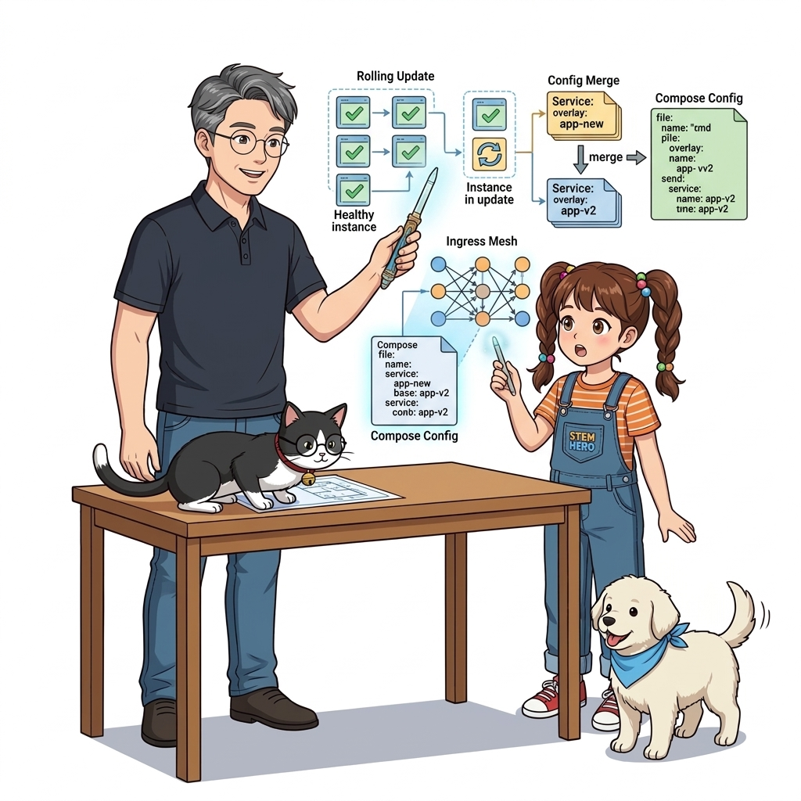
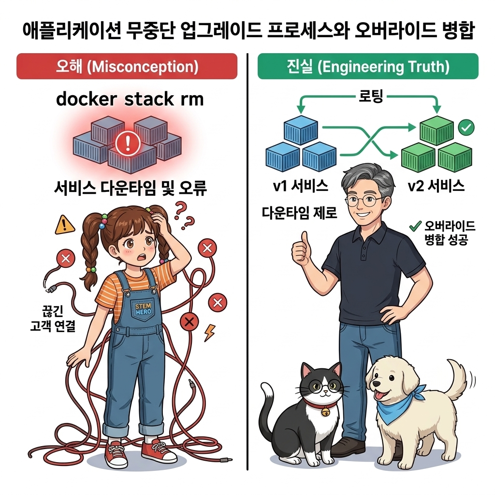
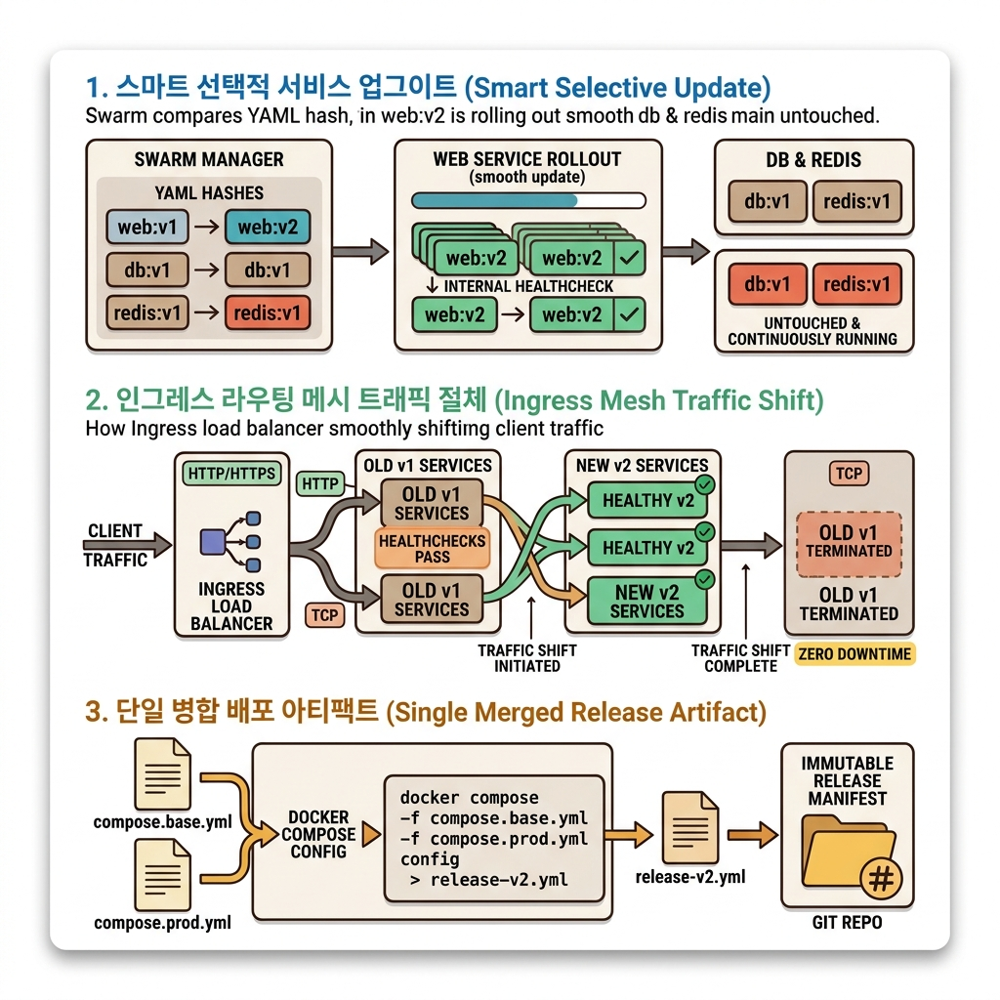
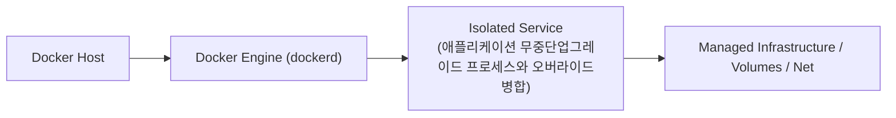
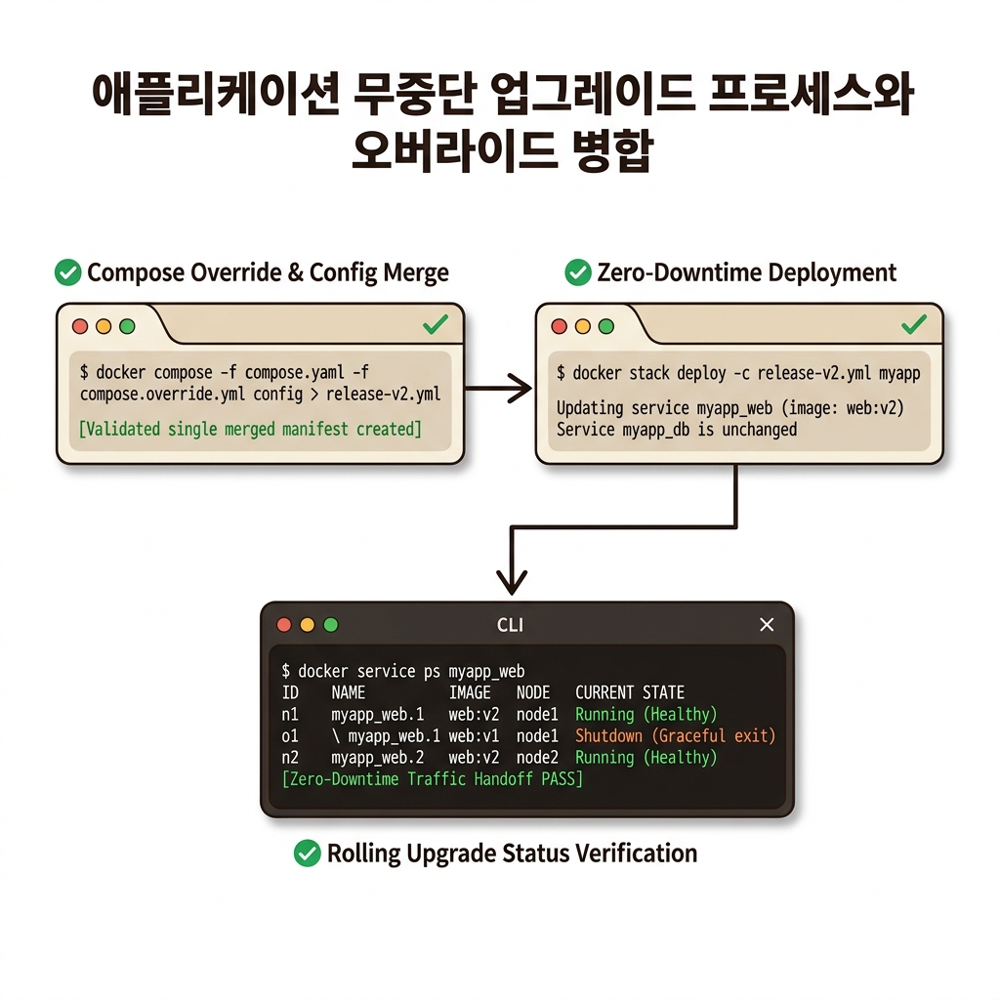
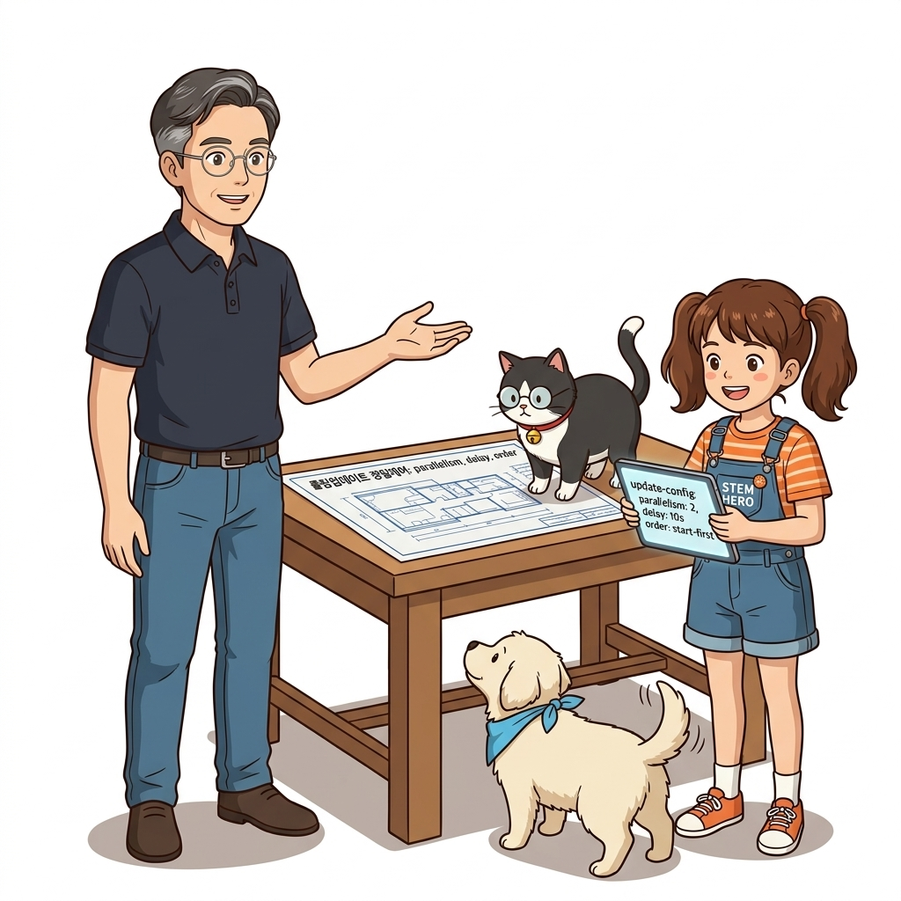

# 088. 애플리케이션 무중단업그레이드 프로세스와 오버라이드병합

과거에는 새 버전을 배포하기 위해 새벽 2시에 서버를 내리고(Downtime) 패치를 적용해야 했지만, 컨테이너 오케스트레이터는 **여러 개의 레플리카를 한 번에 조금씩 순차적으로 새 버전 컨테이너로 교체하는 롤링 업데이트(Rolling Update)**를 수행합니다.


**그림 06-13-1** 애플리케이션 무중단업그레이드 프로세스와 오버라이드병합의 필요성과 현대 클라우드 아키텍처 관점의 개요

---

### 088.1 왜 애플리케이션 무중단업그레이드 프로세스와 오버라이드병합이(가) 필요한가? (문제 정의와 현실적 배경)

소프트웨어 시스템이 복잡해질수록 설정을 다루는 방식은 전체 인프라의 신뢰성을 결정짓는 핵심 척도가 됩니다. **애플리케이션 무중단업그레이드 프로세스와 오버라이드병합**이(가) 부재하거나 잘못 다루어질 때 현장에서는 다음과 같은 대표적인 병목과 장애가 발생합니다:

1. **하드코딩된 설정과 환경 불일치로 인한 유연성 상실**: 환경이 바뀔 때마다 코드를 다시 빌드해야 하므로 배포 주기가 지연되고 이미지 수가 기하급수적으로 폭증합니다.
2. **보안 민감 데이터의 무분별한 노출**: 비밀번호, 데이터베이스 토큰, 암호화 키가 이미지 레이어에 영구 박제되어 형상관리 시스템이나 외부에 유출될 위험이 커집니다.
3. **재현 불가능한 구성 드리프트**: 스테이징 환경과 프로덕션 환경의 미세한 설정 차이가 예기치 못한 서비스 중단 사고로 직결됩니다.


**그림 06-13-2** 애플리케이션 무중단업그레이드 프로세스와 오버라이드병합에 대한 대표적인 오해와 실제 프로덕션 현장의 엔지니어링 진실

---

### 088.2 핵심 아키텍처와 엔지니어링 메커니즘

또한 `docker stack deploy`는 단일 `-c` 파일만 받는다는 특성을 고려해, 여러 개의 오버라이드 파일(`compose.yaml` + `compose.prod.yaml` + `v2.yaml`)을 **`docker compose config > stack.prod.yaml`로 먼저 단일 파일로 깔끔하게 병합한 뒤 스웜에 전달**하는 실무 표준 배포 파이프라인을 배웁니다!


**그림 06-13-3** 애플리케이션 무중단업그레이드 프로세스와 오버라이드병합의 내부 아키텍처 및 데이터 흐름

#### 📊 핵심 비교 및 엔지니어링 표준 분석

| 구분 / 핵심 원리 | 상세 설명 및 동작 메커니즘 | 실무 적용 시 주의점 및 베스트 프랙티스 |
| :--- | :--- | :--- |
| **변경된 서비스만 스마트 업데이트** | `docker stack deploy`를 새 버전 파일로 다시 실행하면, 스웜은 전체 스택을 껐다 켜지 않고 **정의가 바뀐 서비스의 컨테이너들만 무중단으로 순차 교체**함! | 변경되지 않은 데이터베이스나 다른 마이크로서비스 컨테이너는 단 1초의 흔들림도 없이 그대로 유지됨 |
| **인그레스 라우팅 메시와의 조화** | 구버전 컨테이너가 종료(`Shutdown`)되기 전에 인그레스 로드밸런서 목록에서 먼저 제외되고, 신버전 컨테이너가 `Running/Healthy`가 된 직후 트래픽이 유입됨 | 사용자 입장에서는 새로고침을 연타해도 단 한 번의 에러 페이지 없이 어느새 신버전 화면으로 전환됨! |
| **단일 병합 아티팩트 보관** | `docker compose config > prod-release-v2.yml`로 생성된 단일 파일을 배포 기록(Release History)으로 보관하면 시점별 전체 설정을 한눈에 감사 가능 | 엔터프라이즈 릴리스 관리의 정석 |

---

### 088.3 선언적 실습 및 아키텍처 다이어그램

본 실습은 외부 비공개 패키지에 의존하지 않고, 공식 표준 이미지를 기반으로 즉시 재현 가능한 살아있는 코드로 구성되어 있습니다.

```bash
# 복수의 컴포즈 오버라이드 파일을 단일 스웜 스택 파일로 병합(config)하여 배포하는 실무 워크플로!
mkdir -p /tmp/oz-merge-stack && cd /tmp/oz-merge-stack
cat << 'EOF' > compose.yaml
services:
  web:
    image: nginx:1.26-alpine
EOF
cat << 'EOF' > prod-v2.yaml
services:
  web:
    image: nginx:1.27-alpine
    deploy:
      replicas: 3
EOF

# 두 파일을 병합하여 최종 stack.yml 생성
docker compose -f compose.yaml -f prod-v2.yaml config > stack.yml
grep -E "image:|replicas:" stack.yml
rm -rf /tmp/oz-merge-stack
```

#### 🔍 아키텍처 흐름도 (Mermaid Diagram)




**그림 06-13-4** 선언적 인프라 명세를 통한 애플리케이션 무중단업그레이드 프로세스와 오버라이드병합 검증 파이프라인

---

### 088.4 핵심 정리: 캐릭터 대화와 3대 교훈

> 👧 **도로시**: "교수님! **애플리케이션 무중단업그레이드 프로세스와 오버라이드병합**의 원리를 배우니까, 복잡하게 얽혀 있던 인프라 설정이 레고 블록처럼 질서정연하게 제자리를 찾는 게 보여요!"
> 
> 🐱 **조교 지니**: "야옹~ 맞습니다! 특히 런타임 환경과 불변 인프라의 경계를 명확히 지키는 것이 대규모 클라우드 운영의 제1원칙이랍니다!"
> 
> 🐶 **토토**: "멍멍! 선언적 코드로 한 번 적어두면 언제든 똑같이 복원되니까 정말 든든해요!"
> 
> 👨‍🏫 **이호진 교수님**: "훌륭하구나. 원리를 깊이 이해하고 실습을 통해 손에 익히는 것이 훌륭한 클라우드 엔지니어로 성장하는 가장 빠른 지름길이란다."


**그림 06-13-5** 애플리케이션 무중단업그레이드 프로세스와 오버라이드병합 마스터를 위한 3대 핵심 교훈

1. **설정과 실행의 명확한 분리**:
   * 애플리케이션 코드는 불변으로 유지하고, 가변적인 설정값은 외부에서 주입하여 이식성을 극대화합니다.
2. **선언적 재현성 확보**:
   * 사람이 수작업으로 변경하지 않고 코드 명세를 통해 언제 어디서나 100% 동일한 실행 결과를 보장합니다.
3. **최소 권한 및 보안 모범 사례 준수**:
   * 불필요한 권한과 포트 노출을 최소화하고 민감 데이터를 암호화하여 프로덕션 안정성을 담보합니다.

---

### 088.5 랩노트 피날레와 다음 강의 예고


**그림 06-13-6** 연구실에서 다음 마일스톤인 [롤링업데이트 정밀제어 parallelism delay order] 실습을 예고하는 교수님과 토토

> 💡 **다음 강의 안내**:
> [롤링업데이트 정밀제어 parallelism delay order](../089_롤링업데이트_정밀제어_parallelism_delay_order/)에서는 더욱 심화된 실전 엔지니어링 실습과 아키텍처를 다룹니다!

---

## 🧭 강의 네비게이션
* [◀️ 이전 강의: 087_Part06_중간미션_컨피그와_시크릿이_적용된_고가용성스택배포](../087_Part06_중간미션_컨피그와_시크릿이_적용된_고가용성스택배포/)
* [📋 Part 06. 컨테이너 오케스트레이션: 도커 스웜(Swarm) 클러스터, 스택 배포, 무중단 롤링 업데이트 & 쿠버네티스 (076 ~ 095) 목차로 돌아가기](../)
* [▶️ 다음 강의: 089_롤링업데이트_정밀제어_parallelism_delay_order](../089_롤링업데이트_정밀제어_parallelism_delay_order/)
