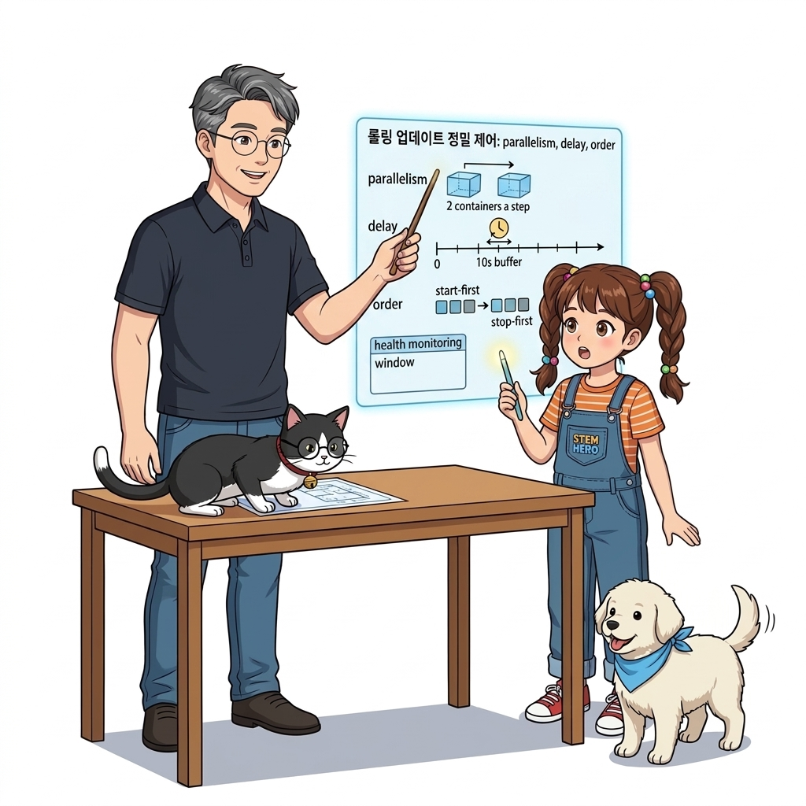
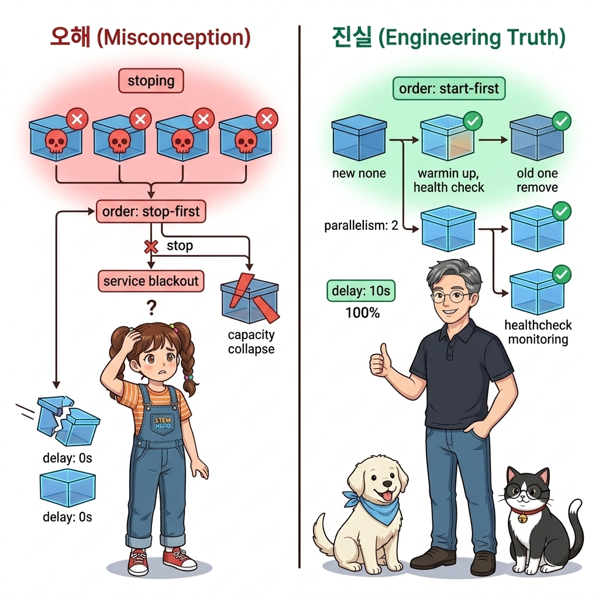
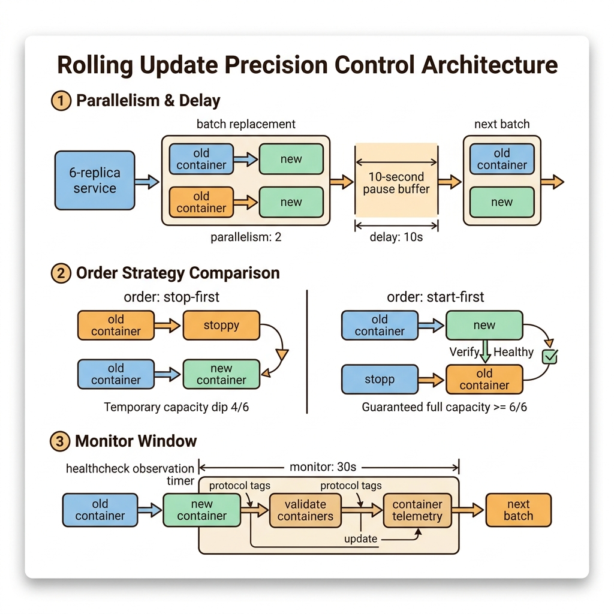
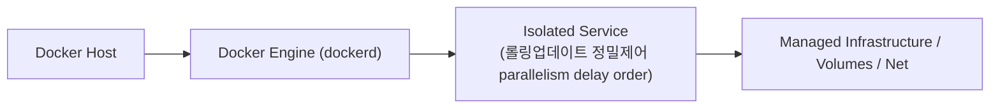
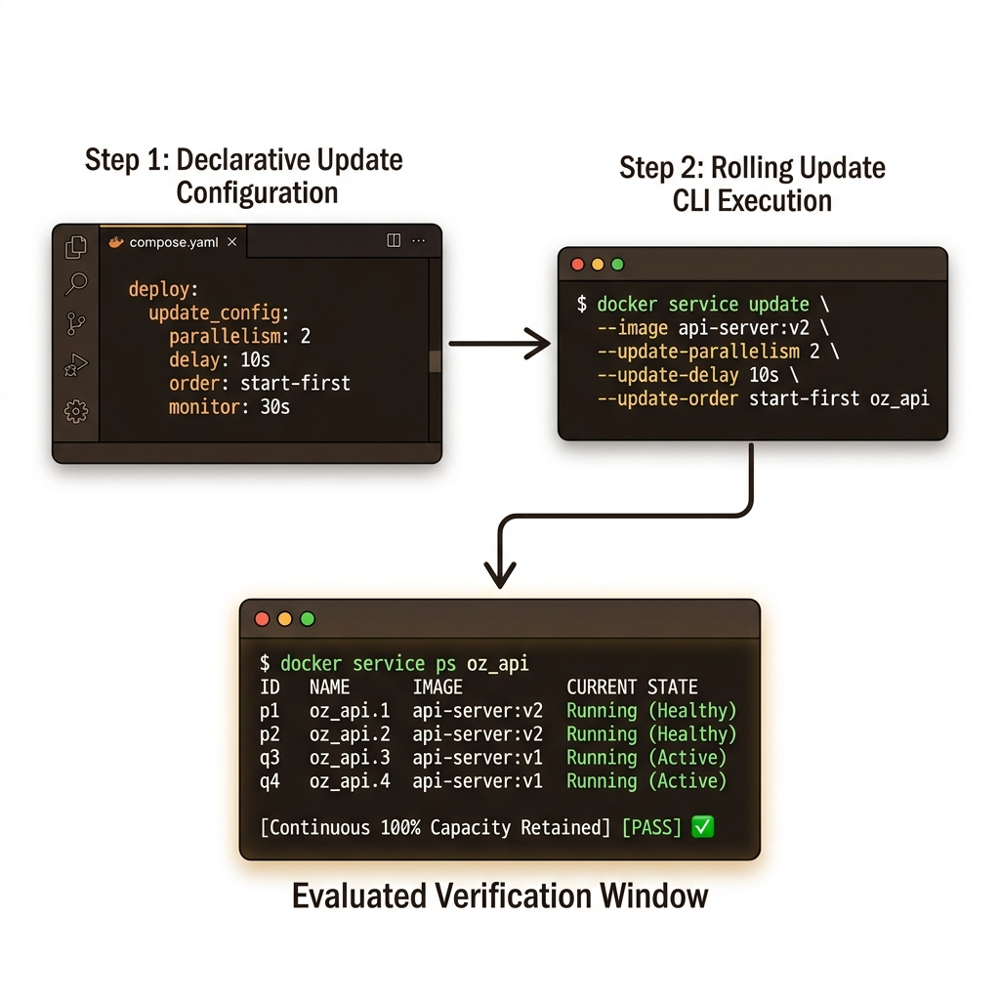
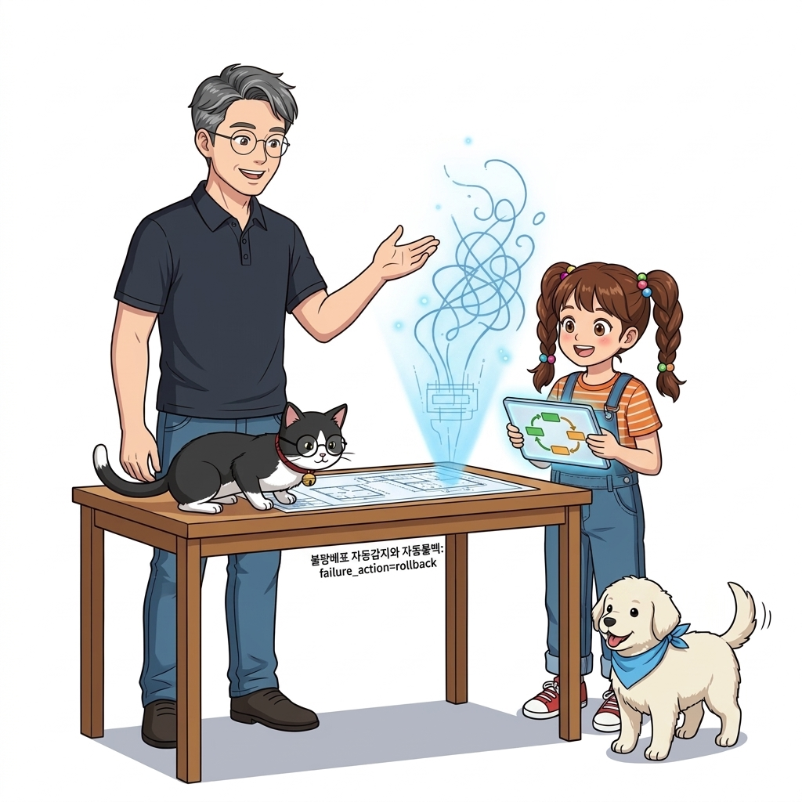

# 089. 롤링업데이트 정밀제어 parallelism delay order

`deploy.update_config` 블록을 통해 롤링 업데이트의 속도와 안전성을 결정하는 핵심 파라미터들을 정밀하게 설계합니다.


**그림 06-14-1** 롤링업데이트 정밀제어 parallelism delay order의 필요성과 현대 클라우드 아키텍처 관점의 개요

---

### 089.1 왜 롤링업데이트 정밀제어 parallelism delay order이(가) 필요한가? (문제 정의와 현실적 배경)

소프트웨어 시스템이 복잡해질수록 설정을 다루는 방식은 전체 인프라의 신뢰성을 결정짓는 핵심 척도가 됩니다. **롤링업데이트 정밀제어 parallelism delay order**이(가) 부재하거나 잘못 다루어질 때 현장에서는 다음과 같은 대표적인 병목과 장애가 발생합니다:

1. **하드코딩된 설정과 환경 불일치로 인한 유연성 상실**: 환경이 바뀔 때마다 코드를 다시 빌드해야 하므로 배포 주기가 지연되고 이미지 수가 기하급수적으로 폭증합니다.
2. **보안 민감 데이터의 무분별한 노출**: 비밀번호, 데이터베이스 토큰, 암호화 키가 이미지 레이어에 영구 박제되어 형상관리 시스템이나 외부에 유출될 위험이 커집니다.
3. **재현 불가능한 구성 드리프트**: 스테이징 환경과 프로덕션 환경의 미세한 설정 차이가 예기치 못한 서비스 중단 사고로 직결됩니다.


**그림 06-14-2** 롤링업데이트 정밀제어 parallelism delay order에 대한 대표적인 오해와 실제 프로덕션 현장의 엔지니어링 진실

---

### 089.2 핵심 아키텍처와 엔지니어링 메커니즘

한 번에 교체할 컨테이너 수(`parallelism`), 교체 묶음 사이의 대기 시간(`delay`), 업데이트 후 정상 동작 감시 시간(`monitor`), 그리고 가용성을 극대화하는 **`order: start-first`** 설정을 마스터합니다!


**그림 06-14-3** 롤링업데이트 정밀제어 parallelism delay order의 내부 아키텍처 및 데이터 흐름

#### 📊 핵심 비교 및 엔지니어링 표준 분석

| 구분 / 핵심 원리 | 상세 설명 및 동작 메커니즘 | 실무 적용 시 주의점 및 베스트 프랙티스 |
| :--- | :--- | :--- |
| **`parallelism` & `delay`** | `replicas: 6`에서 `parallelism: 2`, `delay: 10s`로 설정하면 한 번에 2개씩 새 버전으로 교체하고 10초 대기 후 다음 2개를 교체 | 전체 6개가 한꺼번에 재시작되어 서비스가 마비되는 것을 방지하고 점진적으로 트래픽 전환 |
| **`order: stop-first` vs `start-first`** | 기본값 `stop-first`는 기존 컨테이너를 먼저 끈 뒤 새 컨테이너를 켬(자원 절약) / **`start-first`는 새 버전 컨테이너가 완전히 켜져서 `healthy`가 된 것을 확인한 뒤에야 기존 컨테이너를 종료**(가용성 극대화)! | 메모리 여유가 있는 웹/API 서비스에서는 무조건 **`order: start-first`**를 사용하는 것이 무중단 배포의 핵심 비법! |
| **`monitor` (집중 감시 시간)** | 새 컨테이너가 시작된 후 지정한 시간(예: `30s`, `60s`) 동안 죽지 않고 헬스 체크를 계속 통과하는지 지켜보는 관찰 시간 | 부팅 직후 5초 뒤에 터지는 런타임 버그를 잡아내어 다음 단계 진행 여부를 결정 |

---

### 089.3 선언적 실습 및 아키텍처 다이어그램

본 실습은 외부 비공개 패키지에 의존하지 않고, 공식 표준 이미지를 기반으로 즉시 재현 가능한 살아있는 코드로 구성되어 있습니다.

```yaml
# [stack.yaml] 무중단 가용성을 극대화하는 롤링 업데이트(update_config) 정밀 설정!
services:
  api-server:
    image: nginx:1.27-alpine
    deploy:
      replicas: 6
      update_config:
        parallelism: 2
        delay: 10s
        monitor: 30s
        order: start-first
        failure_action: rollback
```

#### 🔍 아키텍처 흐름도 (Mermaid Diagram)




**그림 06-14-4** 선언적 인프라 명세를 통한 롤링업데이트 정밀제어 parallelism delay order 검증 파이프라인

---

### 089.4 핵심 정리: 캐릭터 대화와 3대 교훈

> 👧 **도로시**: "교수님! **롤링업데이트 정밀제어 parallelism delay order**의 원리를 배우니까, 복잡하게 얽혀 있던 인프라 설정이 레고 블록처럼 질서정연하게 제자리를 찾는 게 보여요!"
> 
> 🐱 **조교 지니**: "야옹~ 맞습니다! 특히 런타임 환경과 불변 인프라의 경계를 명확히 지키는 것이 대규모 클라우드 운영의 제1원칙이랍니다!"
> 
> 🐶 **토토**: "멍멍! 선언적 코드로 한 번 적어두면 언제든 똑같이 복원되니까 정말 든든해요!"
> 
> 👨‍🏫 **이호진 교수님**: "훌륭하구나. 원리를 깊이 이해하고 실습을 통해 손에 익히는 것이 훌륭한 클라우드 엔지니어로 성장하는 가장 빠른 지름길이란다."


**그림 06-14-5** 롤링업데이트 정밀제어 parallelism delay order 마스터를 위한 3대 핵심 교훈

1. **설정과 실행의 명확한 분리**:
   * 애플리케이션 코드는 불변으로 유지하고, 가변적인 설정값은 외부에서 주입하여 이식성을 극대화합니다.
2. **선언적 재현성 확보**:
   * 사람이 수작업으로 변경하지 않고 코드 명세를 통해 언제 어디서나 100% 동일한 실행 결과를 보장합니다.
3. **최소 권한 및 보안 모범 사례 준수**:
   * 불필요한 권한과 포트 노출을 최소화하고 민감 데이터를 암호화하여 프로덕션 안정성을 담보합니다.

---

### 089.5 랩노트 피날레와 다음 강의 예고


**그림 06-14-6** 연구실에서 다음 마일스톤인 [불량배포 자동감지와 자동롤백 failure action rollback] 실습을 예고하는 교수님과 토토

> 💡 **다음 강의 안내**:
> [불량배포 자동감지와 자동롤백 failure action rollback](../090_불량배포_자동감지와_자동롤백_failure_action_rollback/)에서는 더욱 심화된 실전 엔지니어링 실습과 아키텍처를 다룹니다!

---

## 🧭 강의 네비게이션
* [◀️ 이전 강의: 088_애플리케이션_무중단업그레이드_프로세스와_오버라이드병합](../088_애플리케이션_무중단업그레이드_프로세스와_오버라이드병합/)
* [📋 Part 06. 컨테이너 오케스트레이션: 도커 스웜(Swarm) 클러스터, 스택 배포, 무중단 롤링 업데이트 & 쿠버네티스 (076 ~ 095) 목차로 돌아가기](../)
* [▶️ 다음 강의: 090_불량배포_자동감지와_자동롤백_failure_action_rollback](../090_불량배포_자동감지와_자동롤백_failure_action_rollback/)
