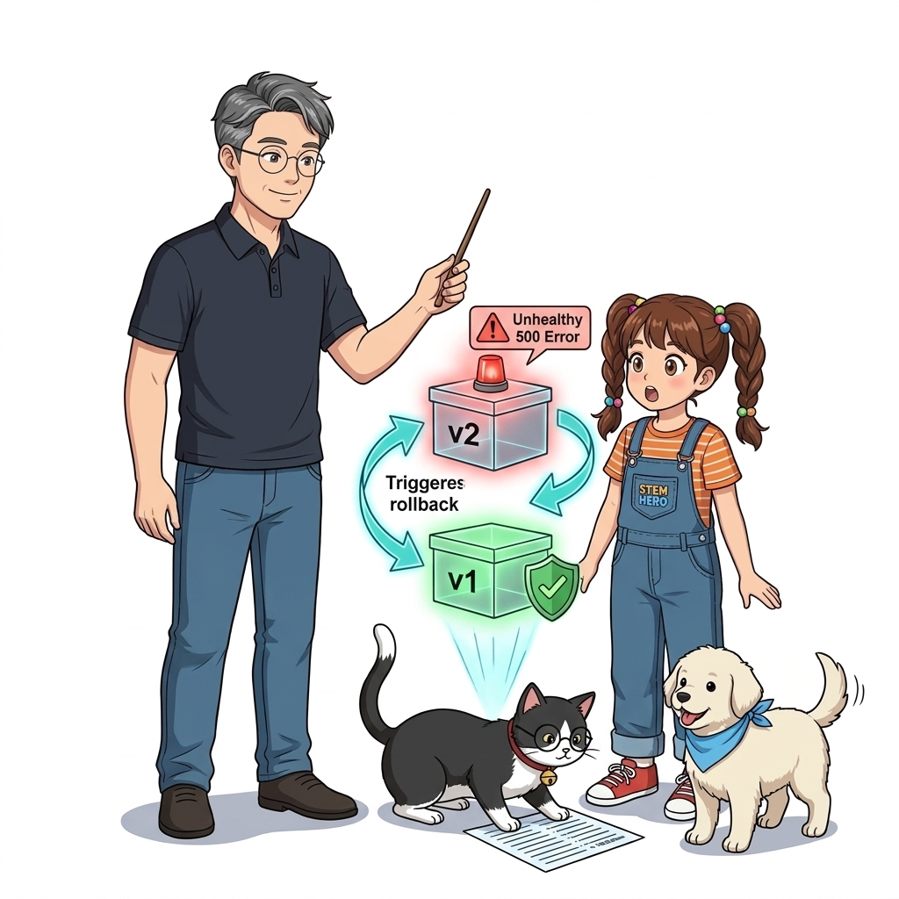
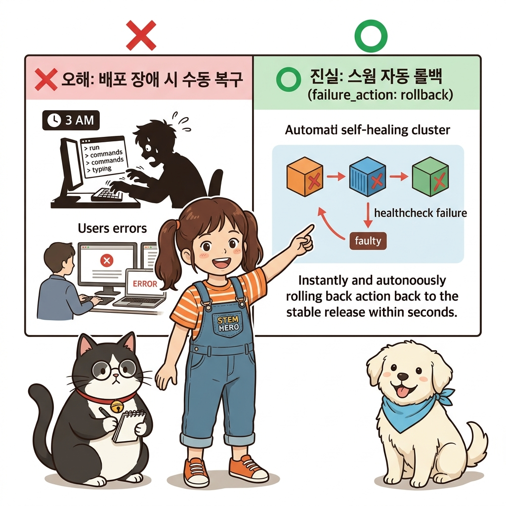
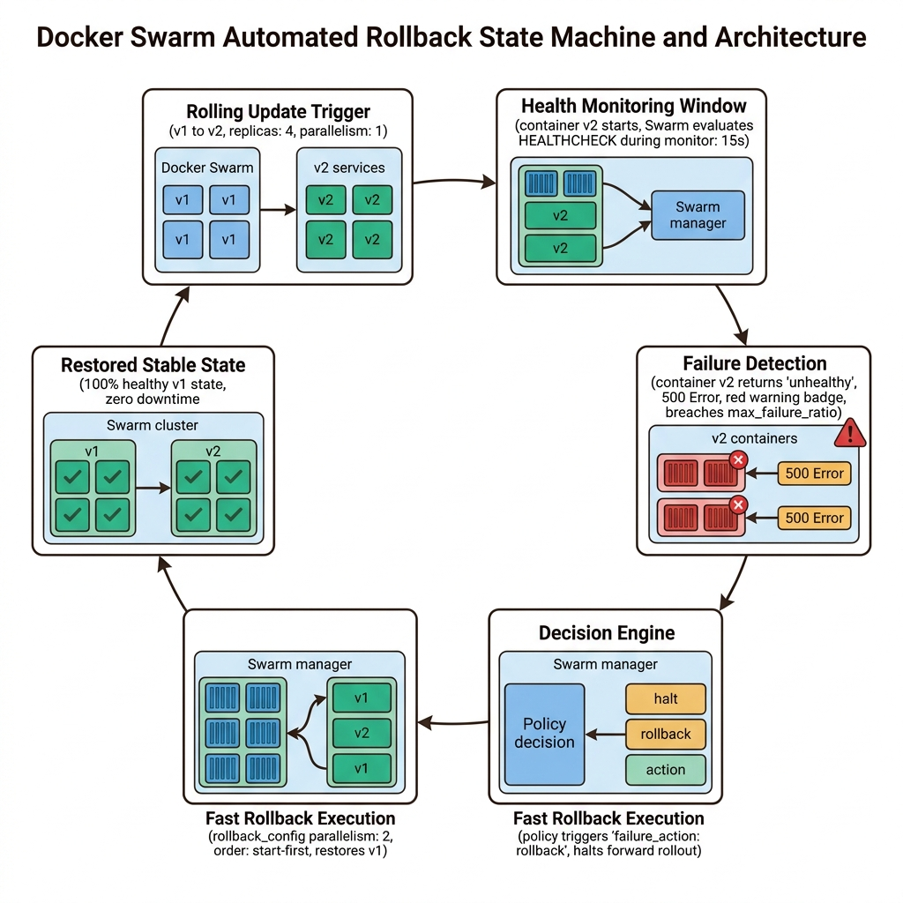
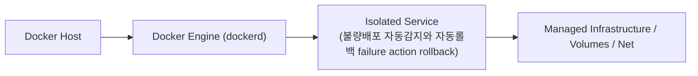
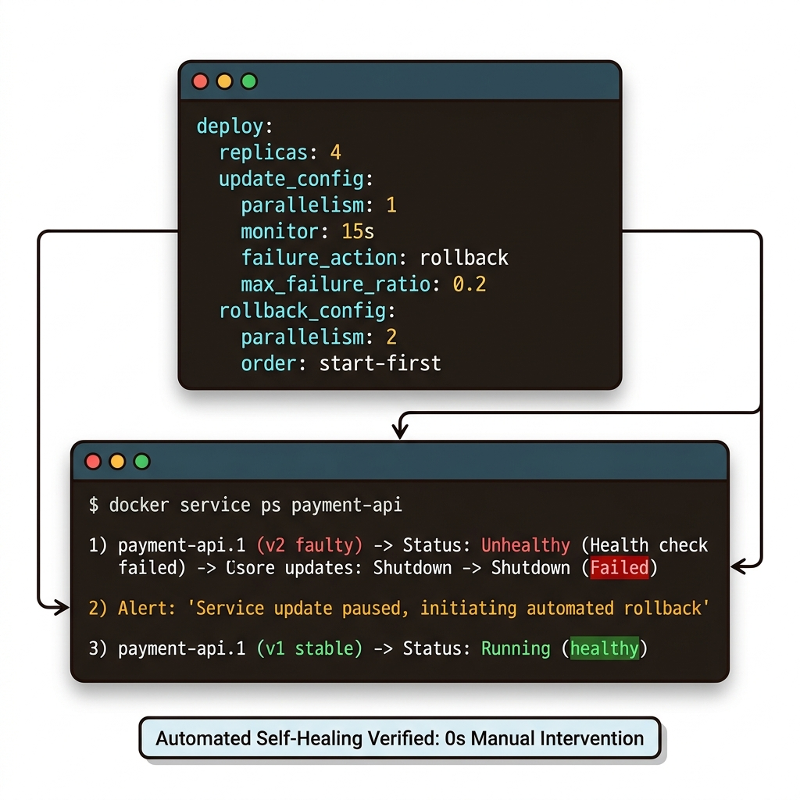
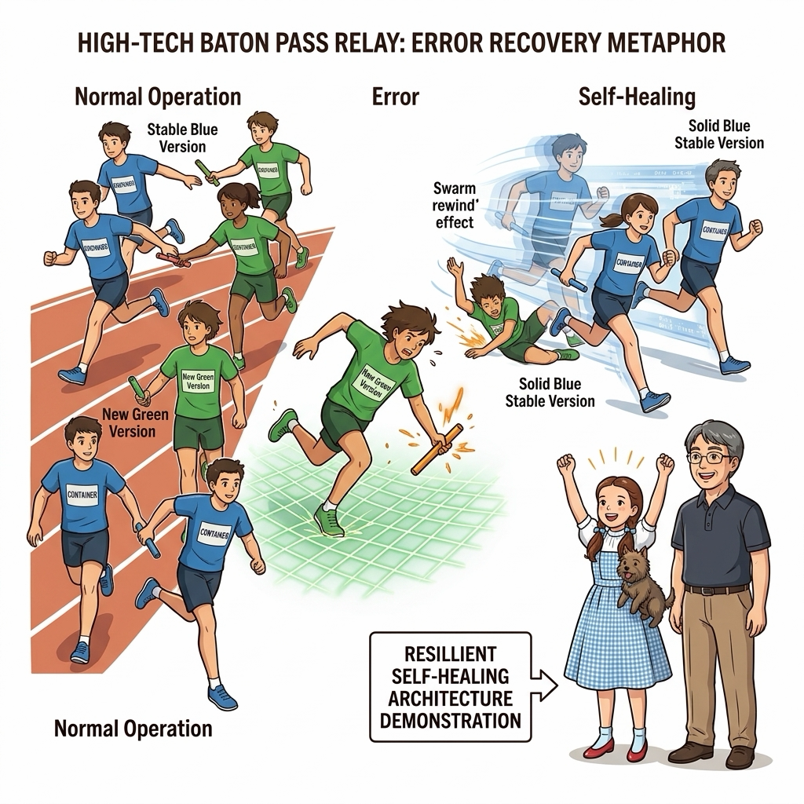
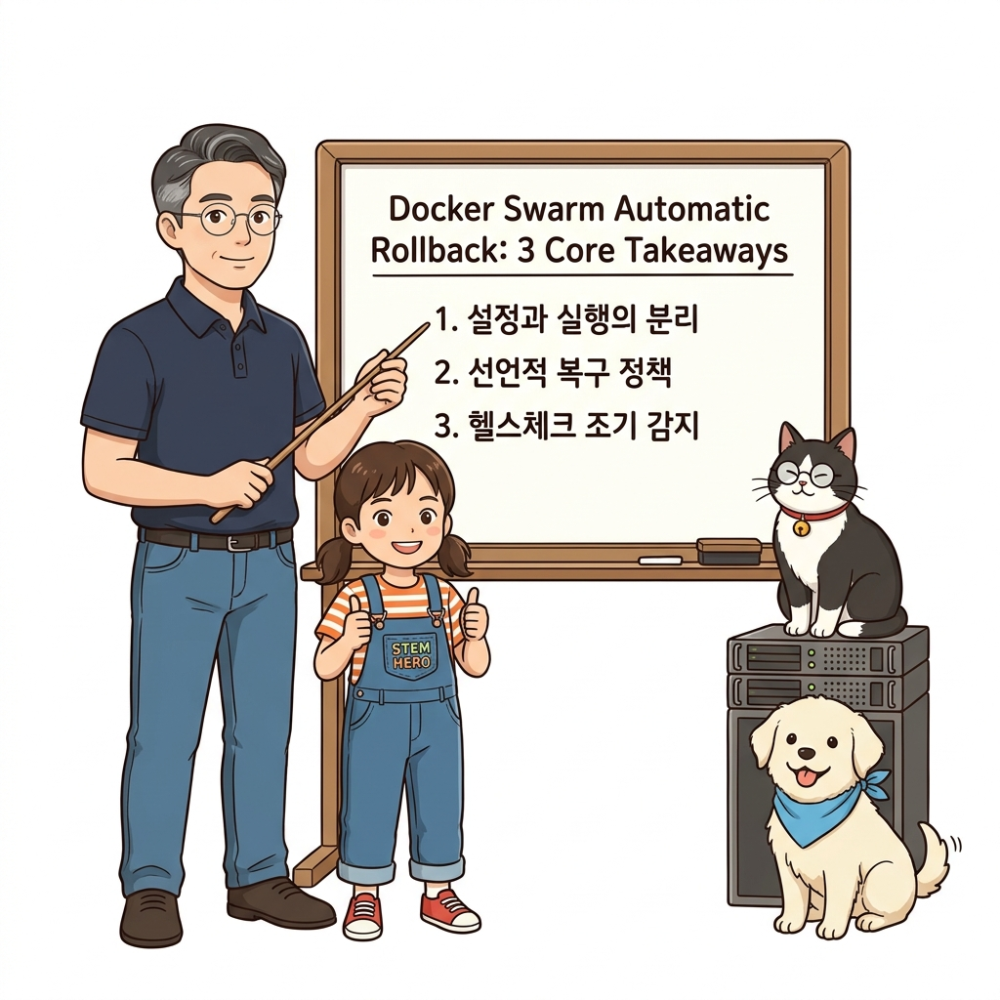
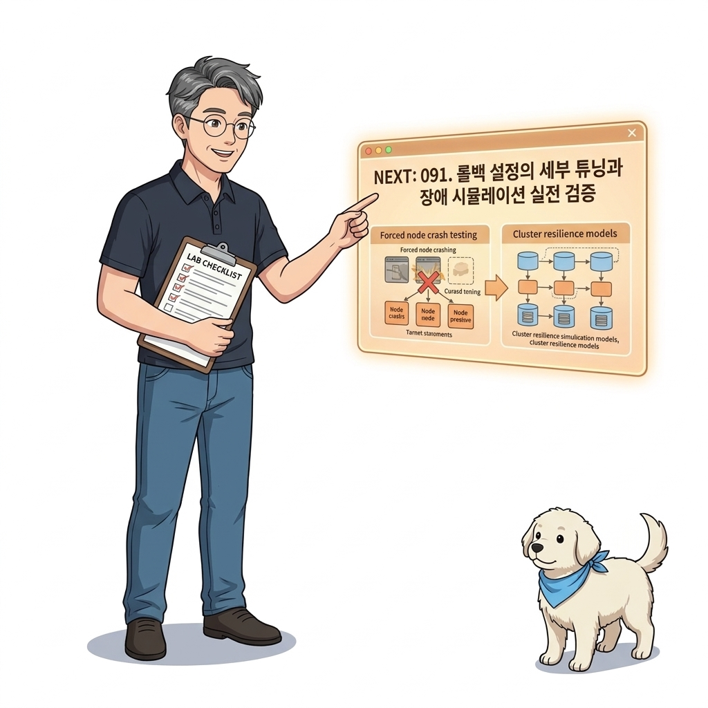

# 090. 불량배포 자동감지와 자동롤백 failure action rollback

아무리 CI 테스트를 거쳐도 운영 환경의 실제 트래픽이나 설정 차이로 인해 새 버전 컨테이너가 `unhealthy` 상태에 빠지거나 크래시될 수 있습니다.


**그림 06-15-1** 불량배포 자동감지와 자동롤백 failure action rollback의 필요성과 현대 클라우드 아키텍처 관점의 개요

---

### 090.1 왜 불량배포 자동감지와 자동롤백 failure action rollback이(가) 필요한가? (문제 정의와 현실적 배경)

소프트웨어 시스템이 복잡해질수록 설정을 다루는 방식은 전체 인프라의 신뢰성을 결정짓는 핵심 척도가 됩니다. **불량배포 자동감지와 자동롤백 failure action rollback**이(가) 부재하거나 잘못 다루어질 때 현장에서는 다음과 같은 대표적인 병목과 장애가 발생합니다:

1. **하드코딩된 설정과 환경 불일치로 인한 유연성 상실**: 환경이 바뀔 때마다 코드를 다시 빌드해야 하므로 배포 주기가 지연되고 이미지 수가 기하급수적으로 폭증합니다.
2. **보안 민감 데이터의 무분별한 노출**: 비밀번호, 데이터베이스 토큰, 암호화 키가 이미지 레이어에 영구 박제되어 형상관리 시스템이나 외부에 유출될 위험이 커집니다.
3. **재현 불가능한 구성 드리프트**: 스테이징 환경과 프로덕션 환경의 미세한 설정 차이가 예기치 못한 서비스 중단 사고로 직결됩니다.


**그림 06-15-2** 불량배포 자동감지와 자동롤백 failure action rollback에 대한 대표적인 오해와 실제 프로덕션 현장의 엔지니어링 진실

---

### 090.2 핵심 아키텍처와 엔지니어링 메커니즘

`update_config`에 **`failure_action: rollback`**과 `max_failure_ratio`를 설정하고, 되돌아갈 때의 속도를 제어하는 **`rollback_config`**를 구성하여, 사람의 개입 없이 클러스터 스스로 안정적이었던 직전 버전으로 자동 복구하는 메커니즘을 배웁니다!


**그림 06-15-3** 불량배포 자동감지와 자동롤백 failure action rollback의 내부 아키텍처 및 데이터 흐름

#### 📊 핵심 비교 및 엔지니어링 표준 분석

| 구분 / 핵심 원리 | 상세 설명 및 동작 메커니즘 | 실무 적용 시 주의점 및 베스트 프랙티스 |
| :--- | :--- | :--- |
| **`failure_action` 3가지 옵션** | 1) `pause`(기본값: 추가 배포를 멈추고 사람 대기), 2) `continue`(무시하고 강행), 3) **`rollback`(즉시 업데이트를 취소하고 이전 정상 버전으로 자동 롤백)**! | 무인 자동화 운영 환경에서는 반드시 `failure_action: rollback`으로 설정! |
| **헬스 체크(`HEALTHCHECK`)와의 필수 결합** | 스웜이 새 버전의 성공/실패를 판단하는 기준은 `monitor` 시간 동안 컨테이너가 살아있는가와 **`HEALTHCHECK`가 `healthy`를 유지하는가**임! | Part 04에서 만든 정밀 헬스 체크가 여기서 자동 롤백의 방아쇠(Trigger) 역할을 수행 |
| **빠른 롤백 (`rollback_config`)** | 업데이트할 때는 신중하게 1개씩(`parallelism: 1`, `monitor: 15s`) 올리더라도, 장애가 나서 롤백할 때는 이미 검증된 이전 버전이므로 빠르게(`parallelism: 2~3`, `monitor: 0s`) 복구! | 고객이 체감하는 장애 노출 시간을 최소한으로 줄이는 실무 튜닝 팁 |

---

### 090.3 선언적 실습 및 아키텍처 다이어그램

본 실습은 외부 비공개 패키지에 의존하지 않고, 공식 표준 이미지를 기반으로 즉시 재현 가능한 살아있는 코드로 구성되어 있습니다.

```yaml
# 업데이트 중 불량 감지 시 즉시 이전 버전으로 초고속 자동 복구하는 update_config & rollback_config 설계!
services:
  payment-api:
    image: oz-cloud/payment:v2
    deploy:
      replicas: 4
      update_config:
        parallelism: 1
        monitor: 15s
        failure_action: rollback
        max_failure_ratio: 0.2
      rollback_config:
        parallelism: 2
        monitor: 0s
        order: start-first
```

#### 🔍 아키텍처 흐름도 (Mermaid Diagram)




**그림 06-15-4** 선언적 인프라 명세를 통한 불량배포 자동감지와 자동롤백 failure action rollback 검증 파이프라인

---

<!-- BIBLE_INTEGRATION_book7_swarm_stack_rolling_rollback -->
---

### 090.B 📚 도커 바이블 심화: 도커 스웜 스택 기반 무중단 롤링 업데이트와 장애 자동 롤백(rollback_config)
*출처 도서: 『도커 교과서』 핵심 분석*

프로덕션 환경에서 새로운 버전의 서비스를 배포할 때 가장 중요한 것은 사용자 트래픽의 단 1초 중단도 없어야 하며, 배포 중 예기치 않은 크래시가 발생했을 때 사람의 개입 없이 시스템이 알아서 즉시 구버전으로 원상 복구(Auto Rollback)되어야 한다는 점입니다.

도커 스웜(Docker Swarm)은 `compose.yaml`의 `deploy` 블록 아래에 선언적 **`update_config`와 `rollback_config`**를 통해 이를 완벽하게 지원합니다:
* `parallelism: 2`: 한 번에 2대의 컨테이너씩 교체
* `delay: 10s`: 다음 배치 컨테이너를 교체하기 전 10초 동안 신규 컨테이너의 안정성 관찰
* `failure_action: rollback`: 신규 컨테이너가 헬스체크에 실패하면 즉시 전체 배포를 중단하고 기존 정상 버전으로 자동 롤백


**그림 090-B-1** 도커 스웜 롤링 업데이트 중 장애를 감지하고 이전 정상 버전으로 자동 회귀하는 자가치유 일러스트

```bash
# [실습] 선언적 무중단 롤링 업데이트 및 자동 롤백 스택 정의
cat << 'EOF' > stack-rolling.yaml
version: '3.8'
services:
  web:
    image: nginx:alpine
    deploy:
      replicas: 4
      update_config:
        parallelism: 2
        delay: 5s
        failure_action: rollback
        monitor: 10s
        max_failure_ratio: 0.2
      rollback_config:
        parallelism: 2
        delay: 5s
EOF

# 스웜 스택 배포 및 롤링 상태 관찰
# docker stack deploy -c stack-rolling.yaml my-app
# docker service ps my-app_web
rm -f stack-rolling.yaml
```

> 👨‍🏫 **이호진 교수님의 바이블 멘토링 노트**:
> "무중단 배포의 핵심은 '배포가 실패했을 때의 대비책이 자동화되어 있는가'입니다. 사람이 새벽에 눈 비비며 수동으로 이전 이미지를 재배포하는 환경은 진정한 오케스트레이션이 아닙니다."
>
> 👧 **도로시의 깨달음**:
> "새 버전이 아프면(헬스체크 실패) 시스템이 알아서 얼른 건강했던 옛날 모습으로 되돌려놓는 똑똑한 자동 후진 기능이군요!"
>
> 🐱 **조교 지니의 아키텍처 체크포인트**:
> "`monitor: 10s` 옵션은 컨테이너가 켜진 뒤 최소 10초 동안 죽지 않고 헬스 상태를 유지하는지 커널이 지켜보게 만듭니다."

---

### 090.C 📚 도커 바이블 심화: 무정전 가용성을 위한 order: start-first 전략과 수동 즉시 롤백(docker service rollback)

> 📖 **참고 도서 심층 연계**:
> * 《시작하세요! 도커/쿠버네티스》 제3장 (스웜 서비스 무중단 업데이트 정책과 롤백 생명주기)
> * 《도커 교과서》 제14장 (배포 장애 시 수동/자동 복구 엔지니어링)

롤링 업데이트가 진행되는 동안 서비스의 전체 처리 용량(Capacity)이 일시적으로 줄어들며 사용자 응답 지연이 발생하는 현상을 방지하려면 `order` 파라미터의 내부 원리를 정확히 통제해야 합니다.

#### 1. `order: start-first` vs `order: stop-first` 용량 곡선 비교

| 비교 항목 | `order: stop-first` (기본값) | `order: start-first` (가용성 최우선 권장) |
| :--- | :--- | :--- |
| **교체 순서** | 기존 컨테이너 중지(`SIGTERM`) ➔ 완전 정지 후 새 컨테이너 기동 | **새 컨테이너 먼저 기동 ➔ 헬스체크 통과(`healthy`) 확인 후 ➔ 구버전 중지** |
| **서비스 가용성** | 업데이트 진행 중 전체 레플리카 수가 `N - parallelism`으로 일시 감소 | 롤아웃 내내 최소 100% 이상의 가용 레플리카 용량 완벽 보장 |
| **클러스터 자원 요구** | 추가 메모리/CPU 버퍼 필요 없음 (자원 반납 후 재할당) | 두 버전이 일시적으로 공존하므로 노드에 여유 자원(RAM/CPU) 버퍼 필수 |
| **포트 충돌 위험** | 호스트 포트 직결 시 충돌 없음 | 호스트 포트 직접 바인딩 시 포트 점유 충돌 발생 (인그레스 메시 모드 필수) |

#### 2. 긴급 재해 복구를 위한 1초 수동 롤백: `docker service rollback`

자동 롤백 임계치(`max_failure_ratio`)에 걸리지 않았더라도, 새로운 버전의 심각한 비즈니스 로직 버그(예: 결제 금액 0원 처리 버그)가 발견되었을 때 엔지니어가 즉시 서비스를 이전 버전으로 되돌리는 명령입니다:

```bash
# 1. 장애 감지 즉시 직전 정상 스냅샷으로 수동 롤백 트리거
docker service rollback my-app_payment-api

# 2. 롤백 진행 상황 및 이전 버전 태스크 복구 확인
docker service ps my-app_payment-api
```

* 스웜 매니저는 각 서비스의 **직전 성공 사양(Previous Spec)**을 내부 Raft 분산 저장소에 영구 보존하고 있습니다.
* `docker service rollback`을 실행하면 매니저는 새로운 이미지를 재빌드하거나 레지스트리를 재조회할 필요 없이, Raft에 기록된 직전 정상 스펙으로 태스크를 즉시 되돌립니다.

> 👧 **도로시**: "와! `order: start-first`를 쓰면 새 컨테이너가 건강하게 숨을 쉬는 걸 확인한 뒤에야 옛날 컨테이너를 은퇴시키니 트래픽 구멍이 전혀 생기지 않겠네요!"
> 
> 👨‍🏫 **이호진 교수님**: "정확하단다, 도로시! 그리고 시스템이 자동으로 감지하지 못한 숨은 비즈니스 장애가 터졌을 때도 당황하지 않고 `docker service rollback` 한 줄이면 1초 만에 평화를 되찾을 수 있단다."
> 
> 🐶 **토토**: "멍멍! 스웜의 든든한 Raft 데이터베이스가 직전 정상 버전을 꼭 기억하고 있으니 정말 안전해!"


### 090.4 핵심 정리: 캐릭터 대화와 3대 교훈

> 👧 **도로시**: "교수님! **불량배포 자동감지와 자동롤백 failure action rollback**의 원리를 배우니까, 복잡하게 얽혀 있던 인프라 설정이 레고 블록처럼 질서정연하게 제자리를 찾는 게 보여요!"
> 
> 🐱 **조교 지니**: "야옹~ 맞습니다! 특히 런타임 환경과 불변 인프라의 경계를 명확히 지키는 것이 대규모 클라우드 운영의 제1원칙이랍니다!"
> 
> 🐶 **토토**: "멍멍! 선언적 코드로 한 번 적어두면 언제든 똑같이 복원되니까 정말 든든해요!"
> 
> 👨‍🏫 **이호진 교수님**: "훌륭하구나. 원리를 깊이 이해하고 실습을 통해 손에 익히는 것이 훌륭한 클라우드 엔지니어로 성장하는 가장 빠른 지름길이란다."


**그림 06-15-5** 불량배포 자동감지와 자동롤백 failure action rollback 마스터를 위한 3대 핵심 교훈

1. **설정과 실행의 명확한 분리**:
   * 애플리케이션 코드는 불변으로 유지하고, 가변적인 설정값은 외부에서 주입하여 이식성을 극대화합니다.
2. **선언적 재현성 확보**:
   * 사람이 수작업으로 변경하지 않고 코드 명세를 통해 언제 어디서나 100% 동일한 실행 결과를 보장합니다.
3. **최소 권한 및 보안 모범 사례 준수**:
   * 불필요한 권한과 포트 노출을 최소화하고 민감 데이터를 암호화하여 프로덕션 안정성을 담보합니다.

---

### 090.5 랩노트 피날레와 다음 강의 예고


**그림 06-15-6** 연구실에서 다음 마일스톤인 [롤백설정의 세부튜닝과 장애시뮬레이션 실전검증] 실습을 예고하는 교수님과 토토

> 💡 **다음 강의 안내**:
> [롤백설정의 세부튜닝과 장애시뮬레이션 실전검증](../091_롤백설정의_세부튜닝과_장애시뮬레이션_실전검증/)에서는 더욱 심화된 실전 엔지니어링 실습과 아키텍처를 다룹니다!

---

## 🧭 강의 네비게이션
* [◀️ 이전 강의: 089_롤링업데이트_정밀제어_parallelism_delay_order](../089_롤링업데이트_정밀제어_parallelism_delay_order/)
* [📋 Part 06. 컨테이너 오케스트레이션: 도커 스웜(Swarm) 클러스터, 스택 배포, 무중단 롤링 업데이트 & 쿠버네티스 (076 ~ 095) 목차로 돌아가기](../)
* [▶️ 다음 강의: 091_롤백설정의_세부튜닝과_장애시뮬레이션_실전검증](../091_롤백설정의_세부튜닝과_장애시뮬레이션_실전검증/)
