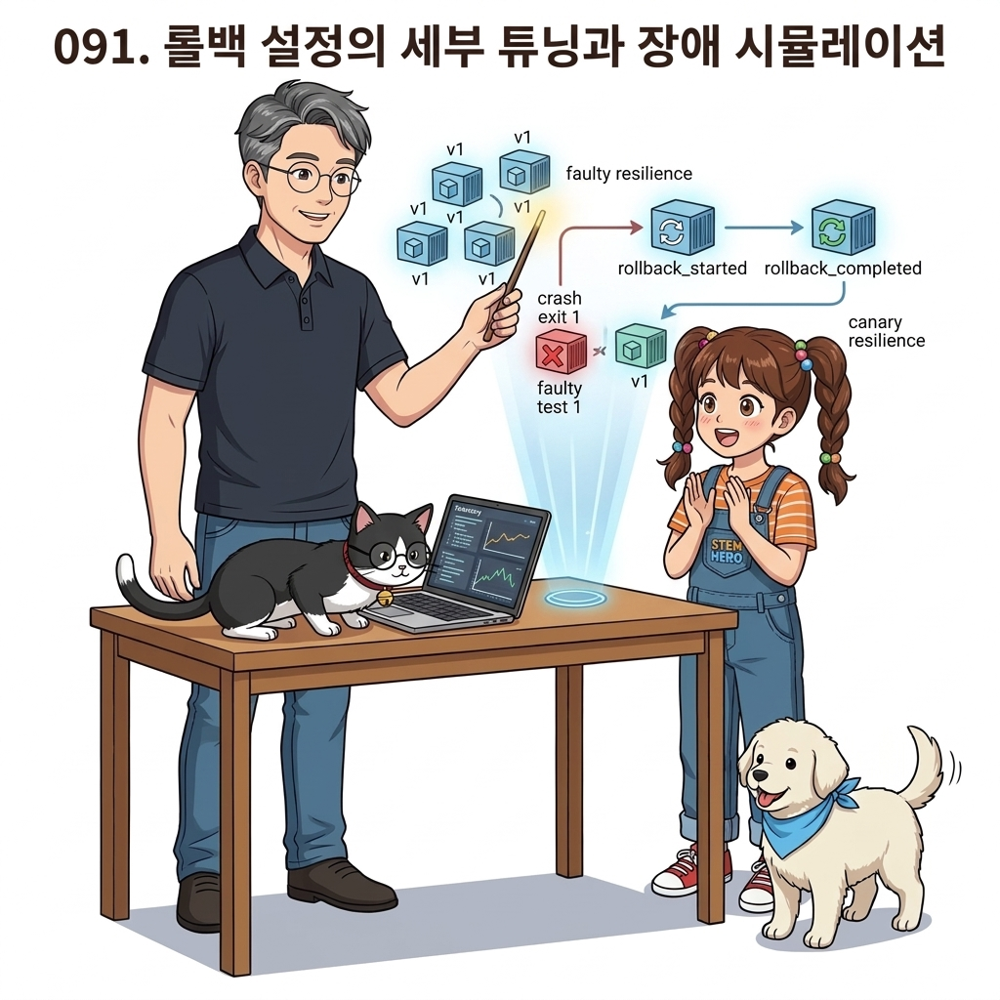
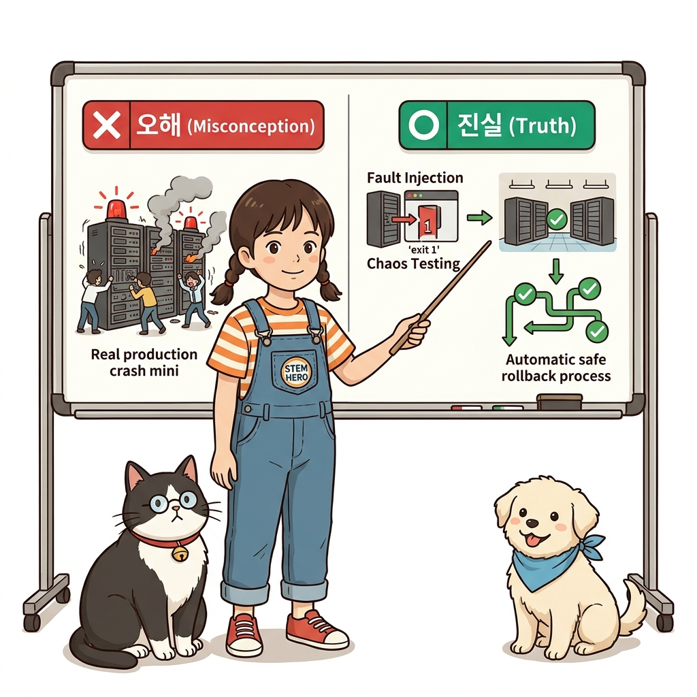
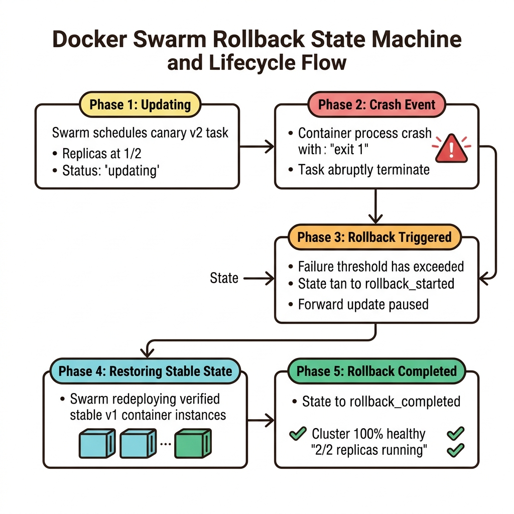
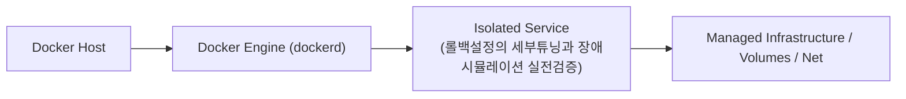
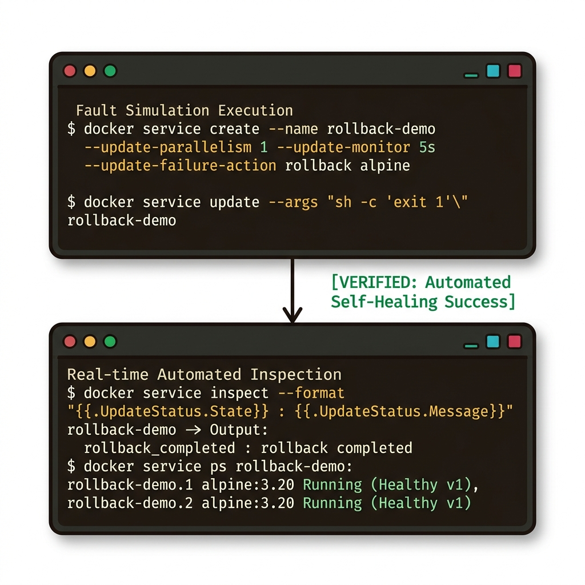
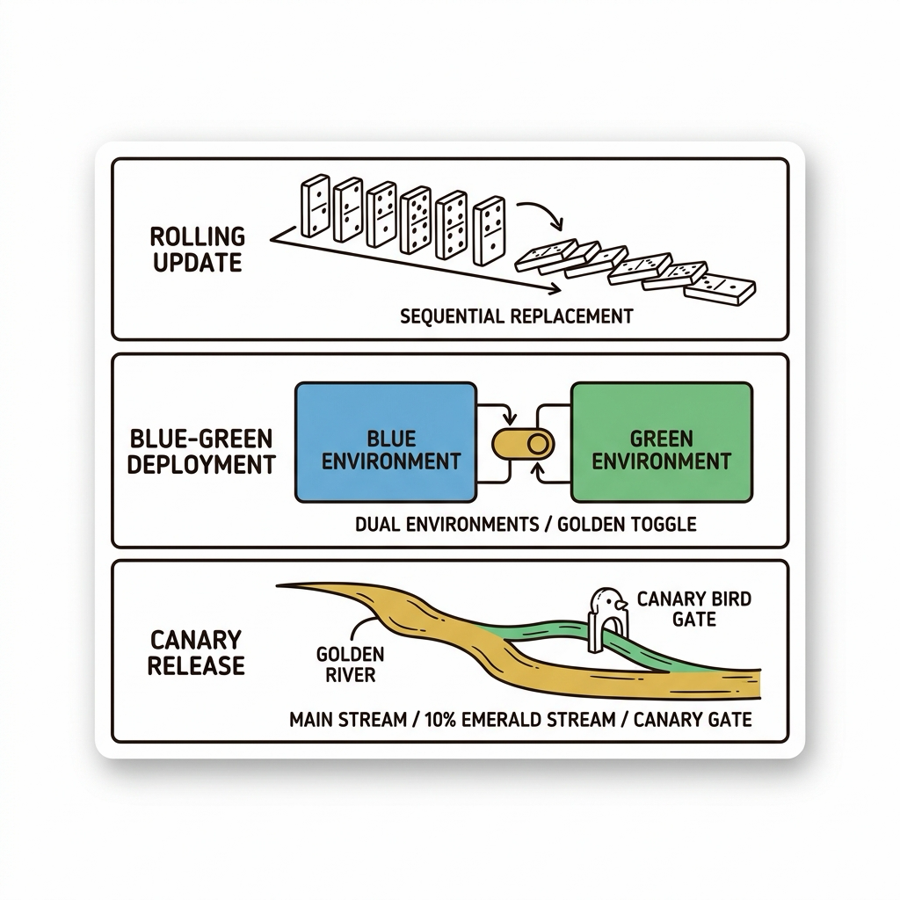
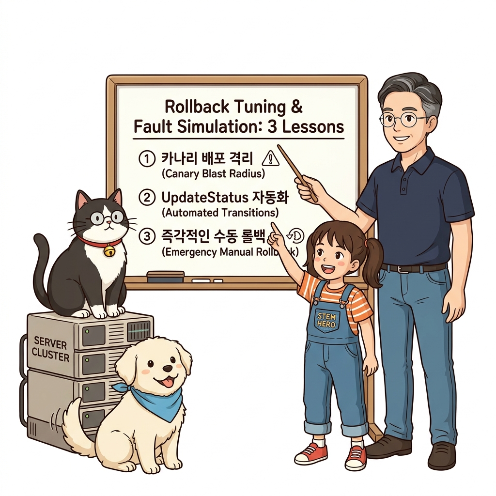

# 091. 롤백설정의 세부튜닝과 장애시뮬레이션 실전검증

정상 동작하는 `v1` 서비스를 먼저 배포한 뒤, 시작 후 2초 만에 비정상 종료(`exit 1`)되는 불량 `v2` 이미지로 서비스를 업데이트합니다.


**그림 06-16-1** 롤백설정의 세부튜닝과 장애시뮬레이션 실전검증의 필요성과 현대 클라우드 아키텍처 관점의 개요

---

### 091.1 왜 롤백설정의 세부튜닝과 장애시뮬레이션 실전검증이(가) 필요한가? (문제 정의와 현실적 배경)

소프트웨어 시스템이 복잡해질수록 설정을 다루는 방식은 전체 인프라의 신뢰성을 결정짓는 핵심 척도가 됩니다. **롤백설정의 세부튜닝과 장애시뮬레이션 실전검증**이(가) 부재하거나 잘못 다루어질 때 현장에서는 다음과 같은 대표적인 병목과 장애가 발생합니다:

1. **하드코딩된 설정과 환경 불일치로 인한 유연성 상실**: 환경이 바뀔 때마다 코드를 다시 빌드해야 하므로 배포 주기가 지연되고 이미지 수가 기하급수적으로 폭증합니다.
2. **보안 민감 데이터의 무분별한 노출**: 비밀번호, 데이터베이스 토큰, 암호화 키가 이미지 레이어에 영구 박제되어 형상관리 시스템이나 외부에 유출될 위험이 커집니다.
3. **재현 불가능한 구성 드리프트**: 스테이징 환경과 프로덕션 환경의 미세한 설정 차이가 예기치 못한 서비스 중단 사고로 직결됩니다.


**그림 06-16-2** 롤백설정의 세부튜닝과 장애시뮬레이션 실전검증에 대한 대표적인 오해와 실제 프로덕션 현장의 엔지니어링 진실

---

### 091.2 핵심 아키텍처와 엔지니어링 메커니즘

스웜이 `v2` 컨테이너 1개를 띄워보고 실패하자마자 업데이트를 즉시 중단하고 다시 `v1`으로 롤백하여 `rollback completed` 상태를 출력하는 전 과정을 실시간으로 관찰합니다!


**그림 06-16-3** 롤백설정의 세부튜닝과 장애시뮬레이션 실전검증의 내부 아키텍처 및 데이터 흐름

#### 📊 핵심 비교 및 엔지니어링 표준 분석

| 구분 / 핵심 원리 | 상세 설명 및 동작 메커니즘 | 실무 적용 시 주의점 및 베스트 프랙티스 |
| :--- | :--- | :--- |
| **`UpdateStatus` 상태 변화** | `updating` ➔ (불량 감지) ➔ `rollback_started` ➔ (이전 버전 컨테이너 복구) ➔ **`rollback_completed`**! | `docker service inspect --pretty`를 치면 왜 롤백이 일어났는지 친절한 상태 메시지가 기록되어 있음 |
| **카나리(Canary) 테스트 효과** | `parallelism: 1`로 설정해 두면 전체 10개 레플리카 중 9개는 정상 `v1`을 계속 서비스하는 상태에서 단 1개만 먼저 `v2`로 시험 가동함 | 그 1개가 실패하면 나머지 9개는 건드리지도 않고 1개만 다시 `v1`으로 되돌리므로 전체 서비스 가용성은 100% 유지됨! |
| **수동 롤백 명령** | 기능은 정상인데 화면 디자인이 잘못 나간 경우처럼 사람이 직접 되돌려야 할 때는 언제든 `docker service rollback <서비스명>` 한 줄이면 끝! | 배포 공포증을 완전히 사라지게 만드는 도커 스웜의 마법 |

---

### 091.3 선언적 실습 및 아키텍처 다이어그램

본 실습은 외부 비공개 패키지에 의존하지 않고, 공식 표준 이미지를 기반으로 즉시 재현 가능한 살아있는 코드로 구성되어 있습니다.

```bash
# [자동 롤백 실전 실험] 정상 서비스(v1) 배포 ➔ 불량 버전(exit 1) 업데이트 시도 ➔ 스웜의 자동 롤백 확인!
docker swarm init 2>/dev/null || true
docker service create --name rollback-demo --replicas 2   --update-parallelism 1 --update-monitor 5s --update-failure-action rollback   alpine:3.20 sh -c "echo 'Healthy v1 running'; sleep 120"

# 고의로 시작하자마자 죽는(exit 1) 불량 명령으로 업데이트 시도!
docker service update --args "sh -c 'echo Buggy v2 crash!; exit 1'" rollback-demo || true
docker service inspect --format 'Update State: {{.UpdateStatus.State}} | Message: {{.UpdateStatus.Message}}' rollback-demo
docker service rm rollback-demo
```

#### 🔍 아키텍처 흐름도 (Mermaid Diagram)




**그림 06-16-4** 선언적 인프라 명세를 통한 롤백설정의 세부튜닝과 장애시뮬레이션 실전검증 검증 파이프라인

---

<!-- BIBLE_INTEGRATION_book3_deep_091 -->
---

### 091.C 📚 도커 바이블 심화: 3대 무중단 배포 전략 완벽 비교: 롤링 업데이트 vs 블루-그린 vs 카나리 릴리스
*출처 도서: 『도커를 활용한 마이크로서비스』 핵심 분석 (도커를 활용한 마이크로서비스 제6장 (데브옵스와 연속 업데이트))*

프로덕션 환경에서 마이크로서비스를 업데이트할 때, 서비스 다운타임 없이 신구 버전을 교체하는 **3대 무중단 배포 전략**의 트레이드오프 비교입니다:

| 배포 전략 | 교체 메커니즘 | 리소스 소모량 | 롤백 속도 | 적합한 시스템 특성 |
| :--- | :--- | :---: | :---: | :--- |
| **롤링 업데이트 (Rolling Update)** | 기존 인스턴스를 하나씩 순차적으로 끄고 새 버전으로 점진적 교체 | **100% (추가 리소스 최소)** | 중간 (역방향 롤링 필요) | 일반적인 웹/API 서비스, 쿠버네티스/스웜의 기본 배포 방식 |
| **블루-그린 (Blue-Green)** | 구버전(Blue)과 동일한 규모의 신버전(Green)을 100% 구축 후 로드밸런서 스위칭 | **200% (일시적 2배 자원 필요)** | **초고속 (스위칭 1초 롤백)** | 결제, 금융 등 버전 불일치나 DB 스키마 충돌을 절대 허용하지 않는 무결점 시스템 |
| **카나리 릴리스 (Canary Release)** | 전체 트래픽의 5%~10%만 신버전으로 라우팅하여 실환경 모니터링 후 점진적 확대 | **110% (약간의 추가 자원)** | 빠름 (카나리 인스턴스 격리) | 대규모 B2C 플랫폼, 머신러닝 신규 모델 A/B 테스트 |


**그림 091-B-2** 롤링 업데이트, 블루-그린 스위칭, 카나리 카나리아 분기 배포의 3대 무중단 아키텍처 비교도

```bash
# [실습] Nginx 가중치 기반 카나리 릴리스(9:1 트래픽 분기) 구현
cat << 'EOF' > canary-upstream.conf
upstream backend_cluster {
    server app-stable:8080 weight=9;  # 안정된 기존 버전 90%
    server app-canary:8080 weight=1;  # 신규 검증 카나리 10%
}

server {
    listen 80;
    location / {
        proxy_pass http://backend_cluster;
    }
}
EOF
```

> 👨‍🏫 **이호진 교수님의 바이블 멘토링 노트**:
> "새 버전에 잠재된 버그가 전체 사용자의 100%에게 폭탄처럼 터지는 것을 방지하는 유일한 방패가 카나리 릴리스입니다. 광산의 카나리아처럼 위험을 먼저 감지하고 즉시 차단하세요."
>
> 👧 **도로시의 깨달음**:
> "모든 손님을 한꺼번에 새 방으로 안내하지 않고, 10명의 손님만 먼저 새 방에 모셔서 문제가 없는지 지켜보는 똑똑한 전략이네요!"
>
> 🐱 **조교 지니의 아키텍처 체크포인트**:
> "블루-그린 배포 시 데이터베이스 변경이 수반될 때는, 반드시 구버전과 신버전 코드가 모두 작동할 수 있는 '하위 호환성 DB 마이그레이션(Expand and Contract 패턴)'이 선행되어야 합니다."


### 091.4 핵심 정리: 캐릭터 대화와 3대 교훈

> 👧 **도로시**: "교수님! **롤백설정의 세부튜닝과 장애시뮬레이션 실전검증**의 원리를 배우니까, 복잡하게 얽혀 있던 인프라 설정이 레고 블록처럼 질서정연하게 제자리를 찾는 게 보여요!"
> 
> 🐱 **조교 지니**: "야옹~ 맞습니다! 특히 런타임 환경과 불변 인프라의 경계를 명확히 지키는 것이 대규모 클라우드 운영의 제1원칙이랍니다!"
> 
> 🐶 **토토**: "멍멍! 선언적 코드로 한 번 적어두면 언제든 똑같이 복원되니까 정말 든든해요!"
> 
> 👨‍🏫 **이호진 교수님**: "훌륭하구나. 원리를 깊이 이해하고 실습을 통해 손에 익히는 것이 훌륭한 클라우드 엔지니어로 성장하는 가장 빠른 지름길이란다."


**그림 06-16-5** 롤백설정의 세부튜닝과 장애시뮬레이션 실전검증 마스터를 위한 3대 핵심 교훈

1. **설정과 실행의 명확한 분리**:
   * 애플리케이션 코드는 불변으로 유지하고, 가변적인 설정값은 외부에서 주입하여 이식성을 극대화합니다.
2. **선언적 재현성 확보**:
   * 사람이 수작업으로 변경하지 않고 코드 명세를 통해 언제 어디서나 100% 동일한 실행 결과를 보장합니다.
3. **최소 권한 및 보안 모범 사례 준수**:
   * 불필요한 권한과 포트 노출을 최소화하고 민감 데이터를 암호화하여 프로덕션 안정성을 담보합니다.

---

### 091.5 랩노트 피날레와 다음 강의 예고


**그림 06-16-6** 연구실에서 다음 마일스톤인 [클러스터 노드유지보수 Drain모드와 무중단서버점검] 실습을 예고하는 교수님과 토토

> 💡 **다음 강의 안내**:
> [클러스터 노드유지보수 Drain모드와 무중단서버점검](../092_클러스터_노드유지보수_Drain모드와_무중단서버점검/)에서는 더욱 심화된 실전 엔지니어링 실습과 아키텍처를 다룹니다!

---

## 🧭 강의 네비게이션
* [◀️ 이전 강의: 090_불량배포_자동감지와_자동롤백_failure_action_rollback](../090_불량배포_자동감지와_자동롤백_failure_action_rollback/)
* [📋 Part 06. 컨테이너 오케스트레이션: 도커 스웜(Swarm) 클러스터, 스택 배포, 무중단 롤링 업데이트 & 쿠버네티스 (076 ~ 095) 목차로 돌아가기](../)
* [▶️ 다음 강의: 092_클러스터_노드유지보수_Drain모드와_무중단서버점검](../092_클러스터_노드유지보수_Drain모드와_무중단서버점검/)
