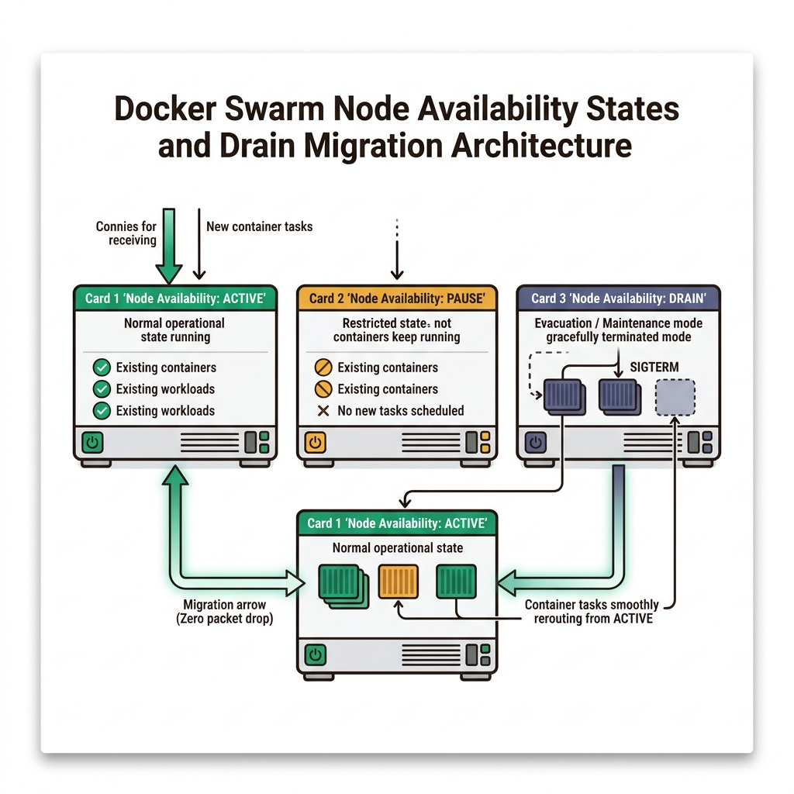
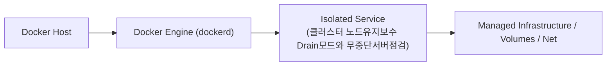
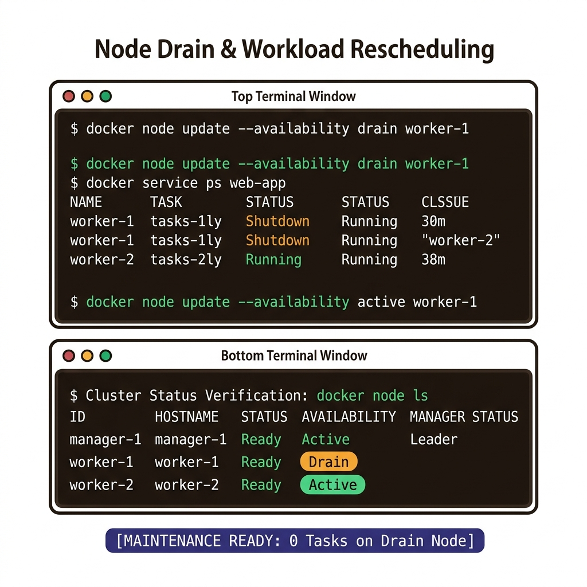
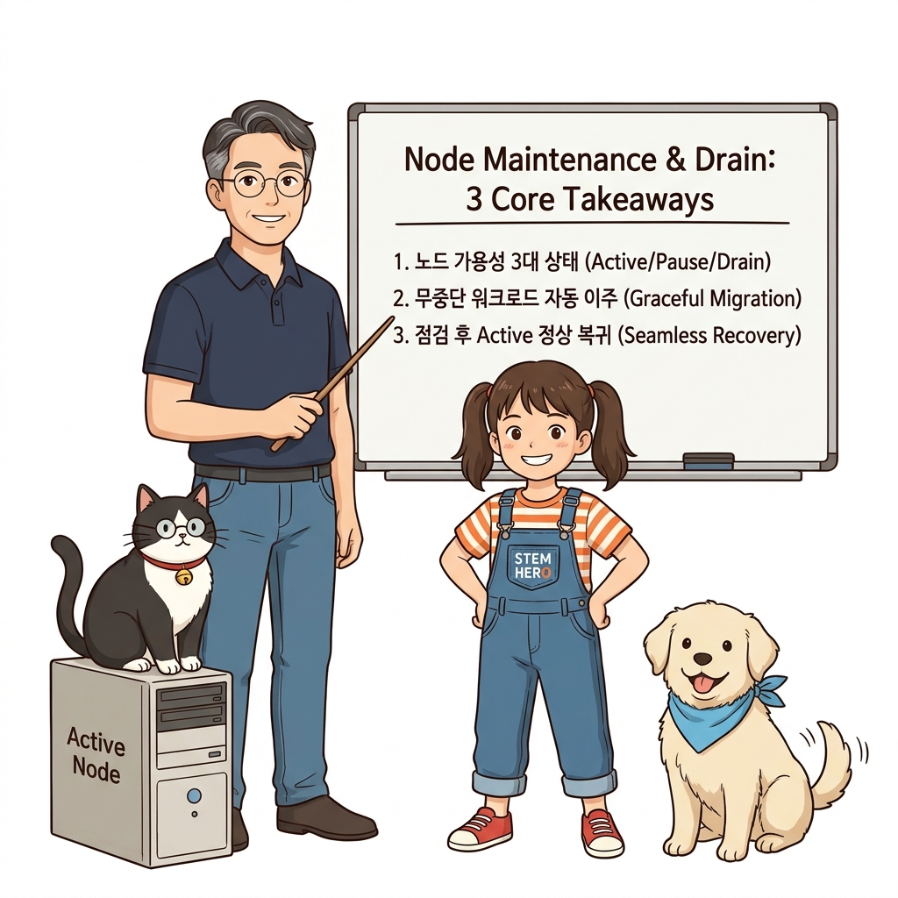
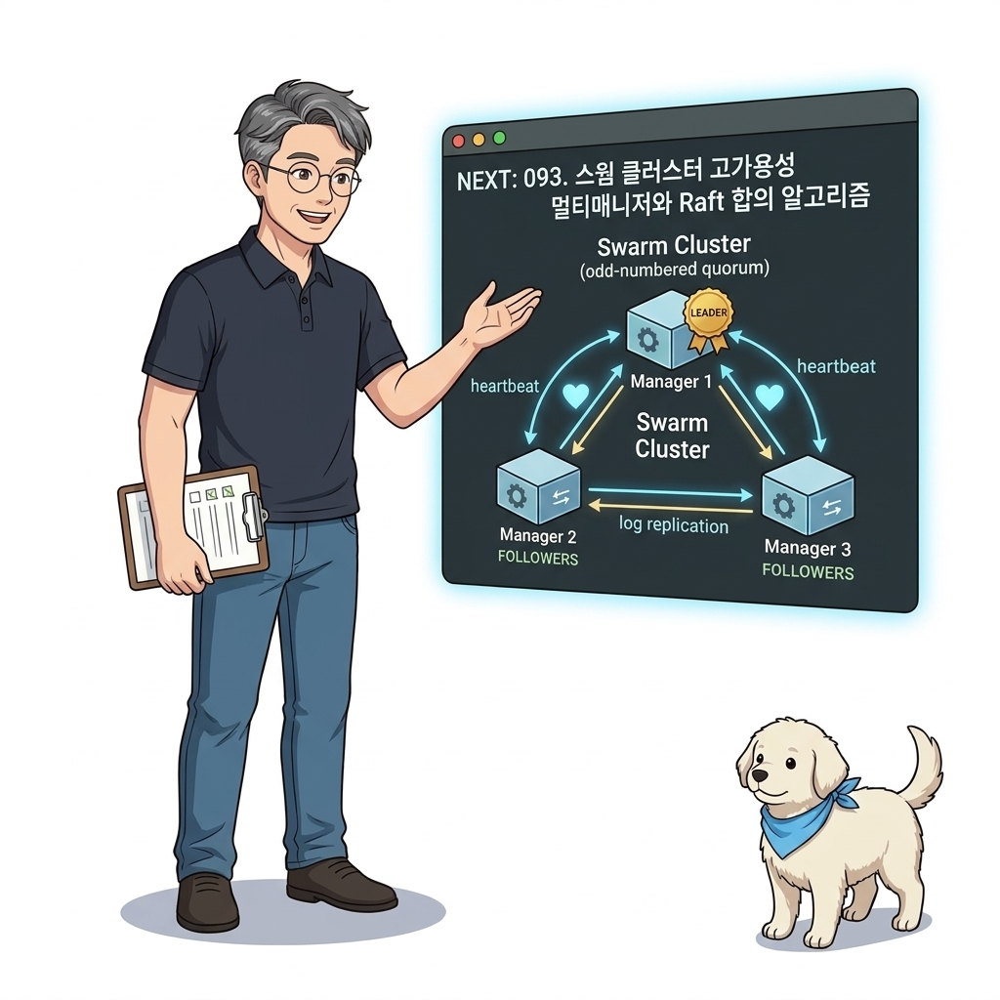

# 092. 클러스터 노드유지보수 Drain모드와 무중단서버점검

클러스터를 구성하는 개별 서버(노드)도 언젠가는 OS 보안 업데이트, 디스크 교체, 하드웨어 점검을 위해 재부팅해야 합니다.


**그림 06-17-1** 클러스터 노드유지보수 Drain모드와 무중단서버점검의 필요성과 현대 클라우드 아키텍처 관점의 개요

---

### 092.1 왜 클러스터 노드유지보수 Drain모드와 무중단서버점검이(가) 필요한가? (문제 정의와 현실적 배경)

소프트웨어 시스템이 복잡해질수록 설정을 다루는 방식은 전체 인프라의 신뢰성을 결정짓는 핵심 척도가 됩니다. **클러스터 노드유지보수 Drain모드와 무중단서버점검**이(가) 부재하거나 잘못 다루어질 때 현장에서는 다음과 같은 대표적인 병목과 장애가 발생합니다:

1. **하드코딩된 설정과 환경 불일치로 인한 유연성 상실**: 환경이 바뀔 때마다 코드를 다시 빌드해야 하므로 배포 주기가 지연되고 이미지 수가 기하급수적으로 폭증합니다.
2. **보안 민감 데이터의 무분별한 노출**: 비밀번호, 데이터베이스 토큰, 암호화 키가 이미지 레이어에 영구 박제되어 형상관리 시스템이나 외부에 유출될 위험이 커집니다.
3. **재현 불가능한 구성 드리프트**: 스테이징 환경과 프로덕션 환경의 미세한 설정 차이가 예기치 못한 서비스 중단 사고로 직결됩니다.


**그림 06-17-2** 클러스터 노드유지보수 Drain모드와 무중단서버점검에 대한 대표적인 오해와 실제 프로덕션 현장의 엔지니어링 진실

---

### 092.2 핵심 아키텍처와 엔지니어링 메커니즘

점검할 노드의 가용성(Availability) 상태를 **`docker node update --availability drain <노드명>`**으로 변경하면, 스웜 매니저가 해당 노드에 있던 모든 컨테이너를 정상 종료하고 다른 활성(`Active`) 노드들로 즉시 이주(Migration)시키는 무중단 서버 유지보수 절차를 배웁니다!


**그림 06-17-3** 클러스터 노드유지보수 Drain모드와 무중단서버점검의 내부 아키텍처 및 데이터 흐름

#### 📊 핵심 비교 및 엔지니어링 표준 분석

| 구분 / 핵심 원리 | 상세 설명 및 동작 메커니즘 | 실무 적용 시 주의점 및 베스트 프랙티스 |
| :--- | :--- | :--- |
| **`Active` 상태 (기본값)** | 새로운 태스크(컨테이너)를 정상적으로 배정받고 실행할 수 있는 일반 가동 상태 | 모든 매니저와 워커 노드의 기본 상태 |
| **`Pause` 상태 (일시 정지)** | 현재 실행 중인 컨테이너들은 그대로 계속 돌리되, **새로 생성되거나 스케일 아웃되는 컨테이너는 이 노드에 배정하지 않음** | 특정 노드의 리소스 사용량이 높아 추가 배치를 잠시 막고자 할 때 유용 |
| **`Drain` 상태 (비우기 / 점검 모드)** | 해당 노드에서 실행 중인 모든 컨테이너(Global 모드 포함)를 즉시 종료하고 **다른 `Active` 노드들에 대체 컨테이너를 새로 띄움**! | 노드가 완전히 비워진 것을 확인한 뒤 안심하고 서버 전원을 끄거나 OS를 재부팅하고, 작업 후 `active`로 되돌리면 끝! |

---

### 092.3 선언적 실습 및 아키텍처 다이어그램

본 실습은 외부 비공개 패키지에 의존하지 않고, 공식 표준 이미지를 기반으로 즉시 재현 가능한 살아있는 코드로 구성되어 있습니다.

```bash
# 클러스터 노드의 3대 가용성 상태(Active / Pause / Drain) 확인 및 전환 명령 레퍼런스
docker swarm init 2>/dev/null || true
NODE_ID=$(docker node ls -q | head -n 1)
docker node inspect --format 'Node: {{.Description.Hostname}} | Status: {{.Status.State}} | Availability: {{.Spec.Availability}}' $NODE_ID

echo "1. 점검을 위해 노드 비우기 (기존 컨테이너 타 노드로 이주) : docker node update --availability drain <노드명>"
echo "2. 신규 배치만 막고 기존 컨테이너는 유지하기             : docker node update --availability pause <노드명>"
echo "3. 점검 완료 후 정상 복귀                               : docker node update --availability active <노드명>" 
```

#### 🔍 아키텍처 흐름도 (Mermaid Diagram)




**그림 06-17-4** 선언적 인프라 명세를 통한 클러스터 노드유지보수 Drain모드와 무중단서버점검 검증 파이프라인

---

### 092.4 핵심 정리: 캐릭터 대화와 3대 교훈

> 👧 **도로시**: "교수님! **클러스터 노드유지보수 Drain모드와 무중단서버점검**의 원리를 배우니까, 복잡하게 얽혀 있던 인프라 설정이 레고 블록처럼 질서정연하게 제자리를 찾는 게 보여요!"
> 
> 🐱 **조교 지니**: "야옹~ 맞습니다! 특히 런타임 환경과 불변 인프라의 경계를 명확히 지키는 것이 대규모 클라우드 운영의 제1원칙이랍니다!"
> 
> 🐶 **토토**: "멍멍! 선언적 코드로 한 번 적어두면 언제든 똑같이 복원되니까 정말 든든해요!"
> 
> 👨‍🏫 **이호진 교수님**: "훌륭하구나. 원리를 깊이 이해하고 실습을 통해 손에 익히는 것이 훌륭한 클라우드 엔지니어로 성장하는 가장 빠른 지름길이란다."


**그림 06-17-5** 클러스터 노드유지보수 Drain모드와 무중단서버점검 마스터를 위한 3대 핵심 교훈

1. **설정과 실행의 명확한 분리**:
   * 애플리케이션 코드는 불변으로 유지하고, 가변적인 설정값은 외부에서 주입하여 이식성을 극대화합니다.
2. **선언적 재현성 확보**:
   * 사람이 수작업으로 변경하지 않고 코드 명세를 통해 언제 어디서나 100% 동일한 실행 결과를 보장합니다.
3. **최소 권한 및 보안 모범 사례 준수**:
   * 불필요한 권한과 포트 노출을 최소화하고 민감 데이터를 암호화하여 프로덕션 안정성을 담보합니다.

---

### 092.5 랩노트 피날레와 다음 강의 예고


**그림 06-17-6** 연구실에서 다음 마일스톤인 [스웜클러스터 고가용성 멀티매니저와 Raft합의알고리즘] 실습을 예고하는 교수님과 토토

> 💡 **다음 강의 안내**:
> [스웜클러스터 고가용성 멀티매니저와 Raft합의알고리즘](../093_스웜클러스터_고가용성_멀티매니저와_Raft합의알고리즘/)에서는 더욱 심화된 실전 엔지니어링 실습과 아키텍처를 다룹니다!

---

## 🧭 강의 네비게이션
* [◀️ 이전 강의: 091_롤백설정의_세부튜닝과_장애시뮬레이션_실전검증](../091_롤백설정의_세부튜닝과_장애시뮬레이션_실전검증/)
* [📋 Part 06. 컨테이너 오케스트레이션: 도커 스웜(Swarm) 클러스터, 스택 배포, 무중단 롤링 업데이트 & 쿠버네티스 (076 ~ 095) 목차로 돌아가기](../)
* [▶️ 다음 강의: 093_스웜클러스터_고가용성_멀티매니저와_Raft합의알고리즘](../093_스웜클러스터_고가용성_멀티매니저와_Raft합의알고리즘/)
