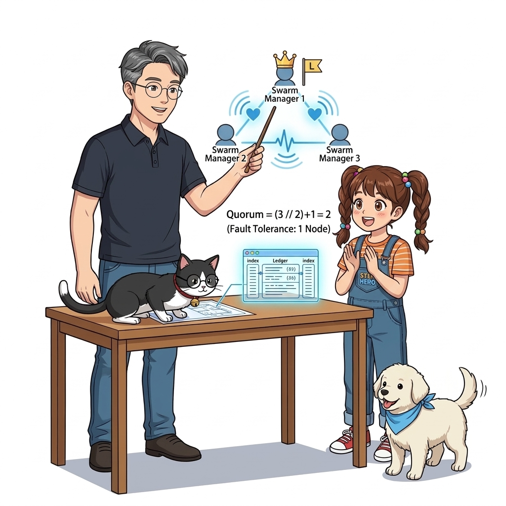
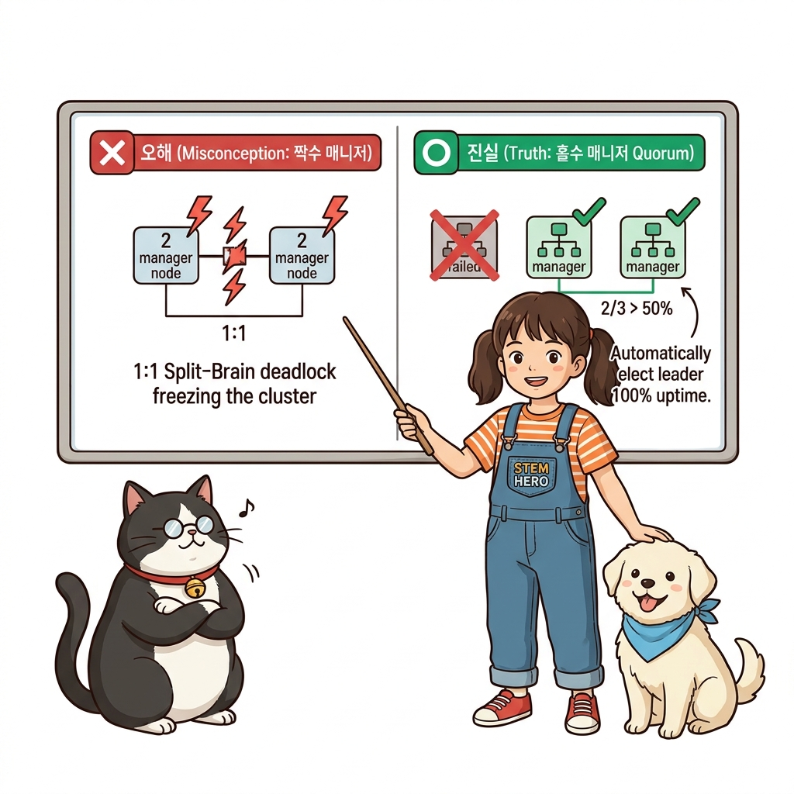
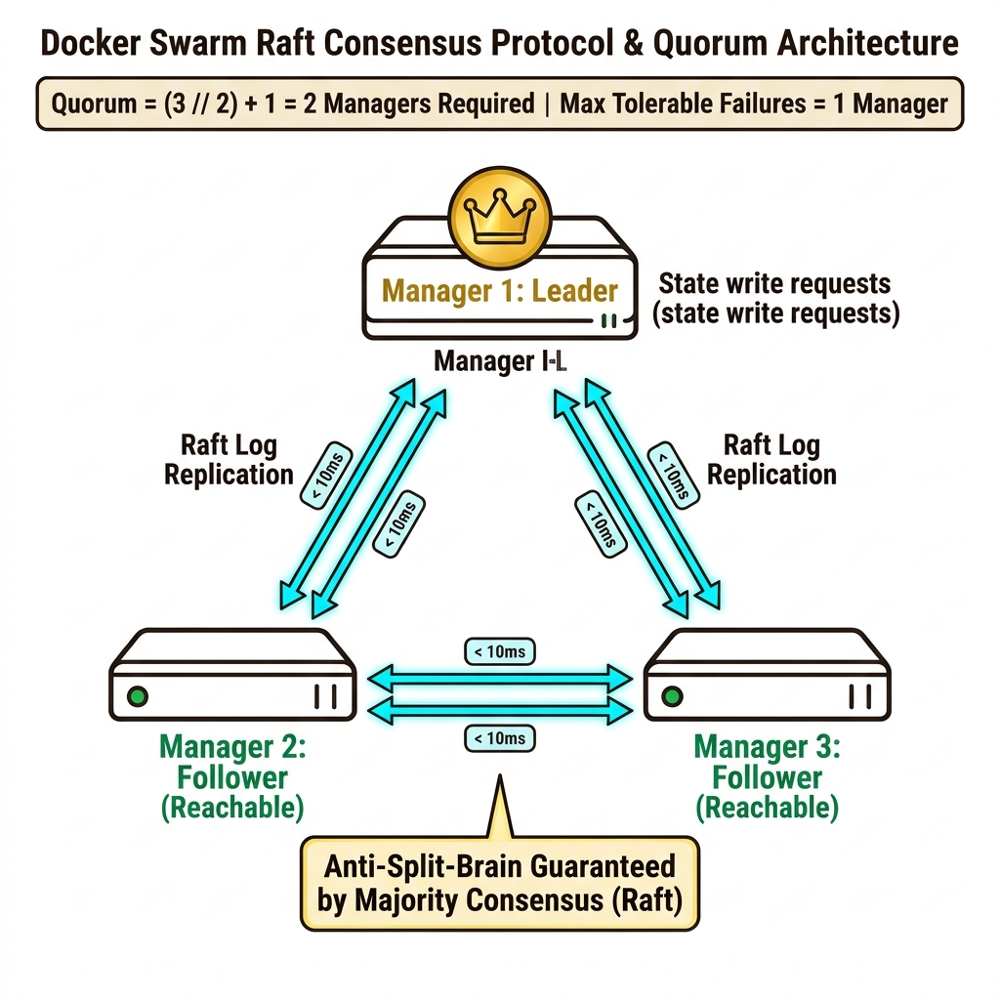
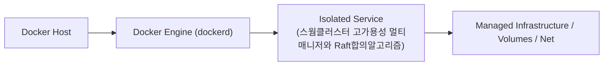
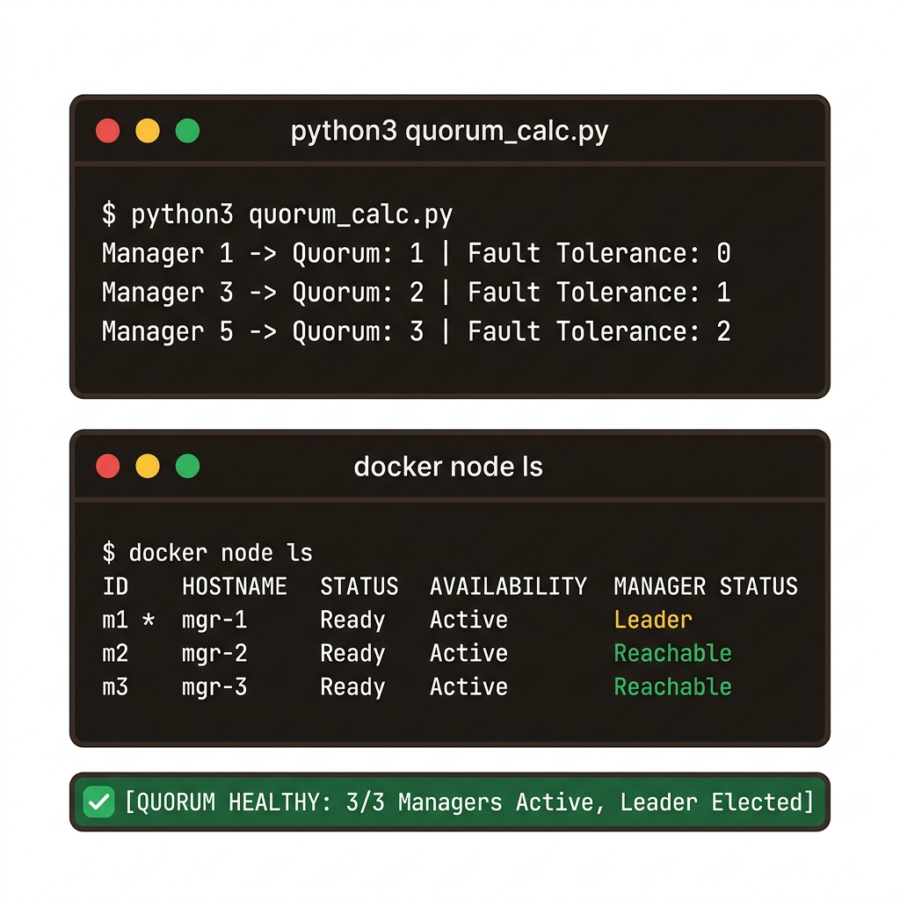
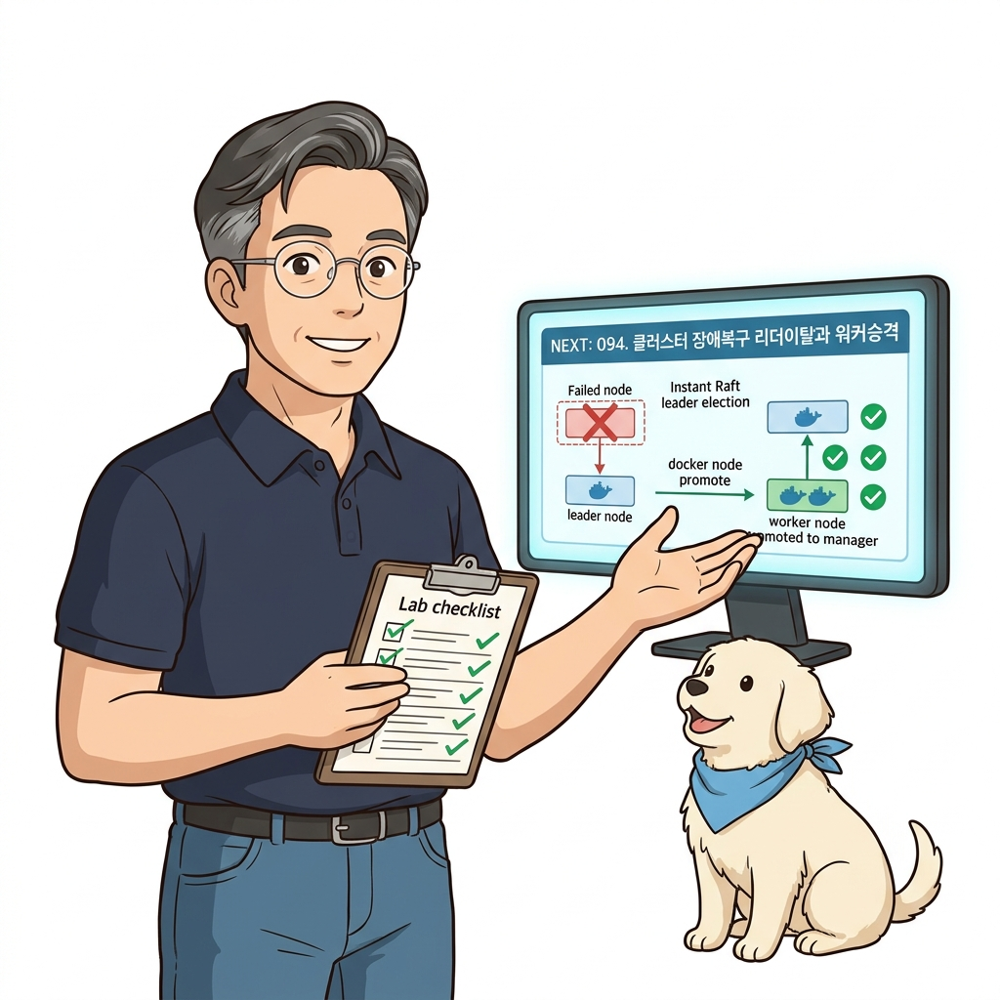

# 093. 스웜클러스터 고가용성 멀티매니저와 Raft합의알고리즘

단 1대의 매니저 노드만으로 클러스터를 운영하면 그 매니저 서버가 다운될 때 워커 노드의 컨테이너들은 계속 돌아가지만 **클러스터의 두뇌(스케줄링, 자가 치유, API 제어)가 마비**됩니다.


**그림 06-18-1** 스웜클러스터 고가용성 멀티매니저와 Raft합의알고리즘의 필요성과 현대 클라우드 아키텍처 관점의 개요

---

### 093.1 왜 스웜클러스터 고가용성 멀티매니저와 Raft합의알고리즘이(가) 필요한가? (문제 정의와 현실적 배경)

소프트웨어 시스템이 복잡해질수록 설정을 다루는 방식은 전체 인프라의 신뢰성을 결정짓는 핵심 척도가 됩니다. **스웜클러스터 고가용성 멀티매니저와 Raft합의알고리즘**이(가) 부재하거나 잘못 다루어질 때 현장에서는 다음과 같은 대표적인 병목과 장애가 발생합니다:

1. **하드코딩된 설정과 환경 불일치로 인한 유연성 상실**: 환경이 바뀔 때마다 코드를 다시 빌드해야 하므로 배포 주기가 지연되고 이미지 수가 기하급수적으로 폭증합니다.
2. **보안 민감 데이터의 무분별한 노출**: 비밀번호, 데이터베이스 토큰, 암호화 키가 이미지 레이어에 영구 박제되어 형상관리 시스템이나 외부에 유출될 위험이 커집니다.
3. **재현 불가능한 구성 드리프트**: 스테이징 환경과 프로덕션 환경의 미세한 설정 차이가 예기치 못한 서비스 중단 사고로 직결됩니다.


**그림 06-18-2** 스웜클러스터 고가용성 멀티매니저와 Raft합의알고리즘에 대한 대표적인 오해와 실제 프로덕션 현장의 엔지니어링 진실

---

### 093.2 핵심 아키텍처와 엔지니어링 메커니즘

매니저 노드를 **3대 또는 5대(홀수)**로 구성하여 리더(Leader) 매니저가 죽더라도 나머지 매니저들이 **Raft 분산 합의 알고리즘**과 과반수 정족수(Quorum, $N/2 + 1$) 투표를 통해 1초 만에 새로운 리더를 선출하는 고가용성 컨트롤 플레인 원리를 완벽히 이해합니다!


**그림 06-18-3** 스웜클러스터 고가용성 멀티매니저와 Raft합의알고리즘의 내부 아키텍처 및 데이터 흐름

#### 📊 핵심 비교 및 엔지니어링 표준 분석

| 구분 / 핵심 원리 | 상세 설명 및 동작 메커니즘 | 실무 적용 시 주의점 및 베스트 프랙티스 |
| :--- | :--- | :--- |
| **왜 매니저는 반드시 '홀수(3대 또는 5대)'여야 할까?** | 매니저 3대(정족수 2대)와 매니저 4대(정족수 3대)는 둘 다 최대 **1대**의 장애만 허용함! 짝수(2대, 4대)로 구성하면 동기화 트래픽만 늘어나고 장애 허용 대수는 홀수와 같거나 오히려 불리함(2대 중 1대만 죽어도 과반수 미달로 클러스터 멈춤!) | **실무 황금 법칙: 매니저 노드는 무조건 3대(중소규모) 또는 5대(대규모) 홀수로 구성한다!** |
| **스플릿 브레인(Split-Brain) 방지** | 네트워크 단절로 클러스터가 두 동강 났을 때, 과반수 정족수(Quorum)를 확보한 쪽만 새 리더를 뽑아 클러스터를 계속 운영하고 소수파 쪽은 쓰기를 멈춰 데이터 불일치를 원천 차단 | 분산 데이터베이스와 쿠버네티스(`etcd`)도 100% 동일하게 사용하는 Raft 알고리즘의 핵심 원리 |
| **매니저 노드를 워크로드에서 보호하기** | 대규모 클러스터에서는 매니저 노드가 오직 클러스터 관리에만 집중하도록 매니저 노드들을 `--availability drain`으로 설정해 일반 앱 컨테이너가 매니저에 뜨지 않게 분리하기도 함 | 컨트롤 플레인의 안정성을 극대화하는 엔터프라이즈 운영 기법 |

---

### 093.3 선언적 실습 및 아키텍처 다이어그램

본 실습은 외부 비공개 패키지에 의존하지 않고, 공식 표준 이미지를 기반으로 즉시 재현 가능한 살아있는 코드로 구성되어 있습니다.

```bash
# 스웜 매니저 노드 수에 따른 과반수 정족수(Quorum)와 허용 가능한 매니저 장애 대수 계산기
python3 -c '
for managers in [1, 2, 3, 4, 5, 7]:
    quorum = (managers // 2) + 1
    fault_tolerance = managers - quorum
    print(f"매니저 {managers}대 구성 -> 과반수 정족수(Quorum): {quorum}대 필요 | 동시 다운 허용: 최대 {fault_tolerance}대")
'
```

#### 🔍 아키텍처 흐름도 (Mermaid Diagram)




**그림 06-18-4** 선언적 인프라 명세를 통한 스웜클러스터 고가용성 멀티매니저와 Raft합의알고리즘 검증 파이프라인

---

### 093.4 핵심 정리: 캐릭터 대화와 3대 교훈

> 👧 **도로시**: "교수님! **스웜클러스터 고가용성 멀티매니저와 Raft합의알고리즘**의 원리를 배우니까, 복잡하게 얽혀 있던 인프라 설정이 레고 블록처럼 질서정연하게 제자리를 찾는 게 보여요!"
> 
> 🐱 **조교 지니**: "야옹~ 맞습니다! 특히 런타임 환경과 불변 인프라의 경계를 명확히 지키는 것이 대규모 클라우드 운영의 제1원칙이랍니다!"
> 
> 🐶 **토토**: "멍멍! 선언적 코드로 한 번 적어두면 언제든 똑같이 복원되니까 정말 든든해요!"
> 
> 👨‍🏫 **이호진 교수님**: "훌륭하구나. 원리를 깊이 이해하고 실습을 통해 손에 익히는 것이 훌륭한 클라우드 엔지니어로 성장하는 가장 빠른 지름길이란다."


**그림 06-18-5** 스웜클러스터 고가용성 멀티매니저와 Raft합의알고리즘 마스터를 위한 3대 핵심 교훈

1. **설정과 실행의 명확한 분리**:
   * 애플리케이션 코드는 불변으로 유지하고, 가변적인 설정값은 외부에서 주입하여 이식성을 극대화합니다.
2. **선언적 재현성 확보**:
   * 사람이 수작업으로 변경하지 않고 코드 명세를 통해 언제 어디서나 100% 동일한 실행 결과를 보장합니다.
3. **최소 권한 및 보안 모범 사례 준수**:
   * 불필요한 권한과 포트 노출을 최소화하고 민감 데이터를 암호화하여 프로덕션 안정성을 담보합니다.

---

### 093.5 랩노트 피날레와 다음 강의 예고


**그림 06-18-6** 연구실에서 다음 마일스톤인 [클러스터 장애복구 시나리오 리더노드이탈과 워커승격] 실습을 예고하는 교수님과 토토

> 💡 **다음 강의 안내**:
> [클러스터 장애복구 시나리오 리더노드이탈과 워커승격](../094_클러스터_장애복구_시나리오_리더노드이탈과_워커승격/)에서는 더욱 심화된 실전 엔지니어링 실습과 아키텍처를 다룹니다!

---

## 🧭 강의 네비게이션
* [◀️ 이전 강의: 092_클러스터_노드유지보수_Drain모드와_무중단서버점검](../092_클러스터_노드유지보수_Drain모드와_무중단서버점검/)
* [📋 Part 06. 컨테이너 오케스트레이션: 도커 스웜(Swarm) 클러스터, 스택 배포, 무중단 롤링 업데이트 & 쿠버네티스 (076 ~ 095) 목차로 돌아가기](../)
* [▶️ 다음 강의: 094_클러스터_장애복구_시나리오_리더노드이탈과_워커승격](../094_클러스터_장애복구_시나리오_리더노드이탈과_워커승격/)
