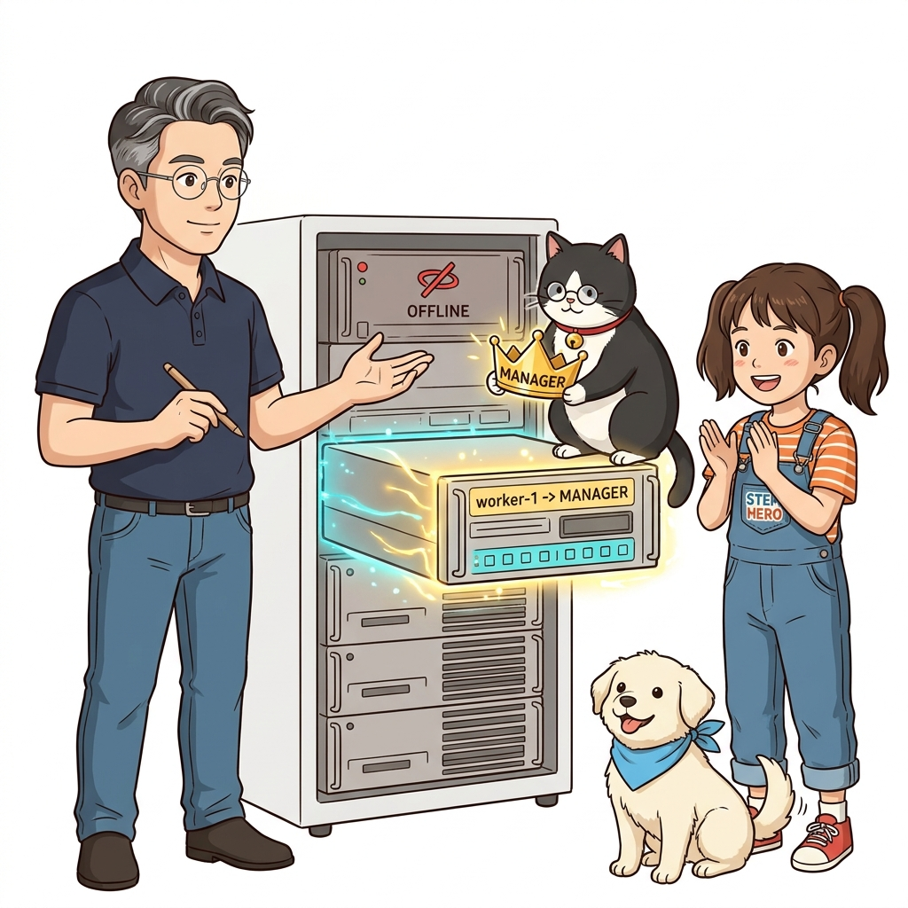
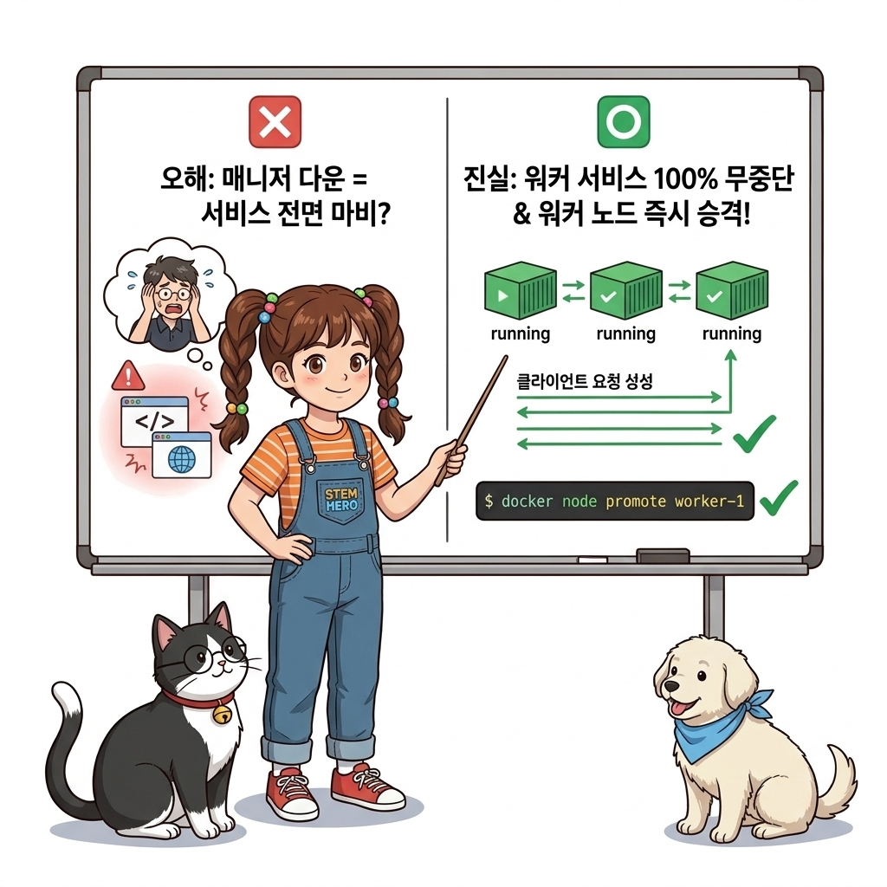
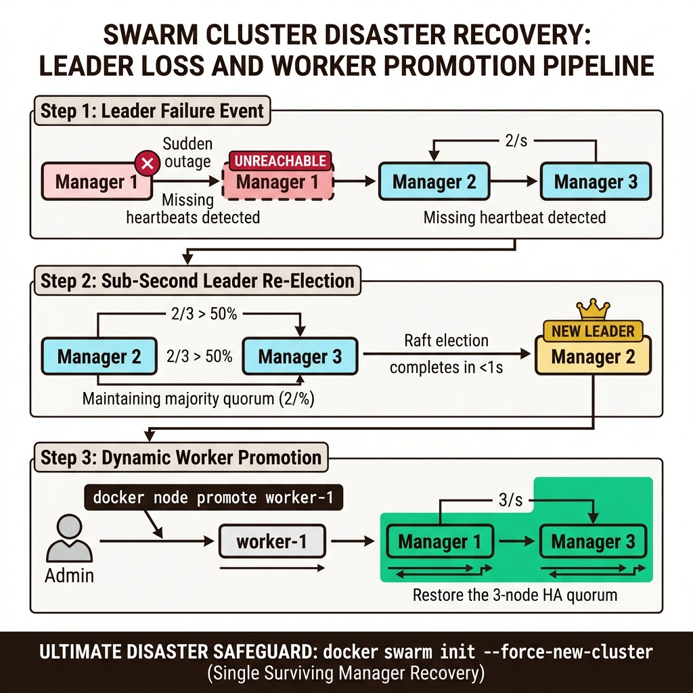
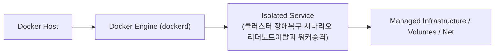
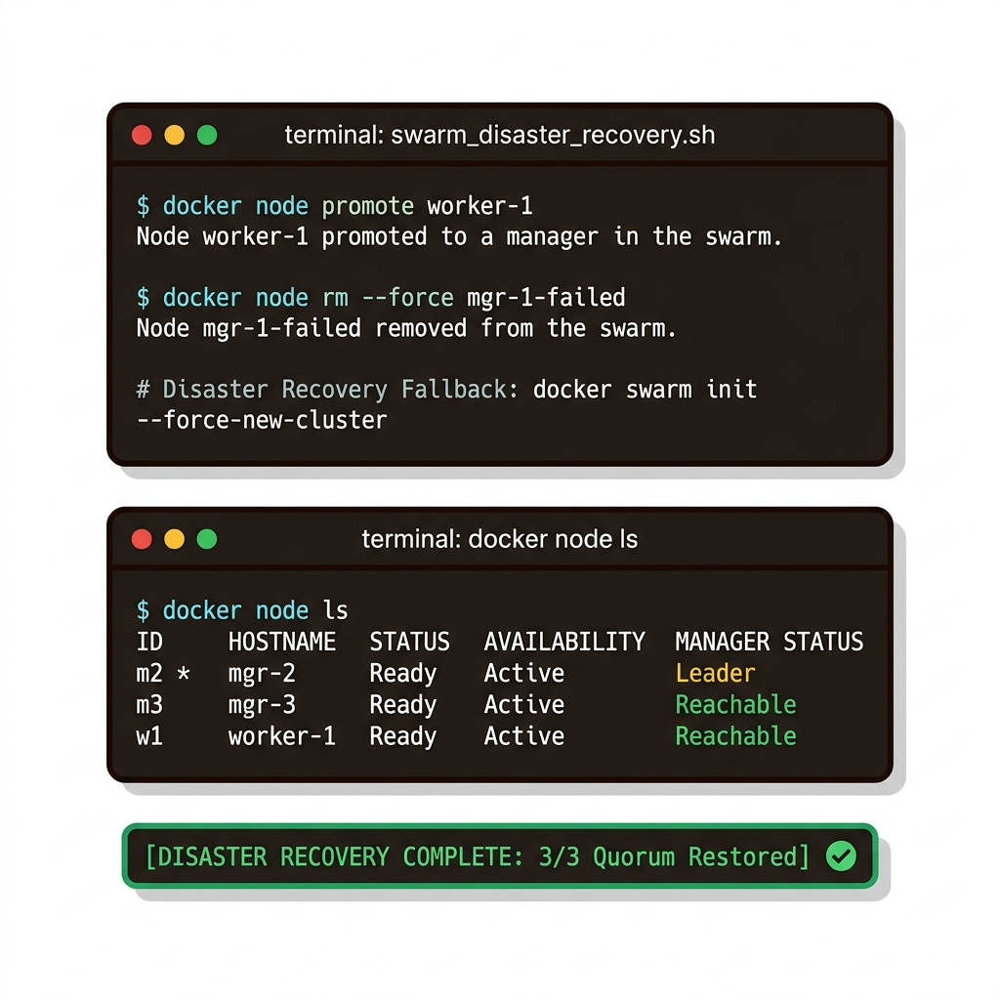
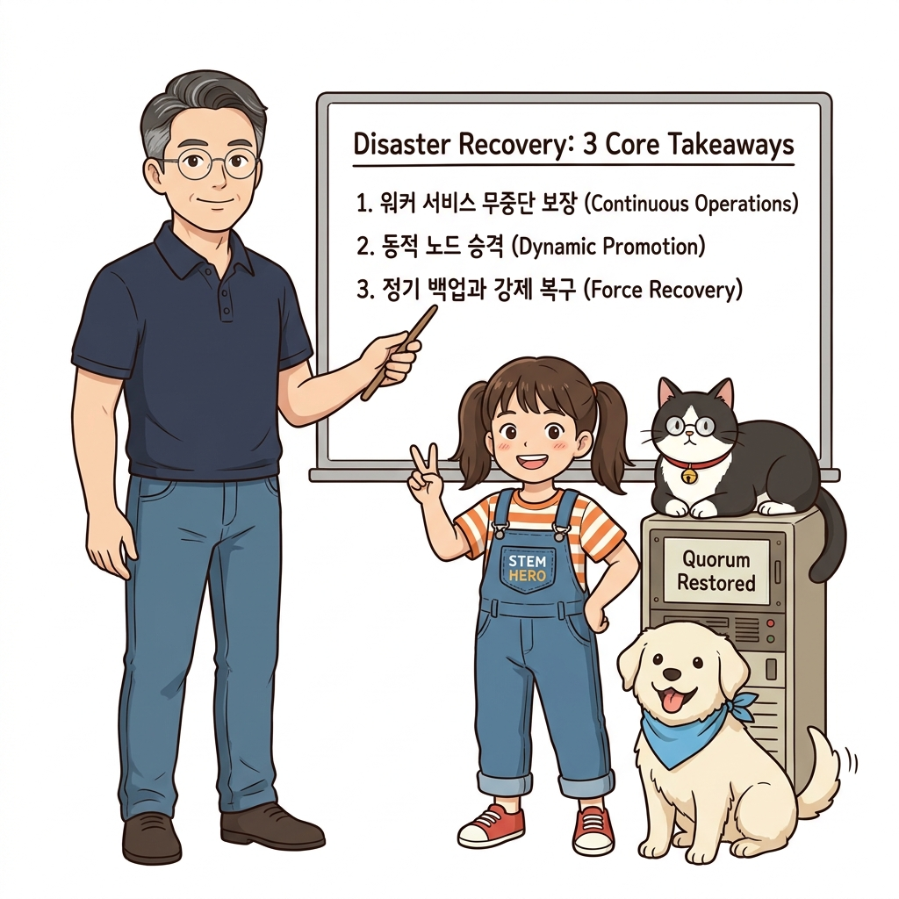
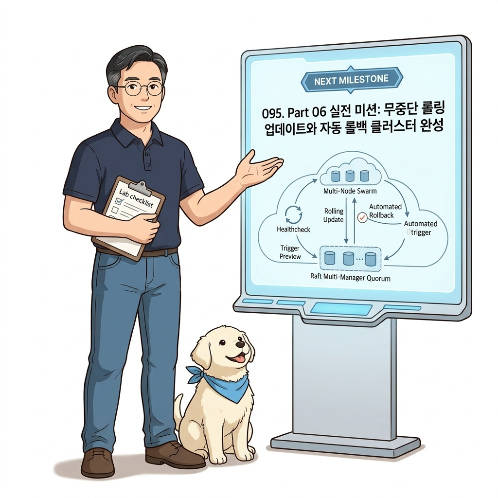

# 094. 클러스터 장애복구 시나리오 리더노드이탈과 워커승격

3대의 매니저 중 1대가 고장 나 탈퇴(`leave`)했을 때, 클러스터에 남아 있는 건강한 워커 노드 하나를 **`docker node promote <노드명>`으로 즉시 매니저로 승격시켜 다시 3매니저 고가용성 체제를 복원**하는 실전 절차를 배웁니다.


**그림 06-19-1** 클러스터 장애복구 시나리오 리더노드이탈과 워커승격의 필요성과 현대 클라우드 아키텍처 관점의 개요

---

### 094.1 왜 클러스터 장애복구 시나리오 리더노드이탈과 워커승격이(가) 필요한가? (문제 정의와 현실적 배경)

소프트웨어 시스템이 복잡해질수록 설정을 다루는 방식은 전체 인프라의 신뢰성을 결정짓는 핵심 척도가 됩니다. **클러스터 장애복구 시나리오 리더노드이탈과 워커승격**이(가) 부재하거나 잘못 다루어질 때 현장에서는 다음과 같은 대표적인 병목과 장애가 발생합니다:

1. **하드코딩된 설정과 환경 불일치로 인한 유연성 상실**: 환경이 바뀔 때마다 코드를 다시 빌드해야 하므로 배포 주기가 지연되고 이미지 수가 기하급수적으로 폭증합니다.
2. **보안 민감 데이터의 무분별한 노출**: 비밀번호, 데이터베이스 토큰, 암호화 키가 이미지 레이어에 영구 박제되어 형상관리 시스템이나 외부에 유출될 위험이 커집니다.
3. **재현 불가능한 구성 드리프트**: 스테이징 환경과 프로덕션 환경의 미세한 설정 차이가 예기치 못한 서비스 중단 사고로 직결됩니다.


**그림 06-19-2** 클러스터 장애복구 시나리오 리더노드이탈과 워커승격에 대한 대표적인 오해와 실제 프로덕션 현장의 엔지니어링 진실

---

### 094.2 핵심 아키텍처와 엔지니어링 메커니즘

또한 천재지변으로 매니저 과반수가 동시에 꺼져 정족수(Quorum)를 잃었을 때, 살아남은 매니저 1대에서 클러스터 데이터베이스를 살려내는 최후의 보루 **`docker swarm init --force-new-cluster`** 재해 복구 명령을 익힙니다.


**그림 06-19-3** 클러스터 장애복구 시나리오 리더노드이탈과 워커승격의 내부 아키텍처 및 데이터 흐름

#### 📊 핵심 비교 및 엔지니어링 표준 분석

| 구분 / 핵심 원리 | 상세 설명 및 동작 메커니즘 | 실무 적용 시 주의점 및 베스트 프랙티스 |
| :--- | :--- | :--- |
| **`docker node promote` / `demote`** | 클러스터 재시작이나 서비스 중단 없이 실행 중인 워커 노드를 즉시 매니저 그룹(Raft 합의 멤버)에 편입시키거나 워커로 강등 | 매니저 서버 교체 시: 새 워커를 `promote`로 승격(매니저 4대) ➔ 구형 매니저를 `drain` 및 `demote`(매니저 3대 유지) ➔ 구형 서버 안전 제거! |
| **정족수 상실(Quorum Loss) 시 증상** | 3대의 매니저 중 2대가 동시에 꺼지면 살아남은 1대의 매니저는 정족수(2대) 미달로 `docker service` 명령을 거부함 (단, 이미 실행 중인 워커의 컨테이너들은 계속 정상 서비스됨!) | 꺼진 매니저 서버를 다시 켜서 정족수를 회복하거나, 영구 손실 시 `--force-new-cluster`로 살아남은 매니저를 단독 리더로 재선언 |
| **Raft 데이터베이스 백업** | 매니저 노드의 `/var/lib/docker/swarm/` 폴더에는 클러스터의 모든 스택·컨피그·시크릿 상태가 들어있으므로 정기 백업 권장 | 클러스터 전체가 파괴되어도 백업 폴더 하나로 1분 만에 복원 가능 |

---

### 094.3 선언적 실습 및 아키텍처 다이어그램

본 실습은 외부 비공개 패키지에 의존하지 않고, 공식 표준 이미지를 기반으로 즉시 재현 가능한 살아있는 코드로 구성되어 있습니다.

```bash
# 노드 역할 승격(promote) 및 강등(demote), 재해 복구 명령어 레퍼런스
cat << 'EOF'
1. 워커 노드를 매니저 노드로 승격   : docker node promote <노드이름>
2. 매니저 노드를 워커 노드로 강등   : docker node demote <노드이름>
3. 다운된 노드를 클러스터에서 제거  : docker node rm --force <노드이름>
4. 정족수 상실 시 단일 매니저 강제 복구: docker swarm init --force-new-cluster
EOF
```

#### 🔍 아키텍처 흐름도 (Mermaid Diagram)




**그림 06-19-4** 선언적 인프라 명세를 통한 클러스터 장애복구 시나리오 리더노드이탈과 워커승격 검증 파이프라인

---

### 094.4 핵심 정리: 캐릭터 대화와 3대 교훈

> 👧 **도로시**: "교수님! **클러스터 장애복구 시나리오 리더노드이탈과 워커승격**의 원리를 배우니까, 복잡하게 얽혀 있던 인프라 설정이 레고 블록처럼 질서정연하게 제자리를 찾는 게 보여요!"
> 
> 🐱 **조교 지니**: "야옹~ 맞습니다! 특히 런타임 환경과 불변 인프라의 경계를 명확히 지키는 것이 대규모 클라우드 운영의 제1원칙이랍니다!"
> 
> 🐶 **토토**: "멍멍! 선언적 코드로 한 번 적어두면 언제든 똑같이 복원되니까 정말 든든해요!"
> 
> 👨‍🏫 **이호진 교수님**: "훌륭하구나. 원리를 깊이 이해하고 실습을 통해 손에 익히는 것이 훌륭한 클라우드 엔지니어로 성장하는 가장 빠른 지름길이란다."


**그림 06-19-5** 클러스터 장애복구 시나리오 리더노드이탈과 워커승격 마스터를 위한 3대 핵심 교훈

1. **설정과 실행의 명확한 분리**:
   * 애플리케이션 코드는 불변으로 유지하고, 가변적인 설정값은 외부에서 주입하여 이식성을 극대화합니다.
2. **선언적 재현성 확보**:
   * 사람이 수작업으로 변경하지 않고 코드 명세를 통해 언제 어디서나 100% 동일한 실행 결과를 보장합니다.
3. **최소 권한 및 보안 모범 사례 준수**:
   * 불필요한 권한과 포트 노출을 최소화하고 민감 데이터를 암호화하여 프로덕션 안정성을 담보합니다.

---

### 094.5 랩노트 피날레와 다음 강의 예고


**그림 06-19-6** 연구실에서 다음 마일스톤인 [Part06 실전미션 무중단롤링업데이트와 자동롤백 클러스터완성] 실습을 예고하는 교수님과 토토

> 💡 **다음 강의 안내**:
> [Part06 실전미션 무중단롤링업데이트와 자동롤백 클러스터완성](../095_Part06_실전미션_무중단롤링업데이트와_자동롤백_클러스터완성/)에서는 더욱 심화된 실전 엔지니어링 실습과 아키텍처를 다룹니다!

---

## 🧭 강의 네비게이션
* [◀️ 이전 강의: 093_스웜클러스터_고가용성_멀티매니저와_Raft합의알고리즘](../093_스웜클러스터_고가용성_멀티매니저와_Raft합의알고리즘/)
* [📋 Part 06. 컨테이너 오케스트레이션: 도커 스웜(Swarm) 클러스터, 스택 배포, 무중단 롤링 업데이트 & 쿠버네티스 (076 ~ 095) 목차로 돌아가기](../)
* [▶️ 다음 강의: 095_Part06_실전미션_무중단롤링업데이트와_자동롤백_클러스터완성](../095_Part06_실전미션_무중단롤링업데이트와_자동롤백_클러스터완성/)
