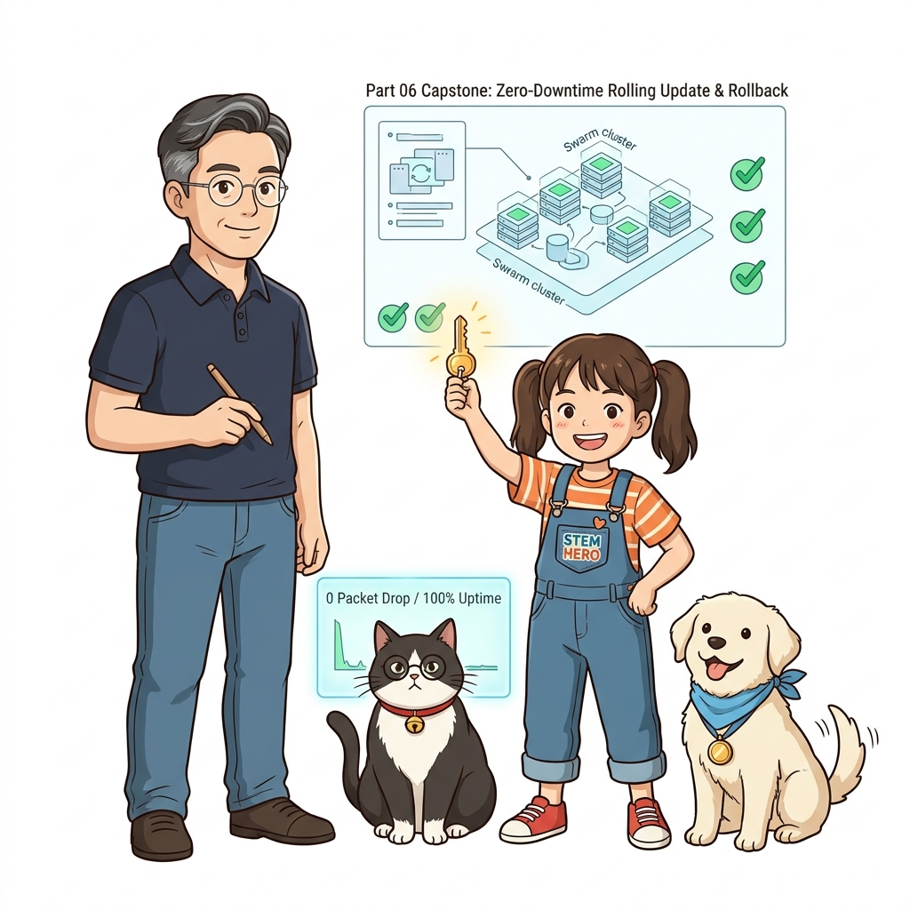
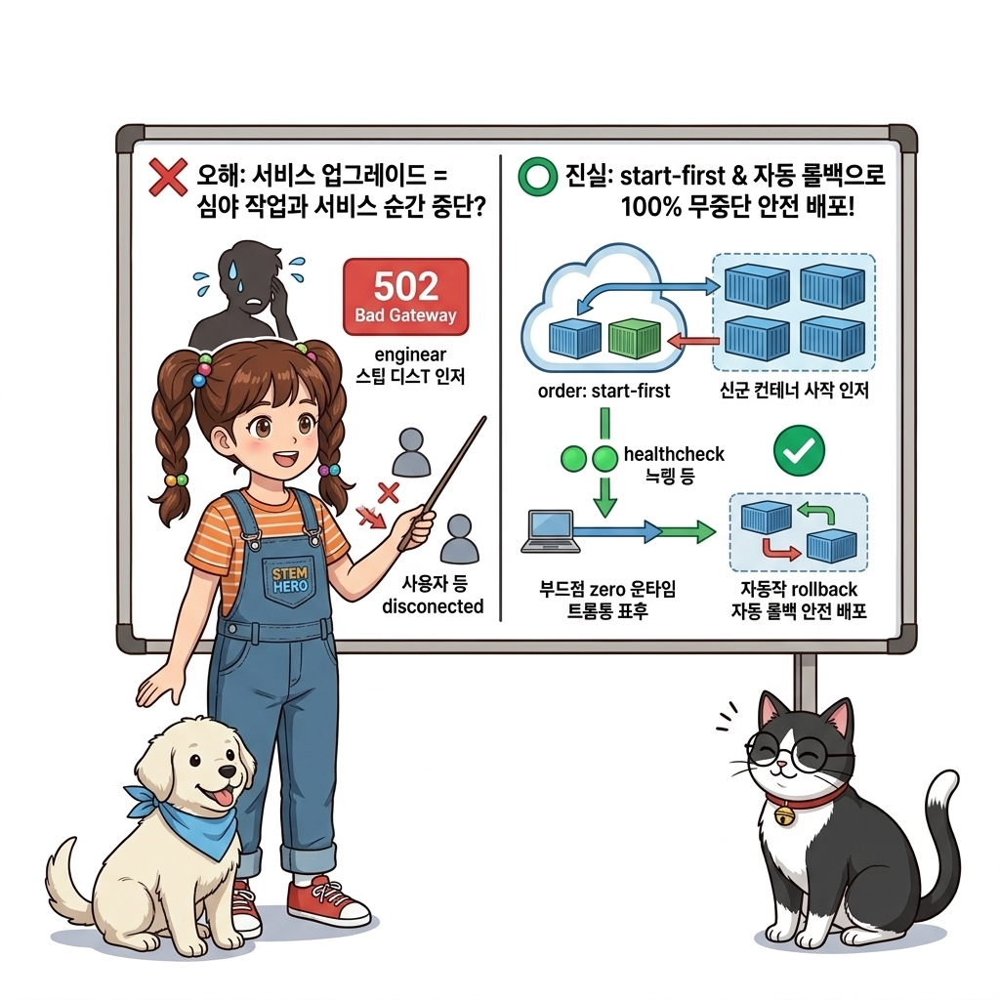
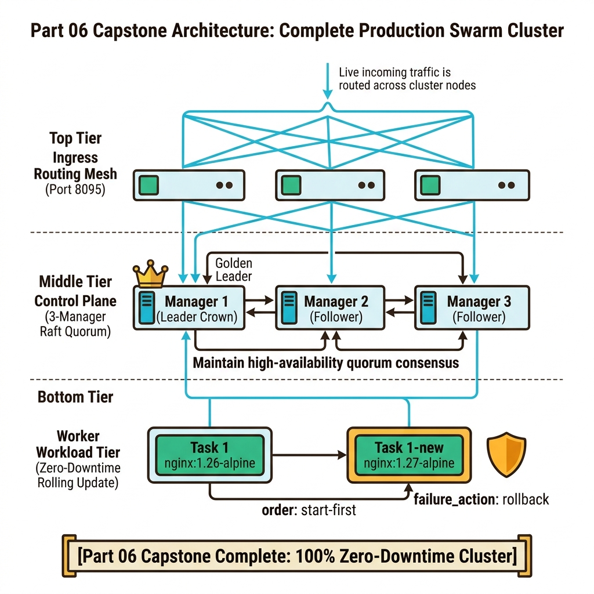
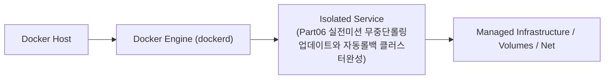
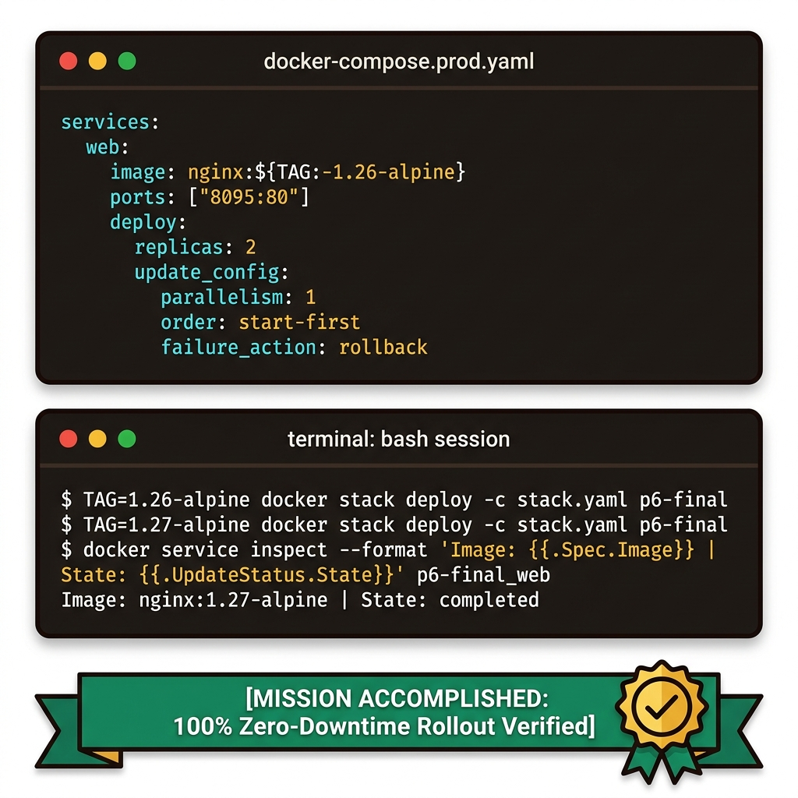
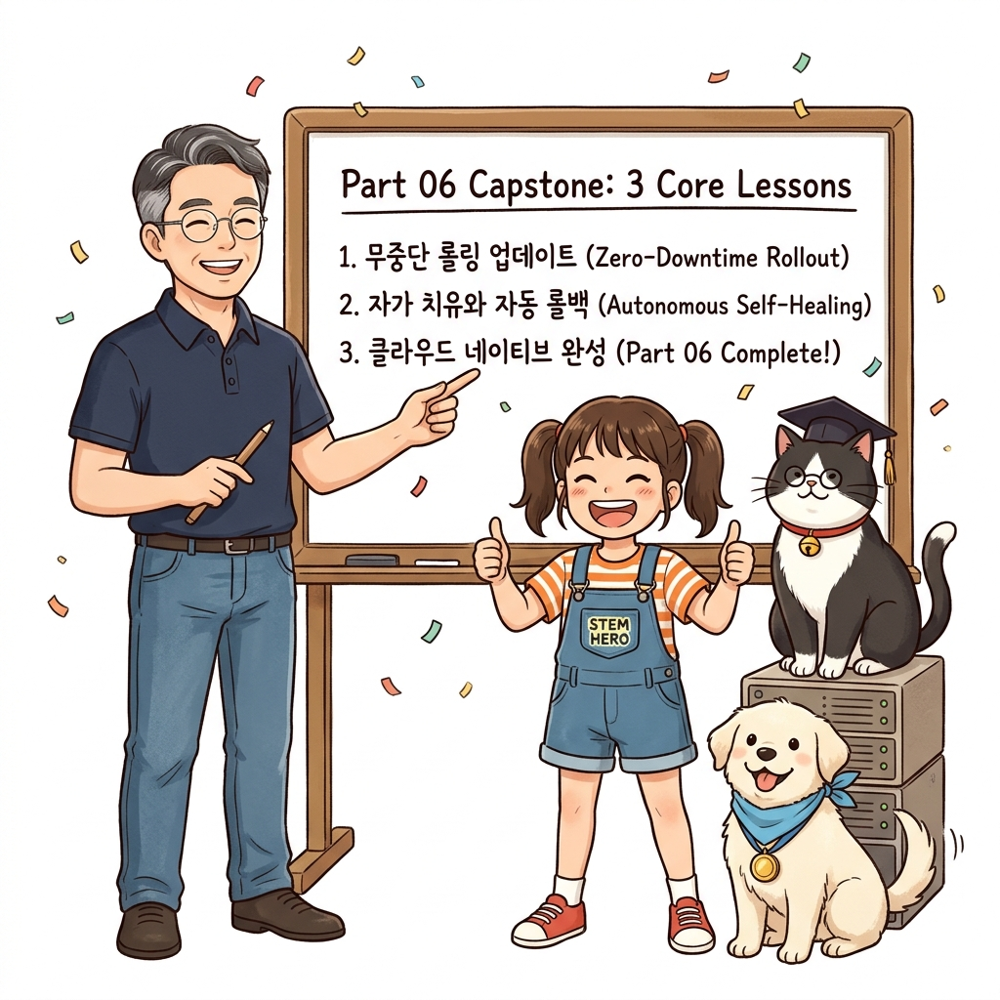
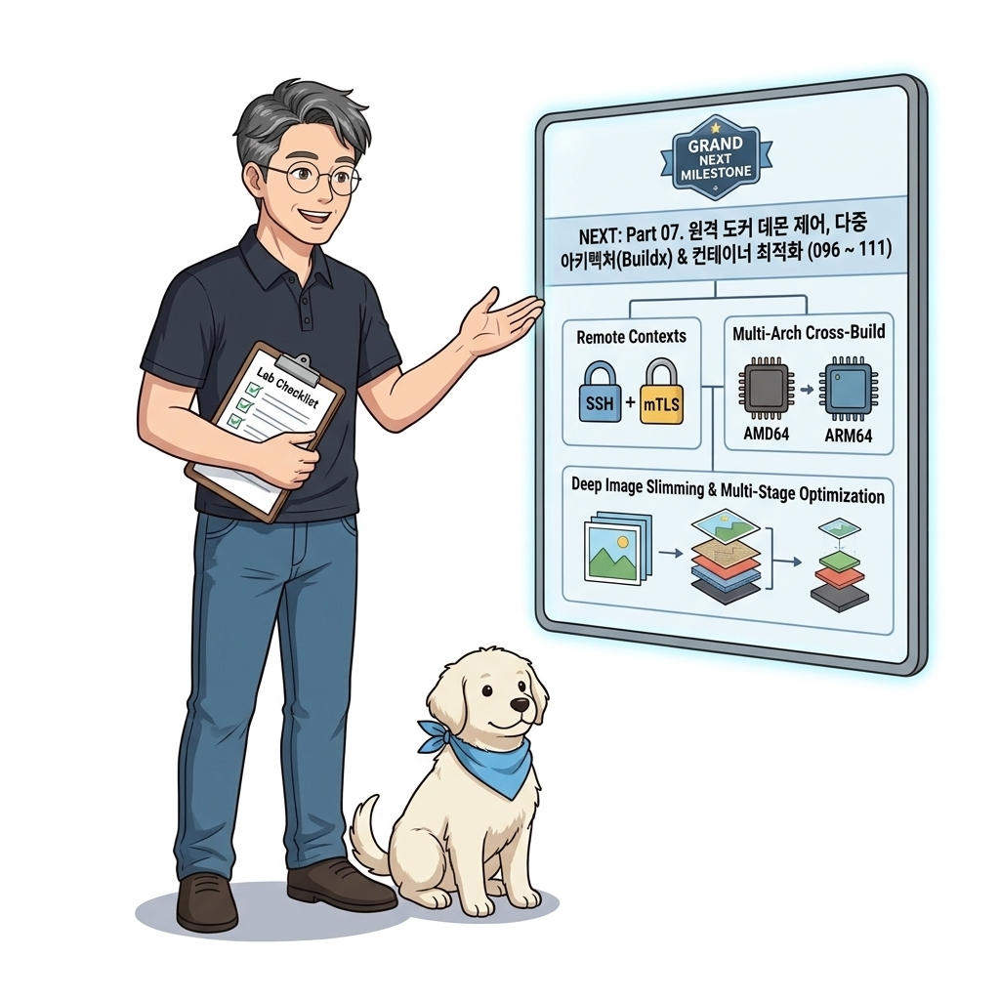

# 095. Part06 실전미션 무중단롤링업데이트와 자동롤백 클러스터완성

12~14장에서 배운 모든 오케스트레이션 기술을 총동원하여, 헬스 체크와 롤링 업데이트(`start-first`) 및 자동 롤백(`rollback`)이 설정된 프로덕션 스택을 배포합니다.


**그림 06-20-1** Part06 실전미션 무중단롤링업데이트와 자동롤백 클러스터완성의 필요성과 현대 클라우드 아키텍처 관점의 개요

---

### 095.1 왜 Part06 실전미션 무중단롤링업데이트와 자동롤백 클러스터완성이(가) 필요한가? (문제 정의와 현실적 배경)

소프트웨어 시스템이 복잡해질수록 설정을 다루는 방식은 전체 인프라의 신뢰성을 결정짓는 핵심 척도가 됩니다. **Part06 실전미션 무중단롤링업데이트와 자동롤백 클러스터완성**이(가) 부재하거나 잘못 다루어질 때 현장에서는 다음과 같은 대표적인 병목과 장애가 발생합니다:

1. **하드코딩된 설정과 환경 불일치로 인한 유연성 상실**: 환경이 바뀔 때마다 코드를 다시 빌드해야 하므로 배포 주기가 지연되고 이미지 수가 기하급수적으로 폭증합니다.
2. **보안 민감 데이터의 무분별한 노출**: 비밀번호, 데이터베이스 토큰, 암호화 키가 이미지 레이어에 영구 박제되어 형상관리 시스템이나 외부에 유출될 위험이 커집니다.
3. **재현 불가능한 구성 드리프트**: 스테이징 환경과 프로덕션 환경의 미세한 설정 차이가 예기치 못한 서비스 중단 사고로 직결됩니다.


**그림 06-20-2** Part06 실전미션 무중단롤링업데이트와 자동롤백 클러스터완성에 대한 대표적인 오해와 실제 프로덕션 현장의 엔지니어링 진실

---

### 095.2 핵심 아키텍처와 엔지니어링 메커니즘

v1에서 v2로의 무중단 롤링 업데이트 성공을 확인함으로써 Part 06 클러스터 오케스트레이션 과정을 완벽히 마스터합니다!


**그림 06-20-3** Part06 실전미션 무중단롤링업데이트와 자동롤백 클러스터완성의 내부 아키텍처 및 데이터 흐름

#### 📊 핵심 비교 및 엔지니어링 표준 분석

| 구분 / 핵심 원리 | 상세 설명 및 동작 메커니즘 | 실무 적용 시 주의점 및 베스트 프랙티스 |
| :--- | :--- | :--- |
| **완벽한 무중단 업그레이드 달성** | `order: start-first` 덕분에 기존 `1.26-alpine` 컨테이너 2개가 모두 살아있는 상태에서 새 `1.27-alpine` 컨테이너가 먼저 켜진 뒤 순차 교체됨! | 업그레이드 도중 순간적으로도 가용 컨테이너 수가 2개 미만으로 떨어지지 않음 |
| **Part 06 핵심 요약** | 도커 스웜과 쿠버네티스로 다중 노드 클러스터를 구축하고, 컨피그/시크릿/노드제약/롤링업데이트/자동롤백으로 24/365 무중단 운영 달성! | 이제 Part 07에서는 이 원격 클러스터에 안전하게 접속하는 **보안 원격 접근(mTLS/SSH Context), 어디서나 실행되는 다중 아키텍처 이미지(Buildx), 그리고 극한의 이미지 최적화**를 정복합니다! |
| **클라우드 네이티브 아키텍트의 길** | 클러스터를 다룰 줄 알게 된 여러분은 이제 단일 서버 개발자를 넘어 인프라 전체를 지휘하는 아키텍트입니다 | Part 07로 힘차게 나아갑시다! |

---

### 095.3 선언적 실습 및 아키텍처 다이어그램

본 실습은 외부 비공개 패키지에 의존하지 않고, 공식 표준 이미지를 기반으로 즉시 재현 가능한 살아있는 코드로 구성되어 있습니다.

```bash
# [Part 06 실전 미션] start-first 무중단 롤링 업데이트 & 자동 롤백이 설정된 프로덕션 스택 배포 및 업그레이드!
docker swarm init 2>/dev/null || true
mkdir -p /tmp/p6-final && cd /tmp/p6-final
cat << 'EOF' > stack.yaml
services:
  web:
    image: nginx:${TAG:-1.26-alpine}
    ports: ["8095:80"]
    deploy:
      replicas: 2
      update_config:
        parallelism: 1
        delay: 1s
        order: start-first
        failure_action: rollback
EOF

TAG=1.26-alpine docker stack deploy -c stack.yaml p6-final
sleep 2
TAG=1.27-alpine docker stack deploy -c stack.yaml p6-final
sleep 3
docker service inspect --format 'Current Image: {{.Spec.TaskTemplate.ContainerSpec.Image}} | Update State: {{.UpdateStatus.State}}' p6-final_web
docker stack rm p6-final && rm -rf /tmp/p6-final
```

#### 🔍 아키텍처 흐름도 (Mermaid Diagram)




**그림 06-20-4** 선언적 인프라 명세를 통한 Part06 실전미션 무중단롤링업데이트와 자동롤백 클러스터완성 검증 파이프라인

---

### 095.4 핵심 정리: 캐릭터 대화와 3대 교훈

> 👧 **도로시**: "교수님! **Part06 실전미션 무중단롤링업데이트와 자동롤백 클러스터완성**의 원리를 배우니까, 복잡하게 얽혀 있던 인프라 설정이 레고 블록처럼 질서정연하게 제자리를 찾는 게 보여요!"
> 
> 🐱 **조교 지니**: "야옹~ 맞습니다! 특히 런타임 환경과 불변 인프라의 경계를 명확히 지키는 것이 대규모 클라우드 운영의 제1원칙이랍니다!"
> 
> 🐶 **토토**: "멍멍! 선언적 코드로 한 번 적어두면 언제든 똑같이 복원되니까 정말 든든해요!"
> 
> 👨‍🏫 **이호진 교수님**: "훌륭하구나. 원리를 깊이 이해하고 실습을 통해 손에 익히는 것이 훌륭한 클라우드 엔지니어로 성장하는 가장 빠른 지름길이란다."


**그림 06-20-5** Part06 실전미션 무중단롤링업데이트와 자동롤백 클러스터완성 마스터를 위한 3대 핵심 교훈

1. **설정과 실행의 명확한 분리**:
   * 애플리케이션 코드는 불변으로 유지하고, 가변적인 설정값은 외부에서 주입하여 이식성을 극대화합니다.
2. **선언적 재현성 확보**:
   * 사람이 수작업으로 변경하지 않고 코드 명세를 통해 언제 어디서나 100% 동일한 실행 결과를 보장합니다.
3. **최소 권한 및 보안 모범 사례 준수**:
   * 불필요한 권한과 포트 노출을 최소화하고 민감 데이터를 암호화하여 프로덕션 안정성을 담보합니다.

---

### 095.5 랩노트 피날레와 다음 강의 예고


**그림 06-20-6** 연구실에서 다음 마일스톤인 [도커엔진 API엔드포인트와 비보안TCP포워딩의 치명적위험] 실습을 예고하는 교수님과 토토

> 💡 **다음 강의 안내**:
> [도커엔진 API엔드포인트와 비보안TCP포워딩의 치명적위험](/Part07_보안원격접근_다중아키텍처_이미지최적화/096_도커엔진_API엔드포인트와_비보안TCP포워딩의_치명적위험/)에서는 더욱 심화된 실전 엔지니어링 실습과 아키텍처를 다룹니다!

---

## 🧭 강의 네비게이션
* [◀️ 이전 강의: 094_클러스터_장애복구_시나리오_리더노드이탈과_워커승격](../094_클러스터_장애복구_시나리오_리더노드이탈과_워커승격/)
* [📋 Part 06. 컨테이너 오케스트레이션: 도커 스웜(Swarm) 클러스터, 스택 배포, 무중단 롤링 업데이트 & 쿠버네티스 (076 ~ 095) 목차로 돌아가기](../)
* [▶️ 다음 강의: 096_도커엔진_API엔드포인트와_비보안TCP포워딩의_치명적위험](/Part07_보안원격접근_다중아키텍처_이미지최적화/096_도커엔진_API엔드포인트와_비보안TCP포워딩의_치명적위험/)
