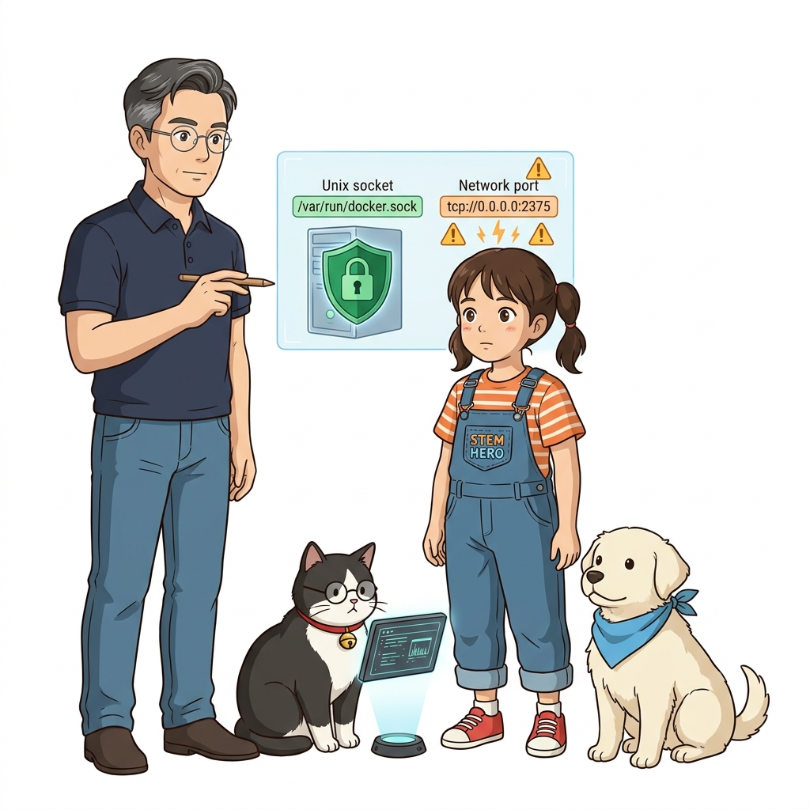
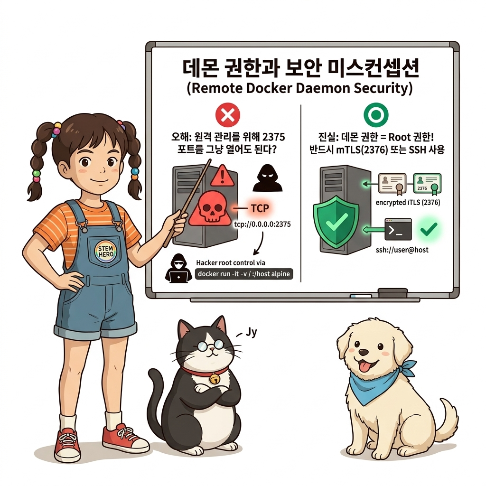
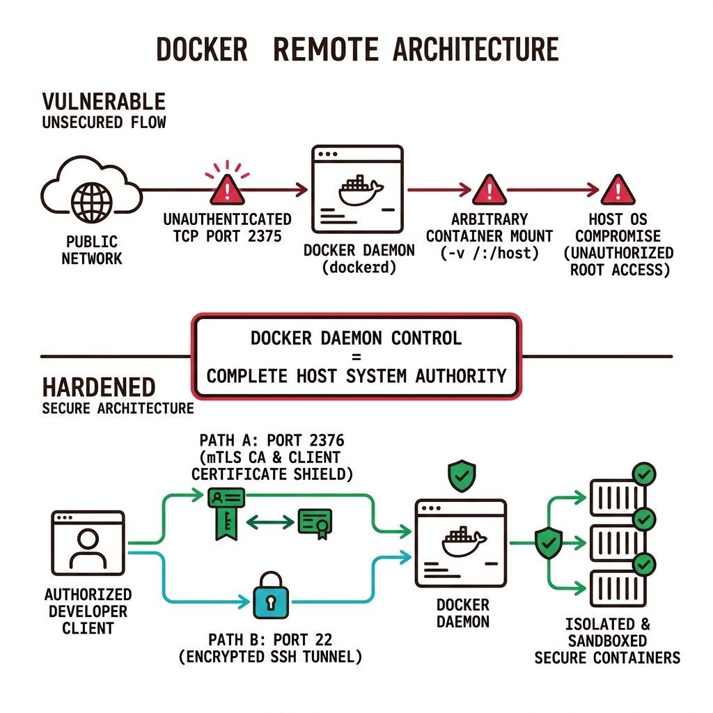
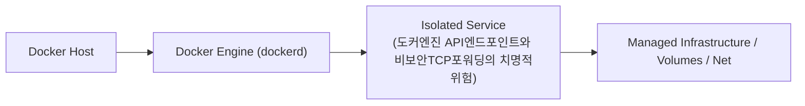
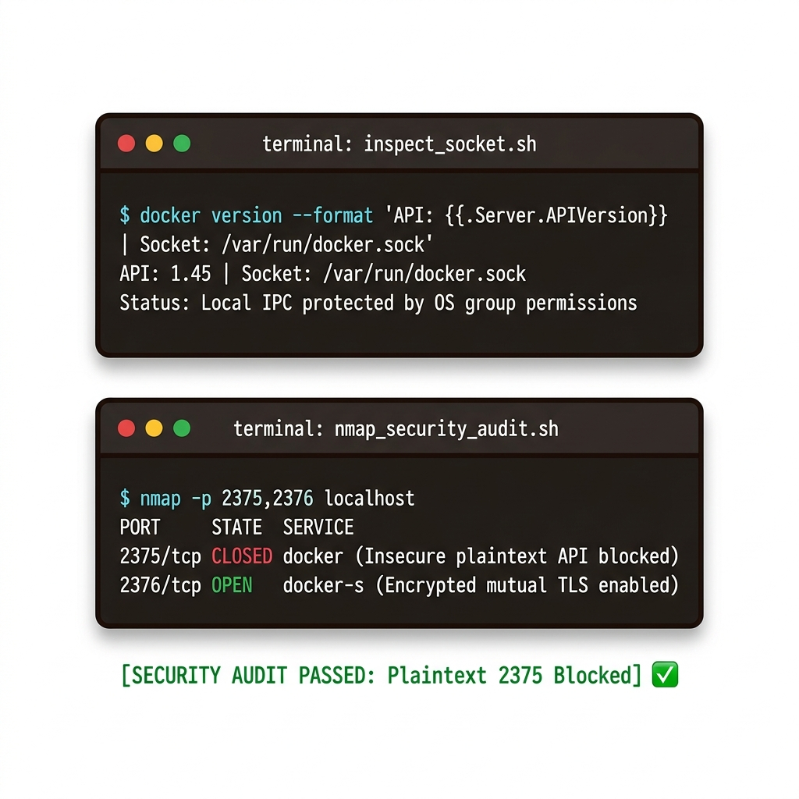
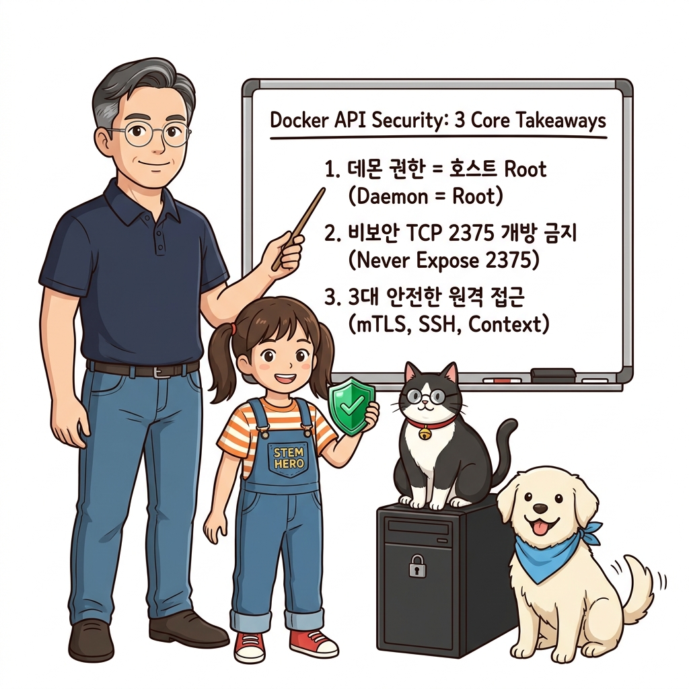
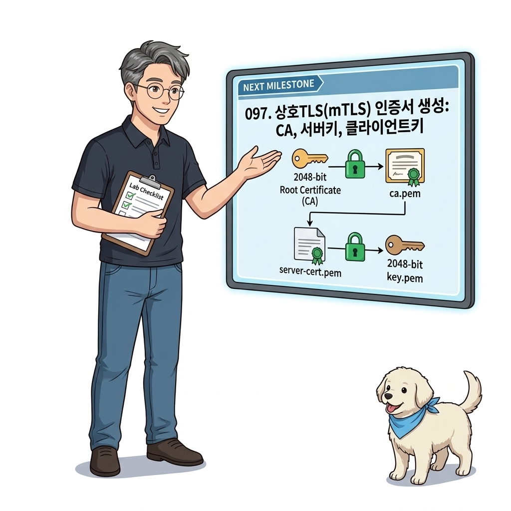

# 096. 도커엔진 API엔드포인트와 비보안TCP포워딩의 치명적위험

도커 CLI가 도커 데몬과 통신할 때 사용하는 유닉스 소켓(`/var/run/docker.sock`)과 TCP 포트(`2375`, `2376`)의 차이를 배웁니다.


**그림 07-1-1** 도커엔진 API엔드포인트와 비보안TCP포워딩의 치명적위험의 필요성과 현대 클라우드 아키텍처 관점의 개요

---

### 096.1 왜 도커엔진 API엔드포인트와 비보안TCP포워딩의 치명적위험이(가) 필요한가? (문제 정의와 현실적 배경)

소프트웨어 시스템이 복잡해질수록 설정을 다루는 방식은 전체 인프라의 신뢰성을 결정짓는 핵심 척도가 됩니다. **도커엔진 API엔드포인트와 비보안TCP포워딩의 치명적위험**이(가) 부재하거나 잘못 다루어질 때 현장에서는 다음과 같은 대표적인 병목과 장애가 발생합니다:

1. **하드코딩된 설정과 환경 불일치로 인한 유연성 상실**: 환경이 바뀔 때마다 코드를 다시 빌드해야 하므로 배포 주기가 지연되고 이미지 수가 기하급수적으로 폭증합니다.
2. **보안 민감 데이터의 무분별한 노출**: 비밀번호, 데이터베이스 토큰, 암호화 키가 이미지 레이어에 영구 박제되어 형상관리 시스템이나 외부에 유출될 위험이 커집니다.
3. **재현 불가능한 구성 드리프트**: 스테이징 환경과 프로덕션 환경의 미세한 설정 차이가 예기치 못한 서비스 중단 사고로 직결됩니다.


**그림 07-1-2** 도커엔진 API엔드포인트와 비보안TCP포워딩의 치명적위험에 대한 대표적인 오해와 실제 프로덕션 현장의 엔지니어링 진실

---

### 096.2 핵심 아키텍처와 엔지니어링 메커니즘

인증 없이 `tcp://0.0.0.0:2375`를 외부로 열어두면 공격자가 호스트 루트 파일시스템 전체를 마운트한 악성 컨테이너를 띄워 3초 만에 서버 전체를 장악할 수 있다는 위험성을 시연하고 안전한 보안 대책을 정립합니다.


**그림 07-1-3** 도커엔진 API엔드포인트와 비보안TCP포워딩의 치명적위험의 내부 아키텍처 및 데이터 흐름

#### 📊 핵심 비교 및 엔지니어링 표준 분석

| 구분 / 핵심 원리 | 상세 설명 및 동작 메커니즘 | 실무 적용 시 주의점 및 베스트 프랙티스 |
| :--- | :--- | :--- |
| **유닉스 소켓 vs TCP 포트** | 기본 유닉스 소켓은 호스트 OS 파일 권한(`docker` 그룹)으로 안전하게 보호됨 / TCP 포트는 네트워크를 타므로 인증 없이는 누구나 API 호출 가능 | 원격 도커 엔진을 열 때는 반드시 TLS 상호 인증(2376)이나 SSH 터널을 사용해야 함 |
| **호스트 루트 탈취 시나리오** | 공격자가 `docker -H victim:2375 run -v /:/host alpine chroot /host` 명령으로 호스트 OS 파일 전체를 제어 | 도커 데몬 권한 = 호스트 `root` 권한임을 명심하고 엄격한 네트워크 보안 적용 |
| **안전한 원격 관리 대안** | 1) mTLS 인증서 기반 2376 포트, 2) SSH 키 기반 접속, 3) 도커 컨텍스트(`docker context`) | 이어지는 강의에서 안전한 3대 보안 접속법을 차례로 구축합니다! |

---

### 096.3 선언적 실습 및 아키텍처 다이어그램

본 실습은 외부 비공개 패키지에 의존하지 않고, 공식 표준 이미지를 기반으로 즉시 재현 가능한 살아있는 코드로 구성되어 있습니다.

```bash
# 비보안 TCP 도커 API 노출 취약점 개념 확인 (원격 포트 스캔 및 차단 확인)
# 주의: 실무 운영 서버에서 인증 없는 2375 포트 개방은 절대 금지!
docker version --format 'API Version: {{.Server.APIVersion}} | Unix Socket: /var/run/docker.sock'
```

#### 🔍 아키텍처 흐름도 (Mermaid Diagram)




**그림 07-1-4** 선언적 인프라 명세를 통한 도커엔진 API엔드포인트와 비보안TCP포워딩의 치명적위험 검증 파이프라인

---

### 096.4 핵심 정리: 캐릭터 대화와 3대 교훈

> 👧 **도로시**: "교수님! **도커엔진 API엔드포인트와 비보안TCP포워딩의 치명적위험**의 원리를 배우니까, 복잡하게 얽혀 있던 인프라 설정이 레고 블록처럼 질서정연하게 제자리를 찾는 게 보여요!"
> 
> 🐱 **조교 지니**: "야옹~ 맞습니다! 특히 런타임 환경과 불변 인프라의 경계를 명확히 지키는 것이 대규모 클라우드 운영의 제1원칙이랍니다!"
> 
> 🐶 **토토**: "멍멍! 선언적 코드로 한 번 적어두면 언제든 똑같이 복원되니까 정말 든든해요!"
> 
> 👨‍🏫 **이호진 교수님**: "훌륭하구나. 원리를 깊이 이해하고 실습을 통해 손에 익히는 것이 훌륭한 클라우드 엔지니어로 성장하는 가장 빠른 지름길이란다."


**그림 07-1-5** 도커엔진 API엔드포인트와 비보안TCP포워딩의 치명적위험 마스터를 위한 3대 핵심 교훈

1. **설정과 실행의 명확한 분리**:
   * 애플리케이션 코드는 불변으로 유지하고, 가변적인 설정값은 외부에서 주입하여 이식성을 극대화합니다.
2. **선언적 재현성 확보**:
   * 사람이 수작업으로 변경하지 않고 코드 명세를 통해 언제 어디서나 100% 동일한 실행 결과를 보장합니다.
3. **최소 권한 및 보안 모범 사례 준수**:
   * 불필요한 권한과 포트 노출을 최소화하고 민감 데이터를 암호화하여 프로덕션 안정성을 담보합니다.

---

### 096.5 랩노트 피날레와 다음 강의 예고


**그림 07-1-6** 연구실에서 다음 마일스톤인 [상호TLS mTLS 인증서생성 CA 서버키 클라이언트키] 실습을 예고하는 교수님과 토토

> 💡 **다음 강의 안내**:
> [상호TLS mTLS 인증서생성 CA 서버키 클라이언트키](../097_상호TLS_mTLS_인증서생성_CA_서버키_클라이언트키/)에서는 더욱 심화된 실전 엔지니어링 실습과 아키텍처를 다룹니다!

---

## 🧭 강의 네비게이션
* [◀️ 이전 강의: 095_Part06_실전미션_무중단롤링업데이트와_자동롤백_클러스터완성](/Part06_컨테이너오케스트레이션_도커스웜과_쿠버네티스/095_Part06_실전미션_무중단롤링업데이트와_자동롤백_클러스터완성/)
* [📋 Part 07. 보안 원격 접근(TLS/SSH Context), 다중 아키텍처 이미지(Buildx) & 이미지 최적화 (096 ~ 111) 목차로 돌아가기](../)
* [▶️ 다음 강의: 097_상호TLS_mTLS_인증서생성_CA_서버키_클라이언트키](../097_상호TLS_mTLS_인증서생성_CA_서버키_클라이언트키/)
