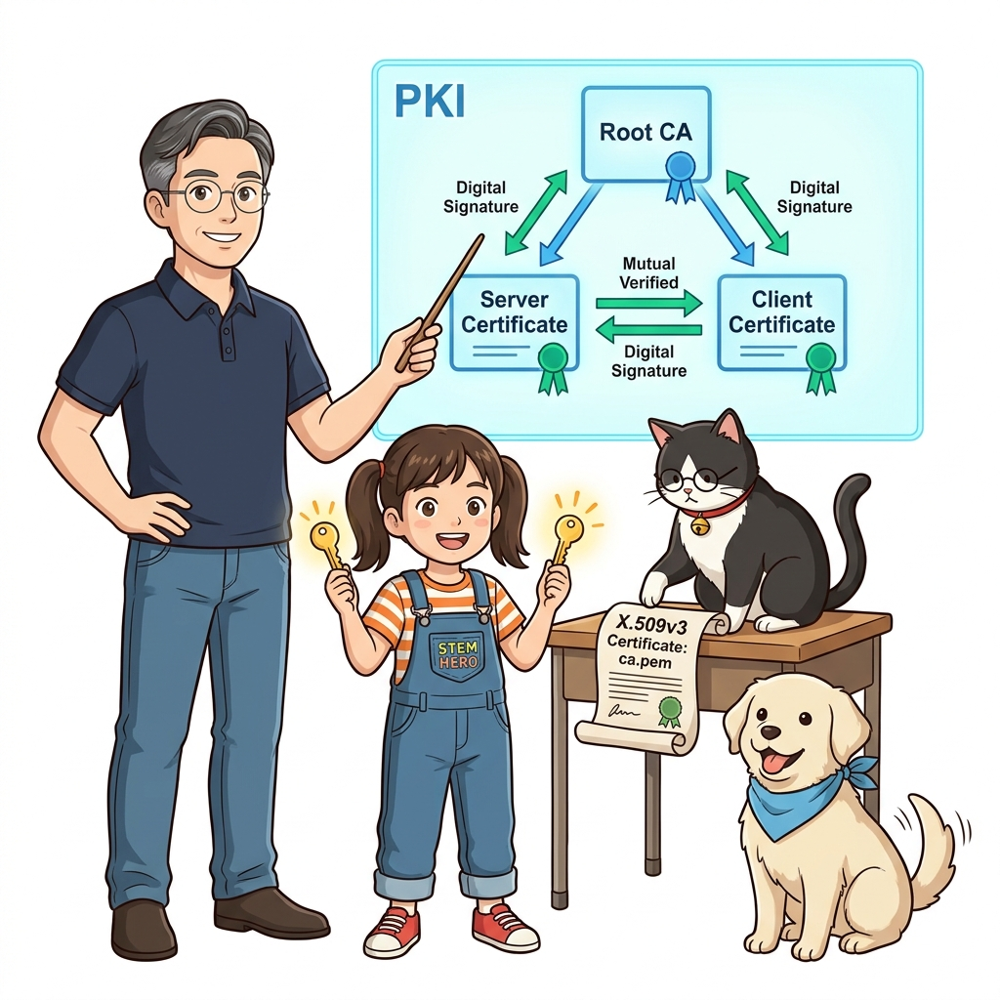
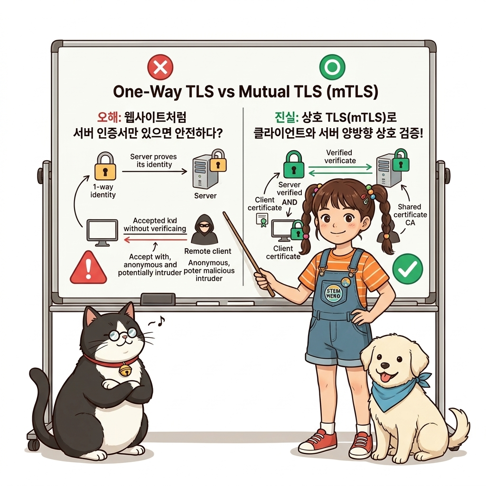
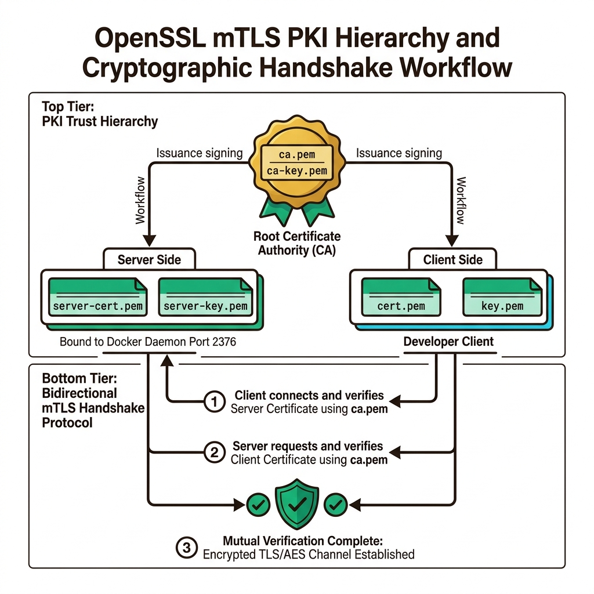
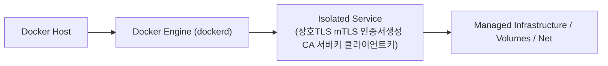
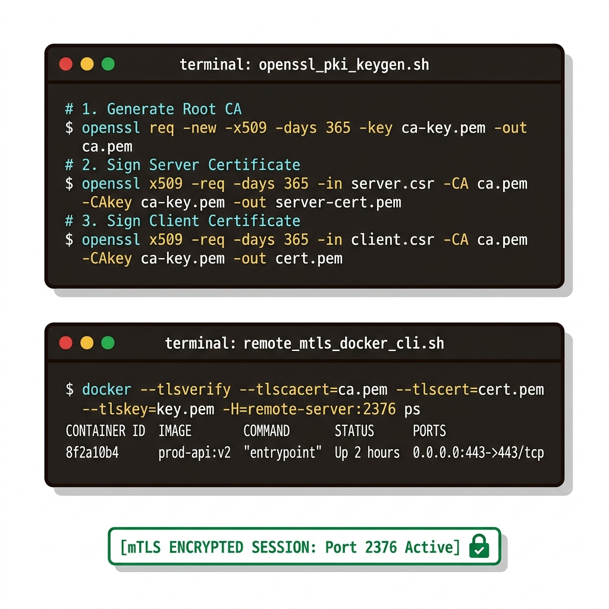
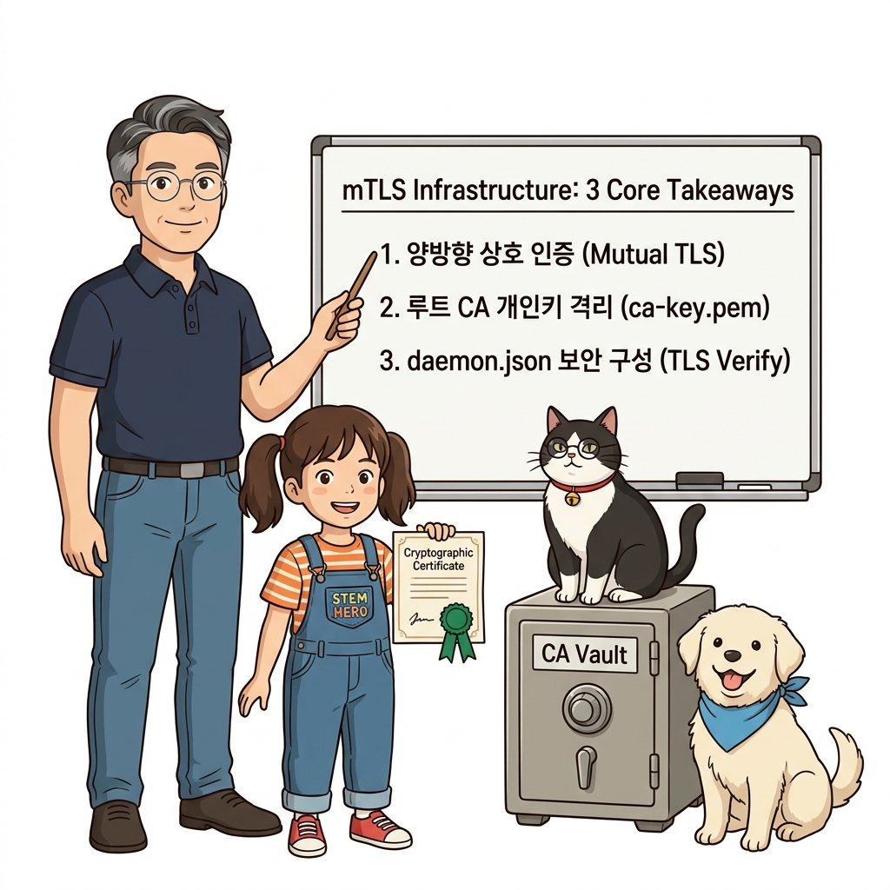
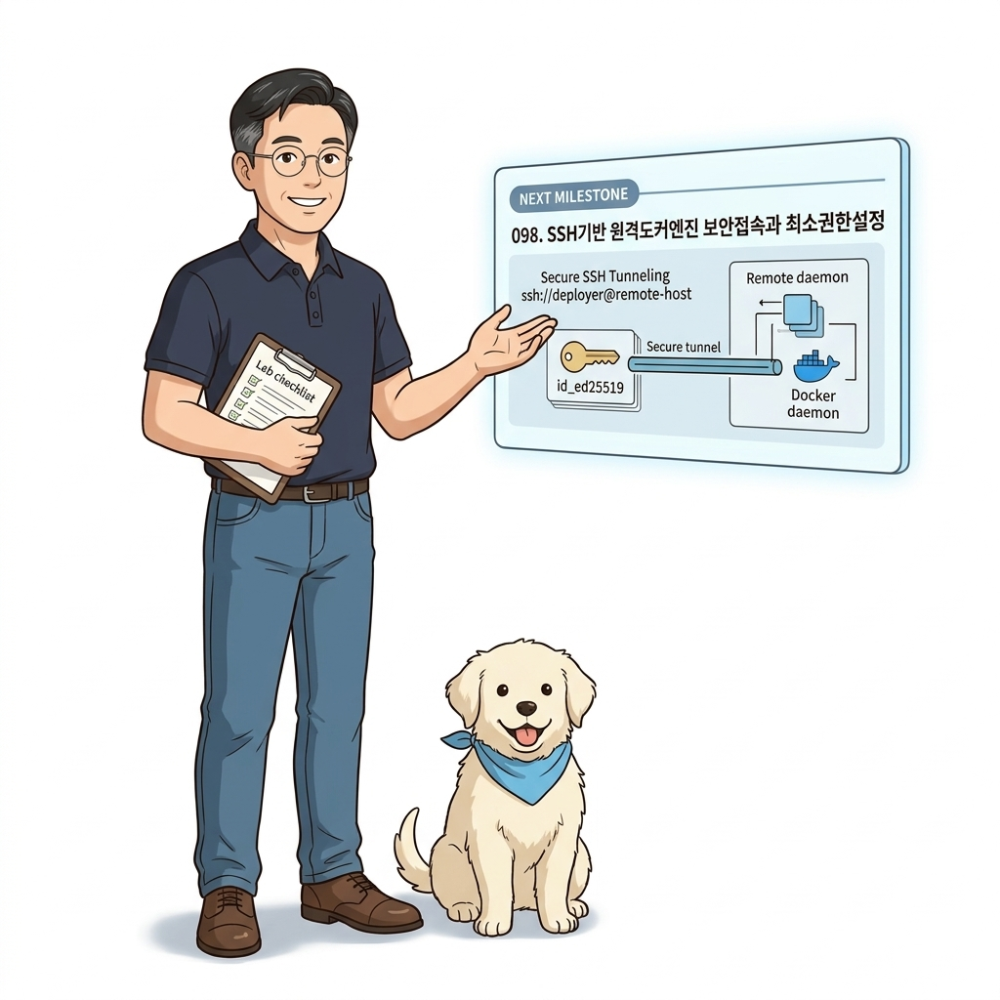

# 097. 상호TLS mTLS 인증서생성 CA 서버키 클라이언트키

도커 클라이언트와 도커 서버가 서로의 신원을 암호학적으로 상호 검증하는 **mTLS(Mutual TLS, 양방향 인증서)**의 동작 원리를 배웁니다.


**그림 07-2-1** 상호TLS mTLS 인증서생성 CA 서버키 클라이언트키의 필요성과 현대 클라우드 아키텍처 관점의 개요

---

### 097.1 왜 상호TLS mTLS 인증서생성 CA 서버키 클라이언트키이(가) 필요한가? (문제 정의와 현실적 배경)

소프트웨어 시스템이 복잡해질수록 설정을 다루는 방식은 전체 인프라의 신뢰성을 결정짓는 핵심 척도가 됩니다. **상호TLS mTLS 인증서생성 CA 서버키 클라이언트키**이(가) 부재하거나 잘못 다루어질 때 현장에서는 다음과 같은 대표적인 병목과 장애가 발생합니다:

1. **하드코딩된 설정과 환경 불일치로 인한 유연성 상실**: 환경이 바뀔 때마다 코드를 다시 빌드해야 하므로 배포 주기가 지연되고 이미지 수가 기하급수적으로 폭증합니다.
2. **보안 민감 데이터의 무분별한 노출**: 비밀번호, 데이터베이스 토큰, 암호화 키가 이미지 레이어에 영구 박제되어 형상관리 시스템이나 외부에 유출될 위험이 커집니다.
3. **재현 불가능한 구성 드리프트**: 스테이징 환경과 프로덕션 환경의 미세한 설정 차이가 예기치 못한 서비스 중단 사고로 직결됩니다.


**그림 07-2-2** 상호TLS mTLS 인증서생성 CA 서버키 클라이언트키에 대한 대표적인 오해와 실제 프로덕션 현장의 엔지니어링 진실

---

### 097.2 핵심 아키텍처와 엔지니어링 메커니즘

OpenSSL로 자체 인증 기관(CA)을 만들고, 도커 데몬용 서버 인증서(`server-cert.pem`)와 클라이언트용 인증서(`cert.pem`, `key.pem`)를 발급하여 `2376` 보안 포트로 도커 데몬을 안전하게 가동합니다.


**그림 07-2-3** 상호TLS mTLS 인증서생성 CA 서버키 클라이언트키의 내부 아키텍처 및 데이터 흐름

#### 📊 핵심 비교 및 엔지니어링 표준 분석

| 구분 / 핵심 원리 | 상세 설명 및 동작 메커니즘 | 실무 적용 시 주의점 및 베스트 프랙티스 |
| :--- | :--- | :--- |
| **상호 인증(Mutual TLS)의 원리** | 클라이언트가 서버의 인증서를 검증할 뿐만 아니라, 서버도 접속해 온 클라이언트가 CA가 서명한 유효한 키를 가졌는지 검증 | CA 비밀키를 가진 관리자가 발급해 준 인증서가 없는 클라이언트는 접속 자체가 원천 차단됨! |
| **데몬 보안 설정 (`daemon.json`)** | `tlsverify: true`, `tlscacert: /certs/ca.pem`, `tlscert: /certs/server-cert.pem`, `tlskey: /certs/server-key.pem` 지정 후 2376 포트 바인딩 | 패킷이 네트워크 구간에서 완전 암호화되어 스니핑 방지 |
| **클라이언트 보안 플래그** | `docker --tlsverify --tlscacert=ca.pem --tlscert=cert.pem --tlskey=key.pem -H=remote:2376 ps` | 긴 옵션을 매번 치는 대신 다음 강의의 `docker context`에 등록하면 한 번에 해결! |

---

### 097.3 선언적 실습 및 아키텍처 다이어그램

본 실습은 외부 비공개 패키지에 의존하지 않고, 공식 표준 이미지를 기반으로 즉시 재현 가능한 살아있는 코드로 구성되어 있습니다.

```bash
# OpenSSL을 이용한 도커 mTLS 인증서 발급 프로세스 레퍼런스
cat << 'EOF'
1. CA 개인키 및 인증서 생성 : openssl req -new -x509 -days 365 -key ca-key.pem -out ca.pem
2. 서버 인증서 및 개인키 생성: openssl req -new -key server-key.pem -out server.csr && openssl x509 -req ...
3. 클라이언트 인증서 발급   : openssl req -new -key key.pem -out client.csr && openssl x509 -req ...
EOF
```

#### 🔍 아키텍처 흐름도 (Mermaid Diagram)




**그림 07-2-4** 선언적 인프라 명세를 통한 상호TLS mTLS 인증서생성 CA 서버키 클라이언트키 검증 파이프라인

---

### 097.4 핵심 정리: 캐릭터 대화와 3대 교훈

> 👧 **도로시**: "교수님! **상호TLS mTLS 인증서생성 CA 서버키 클라이언트키**의 원리를 배우니까, 복잡하게 얽혀 있던 인프라 설정이 레고 블록처럼 질서정연하게 제자리를 찾는 게 보여요!"
> 
> 🐱 **조교 지니**: "야옹~ 맞습니다! 특히 런타임 환경과 불변 인프라의 경계를 명확히 지키는 것이 대규모 클라우드 운영의 제1원칙이랍니다!"
> 
> 🐶 **토토**: "멍멍! 선언적 코드로 한 번 적어두면 언제든 똑같이 복원되니까 정말 든든해요!"
> 
> 👨‍🏫 **이호진 교수님**: "훌륭하구나. 원리를 깊이 이해하고 실습을 통해 손에 익히는 것이 훌륭한 클라우드 엔지니어로 성장하는 가장 빠른 지름길이란다."


**그림 07-2-5** 상호TLS mTLS 인증서생성 CA 서버키 클라이언트키 마스터를 위한 3대 핵심 교훈

1. **설정과 실행의 명확한 분리**:
   * 애플리케이션 코드는 불변으로 유지하고, 가변적인 설정값은 외부에서 주입하여 이식성을 극대화합니다.
2. **선언적 재현성 확보**:
   * 사람이 수작업으로 변경하지 않고 코드 명세를 통해 언제 어디서나 100% 동일한 실행 결과를 보장합니다.
3. **최소 권한 및 보안 모범 사례 준수**:
   * 불필요한 권한과 포트 노출을 최소화하고 민감 데이터를 암호화하여 프로덕션 안정성을 담보합니다.

---

### 097.5 랩노트 피날레와 다음 강의 예고


**그림 07-2-6** 연구실에서 다음 마일스톤인 [SSH기반 원격도커엔진 보안접속과 최소권한설정] 실습을 예고하는 교수님과 토토

> 💡 **다음 강의 안내**:
> [SSH기반 원격도커엔진 보안접속과 최소권한설정](../098_SSH기반_원격도커엔진_보안접속과_최소권한설정/)에서는 더욱 심화된 실전 엔지니어링 실습과 아키텍처를 다룹니다!

---

## 🧭 강의 네비게이션
* [◀️ 이전 강의: 096_도커엔진_API엔드포인트와_비보안TCP포워딩의_치명적위험](../096_도커엔진_API엔드포인트와_비보안TCP포워딩의_치명적위험/)
* [📋 Part 07. 보안 원격 접근(TLS/SSH Context), 다중 아키텍처 이미지(Buildx) & 이미지 최적화 (096 ~ 111) 목차로 돌아가기](../)
* [▶️ 다음 강의: 098_SSH기반_원격도커엔진_보안접속과_최소권한설정](../098_SSH기반_원격도커엔진_보안접속과_최소권한설정/)
